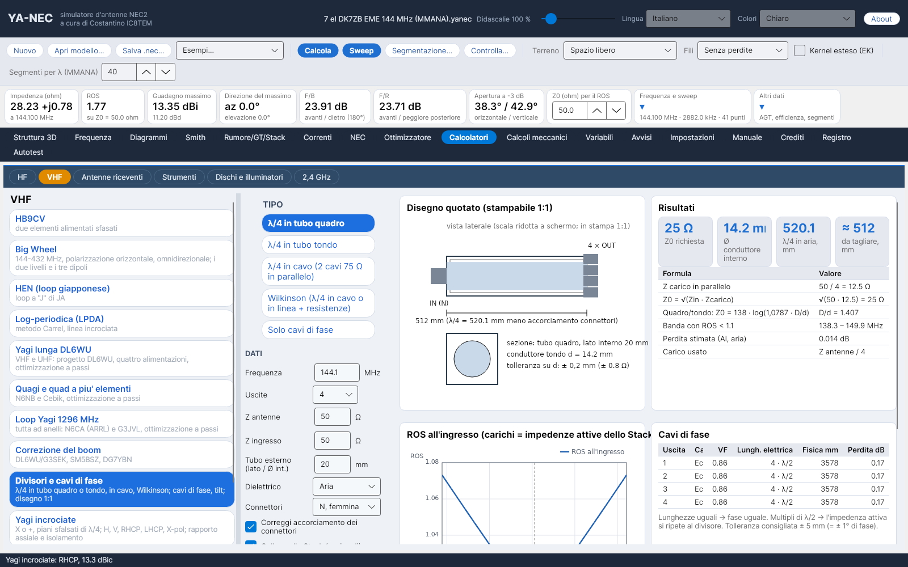

[Italiano](README.md) · [English](README.en.md) · [Français](README.fr.md) · **Deutsch** · [Español](README.es.md) · [Português](README.pt.md) · [日本語](README.ja.md) · [한국어](README.ko.md)

# YA-NEC

**Drahtantennen-Simulator auf Basis von NEC-2** für Windows, Linux und macOS (C#, .NET 8, Avalonia).
Von Costantino Cerrotta **IC8TEM**.

> *Die Geschichte dieses Programms schreibt ihr: mit euren Projekten, euren Ideen, eurer Genialität, euren Entdeckungen und euren Gewissheiten.*

Die Rechenmaschine ist eine C#-Übersetzung von **nec2c** (dem NEC-2 des Lawrence Livermore National Laboratory) und wird bei jeder Version mit nec2c und EZNEC verglichen. Sie öffnet Modelle in **NEC (.nec)**, **MMANA (.maa)**, **AutoEZ (.weq)**, **EZNEC (.ez)**, **YO/AO von K6STI (.yag, .ant)** und im eigenen **.yanec**-Format.

Funktionen: Impedanz, SWR, Gewinn, 2D- und 3D-Diagramme, Frequenz-Sweep und Smith-Diagramm; Leeson-Korrektur für Teleskoprohre (gestufte Durchmesser) wie in EZNEC; Böden (ideal, Reflexionsfaktor, Sommerfeld, Radialnetz); Variablen, Formeln und Optimierer; mehr als 40 Rechner (Lang-Yagi DL6WU, Quagi, LPDA, Moxon, Hexbeam, Mehrband-Dipole und -Yagis, Four-Square, Vertikale, Parabolspiegel und Erreger, Elementhalterungen und mehr); Empfangsantennen und RDF; Rauschen, G/T und Gruppierung (Stack); Kabeltabelle, Anpassleitungen und Baluns; Prüfung der Eingabedaten. Jede Rechenentscheidung und jedes Kontrollkästchen wird im [Handbuch](doc/Manuale_d_uso.pdf) erklärt, das auch im Programm verfügbar ist (Reiter Handbuch). Mehr im [Wiki](https://github.com/ic8tem/YA-NEC/wiki).

**Sprache:** Die Oberfläche gibt es in 37 Sprachen (Menü Sprache, oben rechts), das Wiki ebenfalls. Das Handbuch ist italienisch.

## Bildschirmfotos

<table><tr><td width="50%" align="center"> 3D-Struktur mit Strömen und Keule</td><td width="50%" align="center"> Reales Gelände im HFTA-Stil auf dem DEM-Profil</td></tr><tr><td width="50%" align="center"> Empfang: RDF, DMF und Rauschen</td><td width="50%" align="center"> Bautoleranzen (Monte Carlo)</td></tr><tr><td width="50%" align="center"> Kabel und Balun: Gleichtaktstrom</td><td width="50%" align="center"> Gekreuzte Yagis: RHCP, LHCP, Achsverhältnis</td></tr><tr><td width="50%" align="center"> Mechanische Berechnungen: Wind (NTC 2018)</td><td width="50%" align="center"> Leistungsteiler und Phasenleitungen</td></tr><tr><td width="50%" align="center"> KW-Lasten: Traps und Spulen</td><td width="50%" align="center"> Smith-Diagramm</td></tr></table>

## Neu in 1.5.8

- **Rechner > HF > Drahtantennen**: Schaltfläche **Tabelle ›** mit NEC-Tabellen (EFHW 49:1 und 64:1 mit und ohne Gegengewicht, 9:1 mit dem besten Gegengewicht, mittlerer oder perfekter Boden); eine Zeile wird in die Seite übernommen, die freie Berechnung bleibt.
- **Optimierer**: **VHF-Maske SWR + G/T**, optimiert das G/T eines 2 x 2 Stacks bei 30 Grad (DL6WU-Abstände, VE7BQH-Temperaturen, 20 dB Vorverstärker, 2 dB Kabel) zusammen mit dem SWR.
- **Berechnungshandbuch**: Kapitel 16 und Abschnitt 8.4; **Videokurs**: Lektion 32.

## Neu in 1.5.7

- **Drahtantennen**: die Ladespule ist eine Option der EFHW (ja / nein), und **Spule abstimmen (NEC)** findet die passende Induktivität mit Gegengewicht und Boden.
- **Übersetzungen**: die orangen Warnungen aller Rechner werden jetzt übersetzt; Zeichnungsbeschriftungen und die Echtzeitberechnung ebenfalls.
- **3D-Struktur**: isolierter Draht wird nicht mehr als Reihe von Spulen gezeichnet.

## Neu in 1.5.6

- **Rechner > HF > Drahtantennen** (neu): endgespeiste Drahtantennen. EFHW Mehrband, Einband und mit Spule (49:1 oder 64:1), nicht resonanter Draht mit 9:1 oder 4:1; sechs Anordnungen (schräg nach oben oder unten, vertikal, umgekehrtes L und U, gerade); Gegengewicht 0,05 λ oder Koaxmantel, Kondensator, Spannung am Ende, SWR je Band aus dem TF5NN-Modell und aus NEC; **Länge abstimmen (NEC)**.
- **Sprungtasten**: von den Drahtantennen und den anderen Drahtseiten (Dipole, OCF/Windom, T2FD, G5RV, Delta, Quad, Loop, Skywire, Moxon, Hexbeam) öffnet sich die Seite Balun, Drossel (FT-Ringkerne), Viertelwelle (RG-Kabel) oder Lasten bereits ausgefüllt, mit «‹ Zurück».
- **Discone**: von der Familie HF in die Familie VHF verschoben.

## Neu in 1.5.5

- **Rechner > HEN**: die Karte zeigt horizontale Polarisation, wie die NEC-Prüfung (vorher stand dort vertikal).
- **VNA-Messungen**: Titel, Legende und Korrekturvorschlag übersetzt (sie blieben auf Italienisch).
- **Videokurs**: 32 Lektionen, mit den neuen 30 «Kabel und VNA-Messungen» und 31 «Weitere Rechner».

## Neu in 1.5.4

- **Von Hand geschriebenes Modell**: Drähte, die vor der Quelle übernommen werden, geben einen orangefarbenen Hinweis in der Statusleiste, ohne Fenster; echte Fehlerfenster erhalten den Fokus (Enter oder Esc schließen sie).
- **Übersetzungen**: Seite Boom (vom Aufmaß zum elektrischen Modell) ins Englische übersetzt.
- **Vollständiger Videokurs**: 30 Lektionen mit 1.5.3-1.5.4 aufgenommen, auf Italienisch und Englisch, mit der neuen Lektion 29 «Skalieren und neu zentrieren».

## Neu in 1.5.3

- **Skalieren und neu zentrieren** (Variablen und Optimierung): ein MMANA-Modell oder ein Entwurf mit einem Klick auf die gewünschte Frequenz; Durchmesser skaliert, gleich oder handelsüblich (Vollstäbe 3-6 mm, Stäbe oder Rohre 8-40 mm); die Korrektur des Strahlers setzt die Reaktanz auf null.
- **Diagramme**: der erste Eintrag heißt **Keulen**, der Reiter Frequenz wird zu **Parameter**; **Winkelschritt** an den Rechner angepasst; **Empfang (RDF)** am geöffneten Modell.
- **Korrekturen**: Quad mit 2-3 Elementen in Automatisch wird vom NEC in Resonanz gebracht (Cebik gilt für die einzelne Schleife); nur noch ein Hinweis bei einem Modell ohne Quelle; Videokurs mit 1.5.3 neu aufgenommen.

## Neu in 1.5.2

- **Neu geordnete Reiter** (von 16 auf 13): Smith-Diagramm im Band der Diagramme, **NEC/Ströme**, **Variablen und Optimierung**; Stockabstände VHF und HF + HFTA; neue Reihenfolge der Rechner-Familien.
- **3D-Struktur**: Leitungen, Lasten und Netzwerke auf den Drähten; die Bodenlegende öffnet sich mit **Boden zeigen** in der Statusleiste; jeder Fehler fett und in einem OK-Fenster. **Frequenz**: Amateurfunkbänder im Hintergrund der Diagramme.
- **Realer Boden**: Rechenstatus und Standorthöhe von Hand. **Optimierer**: **Maße auf den Millimeter** (Koordinaten und handelsübliche Durchmesser, NEC-Prüfung, Zuschnittliste). Diagramme und Karten in 36 Sprachen übersetzt.

## Neu in 1.5.1

- **Optimierer**: „+ Variable hinzufügen“ erzeugt eine Variable aus dem Modell (Länge oder Umfang, Position, Radius jedes Elements, auch Loops; Antennenhöhe), mit ockerfarbener Vorschau.
- **Variablen**: rechts zeigt die 3D-Struktur in Ocker, wo die gewählte Variable wirkt.
- Korrekturen und vollständige englische Übersetzung.

## Neu in 1.5

- **Rechner**: Mechanische Berechnungen jetzt unter den Rechnern; Blindwiderstand des kurzen Dipols, Faltdipol über der Frequenz, Magnetloop mit mehreren Windungen und kapazitiver Kopplung (Antenna Engineering Handbook, 4. Aufl.). **Stockungsabstände KW** als eigener Punkt.
- **AutoEZ-, MultiNEC-, EZNEC-Modelle**: „mark out“-Quellen, virtuelle Drähte, Transformatoren, berechnete Zellen; die gespeicherte .nec schreibt Stromquellen als berechnete Spannungen.

## Neu in 1.4.2

- **Rechner**: NVIS (beste Höhe und Erdschirm, nach Cebik), Haarnadel-Anpassung (Beta-Match), Quad mit Cebiks Methode und NEC-Resonanz im VHF-Bereich, J-Pole mit Slim Jim.
- **Optimierer**: Monte Carlo mit Bautoleranzen. **Stacks**: Abstand auf zwei Frequenzen geprüft.
- **Einstellungen**: Update erzwingen, Problem melden.

## Neu in 1.4

- **Technische Dokumente**: Benutzerhandbuch, neues Berechnungs- und Quellenhandbuch und nummerierte Zitate, jeweils mit Inhaltsverzeichnis und PDF; Suche in allen drei (Dokumente auf Italienisch).
- **Stockungsabstände**: aktives SWR und realisierter Gewinn; Abstände mit hohem aktiven SWR werden als "nicht wählen" markiert.
- **Schließen**: Bestätigungsfenster mit Dank.

## Neu in 1.3

- **Empfangsantennen**: In den Rechnern sind jetzt **Niedriger Dipol**, **K9AY** (Abschluss mit "für F/B optimieren"), **4-Square RX** und die **Hi-Z**-Gruppen mit 2, 3 und 8 Vertikalen aktiv, mit der **Phase zwischen den Reihen** und der Schaltfläche "Phase optimieren (RDF)". Jeder Eintrag erzeugt das NEC-Modell und liefert RDF, DMF, F/B und den Platz in der Rangliste; ein gelber Hinweis erinnert an die NEC-2-Grenze bei Drähten am realen Boden.
- **Empfang (RDF)**: Die 8 Vertikalen im Kreis haben 220 Grad Phase, die Keule zeigt nach vorn.
- **Videokurs**: Lektionen 22 (Reales Gelände), 23 (Empfangsantennen), 24 (VHF-Werkzeuge) und 25 (Mechanik und KW-Lasten), auf Italienisch und Englisch mit Sprecher.
- **Sprachen**: Noch nicht übersetzte Texte erscheinen auf Englisch statt Italienisch.
- **Korrekturen**: KW-Lasten schließt sich nicht mehr beim Wechsel zu "Ladespule"; ein Klick auf einen anderen Eintrag mit dem Cursor in einem Feld schließt das Programm nicht mehr; Hinweise der Empfangsantennen häufen sich nicht mehr; breite Fenster ragen nicht mehr nach rechts hinaus.
- Alles in Kapitel 24 des Handbuchs, mit den Quellen (K9AY, Hi-Z Antennas, IV3PRK, ON4UN, W7EL).

## Neu in 1.2

- **Reales Gelände** (wie HFTA von N6BV): Elevationsdiagramm über dem wahren Geländeprofil, aus dem DEM **TINITALY** (Italien, 10 m) oder **SRTM1** (weltweit), aus einer HorizonProfiler-Datei oder eben. Reflexionen Abschnitt für Abschnitt, gewichtet mit den Fresnel-Zonen, Beugung an Kämmen, Meer, gekrümmte Erde; Verkehrsrichtungen aus dem Locator (bis 12 Zeichen) und **Karte** mit Luftbild, OpenStreetMap und Locator-Gitter. Auf VHF Gesamtansicht und Zoom 0-15 Grad.
- **Empfang (RDF)**: RDF, DMF, mittleres F/R, Antennenrauschen (ITU-R P.372) und Empfängerreserve für Beverage, BOG, K9AY, Flag, EWE, 4-Square und 8 Vertikale im Kreis.
- **VNA-Messungen**: .s1p- und CSV-Dateien über der Rechnung, Kabel herausgerechnet (De-Embedding), Smith-Diagramm und Korrekturvorschlag.
- **Bautoleranzen**: wiederholbares Monte Carlo, Empfindlichkeit je Element und Zuschnittliste mit zulässiger Toleranz.
- **Mechanische Berechnungen** (neuer Reiter): **Wind** nach NTC 2018, CNR-DT 207 und EN 1991-1-4 (Zone aus dem Locator, Querströmung) und **Ausbalancieren** am Mast; Kräfte in N und kgf.
- **Kabel und Balun** von 1,8 bis 1296 MHz (der Schirm wird ein NEC-Draht), **H-Rahmen und Mast** im Stack, λ/4- und Wilkinson-**Teiler** mit 1:1-Zeichnung, **gekreuzte Yagis** (RHCP, LHCP, X-Pol), **KW-Lasten** (W8NX-Koax-Traps, Spulen, Linear Loading), **mittleres F/R** auch im Optimierer und automatischer **AGT-Test**.
- Alles im Kapitel 23 des Handbuchs erklärt, mit den Quellen; neue Einträge in die 37 Sprachen übersetzt.

## Neu in 1.1

> **Anmerkung des Autors.** In dieser Version habe ich lange über die Rauschtemperatur nachgedacht. Man hat mich auf MATLAB-Studien zur Stockung von Richtantennen aufmerksam gemacht, und ich wollte es sofort versuchen: den Nutzern von YA-NEC die Möglichkeit geben, über den Stockungsabstand nach DL6WU (die trigonometrische Formel) hinauszugehen, und sie, wenn sie möchten, bei der Wahl eines eigenen Stockungsabstands begleiten. Dazu eine gründliche Überarbeitung der Oberfläche. — *Costantino IC8TEM*

- **Rauschen vom echten Himmel.** Neue Seite im Obertab **Rauschen/GT/Stock**: Das Diagramm der Antenne oder des Stocks wird über die echte Himmelskarte gelegt (408-MHz-Durchmusterung von Haslam, von Remazeilles neu bearbeitet, von G8ONH auf 144 und 432 MHz umgerechnet), vom eigenen QTH (Locator oder Koordinaten) zur gewählten Zeit, mit beliebiger Ausrichtung, auf den Mond oder auf die kälteste Himmelsstelle. Zwei G/T nebeneinander: mit gleichmäßigem Himmel, vergleichbar mit den Tabellen von VE7BQH (30 Grad, 2 x 2-Stock im DL6WU-Abstand), und mit dem echten Himmel, mit der Kurve der Antennentemperatur über 24 Stunden samt Minimum und Maximum. Die Rechnung ist **skynoise von John C. Sager G8ONH** (MIT-Lizenz), nach C# portiert.
- **Stockungsabstand mit NEC gewählt.** Auf der Seite **Stockungsabstände** (aus den Rechnern verschoben) wird der Stock für eine Reihe von Abständen um den DL6WU-Abstand wirklich berechnet: Gewinn, höchste Nebenkeule, G/T und Kopplungsmatrix zwischen den Ports (S11, S21...). Ein Kriterium wählt den vorgeschlagenen Abstand (höchster Gewinn, niedrigste Nebenkeulen, bestes G/T oder Gewinn mit Nebenkeulen unter einer Schwelle), und eine Schaltfläche erstellt damit den Stock. Auf **KW** gilt die DL6WU-Formel nicht: Der Stock über Grund wird nach den gewünschten Abstrahlwinkeln gewählt, mit Elevationsdiagrammen gleichphasig (BIP), einzeln und gegenphasig (BOP).
- **Rechner nach Familien.** Eine Leiste unter den Tabs teilt die Rechner in **KW**, **UKW**, **Empfangsantennen** (kein eigener Tab mehr), **Werkzeuge**, **Spiegel und Erreger** und **2,4 GHz**; die Liste links zeigt nur die gewählte Familie.
- **Messungen im Diagramm.** Neben der -3-dB-Breite: Breite bis zur ersten Nullstelle (FNBW), höchste Nebenkeule (SLL) und zwei Cursor C1 und C2 per Klick, mit Pegel, Winkel und Differenz.
- **V/R entlang der Achse** korrigiert für Freiraummodelle, deren Keule entlang der Z-Achse zeigt (wie die Yagi der MathWorks Antenna Toolbox).
- **Neue Rechner**: Biquad und Doppel-Biquad (Spiegelerreger), Big Wheel und drei Dipole, horizontale Mehrband-Schleife (Skywire) mit Leitungsverlust auf jedem Band.
- **Übersetzungen**: alle neuen Einträge in den 37 Sprachen des Programms. **Videokurs** mit Lektionen zu den neuen Themen aktualisiert.

## Herunterladen

Auf der Seite **[Releases](https://github.com/ic8tem/YA-NEC/releases)** das Zip für die eigene Plattform herunterladen, in einen **beschreibbaren Ordner** entpacken (z. B. `C:\YA-NEC` oder `~/YA-NEC`) und `YA-NEC.exe` starten (Linux und macOS: `YA-NEC`). Eine .NET-Installation ist nicht nötig. Einstellungen und Daten bleiben im Ordner `data` neben dem Programm: kein AppData, keine Registry.

| System | Paket |
|---|---|
| Windows 10/11 64 Bit | `YA-NEC-<version>-windows-x64-portatile.zip` |
| Windows 10/11 32 Bit | `YA-NEC-<version>-windows-x86-portatile.zip` |
| Windows auf ARM (Snapdragon) | `YA-NEC-<version>-windows-arm64-portatile.zip` |
| Windows 7 SP1, 8, 8.1 (.NET 6) | `YA-NEC-<version>-windows7-x64-portatile.zip`, `-windows7-x86-portatile.zip` (Updates KB2533623 und KB2999226 erforderlich) |
| Linux x86_64 | `YA-NEC-<version>-linux-x64.tar.gz` |
| Linux ARM64 (Raspberry Pi OS 64 Bit, andere aarch64) | `YA-NEC-<version>-linux-arm64.tar.gz` |
| Linux ARM 32 Bit (Raspberry Pi OS 32 Bit, armv7l) | `YA-NEC-<version>-linux-armv7l.tar.gz` |
| Alpine und andere musl-Linux | `YA-NEC-<version>-alpine-x64.tar.gz`, `-alpine-arm64.tar.gz` |
| macOS Apple Silicon (M1-M4) | `YA-NEC-<version>-mac-apple-silicon-app.zip` |
| macOS Intel | `YA-NEC-<version>-mac-intel-app.zip` |

Zu jedem Zip gehört die Prüfsumme `.sha256`.

- **Linux**: nach dem Entpacken bei Bedarf `chmod +x YA-NEC`; benötigt werden `libfontconfig1` und `libicu` (auf Desktop-Distributionen bereits vorhanden).
- **macOS**: Das Programm ist nicht von Apple signiert. Nach dem Entpacken im Terminal: `xattr -dr com.apple.quarantine ~/YA-NEC` (der entpackte Ordner), dann `~/YA-NEC/YA-NEC`.

## Automatische Aktualisierung

Alle 30 Minuten prüft das Programm im Hintergrund, ob es hier eine neue Version gibt. Falls ja, lädt es das Zip seiner Plattform herunter, prüft die SHA-256-Prüfsumme und installiert es: Die neue Version startet **beim nächsten Programmstart**, mit einer Meldung in der Statusleiste. Die vorherige Version bleibt in `data/aggiornamenti/precedente-<version>`; Einstellungen (`data/config.ini`) und Modelle des Benutzers bleiben unberührt. Ohne Prüfsumme oder mit abweichender Prüfsumme wird nichts installiert. Abschalten unter **Einstellungen > Aktualisierung**.

**Ausnahme: Debian/Ubuntu- (.deb) und Fedora/openSUSE-Pakete (.rpm).** Wenn es sie gibt, installieren sie sich mit Administratorrechten in Systemordner; das Programm kann (und darf) sich daher nicht selbst ändern: Sie werden über die Paketverwaltung aktualisiert. In diesen Paketen ist die automatische Aktualisierung abgeschaltet, und die Einstellungen sagen das.

## Aus dem Quellcode kompilieren

.NET 8 SDK erforderlich. Windows: `compila.bat` (Programm in `build\win-x64`), `compila.bat /distribuzione` für die eigenständige Version, `compila_win7.bat` für Windows 7. Linux und macOS: `./compila.sh`. Einzelheiten in [LEGGIMI.txt](LEGGIMI.txt) (italienisch).

## Danksagung und Lizenz

**GPL-3.0** ([LICENSE](LICENSE), [THIRD-PARTY-NOTICES.txt](THIRD-PARTY-NOTICES.txt)), wie nec2c und xnec2c, von denen die Rechenmaschine abstammt. YA-NEC gibt es dank der Arbeit von Funkamateuren und Forschern: Die vollständige Liste steht in [CREDITI.txt](CREDITI.txt) und im Reiter **Danksagung**. Dank an Luis IV3PRK für die kostenlosen Veröffentlichungen auf seiner Website.

## Kontakt

ic8tem@gmail.com · [QRZ](https://www.qrz.com/db/ic8tem) · [Facebook-Gruppe](https://www.facebook.com/groups/1675310160982493) · Spenden: [ko-fi.com/ic8tem](https://ko-fi.com/ic8tem)
