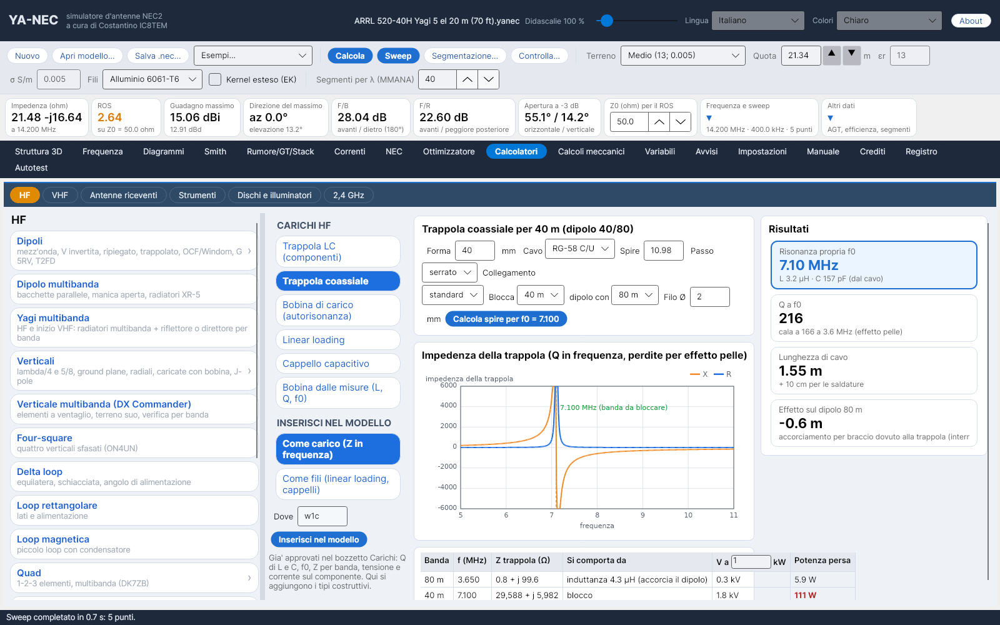

[Italiano](README.md) · [English](README.en.md) · [Français](README.fr.md) · [Deutsch](README.de.md) · **Español** · [Português](README.pt.md) · [日本語](README.ja.md) · [한국어](README.ko.md)

# YA-NEC

**Simulador de antenas de hilo basado en NEC-2** para Windows, Linux y macOS (C#, .NET 8, Avalonia).
Por Costantino Cerrotta **IC8TEM**.

> *La historia de este programa la escribiréis vosotros: con vuestros proyectos, vuestras ideas, vuestro ingenio, vuestros descubrimientos y vuestras certezas.*

El motor es una traducción a C# de **nec2c** (el NEC-2 del Lawrence Livermore National Laboratory), comparada en cada versión con nec2c y EZNEC. Abre modelos **NEC (.nec)**, **MMANA (.maa)**, **AutoEZ (.weq)**, **EZNEC (.ez)**, **YO/AO de K6STI (.yag, .ant)** y su propio formato **.yanec**.

Funciones: impedancia, ROE, ganancia, diagramas 2D y 3D, barrido en frecuencia y carta de Smith; corrección de Leeson para tubos telescópicos, como EZNEC; suelos (perfecto, coeficiente de reflexión, Sommerfeld, radiales); variables, fórmulas y optimizador; más de 40 calculadoras (Yagi larga DL6WU, Quagi, LPDA, Moxon, hexbeam, dipolos y Yagis multibanda, four-square, verticales, parábolas e iluminadores, soportes de los elementos y más); antenas de recepción y RDF; ruido, G/T y agrupación (stack); tabla de cables, líneas de adaptación y baluns; control de los datos introducidos. Cada decisión de cálculo y cada casilla se explican en el [manual](doc/Manuale_d_uso.pdf), también dentro del programa (pestaña Manual). Más información en el [Wiki](https://github.com/ic8tem/YA-NEC/wiki).

**Idioma:** la interfaz está disponible en 37 idiomas (menú Idioma, arriba a la derecha), y el Wiki también. El manual está en italiano.

## Capturas de pantalla

<table><tr><td width="50%" align="center"> Estructura 3D con las corrientes y el lóbulo</td><td width="50%" align="center"> Terreno real al estilo HFTA sobre el perfil DEM</td></tr><tr><td width="50%" align="center"> Recepción: RDF, DMF y ruido</td><td width="50%" align="center"> Tolerancias de construcción (Monte Carlo)</td></tr><tr><td width="50%" align="center"> Cable y balun: corriente de modo común</td><td width="50%" align="center"> Yagis cruzadas: RHCP, LHCP, relación axial</td></tr><tr><td width="50%" align="center"> Cálculos mecánicos: viento (NTC 2018)</td><td width="50%" align="center"> Divisores y cables de fase</td></tr><tr><td width="50%" align="center"> Cargas HF: trampas y bobinas</td><td width="50%" align="center"> Carta de Smith</td></tr></table>

## Novedades de la 1.2

- **Terreno real** (como HFTA de N6BV): diagrama de elevación sobre el perfil verdadero del terreno, desde el DEM **TINITALY** (Italia, 10 m) o **SRTM1** (mundo), un archivo de HorizonProfiler o plano. Reflexiones tramo a tramo ponderadas con las zonas de Fresnel, difracción en las crestas, mar, Tierra curva; direcciones de tráfico desde el locator (hasta 12 caracteres) y **mapa** con foto aérea, OpenStreetMap y cuadrícula de locators. En VHF vista completa y zoom 0-15 grados.
- **Recepción (RDF)**: RDF, DMF, F/R medio, ruido de antena (UIT-R P.372) y margen del receptor para Beverage, BOG, K9AY, Flag, EWE, 4-square y 8 verticales en círculo.
- **Medidas VNA**: archivos .s1p y CSV sobre el cálculo, con el cable quitado (de-embedding), carta de Smith y corrección propuesta.
- **Tolerancias de construcción**: Monte Carlo repetible, sensibilidad por elemento y lista de corte con la tolerancia admitida.
- **Cálculos mecánicos** (nueva pestaña): **viento** según NTC 2018, CNR-DT 207 y EN 1991-1-4 (zona desde el locator, flujo transversal) y **equilibrado** en el mástil; fuerzas en N y kgf.
- **Cable y balun** de 1,8 a 1296 MHz (la malla se vuelve un hilo NEC), **bastidor en H y mástil** en el apilamiento, **divisores** λ/4 y Wilkinson con dibujo 1:1, **Yagis cruzadas** (RHCP, LHCP, X-pol), **cargas HF** (trampas coaxiales W8NX, bobinas, linear loading), **F/R medio** también en el optimizador y **prueba AGT** automática.
- Todo explicado en el capítulo 23 del manual, con las fuentes; elementos nuevos traducidos a las 37 lenguas.

## Novedades de la 1.1

> **Nota del autor.** En esta versión he reflexionado mucho sobre la temperatura de ruido. Me señalaron unos estudios en MATLAB sobre el apilamiento de antenas directivas y quise probarlo enseguida: ofrecer a quien usa YA-NEC la posibilidad de ir más allá de la distancia de apilamiento de DL6WU (la fórmula trigonométrica) y acompañarlo, si quiere, en la elección de su propia distancia de apilamiento. Y, con ello, una profunda revisión de la interfaz. — *Costantino IC8TEM*

- **Ruido del cielo real.** Nueva página en la superpestaña **Ruido/GT/Apilamiento**: el diagrama de la antena o del apilamiento se coloca sobre el mapa real del cielo (relevamiento de 408 MHz de Haslam, reprocesado por Remazeilles, llevado a 144 y 432 MHz por G8ONH), desde su QTH (localizador o coordenadas) a la hora elegida, apuntando donde quiera, a la Luna o al punto de cielo más frío. Dos G/T lado a lado: con cielo uniforme, comparable con las tablas de VE7BQH (30 grados, apilamiento 2 x 2 a la distancia DL6WU), y con el cielo real, con la curva de temperatura de antena en 24 horas y su mínimo y máximo. El cálculo es el de **skynoise de John C. Sager G8ONH** (licencia MIT), portado a C#.
- **Distancia de apilamiento elegida con NEC.** En la página **Distancias de apilamiento** (sacada de las Calculadoras) el apilamiento se calcula de verdad para una serie de distancias alrededor de la de DL6WU: ganancia, lóbulo lateral más alto, G/T y matriz de acoplamiento entre puertos (S11, S21...). Un criterio elige la distancia propuesta (ganancia máxima, lóbulos más bajos, mejor G/T, o ganancia con los lóbulos bajo un umbral) y un botón la usa para crear el apilamiento. En **HF** la fórmula de DL6WU no vale: el apilamiento sobre el suelo se elige según los ángulos de salida deseados, con diagramas de elevación en fase (BIP), solas y en contrafase (BOP).
- **Calculadoras por familias.** Una barra bajo las pestañas divide las calculadoras en **HF**, **VHF**, **Antenas receptoras** (ya no es una pestaña aparte), **Herramientas**, **Parábolas y alimentadores** y **2,4 GHz**; la lista de la izquierda muestra solo la familia elegida.
- **Medidas en los diagramas.** Además de la apertura a -3 dB: apertura al primer nulo (FNBW), lóbulo lateral más alto (SLL) y dos cursores C1 y C2 que se colocan con un clic, con nivel, ángulo y diferencia entre ambos.
- **F/B a lo largo del eje** corregido para modelos en espacio libre con el haz a lo largo del eje Z (como la Yagi del MathWorks Antenna Toolbox).
- **Nuevas calculadoras**: biquad y doble biquad (alimentadores de parábola), Big Wheel y tres dipolos, lazo horizontal multibanda (Skywire) con la pérdida de la línea en cada banda.
- **Traducciones**: todas las entradas nuevas en los 37 idiomas del programa. **Videocurso** actualizado con lecciones sobre los nuevos temas.

## Descarga

En la página **[Releases](https://github.com/ic8tem/YA-NEC/releases)** se descarga el zip de la propia plataforma, se extrae en una **carpeta con permiso de escritura** (por ejemplo `C:\YA-NEC` o `~/YA-NEC`) y se ejecuta `YA-NEC.exe` (Linux y macOS: `YA-NEC`). No hace falta instalar .NET. La configuración y los datos quedan en la carpeta `data` junto al programa: nada en AppData ni en el registro.

| Sistema | Paquete |
|---|---|
| Windows 10/11 64 bits | `YA-NEC-<versión>-win-x64.zip` |
| Windows 10/11 32 bits | `YA-NEC-<versión>-win-x86.zip` |
| Windows en ARM (Snapdragon) | `YA-NEC-<versión>-win-arm64.zip` |
| Windows 7 SP1, 8, 8.1 (.NET 6) | `YA-NEC-<versión>-win7-x64.zip`, `-win7-x86.zip` (requiere las actualizaciones KB2533623 y KB2999226) |
| Linux x86_64 | `YA-NEC-<versión>-linux-x64.zip` |
| Linux ARM64 (Raspberry Pi OS 64 bits, otros aarch64) | `YA-NEC-<versión>-linux-arm64.zip` |
| Linux ARM 32 bits (Raspberry Pi OS 32 bits, armv7l) | `YA-NEC-<versión>-linux-arm.zip` |
| Alpine y otros Linux con musl | `YA-NEC-<versión>-linux-musl-x64.zip`, `-linux-musl-arm64.zip` |
| macOS Apple Silicon (M1-M4) | `YA-NEC-<versión>-osx-arm64.zip` |
| macOS Intel | `YA-NEC-<versión>-osx-x64.zip` |

Cada zip va acompañado de su huella `.sha256`.

- **Linux**: tras extraer, `chmod +x YA-NEC` si hace falta; se necesitan `libfontconfig1` y `libicu` (ya presentes en las distribuciones de escritorio).
- **macOS**: el programa no está firmado por Apple. Tras extraer, en el Terminal: `xattr -dr com.apple.quarantine ~/YA-NEC` (la carpeta extraída) y luego `~/YA-NEC/YA-NEC`.

## Actualización automática

Cada 30 minutos el programa comprueba en silencio si aquí hay una versión nueva. Si la hay, descarga el zip de su plataforma, verifica la huella SHA-256 y lo instala: la nueva versión arranca **en el próximo inicio**, con un mensaje en la barra de estado. La versión anterior se guarda en `data/aggiornamenti/precedente-<versión>`; la configuración (`data/config.ini`) y los modelos del usuario no se tocan. Sin huella, o con una huella distinta, no se instala nada. La actualización se desactiva en **Configuración > Actualización**.

**Excepción: paquetes Debian/Ubuntu (.deb) y Fedora/openSUSE (.rpm).** Cuando existan, se instalarán en carpetas del sistema con permisos de administrador, por lo que el programa no puede (ni debe) cambiarse solo: se actualizarán con el gestor de paquetes. En esos paquetes la actualización automática está desactivada y la Configuración lo indica.

## Compilar desde el código fuente

Se necesita el SDK de .NET 8. Windows: `compila.bat` (programa en `build\win-x64`), `compila.bat /distribuzione` para la versión autónoma, `compila_win7.bat` para Windows 7. Linux y macOS: `./compila.sh`. Detalles en [LEGGIMI.txt](LEGGIMI.txt) (en italiano).

## Créditos y licencia

**GPL-3.0** ([LICENSE](LICENSE), [THIRD-PARTY-NOTICES.txt](THIRD-PARTY-NOTICES.txt)), como nec2c y xnec2c, de los que deriva el motor. YA-NEC existe gracias al trabajo de radioaficionados e investigadores: la lista completa está en [CREDITI.txt](CREDITI.txt) y en la pestaña **Créditos**. Gracias a Luis IV3PRK por las publicaciones gratuitas en su sitio web.

## Contacto

ic8tem@gmail.com · [QRZ](https://www.qrz.com/db/ic8tem) · [grupo de Facebook](https://www.facebook.com/groups/1675310160982493) · donaciones: [ko-fi.com/ic8tem](https://ko-fi.com/ic8tem)
