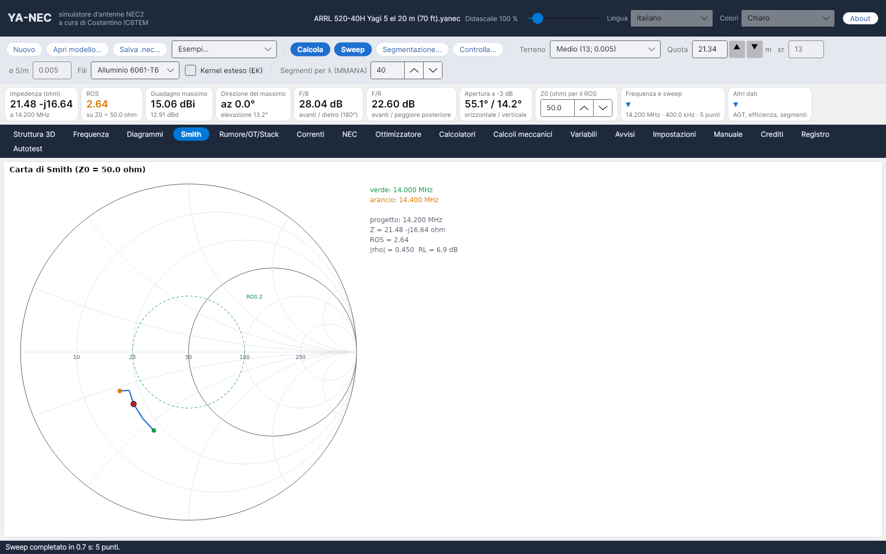

[Italiano](README.md) · [English](README.en.md) · [Français](README.fr.md) · [Deutsch](README.de.md) · **Español** · [Português](README.pt.md) · [日本語](README.ja.md) · [한국어](README.ko.md)

# YA-NEC

**Simulador de antenas de hilo basado en NEC-2** para Windows, Linux y macOS (C#, .NET 8, Avalonia).
Por Costantino Cerrotta **IC8TEM**.

> *La historia de este programa la escribiréis vosotros: con vuestros proyectos, vuestras ideas, vuestro ingenio, vuestros descubrimientos y vuestras certezas.*

El motor es una traducción a C# de **nec2c** (el NEC-2 del Lawrence Livermore National Laboratory), comparada en cada versión con nec2c y EZNEC. Abre modelos **NEC (.nec)**, **MMANA (.maa)**, **AutoEZ (.weq)**, **EZNEC (.ez)**, **YO/AO de K6STI (.yag, .ant)** y su propio formato **.yanec**.

Funciones: impedancia, ROE, ganancia, diagramas 2D y 3D, barrido en frecuencia y carta de Smith; corrección de Leeson para tubos telescópicos, como EZNEC; suelos (perfecto, coeficiente de reflexión, Sommerfeld, radiales); variables, fórmulas y optimizador; más de 40 calculadoras (Yagi larga DL6WU, Quagi, LPDA, Moxon, hexbeam, dipolos y Yagis multibanda, four-square, verticales, parábolas e iluminadores, soportes de los elementos y más); antenas de recepción y RDF; ruido, G/T y agrupación (stack); tabla de cables, líneas de adaptación y baluns; control de los datos introducidos. Cada decisión de cálculo y cada casilla se explican en el [manual](doc/Manuale_d_uso.pdf), también dentro del programa (pestaña Manual). Más información en el [Wiki](https://github.com/ic8tem/YA-NEC/wiki).

**Idioma:** la interfaz está disponible en 37 idiomas (menú Idioma, arriba a la derecha), y el Wiki también. El manual está en italiano.

## Capturas de pantalla

<table><tr><td width="50%" align="center"> Estructura 3D con las corrientes y el lóbulo</td><td width="50%" align="center"> Terreno real al estilo HFTA sobre el perfil DEM</td></tr><tr><td width="50%" align="center"> Recepción: RDF, DMF y ruido</td><td width="50%" align="center"> Tolerancias de construcción (Monte Carlo)</td></tr><tr><td width="50%" align="center"> Cable y balun: corriente de modo común</td><td width="50%" align="center"> Yagis cruzadas: RHCP, LHCP, relación axial</td></tr><tr><td width="50%" align="center"> Cálculos mecánicos: viento (NTC 2018)</td><td width="50%" align="center"> Divisores y cables de fase</td></tr><tr><td width="50%" align="center"> Cargas HF: trampas y bobinas</td><td width="50%" align="center"> Carta de Smith</td></tr></table>

## Novedades de la 1.7

- **Nuevas calculadoras**: Yagi HF de 2-3 elementos con guía de ajuste, Yagi bibanda entrelazada, vertical multibanda con trampas, L invertida / T para 160 m, half-sloper en la torre, dipolo de banda ancha, dipolo multibanda con relés, carga lineal, hilo resonante en armónicos, gamma match y adaptación por stub con carta de Smith.
- **Quad multibanda** con las líneas de las bandas no alimentadas y líneas de desacoplo; **loop magnético** rectangular, con espiras en paralelo, transformador y red L; **Antenas de hilo** con el material del hilo y el FT-82-43.
- **Stack** con el área efectiva; **ROE** que indica de qué lado está R; **Terreno real** con los ángulos de salida hacia un locator; eficiencia en las calculadoras con bobinas y trampas; nueva pestaña **Consejos**.
- **1.7.1**: cotas de la Estructura 3D que se pueden pulsar y cambiar; en Diagramas la separación de un stack cambia en directo.
- **1.7.2 (seguridad)**: la actualización automática instala solo paquetes firmados por YA-NEC; los archivos preparados a propósito ya no cierran el programa.

Las novedades de las versiones anteriores (de la 1.1 a la 1.6) están en las [notas de versión](https://github.com/ic8tem/YA-NEC/releases), en el [Wiki](https://github.com/ic8tem/YA-NEC/wiki) y en el manual.

## Descarga

En la página **[Releases](https://github.com/ic8tem/YA-NEC/releases)** se descarga el zip de la propia plataforma, se extrae en una **carpeta con permiso de escritura** (por ejemplo `C:\YA-NEC` o `~/YA-NEC`) y se ejecuta `YA-NEC.exe` (Linux y macOS: `YA-NEC`). No hace falta instalar .NET. La configuración y los datos quedan en la carpeta `data` junto al programa: nada en AppData ni en el registro.

| Sistema | Paquete |
|---|---|
| Windows 10/11 64 bits | `YA-NEC-<versión>-windows-x64-portatile.zip` |
| Windows 10/11 32 bits | `YA-NEC-<versión>-windows-x86-portatile.zip` |
| Windows en ARM (Snapdragon) | `YA-NEC-<versión>-windows-arm64-portatile.zip` |
| Windows 7 SP1, 8, 8.1 (.NET 6) | `YA-NEC-<versión>-windows7-x64-portatile.zip`, `-windows7-x86-portatile.zip` (requiere las actualizaciones KB2533623 y KB2999226) |
| Linux x86_64 | `YA-NEC-<versión>-linux-x64.tar.gz` |
| Linux ARM64 (Raspberry Pi OS 64 bits, otros aarch64) | `YA-NEC-<versión>-linux-arm64.tar.gz` |
| Linux ARM 32 bits (Raspberry Pi OS 32 bits, armv7l) | `YA-NEC-<versión>-linux-armv7l.tar.gz` |
| Alpine y otros Linux con musl | `YA-NEC-<versión>-alpine-x64.tar.gz`, `-alpine-arm64.tar.gz` |
| macOS Apple Silicon (M1-M4) | `YA-NEC-<versión>-mac-apple-silicon-app.zip` |
| macOS Intel | `YA-NEC-<versión>-mac-intel-app.zip` |

Cada zip va acompañado de su huella `.sha256`.

- **Linux**: tras extraer, `chmod +x YA-NEC` si hace falta; se necesitan `libfontconfig1` y `libicu` (ya presentes en las distribuciones de escritorio).
- **macOS**: el programa no está firmado por Apple. Tras extraer, en el Terminal: `xattr -dr com.apple.quarantine ~/YA-NEC` (la carpeta extraída) y luego `~/YA-NEC/YA-NEC`.

## Actualización automática

El programa comprueba 10 segundos después del arranque y luego cada 3 minutos si aquí hay una versión nueva. Si la hay, la descarga, verifica su huella SHA-256 y, desde la 1.7.2, la **firma de YA-NEC** (ECDSA P-256): sin firma o con firma errónea no instala nada. La nueva versión arranca al reiniciar, cosa que el programa hace solo volviendo a abrir el modelo; la anterior queda en `data/aggiornamenti/precedente-<versión>`, ajustes y modelos no se tocan. Se desactiva en **Ajustes > Actualización**.

**Excepción: paquetes Debian/Ubuntu (.deb) y Fedora/openSUSE (.rpm).** Cuando existan, se instalarán en carpetas del sistema con permisos de administrador, por lo que el programa no puede (ni debe) cambiarse solo: se actualizarán con el gestor de paquetes. En esos paquetes la actualización automática está desactivada y la Configuración lo indica.

## Compilar desde el código fuente

Se necesita el SDK de .NET 8. Windows: `compila.bat` (programa en `build\win-x64`), `compila.bat /distribuzione` para la versión autónoma, `compila_win7.bat` para Windows 7. Linux y macOS: `./compila.sh`. Detalles en [LEGGIMI.txt](LEGGIMI.txt) (en italiano).

## Créditos y licencia

**GPL-3.0-or-later** ([LICENSE](LICENSE), [THIRD-PARTY-NOTICES.txt](THIRD-PARTY-NOTICES.txt)), como nec2c y xnec2c, de los que deriva el motor. YA-NEC existe gracias al trabajo de radioaficionados e investigadores: la lista completa está en [CREDITI.txt](CREDITI.txt) y en la pestaña **Créditos**. Gracias a Luis IV3PRK por las publicaciones gratuitas en su sitio web.

## Contacto

ic8tem@gmail.com · [QRZ](https://www.qrz.com/db/ic8tem) · [grupo de Facebook](https://www.facebook.com/groups/1675310160982493) · donaciones: [ko-fi.com/ic8tem](https://ko-fi.com/ic8tem)
