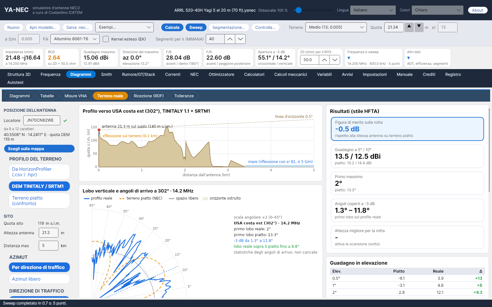
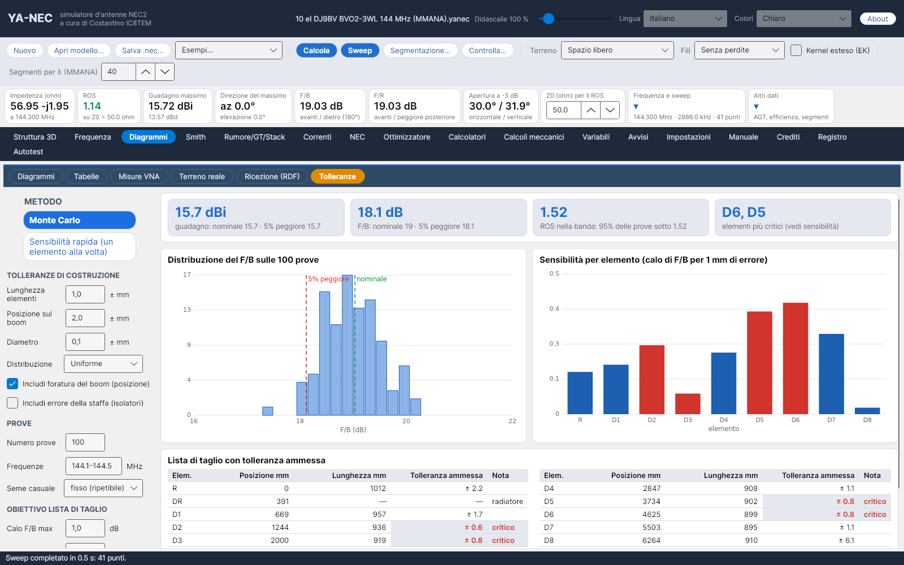

[Italiano](README.md) · [English](README.en.md) · **Français** · [Deutsch](README.de.md) · [Español](README.es.md) · [Português](README.pt.md) · [日本語](README.ja.md) · [한국어](README.ko.md)

# YA-NEC

**Simulateur d'antennes filaires basé sur NEC-2**, pour Windows, Linux et macOS (C#, .NET 8, Avalonia).
Par Costantino Cerrotta **IC8TEM**.

> *L'histoire de ce programme, c'est vous qui l'écrirez : avec vos projets, vos idées, votre génie, vos découvertes et vos certitudes.*

Le moteur est une traduction en C# de **nec2c** (le NEC-2 du Lawrence Livermore National Laboratory), comparée à chaque version avec nec2c et EZNEC. Il ouvre les modèles **NEC (.nec)**, **MMANA (.maa)**, **AutoEZ (.weq)**, **EZNEC (.ez)**, **YO/AO de K6STI (.yag, .ant)** et son propre format **.yanec**.

Fonctions : impédance, ROS, gain, diagrammes 2D et 3D, balayage en fréquence et abaque de Smith ; correction de Leeson des tubes télescopiques, comme EZNEC ; sols (parfait, coefficient de réflexion, Sommerfeld, radians) ; variables, formules et optimiseur ; plus de 40 calculateurs (Yagi longue DL6WU, Quagi, LPDA, Moxon, hexbeam, dipôles et Yagi multibandes, four-square, verticales, paraboles et sources, fixations des éléments, etc.) ; antennes de réception et RDF ; bruit, G/T et couplage (stack) ; abaque des câbles, lignes d'adaptation et baluns ; contrôle des données saisies. Chaque choix de calcul et chaque case à cocher sont expliqués dans le [manuel](doc/Manuale_d_uso.pdf), également disponible dans le programme (onglet Manuel). Plus d'informations dans le [Wiki](https://github.com/ic8tem/YA-NEC/wiki).

**Langue :** l'interface est disponible en 37 langues (menu Langue, en haut à droite), le Wiki aussi. Le manuel est en italien.

## Captures d'écran

<table><tr><td width="50%" align="center"> Structure 3D avec les courants et le lobe</td><td width="50%" align="center"> Terrain réel façon HFTA sur le profil MNT</td></tr><tr><td width="50%" align="center"> Réception : RDF, DMF et bruit</td><td width="50%" align="center"> Tolérances de construction (Monte Carlo)</td></tr><tr><td width="50%" align="center"> Câble et balun : courant de mode commun</td><td width="50%" align="center"> Yagis croisées : RHCP, LHCP, rapport axial</td></tr><tr><td width="50%" align="center"> Calculs mécaniques : vent (NTC 2018)</td><td width="50%" align="center"> Diviseurs et câbles de phase</td></tr><tr><td width="50%" align="center"> Charges HF : trappes et bobines</td><td width="50%" align="center"> Abaque de Smith</td></tr></table>

## Nouveautés de la 1.5

- **Calculateurs** : les calculs mécaniques passent dans les Calculateurs ; réactance du dipôle court, dipôle replié en fréquence, boucle magnétique à plusieurs spires avec couplage capacitif (Antenna Engineering Handbook, 4e éd.). **Distances d'empilement HF** en entrée séparée.
- **Modèles AutoEZ, MultiNEC, EZNEC** : sources « mark out », fils virtuels, transformateurs, cellules calculées ; le .nec enregistré écrit les sources de courant comme les tensions calculées.

## Nouveautés de la 1.4.2

- **Calculateurs** : NVIS (hauteur optimale et écran de sol, d'après Cebik), adaptation en épingle (beta match), Quad avec la méthode de Cebik et la résonance NEC en VHF, J-pole avec la Slim Jim.
- **Optimiseur** : Monte Carlo avec les tolérances de construction. **Stacks** : espacements sur deux fréquences.
- **Réglages** : Forcer la mise à jour, Signaler un problème.

## Nouveautés de la 1.4

- **Documents techniques** : manuel d'utilisation, nouveau manuel de calcul et des sources et citations numérotées, chacun avec sommaire et PDF ; recherche dans les trois (documents en italien).
- **Distances de couplage** : ROS actif et gain réalisé ; les distances à ROS actif élevé sont marquées « à ne pas choisir ».
- **Fermeture** : fenêtre de confirmation avec remerciement.

## Nouveautés de la 1.3

- **Antennes de réception** : dans les Calculateurs s'activent **Dipôle bas**, **K9AY** (terminaison avec « optimiser pour F/B »), **4-square RX** et les réseaux **Hi-Z** de 2, 3 et 8 verticales, avec la **phase entre rangées** et le bouton « optimiser la phase (RDF) ». Chaque élément crée le modèle NEC et donne RDF, DMF, F/B et la place au classement ; un avertissement jaune rappelle la limite du NEC-2 avec des fils reliés au sol réel.
- **Réception (RDF)** : les 8 verticales en cercle ont une phase de 220 degrés et le lobe vers l'avant.
- **Cours vidéo** : leçons 22 (Terrain réel), 23 (Antennes de réception), 24 (Outils VHF) et 25 (Calculs mécaniques et charges HF), en italien et en anglais avec voix.
- **Langues** : les textes pas encore traduits s'affichent en anglais au lieu de l'italien.
- **Corrections** : Charges HF ne se ferme plus en passant à « Bobine de charge » ; un clic sur un autre élément avec le curseur dans un champ ne ferme plus le programme ; les avertissements des antennes de réception ne s'accumulent plus ; les fenêtres larges ne débordent plus à droite.
- Tout est au chapitre 24 du manuel, avec les sources (K9AY, Hi-Z Antennas, IV3PRK, ON4UN, W7EL).

## Nouveautés de la 1.2

- **Terrain réel** (comme HFTA de N6BV) : diagramme d'élévation sur le vrai profil du terrain, depuis le MNT **TINITALY** (Italie, 10 m) ou **SRTM1** (monde), un fichier HorizonProfiler ou un sol plat. Réflexions segment par segment pondérées par les zones de Fresnel, diffraction sur les crêtes, mer, Terre courbe ; directions de trafic depuis le locator (jusqu'à 12 caractères) et **carte** avec photo aérienne, OpenStreetMap et grille des locators. En VHF vue entière et zoom 0-15 degrés.
- **Réception (RDF)** : RDF, DMF, F/R moyen, bruit d'antenne (UIT-R P.372) et marge du récepteur pour Beverage, BOG, K9AY, Flag, EWE, 4-square et 8 verticales en cercle.
- **Mesures VNA** : fichiers .s1p et CSV superposés au calcul, câble retiré (de-embedding), abaque de Smith et correction proposée.
- **Tolérances de construction** : Monte Carlo reproductible, sensibilité par élément et liste de coupe avec la tolérance admise.
- **Calculs mécaniques** (nouvel onglet) : **vent** selon NTC 2018, CNR-DT 207 et EN 1991-1-4 (zone depuis le locator, écoulement transversal) et **équilibrage** sur le mât ; forces en N et kgf.
- **Câble et balun** de 1,8 à 1296 MHz (la tresse devient un fil NEC), **cadre en H et mât** dans le groupement, **diviseurs** λ/4 et Wilkinson avec dessin 1:1, **Yagis croisées** (RHCP, LHCP, X-pol), **charges HF** (trappes coaxiales W8NX, bobines, linear loading), **F/R moyen** aussi dans l'optimiseur et **test AGT** automatique.
- Tout est expliqué au chapitre 23 du manuel, avec les sources ; nouveaux éléments traduits dans les 37 langues.

## Nouveautés de la 1.1

> **Note de l'auteur.** Dans cette version, j'ai longuement réfléchi à la température de bruit. On m'a signalé des études sous MATLAB sur l'empilement des antennes directives, et j'ai voulu m'y essayer tout de suite : offrir à l'utilisateur de YA-NEC la possibilité d'aller au-delà de la distance d'empilement de DL6WU (la formule trigonométrique) et l'accompagner, s'il le souhaite, dans le choix de sa propre distance d'empilement. Et, avec cela, une profonde révision de l'interface. — *Costantino IC8TEM*

- **Bruit du ciel réel.** Nouvelle page dans le super-onglet **Bruit/GT/Empilement** : le diagramme de l'antenne ou de l'empilement est posé sur la vraie carte du ciel (relevé à 408 MHz de Haslam, retraité par Remazeilles, porté à 144 et 432 MHz par G8ONH), depuis votre QTH (locator ou coordonnées) à l'heure choisie, en pointant où vous voulez, sur la Lune ou sur le point de ciel le plus froid. Deux G/T côte à côte : avec un ciel uniforme, comparable aux tableaux de VE7BQH (30 degrés, empilement 2 x 2 à la distance DL6WU), et avec le ciel réel, avec la courbe de température d'antenne sur 24 heures, son minimum et son maximum. Le calcul est celui de **skynoise de John C. Sager G8ONH** (licence MIT), porté en C#.
- **Distance d'empilement choisie avec le NEC.** Dans la page **Distances d'empilement** (sortie des Calculateurs), l'empilement est réellement calculé pour une série de distances autour de celle de DL6WU : gain, lobe secondaire le plus haut, G/T et matrice de couplage entre les ports (S11, S21...). Un critère choisit la distance proposée (gain maximal, lobes les plus bas, meilleur G/T, ou gain avec les lobes sous un seuil) et un bouton l'utilise pour créer l'empilement. En **HF** la formule de DL6WU ne s'applique pas : l'empilement au-dessus du sol se choisit sur les angles de départ voulus, avec les diagrammes en élévation en phase (BIP), seules et en opposition de phase (BOP).
- **Calculateurs par familles.** Une barre sous les onglets répartit les calculateurs en **HF**, **VHF**, **Antennes de réception** (qui n'est plus un onglet séparé), **Outils**, **Paraboles et sources** et **2,4 GHz** ; la liste de gauche ne montre que la famille choisie.
- **Mesures sur les diagrammes.** En plus de l'ouverture à -3 dB : ouverture au premier zéro (FNBW), lobe secondaire le plus haut (SLL) et deux curseurs C1 et C2 posés d'un clic, avec niveau, angle et différence entre les deux.
- **F/B le long de l'axe** corrigé pour les modèles en espace libre dont le faisceau suit l'axe Z (comme la Yagi du MathWorks Antenna Toolbox).
- **Nouveaux calculateurs** : biquad et double biquad (sources de parabole), Big Wheel et trois dipôles, boucle horizontale multibande (Skywire) avec la perte de la ligne sur chaque bande.
- **Traductions** : toutes les nouvelles entrées dans les 37 langues du programme. **Cours vidéo** mis à jour avec les leçons sur les nouveaux sujets.

## Téléchargement

Depuis la page **[Releases](https://github.com/ic8tem/YA-NEC/releases)**, téléchargez le zip de votre plateforme, extrayez-le dans un **dossier accessible en écriture** (par exemple `C:\YA-NEC` ou `~/YA-NEC`) et lancez `YA-NEC.exe` (Linux et macOS : `YA-NEC`). Aucune installation de .NET n'est nécessaire. Les réglages et les données restent dans le dossier `data` à côté du programme : pas d'AppData, pas de registre.

| Système | Paquet |
|---|---|
| Windows 10/11 64 bits | `YA-NEC-<version>-windows-x64-portatile.zip` |
| Windows 10/11 32 bits | `YA-NEC-<version>-windows-x86-portatile.zip` |
| Windows sur ARM (Snapdragon) | `YA-NEC-<version>-windows-arm64-portatile.zip` |
| Windows 7 SP1, 8, 8.1 (.NET 6) | `YA-NEC-<version>-windows7-x64-portatile.zip`, `-windows7-x86-portatile.zip` (mises à jour KB2533623 et KB2999226 requises) |
| Linux x86_64 | `YA-NEC-<version>-linux-x64.tar.gz` |
| Linux ARM64 (Raspberry Pi OS 64 bits, autres aarch64) | `YA-NEC-<version>-linux-arm64.tar.gz` |
| Linux ARM 32 bits (Raspberry Pi OS 32 bits, armv7l) | `YA-NEC-<version>-linux-armv7l.tar.gz` |
| Alpine et autres Linux musl | `YA-NEC-<version>-alpine-x64.tar.gz`, `-alpine-arm64.tar.gz` |
| macOS Apple Silicon (M1-M4) | `YA-NEC-<version>-mac-apple-silicon-app.zip` |
| macOS Intel | `YA-NEC-<version>-mac-intel-app.zip` |

Chaque zip est accompagné de son empreinte `.sha256`.

- **Linux** : après extraction, `chmod +x YA-NEC` si nécessaire ; `libfontconfig1` et `libicu` sont requis (déjà présents sur les distributions de bureau).
- **macOS** : le programme n'est pas signé par Apple. Après extraction, dans le Terminal : `xattr -dr com.apple.quarantine ~/YA-NEC` (le dossier extrait), puis `~/YA-NEC/YA-NEC`.

## Mise à jour automatique

Toutes les 30 minutes, le programme vérifie discrètement s'il existe ici une nouvelle version. Si c'est le cas, il télécharge le zip de sa plateforme, vérifie l'empreinte SHA-256 et l'installe : la nouvelle version démarre **au prochain lancement**, avec un message dans la barre d'état. La version précédente est conservée dans `data/aggiornamenti/precedente-<version>` ; les réglages (`data/config.ini`) et les modèles de l'utilisateur ne sont pas touchés. Sans empreinte, ou avec une empreinte différente, rien n'est installé. La mise à jour se désactive dans **Réglages > Mise à jour**.

**Exception : paquets Debian/Ubuntu (.deb) et Fedora/openSUSE (.rpm).** Quand ils existeront, ils s'installeront dans les dossiers système avec les droits d'administrateur ; le programme ne peut donc pas (et ne doit pas) se modifier lui-même : ils se mettront à jour avec le gestionnaire de paquets. Dans ces paquets, la mise à jour automatique est désactivée et les Réglages l'indiquent.

## Compiler depuis les sources

SDK .NET 8 requis. Windows : `compila.bat` (programme dans `build\win-x64`), `compila.bat /distribuzione` pour la version autonome, `compila_win7.bat` pour Windows 7. Linux et macOS : `./compila.sh`. Détails dans [LEGGIMI.txt](LEGGIMI.txt) (en italien).

## Crédits et licence

**GPL-3.0** ([LICENSE](LICENSE), [THIRD-PARTY-NOTICES.txt](THIRD-PARTY-NOTICES.txt)), comme nec2c et xnec2c dont dérive le moteur. YA-NEC existe grâce au travail de radioamateurs et de chercheurs : la liste complète est dans [CREDITI.txt](CREDITI.txt) et dans l'onglet **Crédits**. Merci à Luis IV3PRK pour les publications gratuites sur son site.

## Contacts

ic8tem@gmail.com · [QRZ](https://www.qrz.com/db/ic8tem) · [groupe Facebook](https://www.facebook.com/groups/1675310160982493) · dons : [ko-fi.com/ic8tem](https://ko-fi.com/ic8tem)
