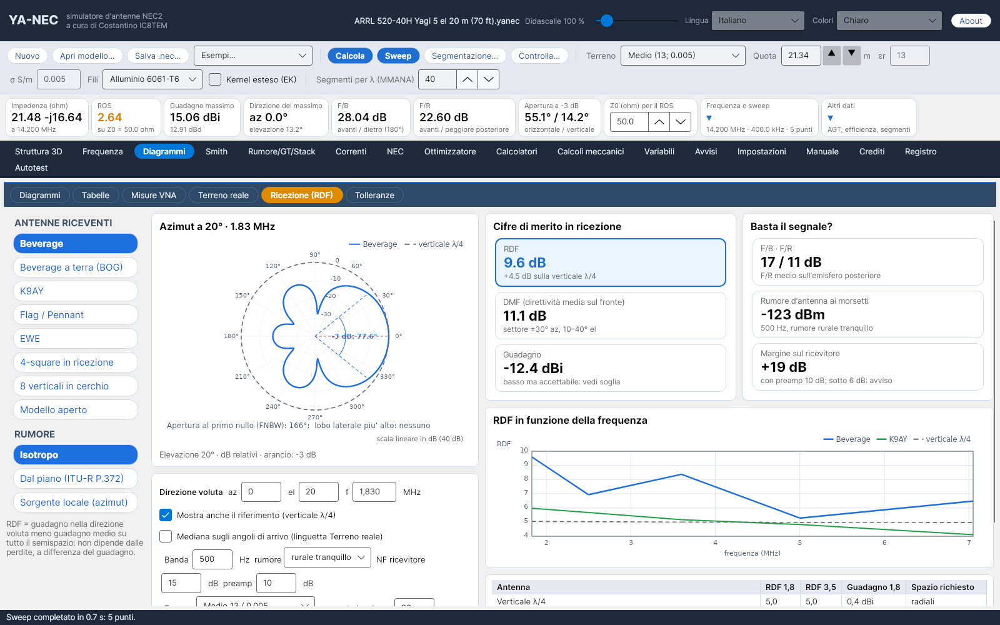

[Italiano](README.md) · [English](README.en.md) · **Français** · [Deutsch](README.de.md) · [Español](README.es.md) · [Português](README.pt.md) · [日本語](README.ja.md) · [한국어](README.ko.md)

# YA-NEC

**Simulateur d'antennes filaires basé sur NEC-2**, pour Windows, Linux et macOS (C#, .NET 8, Avalonia).
Par Costantino Cerrotta **IC8TEM**.

> *L'histoire de ce programme, c'est vous qui l'écrirez : avec vos projets, vos idées, votre génie, vos découvertes et vos certitudes.*

Le moteur est une traduction en C# de **nec2c** (le NEC-2 du Lawrence Livermore National Laboratory), comparée à chaque version avec nec2c et EZNEC. Il ouvre les modèles **NEC (.nec)**, **MMANA (.maa)**, **AutoEZ (.weq)**, **EZNEC (.ez)**, **YO/AO de K6STI (.yag, .ant)** et son propre format **.yanec**.

Fonctions : impédance, ROS, gain, diagrammes 2D et 3D, balayage en fréquence et abaque de Smith ; correction de Leeson des tubes télescopiques, comme EZNEC ; sols (parfait, coefficient de réflexion, Sommerfeld, radians) ; variables, formules et optimiseur ; plus de 40 calculateurs (Yagi longue DL6WU, Quagi, LPDA, Moxon, hexbeam, dipôles et Yagi multibandes, four-square, verticales, paraboles et sources, fixations des éléments, etc.) ; antennes de réception et RDF ; bruit, G/T et couplage (stack) ; abaque des câbles, lignes d'adaptation et baluns ; contrôle des données saisies. Chaque choix de calcul et chaque case à cocher sont expliqués dans le [manuel](doc/Manuale_d_uso.pdf), également disponible dans le programme (onglet Manuel). Plus d'informations dans le [Wiki](https://github.com/ic8tem/YA-NEC/wiki).

**Langue :** l'interface est disponible en 37 langues (menu Langue, en haut à droite), le Wiki aussi. Le manuel est en italien.

## Captures d'écran

<table><tr><td width="50%" align="center"> Structure 3D avec les courants et le lobe</td><td width="50%" align="center"> Terrain réel façon HFTA sur le profil MNT</td></tr><tr><td width="50%" align="center"> Réception : RDF, DMF et bruit</td><td width="50%" align="center"> Tolérances de construction (Monte Carlo)</td></tr><tr><td width="50%" align="center"> Câble et balun : courant de mode commun</td><td width="50%" align="center"> Yagis croisées : RHCP, LHCP, rapport axial</td></tr><tr><td width="50%" align="center"> Calculs mécaniques : vent (NTC 2018)</td><td width="50%" align="center"> Diviseurs et câbles de phase</td></tr><tr><td width="50%" align="center"> Charges HF : trappes et bobines</td><td width="50%" align="center"> Abaque de Smith</td></tr></table>

## Nouveautés de la 1.7

- **Nouveaux calculateurs** : Yagi HF 2-3 éléments avec guide de réglage, Yagi bibande entrelacée, verticale multibande à trappes, L inversé / T pour 160 m, half-sloper sur pylône, dipôle large bande, dipôle multibande à relais, charge linéaire, fil résonant sur les harmoniques, gamma match et adaptation par stub avec abaque de Smith.
- **Quad multibande** avec les lignes des bandes non alimentées et les lignes de découplage ; **boucle magnétique** rectangulaire, à spires en parallèle, avec transformateur et réseau en L ; **Antennes filaires** avec le matériau du fil et le FT-82-43.
- **Stack** avec la surface effective ; **ROS** indiquant de quel côté se trouve R ; **Terrain réel** avec les angles de départ vers un locator ; rendement dans les calculateurs à bobines et trappes ; nouvel onglet **Conseils**.
- **1.7.1** : cotes cliquables dans la Structure 3D ; dans les Diagrammes, l'espacement d'un stack se change en direct.
- **1.7.2 (sécurité)** : la mise à jour automatique n'installe que des paquets signés par YA-NEC ; les fichiers préparés exprès ne ferment plus le programme.

Les nouveautés des versions précédentes (de la 1.1 à la 1.6) sont dans les [notes de version](https://github.com/ic8tem/YA-NEC/releases), dans le [Wiki](https://github.com/ic8tem/YA-NEC/wiki) et dans le manuel.

## Téléchargement

Depuis la page **[Releases](https://github.com/ic8tem/YA-NEC/releases)**, téléchargez le zip de votre plateforme, extrayez-le dans un **dossier accessible en écriture** (par exemple `C:\YA-NEC` ou `~/YA-NEC`) et lancez `YA-NEC.exe` (Linux et macOS : `YA-NEC`). Aucune installation de .NET n'est nécessaire. Les réglages et les données restent dans le dossier `data` à côté du programme : pas d'AppData, pas de registre.

| Système | Paquet |
|---|---|
| Windows 10/11 64 bits | `YA-NEC-<version>-windows-x64-portatile.zip` |
| Windows 10/11 32 bits | `YA-NEC-<version>-windows-x86-portatile.zip` |
| Windows sur ARM (Snapdragon) | `YA-NEC-<version>-windows-arm64-portatile.zip` |
| Windows 7 SP1, 8, 8.1 (.NET 6) | `YA-NEC-<version>-windows7-x64-portatile.zip`, `-windows7-x86-portatile.zip` (mises à jour KB2533623 et KB2999226 requises) |
| Linux x86_64 | `YA-NEC-<version>-linux-x64.tar.gz` |
| Linux ARM64 (Raspberry Pi OS 64 bits, autres aarch64) | `YA-NEC-<version>-linux-arm64.tar.gz` |
| Linux ARM 32 bits (Raspberry Pi OS 32 bits, armv7l) | `YA-NEC-<version>-linux-armv7l.tar.gz` |
| Alpine et autres Linux musl | `YA-NEC-<version>-alpine-x64.tar.gz`, `-alpine-arm64.tar.gz` |
| macOS Apple Silicon (M1-M4) | `YA-NEC-<version>-mac-apple-silicon-app.zip` |
| macOS Intel | `YA-NEC-<version>-mac-intel-app.zip` |

Chaque zip est accompagné de son empreinte `.sha256`.

- **Linux** : après extraction, `chmod +x YA-NEC` si nécessaire ; `libfontconfig1` et `libicu` sont requis (déjà présents sur les distributions de bureau).
- **macOS** : le programme n'est pas signé par Apple. Après extraction, dans le Terminal : `xattr -dr com.apple.quarantine ~/YA-NEC` (le dossier extrait), puis `~/YA-NEC/YA-NEC`.

## Mise à jour automatique

Le programme vérifie 10 secondes après le démarrage puis toutes les 3 minutes s'il y a ici une nouvelle version. Si oui, il la télécharge, vérifie son empreinte SHA-256 et, depuis la 1.7.2, la **signature de YA-NEC** (ECDSA P-256) : sans signature ou avec une signature fausse, rien n'est installé. La nouvelle version démarre au redémarrage, que le programme fait seul en rouvrant le modèle ; la précédente reste dans `data/aggiornamenti/precedente-<version>`, réglages et modèles ne sont pas touchés. Elle se désactive dans **Réglages > Mise à jour**.

**Exception : paquets Debian/Ubuntu (.deb) et Fedora/openSUSE (.rpm).** Quand ils existeront, ils s'installeront dans les dossiers système avec les droits d'administrateur ; le programme ne peut donc pas (et ne doit pas) se modifier lui-même : ils se mettront à jour avec le gestionnaire de paquets. Dans ces paquets, la mise à jour automatique est désactivée et les Réglages l'indiquent.

## Compiler depuis les sources

SDK .NET 8 requis. Windows : `compila.bat` (programme dans `build\win-x64`), `compila.bat /distribuzione` pour la version autonome, `compila_win7.bat` pour Windows 7. Linux et macOS : `./compila.sh`. Détails dans [LEGGIMI.txt](LEGGIMI.txt) (en italien).

## Crédits et licence

**GPL-3.0-or-later** ([LICENSE](LICENSE), [THIRD-PARTY-NOTICES.txt](THIRD-PARTY-NOTICES.txt)), comme nec2c et xnec2c dont dérive le moteur. YA-NEC existe grâce au travail de radioamateurs et de chercheurs : la liste complète est dans [CREDITI.txt](CREDITI.txt) et dans l'onglet **Crédits**. Merci à Luis IV3PRK pour les publications gratuites sur son site.

## Contacts

ic8tem@gmail.com · [QRZ](https://www.qrz.com/db/ic8tem) · [groupe Facebook](https://www.facebook.com/groups/1675310160982493) · dons : [ko-fi.com/ic8tem](https://ko-fi.com/ic8tem)
