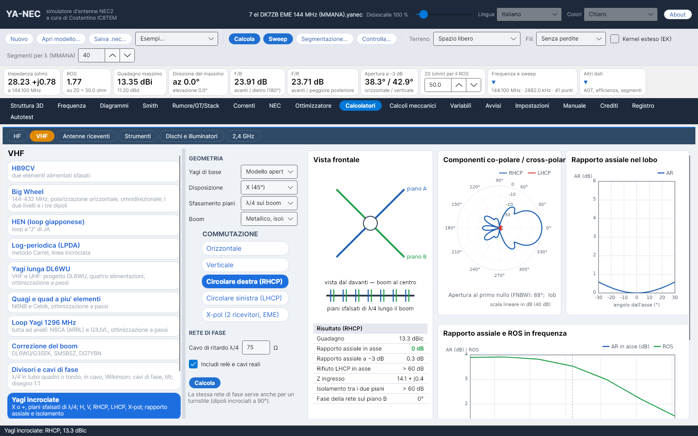

[Italiano](README.md) · [English](README.en.md) · [Français](README.fr.md) · [Deutsch](README.de.md) · [Español](README.es.md) · [Português](README.pt.md) · [日本語](README.ja.md) · **한국어**

# YA-NEC

**NEC-2 기반 와이어 안테나 시뮬레이터** (Windows, Linux, macOS 지원. C#, .NET 8, Avalonia).
제작: Costantino Cerrotta **IC8TEM**.

> *이 프로그램의 역사는 여러분이 만들어 갑니다. 여러분의 프로젝트, 아이디어, 재능, 발견, 그리고 확신으로.*

계산 엔진은 **nec2c**(로렌스 리버모어 국립연구소의 NEC-2)를 C#으로 옮긴 것이며, 매 릴리스마다 nec2c 및 EZNEC와 비교합니다. **NEC (.nec)**, **MMANA (.maa)**, **AutoEZ (.weq)**, **EZNEC (.ez)**, **K6STI의 YO/AO (.yag, .ant)** 모델과 자체 **.yanec** 형식을 열 수 있습니다.

주요 기능: 임피던스, SWR, 이득, 2D·3D 방사 패턴, 주파수 스윕과 스미스 차트; 텔레스코픽(단차 직경) 파이프에 대한 Leeson 보정(EZNEC와 동일); 대지(완전 도체, 반사 계수, Sommerfeld, 래디얼); 변수, 수식, 최적화 도구; 40개가 넘는 계산기(DL6WU 롱 야기, 쿼기, LPDA, Moxon, 헥스빔, 멀티밴드 다이폴과 야기, 포스퀘어, 수직 안테나, 파라볼라와 급전부, 엘리먼트 고정 브래킷 등); 수신 안테나와 RDF; 잡음, G/T, 스택; 동축 케이블 표, 정합 선로, 발룬; 입력 데이터 검사. 모든 계산 방식과 체크박스는 [매뉴얼](doc/Manuale_d_uso.pdf)에 설명되어 있으며 프로그램 안(매뉴얼 탭)에서도 볼 수 있습니다. 자세한 내용은 [Wiki](https://github.com/ic8tem/YA-NEC/wiki)를 참고하세요.

**언어:** 화면은 37개 언어를 지원합니다(오른쪽 위 언어 메뉴). 위키도 마찬가지입니다. 매뉴얼은 이탈리아어입니다.

## 화면

<table><tr><td width="50%" align="center"> 전류와 로브가 있는 3D 구조</td><td width="50%" align="center"> DEM 단면 위의 HFTA 방식 실제 지형</td></tr><tr><td width="50%" align="center"> 수신: RDF, DMF와 잡음</td><td width="50%" align="center"> 제작 공차 (몬테카를로)</td></tr><tr><td width="50%" align="center"> 케이블과 발룬: 공통 모드 전류</td><td width="50%" align="center"> 교차 야기: RHCP, LHCP, 축비</td></tr><tr><td width="50%" align="center"> 기계 계산: 바람 (NTC 2018)</td><td width="50%" align="center"> 전력 분배기와 위상 케이블</td></tr><tr><td width="50%" align="center"> HF 부하: 트랩과 코일</td><td width="50%" align="center"> 스미스 차트</td></tr></table>

## 1.7 새 기능

- **새 계산기**: 튜닝 가이드가 있는 HF 2~3 엘리먼트 야기, 인터레이스 듀얼밴드 야기, 트랩 멀티밴드 버티컬, 160 m용 역 L / T, 타워 하프 슬로퍼, 광대역 다이폴, 릴레이 멀티밴드 다이폴, 선형 로딩, 고조파 공진 와이어, 감마 매치, 스미스 차트가 있는 스텁 정합.
- 급전하지 않는 밴드의 선로와 디커플링 선로가 있는 **멀티밴드 쿼드**, 직사각형·병렬 권선·트랜스와 L 회로가 있는 **마그네틱 루프**, 선재와 FT-82-43을 고르는 **와이어 안테나**.
- 유효 면적이 있는 **스택**, R이 어느 쪽인지 보여 주는 **SWR**, 로케이터 방향 발사각이 있는 **실제 지형**, 코일과 트랩의 효율, 새 **팁** 탭.
- **1.7.1**: 3D 구조의 높이 표시를 클릭해 바꿀 수 있습니다. 패턴에서 스택 간격을 실시간으로 바꿀 수 있습니다.
- **1.7.2 (보안)**: 자동 업데이트는 YA-NEC 서명이 있는 패키지만 설치합니다. 일부러 조작한 파일로 프로그램이 종료되지 않습니다.

이전 버전(1.1~1.6)의 새 기능은 [릴리스 노트](https://github.com/ic8tem/YA-NEC/releases), [Wiki](https://github.com/ic8tem/YA-NEC/wiki), 설명서에 있습니다.

## 다운로드

**[Releases](https://github.com/ic8tem/YA-NEC/releases)** 페이지에서 사용하는 플랫폼의 zip을 내려받아 **쓰기 가능한 폴더**(예: `C:\YA-NEC`, `~/YA-NEC`)에 압축을 풀고 `YA-NEC.exe`(Linux와 macOS는 `YA-NEC`)를 실행합니다. .NET을 설치할 필요가 없습니다. 설정과 데이터는 프로그램 옆 `data` 폴더에 저장되며 AppData나 레지스트리는 사용하지 않습니다.

| 시스템 | 패키지 |
|---|---|
| Windows 10/11 64비트 | `YA-NEC-<버전>-windows-x64-portatile.zip` |
| Windows 10/11 32비트 | `YA-NEC-<버전>-windows-x86-portatile.zip` |
| ARM용 Windows(Snapdragon) | `YA-NEC-<버전>-windows-arm64-portatile.zip` |
| Windows 7 SP1, 8, 8.1(.NET 6) | `YA-NEC-<버전>-windows7-x64-portatile.zip`, `-windows7-x86-portatile.zip`(업데이트 KB2533623, KB2999226 필요) |
| Linux x86_64 | `YA-NEC-<버전>-linux-x64.tar.gz` |
| Linux ARM64(Raspberry Pi OS 64비트, 기타 aarch64) | `YA-NEC-<버전>-linux-arm64.tar.gz` |
| Linux ARM 32비트(Raspberry Pi OS 32비트, armv7l) | `YA-NEC-<버전>-linux-armv7l.tar.gz` |
| Alpine 등 musl 기반 Linux | `YA-NEC-<버전>-alpine-x64.tar.gz`, `-alpine-arm64.tar.gz` |
| macOS Apple Silicon(M1~M4) | `YA-NEC-<버전>-mac-apple-silicon-app.zip` |
| macOS Intel | `YA-NEC-<버전>-mac-intel-app.zip` |

각 zip에는 `.sha256` 체크섬이 함께 있습니다.

- **Linux**: 압축을 푼 뒤 필요하면 `chmod +x YA-NEC`. `libfontconfig1`과 `libicu`가 필요합니다(데스크톱 배포판에는 보통 설치되어 있음).
- **macOS**: Apple 서명이 없습니다. 압축을 푼 뒤 터미널에서 `xattr -dr com.apple.quarantine ~/YA-NEC`(압축을 푼 폴더)를 실행하고 `~/YA-NEC/YA-NEC`로 시작합니다.

## 자동 업데이트

프로그램은 시작 10초 후, 그 뒤로 3분마다 새 버전을 확인합니다. 있으면 내려받아 SHA-256 체크섬과, 1.7.2부터는 **YA-NEC 서명**(ECDSA P-256)을 확인합니다. 서명이 없거나 틀리면 아무것도 설치하지 않습니다. 새 버전은 재시작 때 적용되며, 프로그램이 스스로 모델을 다시 열면서 재시작합니다. 이전 버전은 `data/aggiornamenti/precedente-<버전>`에 남고 설정과 모델은 건드리지 않습니다. **설정 > 업데이트**에서 끌 수 있습니다.

**예외: Debian/Ubuntu(.deb) 및 Fedora/openSUSE(.rpm) 패키지.** 제공될 경우 관리자 권한으로 시스템 폴더에 설치되므로 프로그램이 스스로를 바꿀 수 없고 바꿔서도 안 됩니다. 패키지 관리자로 업데이트하세요. 이런 패키지에서는 자동 업데이트가 꺼져 있으며 설정 화면에도 그렇게 표시됩니다.

## 소스에서 빌드하기

.NET 8 SDK가 필요합니다. Windows: `compila.bat`(프로그램은 `build\win-x64`), 단독 실행판은 `compila.bat /distribuzione`, Windows 7용은 `compila_win7.bat`. Linux와 macOS: `./compila.sh`. 자세한 내용은 [LEGGIMI.txt](LEGGIMI.txt)(이탈리아어)에 있습니다.

## 크레디트와 라이선스

**GPL-3.0-or-later**([LICENSE](LICENSE), [THIRD-PARTY-NOTICES.txt](THIRD-PARTY-NOTICES.txt)). 엔진의 바탕이 된 nec2c, xnec2c와 같습니다. YA-NEC는 아마추어 무선사와 연구자들의 작업 덕분에 존재합니다. 전체 목록은 [CREDITI.txt](CREDITI.txt)와 프로그램의 **크레디트** 탭에 있습니다. 웹사이트에 자료를 무료로 공개해 준 Luis IV3PRK에게 감사드립니다.

## 연락처

ic8tem@gmail.com · [QRZ](https://www.qrz.com/db/ic8tem) · [Facebook 그룹](https://www.facebook.com/groups/1675310160982493) · 후원: [ko-fi.com/ic8tem](https://ko-fi.com/ic8tem)
