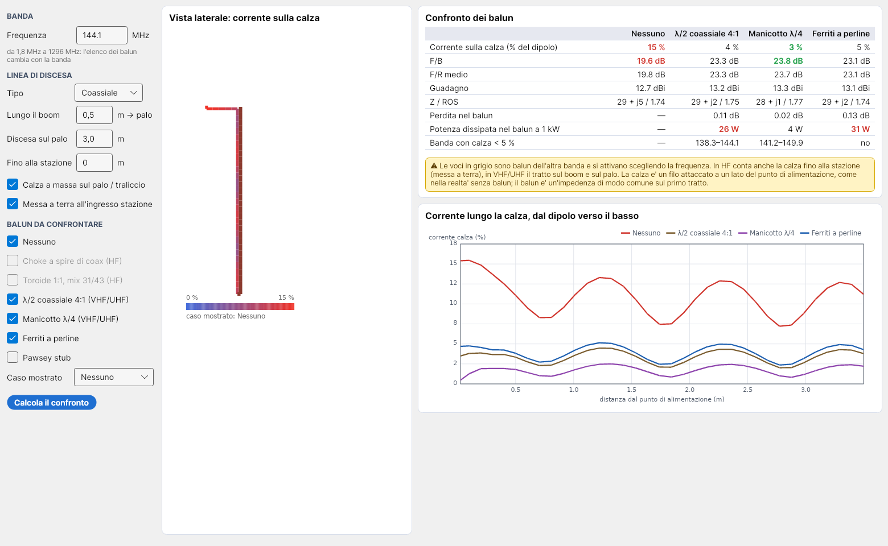

**Italiano** · [English](README.en.md) · [Français](README.fr.md) · [Deutsch](README.de.md) · [Español](README.es.md) · [Português](README.pt.md) · [日本語](README.ja.md) · [한국어](README.ko.md)

# YA-NEC

**Simulatore d'antenne a fili basato sul NEC-2**, per Windows, Linux e macOS (C#, .NET 8, Avalonia).
A cura di Costantino Cerrotta **IC8TEM**.

> *La storia di questo programma la farete voi: con i vostri progetti, con le vostre idee, con la vostra genialità, con le vostre scoperte e con le vostre certezze.*

Il motore è la traduzione in C# di **nec2c** (NEC-2 del Lawrence Livermore National Laboratory), confrontata a ogni collaudo con nec2c ed EZNEC. Apre i modelli **NEC (.nec)**, **MMANA (.maa)**, **AutoEZ (.weq)**, **EZNEC (.ez)**, **YO/AO di K6STI (.yag, .ant)** e il formato proprio **.yanec**.

Cosa c'è: impedenza, ROS, guadagno, diagrammi 2D e 3D, sweep in frequenza e carta di Smith; correzione di Leeson dei tubi telescopici come EZNEC; terreni (perfetto, coefficiente di riflessione, Sommerfeld, radiali); variabili, formule e ottimizzatore; calcolatori (Yagi DL6WU, Quagi, LPDA, Moxon, hexbeam, dipoli e Yagi multibanda, four-square, verticali, parabole e illuminatori, staffe degli elementi e molto altro); antenne riceventi e RDF; rumore, G/T e stack; abaco dei cavi, linee e balun; controllo dei dati inseriti. Ogni scelta di calcolo e ogni casella sono spiegate nel [manuale](doc/Manuale_d_uso.pdf), che è anche dentro il programma (linguetta Manuale). Altre informazioni nel [Wiki](https://github.com/ic8tem/YA-NEC/wiki).

## Immagini del programma

<table><tr><td width="50%" align="center"> Struttura 3D con le correnti e il lobo</td><td width="50%" align="center"> Terreno reale alla HFTA sul profilo DEM</td></tr><tr><td width="50%" align="center"> Ricezione: RDF, DMF e rumore</td><td width="50%" align="center"> Tolleranze costruttive (Monte Carlo)</td></tr><tr><td width="50%" align="center"> Cavo e balun: corrente di modo comune</td><td width="50%" align="center"> Yagi incrociate: RHCP, LHCP, rapporto assiale</td></tr><tr><td width="50%" align="center"> Calcoli meccanici: vento (NTC 2018)</td><td width="50%" align="center"> Divisori e cavi di fase</td></tr><tr><td width="50%" align="center"> Carichi HF: trappole e bobine</td><td width="50%" align="center"> Carta di Smith</td></tr></table>

## Novità della 1.7

- **Nuovi calcolatori**: Yagi HF 2-3 elementi con la guida di taratura, Yagi bibanda interlacciata, verticale trappolata multibanda, L invertita / T per i 160 m, half-sloper sul traliccio, dipolo a banda larga, dipolo multibanda a relè, carico lineare, filo risonante in armonica, gamma match e adattamento a stub con la carta di Smith.
- **Quad multibanda** con le linee delle bande non alimentate e le linee di disaccoppiamento; **loop magnetica** rettangolare, a spire in parallelo, con trasformatore e rete L; **Filari** con il materiale del filo e l'FT-82-43.
- **Stack** con l'area efficace; **ROS** che mostra da che lato sta R; **Terreno reale** con gli angoli di partenza verso un locatore; efficienza nei calcolatori con bobine e trappole; nuova linguetta **Consigli**.
- **1.7.1**: quote della Struttura 3D che si cliccano e si cambiano; nei Diagrammi la distanza di uno stack si cambia in diretta.
- **1.7.2 (sicurezza)**: l'aggiornamento automatico installa solo pacchetti con la firma di YA-NEC; i file preparati apposta non chiudono più il programma.

Le novità delle versioni precedenti (dalla 1.1 alla 1.6) sono nelle [note delle versioni](https://github.com/ic8tem/YA-NEC/releases), nel [Wiki](https://github.com/ic8tem/YA-NEC/wiki) e nel manuale.

## Scaricare

Dalla pagina **[Releases](https://github.com/ic8tem/YA-NEC/releases)** si scarica lo zip della propria piattaforma, lo si estrae in una **cartella scrivibile** (per esempio `C:\YA-NEC` o `~/YA-NEC`) e si avvia `YA-NEC.exe` (Linux e macOS: `YA-NEC`). Non serve installare .NET. Le impostazioni e i dati restano nella cartella `data` accanto al programma: niente AppData, niente registro di sistema.

| Sistema | Pacchetto |
|---|---|
| Windows 10/11 a 64 bit | `YA-NEC-<versione>-windows-x64-portatile.zip` |
| Windows 10/11 a 32 bit | `YA-NEC-<versione>-windows-x86-portatile.zip` |
| Windows su ARM (Snapdragon) | `YA-NEC-<versione>-windows-arm64-portatile.zip` |
| Windows 7 SP1, 8, 8.1 (.NET 6) | `YA-NEC-<versione>-windows7-x64-portatile.zip`, `-windows7-x86-portatile.zip` (servono gli aggiornamenti KB2533623 e KB2999226) |
| Linux x86_64 (Debian, Ubuntu, Mint, Fedora, openSUSE, Arch...) | `YA-NEC-<versione>-linux-x64.tar.gz` |
| Linux ARM64 (Raspberry Pi OS 64 bit, altri aarch64) | `YA-NEC-<versione>-linux-arm64.tar.gz` |
| Linux ARM 32 bit (Raspberry Pi OS 32 bit, armv7l) | `YA-NEC-<versione>-linux-armv7l.tar.gz` |
| Alpine e altri Linux con musl | `YA-NEC-<versione>-alpine-x64.tar.gz`, `-alpine-arm64.tar.gz` |
| macOS Apple Silicon (M1-M4) | `YA-NEC-<versione>-mac-apple-silicon-app.zip` |
| macOS Intel | `YA-NEC-<versione>-mac-intel-app.zip` |

Ogni zip ha accanto la sua impronta `.sha256`.

- **Linux**: dopo l'estrazione `chmod +x YA-NEC` se serve; occorrono `libfontconfig1` e `libicu` (già presenti nelle distribuzioni con desktop).
- **macOS**: il programma non è firmato da Apple. Dopo l'estrazione, nel Terminale: `xattr -dr com.apple.quarantine ~/YA-NEC` (la cartella estratta), poi `~/YA-NEC/YA-NEC`.

## Aggiornamento automatico

Il programma controlla 10 secondi dopo l'avvio e poi ogni 3 minuti se qui c'è una versione nuova. Se c'è, la scarica, ne verifica l'impronta SHA-256 e, dalla 1.7.2, la **firma di YA-NEC** (ECDSA P-256): senza firma o con firma sbagliata non installa niente. La versione nuova entra in funzione al riavvio, che il programma fa da solo riaprendo il modello; la precedente resta in `data/aggiornamenti/precedente-<versione>`, impostazioni e modelli non si toccano. Si spegne in **Impostazioni > Aggiornamento**.

**Eccezione: pacchetti Debian/Ubuntu (.deb) e Fedora/openSUSE (.rpm).** Quando ci saranno, si installeranno nelle cartelle di sistema con i permessi di amministratore: il programma non può (e non deve) cambiarsi da solo, quindi si aggiorneranno con il gestore dei pacchetti (`sudo apt update && sudo apt upgrade`, `sudo dnf upgrade`, `sudo zypper update`). In quei pacchetti l'aggiornamento automatico è spento e le Impostazioni lo dicono.

## Compilare dal sorgente

Serve il .NET 8 SDK. Windows: `compila.bat` (programma in `build\win-x64`), `compila.bat /distribuzione` per la versione autonoma, `compila_win7.bat` per Windows 7. Linux e macOS: `./compila.sh`. Dettagli in [LEGGIMI.txt](LEGGIMI.txt).

## Crediti e licenza

**GPL-3.0-or-later** (file [LICENSE](LICENSE); note di terze parti in [THIRD-PARTY-NOTICES.txt](THIRD-PARTY-NOTICES.txt)), come nec2c e xnec2c da cui deriva il motore. YA-NEC esiste grazie al lavoro di colleghi radioamatori e ricercatori: l'elenco completo è in [CREDITI.txt](CREDITI.txt) e nella linguetta **Crediti** del programma. Un ringraziamento a Luis IV3PRK per le pubblicazioni gratuite sul suo sito.

## Contatti

ic8tem@gmail.com · [QRZ](https://www.qrz.com/db/ic8tem) · [gruppo Facebook](https://www.facebook.com/groups/1675310160982493) · donazioni: [ko-fi.com/ic8tem](https://ko-fi.com/ic8tem)

