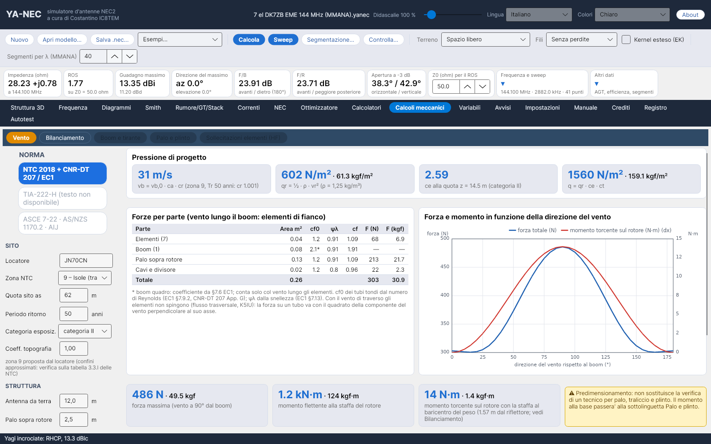

[Italiano](README.md) · [English](README.en.md) · [Français](README.fr.md) · [Deutsch](README.de.md) · [Español](README.es.md) · **Português** · [日本語](README.ja.md) · [한국어](README.ko.md)

# YA-NEC

**Simulador de antenas de fio baseado no NEC-2** para Windows, Linux e macOS (C#, .NET 8, Avalonia).
Por Costantino Cerrotta **IC8TEM**.

> *A história deste programa serão vocês a escrevê-la: com os vossos projetos, as vossas ideias, a vossa genialidade, as vossas descobertas e as vossas certezas.*

O motor é uma tradução em C# do **nec2c** (o NEC-2 do Lawrence Livermore National Laboratory), comparada em cada versão com o nec2c e o EZNEC. Abre modelos **NEC (.nec)**, **MMANA (.maa)**, **AutoEZ (.weq)**, **EZNEC (.ez)**, **YO/AO de K6STI (.yag, .ant)** e o formato próprio **.yanec**.

Funções: impedância, ROE, ganho, diagramas 2D e 3D, varrimento em frequência e carta de Smith; correção de Leeson para tubos telescópicos, como no EZNEC; solos (perfeito, coeficiente de reflexão, Sommerfeld, radiais); variáveis, fórmulas e otimizador; mais de 40 calculadoras (Yagi longa DL6WU, Quagi, LPDA, Moxon, hexbeam, dipolos e Yagis multibanda, four-square, verticais, parábolas e iluminadores, suportes dos elementos e mais); antenas de receção e RDF; ruído, G/T e agrupamento (stack); tabela de cabos, linhas de adaptação e baluns; verificação dos dados introduzidos. Cada escolha de cálculo e cada caixa de seleção são explicadas no [manual](doc/Manuale_d_uso.pdf), também disponível no programa (separador Manual). Mais informação no [Wiki](https://github.com/ic8tem/YA-NEC/wiki).

**Idioma:** a interface está disponível em 37 idiomas (menu Idioma, em cima à direita), e o Wiki também. O manual está em italiano.

## Imagens do programa

<table><tr><td width="50%" align="center"> Estrutura 3D com as correntes e o lóbulo</td><td width="50%" align="center"> Terreno real ao estilo HFTA sobre o perfil DEM</td></tr><tr><td width="50%" align="center"> Receção: RDF, DMF e ruído</td><td width="50%" align="center"> Tolerâncias de construção (Monte Carlo)</td></tr><tr><td width="50%" align="center"> Cabo e balun: corrente de modo comum</td><td width="50%" align="center"> Yagis cruzadas: RHCP, LHCP, razão axial</td></tr><tr><td width="50%" align="center"> Cálculos mecânicos: vento (NTC 2018)</td><td width="50%" align="center"> Divisores e cabos de fase</td></tr><tr><td width="50%" align="center"> Cargas HF: armadilhas e bobinas</td><td width="50%" align="center"> Carta de Smith</td></tr></table>

## Novidades da 1.5.7

- **Antenas de fio**: a bobina de carga é uma opção da EFHW (sim / não) e **Ajustar a bobina (NEC)** procura a indutância certa com contrapeso e solo.
- **Traduções**: os avisos laranja de todas as calculadoras agora são traduzidos, assim como os textos dos desenhos e do cálculo em tempo real.
- **Estrutura 3D**: o fio isolado já não é desenhado como uma fila de bobinas.

## Novidades da 1.5.6

- **Calculadoras > HF > Antenas de fio** (nova): antenas de fio alimentadas na ponta. EFHW multibanda, monobanda e com bobina (49:1 ou 64:1), fio não ressonante com 9:1 ou 4:1; seis disposições (inclinada para cima ou para baixo, vertical, L e U invertidos, reta); contrapeso de 0,05 λ ou malha do coaxial, capacitor, tensão na ponta, ROE por banda com o modelo TF5NN e com o NEC; **Ajustar o comprimento (NEC)**.
- **Botões de ligação**: das antenas de fio e das outras fichas de fio (dipolos, OCF/Windom, T2FD, G5RV, Delta, Quad, Loop, Skywire, Moxon, Hexbeam) abre-se já preenchida a ficha do balun, do choke (toroides FT), do quarto de onda (cabos RG) ou das cargas, com «‹ Voltar».
- **Discone**: passou da família HF para a família VHF.

## Novidades da 1.5.5

- **Calculadoras > HEN**: a ficha indica polarização horizontal, como a verificação NEC (antes dizia vertical).
- **Medidas VNA**: títulos, legenda e proposta de correção traduzidos (ficavam em italiano).
- **Videocurso**: 32 lições, com as novas 30 «Cabos e medidas com o VNA» e 31 «Outras calculadoras».

## Novidades da 1.5.4

- **Modelo escrito à mão**: os fios aplicados antes da fonte dão um aviso laranja na barra de estado, sem janela; as janelas de erro reais recebem o foco (Enter ou Esc as fecham).
- **Traduções**: página Boom (do levantamento ao modelo elétrico) traduzida para inglês.
- **Videocurso completo**: 30 lições gravadas com a 1.5.3-1.5.4, em italiano e inglês, com a nova lição 29 «Redimensionar e recentrar».

## Novidades da 1.5.3

- **Redimensionar e recentrar** (Variáveis e otimização): um modelo MMANA ou um projeto levado à frequência desejada com um clique; diâmetros em escala, iguais ou comerciais (varões maciços 3-6 mm, varões ou tubos 8-40 mm); o retoque do radiador anula a reatância.
- **Diagramas**: a primeira entrada chama-se **Lóbulos**, a aba Frequência passa a **Parâmetros**; **passo dos ângulos** adaptado ao computador; **Receção (RDF)** sobre o modelo aberto.
- **Correções**: quad de 2-3 elementos em Automático levada à ressonância pelo NEC (Cebik vale para o anel isolado); um só aviso para um modelo sem fonte; curso em vídeo regravado com a 1.5.3.

## Novidades da 1.5.2

- **Abas reorganizadas** (de 16 para 13): a carta de Smith na faixa dos Diagramas, **NEC/correntes**, **Variáveis e otimização**; distâncias de empilhamento VHF e HF + HFTA; nova ordem das famílias de Calculadoras.
- **Estrutura 3D**: linhas, cargas e redes desenhadas nos fios; a legenda do terreno abre-se em **Mostrar terreno** na barra de estado; cada erro em negrito e numa janela com OK. **Frequência**: bandas de radioamador no fundo dos gráficos.
- **Terreno real**: estado do cálculo e altitude do local à mão. **Otimizador**: **Medidas ao milímetro** (coordenadas e diâmetros comerciais, verificação NEC, lista de corte). Diagramas, gráficos e painéis traduzidos em 36 idiomas.

## Novidades da 1.5.1

- **Otimizador**: «+ adicionar variável» cria uma variável a partir do modelo (comprimento ou perímetro, posição, raio de cada elemento, também loops; altura da antena), com pré-visualização em ocre.
- **Variáveis**: à direita, a estrutura 3D mostra em ocre onde atua a variável escolhida.
- Correções e tradução inglesa concluída.

## Novidades da 1.5

- **Calculadoras**: os cálculos mecânicos passam para as Calculadoras; reatância do dipolo curto, dipolo dobrado em frequência, loop magnético de várias espiras com acoplamento capacitivo (Antenna Engineering Handbook, 4.ª ed.). **Distâncias de empilhamento HF** como item próprio.
- **Modelos AutoEZ, MultiNEC, EZNEC**: fontes «mark out», fios virtuais, transformadores, células calculadas; o .nec salvo escreve as fontes de corrente como as tensões calculadas.

## Novidades da 1.4.2

- **Calculadoras**: NVIS (altura ideal e tela de terra, segundo Cebik), casamento em grampo (beta), Quad com o método de Cebik e a ressonância NEC em VHF, J-pole com a Slim Jim.
- **Otimizador**: Monte Carlo com as tolerâncias de construção. **Stacks**: espaçamentos em duas frequências.
- **Configurações**: Forçar atualização, Relatar um problema.

## Novidades da 1.4

- **Documentos técnicos**: manual de uso, novo manual de cálculo e fontes e citações numeradas, cada um com índice e PDF; pesquisa nos três (documentos em italiano).
- **Distâncias de empilhamento**: ROE ativa e ganho realizado; distâncias com ROE ativa alta marcadas "não escolher".
- **Fechamento**: janela de confirmação com agradecimento.

## Novidades da 1.3

- **Antenas de receção**: nas Calculadoras ficam ativas **Dipolo baixo**, **K9AY** (terminação com «otimizar para F/B»), **4-square RX** e os agrupamentos **Hi-Z** de 2, 3 e 8 verticais, com a **fase entre filas** e o botão «otimizar a fase (RDF)». Cada item cria o modelo NEC e dá RDF, DMF, F/B e o lugar na classificação; um aviso amarelo lembra o limite do NEC-2 com fios ligados ao solo real.
- **Receção (RDF)**: as 8 verticais em círculo têm fase de 220 graus e o lóbulo para a frente.
- **Curso em vídeo**: lições 22 (Terreno real), 23 (Antenas de receção), 24 (Ferramentas VHF) e 25 (Cálculos mecânicos e cargas HF), em italiano e inglês com voz.
- **Idiomas**: os textos ainda não traduzidos aparecem em inglês em vez de italiano.
- **Correções**: Cargas HF já não fecha ao passar para «Bobina de carga»; um clique noutro item com o cursor num campo já não fecha o programa; os avisos das antenas de receção já não se acumulam; as janelas largas já não saem pela direita.
- Tudo no capítulo 24 do manual, com as fontes (K9AY, Hi-Z Antennas, IV3PRK, ON4UN, W7EL).

## Novidades da 1.2

- **Terreno real** (como o HFTA de N6BV): diagrama de elevação sobre o perfil verdadeiro do terreno, a partir do DEM **TINITALY** (Itália, 10 m) ou **SRTM1** (mundo), de um ficheiro do HorizonProfiler ou plano. Reflexões troço a troço ponderadas pelas zonas de Fresnel, difração nas cristas, mar, Terra curva; direções de tráfego a partir do locator (até 12 caracteres) e **mapa** com foto aérea, OpenStreetMap e grelha de locators. Em VHF vista completa e zoom 0-15 graus.
- **Receção (RDF)**: RDF, DMF, F/R médio, ruído da antena (UIT-R P.372) e margem do recetor para Beverage, BOG, K9AY, Flag, EWE, 4-square e 8 verticais em círculo.
- **Medições VNA**: ficheiros .s1p e CSV sobre o cálculo, com o cabo retirado (de-embedding), carta de Smith e correção proposta.
- **Tolerâncias de construção**: Monte Carlo repetível, sensibilidade por elemento e lista de corte com a tolerância admitida.
- **Cálculos mecânicos** (novo separador): **vento** segundo NTC 2018, CNR-DT 207 e EN 1991-1-4 (zona a partir do locator, escoamento transversal) e **equilíbrio** no mastro; forças em N e kgf.
- **Cabo e balun** de 1,8 a 1296 MHz (a malha torna-se um fio NEC), **estrutura em H e mastro** no agrupamento, **divisores** λ/4 e Wilkinson com desenho 1:1, **Yagis cruzadas** (RHCP, LHCP, X-pol), **cargas HF** (armadilhas coaxiais W8NX, bobinas, linear loading), **F/R médio** também no otimizador e **teste AGT** automático.
- Tudo explicado no capítulo 23 do manual, com as fontes; novos itens traduzidos nas 37 línguas.

## Novidades da 1.1

> **Nota do autor.** Nesta versão pensei muito sobre a temperatura de ruído. Indicaram-me estudos em MATLAB sobre o empilhamento de antenas diretivas e quis experimentar logo: oferecer a quem usa o YA-NEC a possibilidade de ir além da distância de empilhamento de DL6WU (a fórmula trigonométrica) e acompanhá-lo, se quiser, na escolha de uma distância de empilhamento só sua. E, com isso, uma revisão profunda da interface. — *Costantino IC8TEM*

- **Ruído do céu real.** Nova página no super-separador **Ruído/GT/Empilhamento**: o diagrama da antena ou do empilhamento é colocado sobre o mapa real do céu (levantamento a 408 MHz de Haslam, reprocessado por Remazeilles, levado a 144 e 432 MHz por G8ONH), a partir do seu QTH (locator ou coordenadas) à hora escolhida, apontando para onde quiser, para a Lua ou para o ponto de céu mais frio. Dois G/T lado a lado: com céu uniforme, comparável com as tabelas de VE7BQH (30 graus, empilhamento 2 x 2 à distância DL6WU), e com o céu real, com a curva da temperatura de antena em 24 horas e o seu mínimo e máximo. O cálculo é o do **skynoise de John C. Sager G8ONH** (licença MIT), portado para C#.
- **Distância de empilhamento escolhida com o NEC.** Na página **Distâncias de empilhamento** (retirada das Calculadoras) o empilhamento é realmente calculado para uma série de distâncias em torno da de DL6WU: ganho, lóbulo lateral mais alto, G/T e matriz de acoplamento entre portas (S11, S21...). Um critério escolhe a distância proposta (ganho máximo, lóbulos mais baixos, melhor G/T, ou ganho com lóbulos abaixo de um limiar) e um botão usa-a para criar o empilhamento. Em **HF** a fórmula de DL6WU não se aplica: o empilhamento acima do solo escolhe-se pelos ângulos de partida desejados, com diagramas em elevação em fase (BIP), isoladas e em contrafase (BOP).
- **Calculadoras por famílias.** Uma barra sob os separadores divide as calculadoras em **HF**, **VHF**, **Antenas recetoras** (já não é um separador à parte), **Ferramentas**, **Parábolas e alimentadores** e **2,4 GHz**; a lista à esquerda mostra só a família escolhida.
- **Medidas nos diagramas.** Além da abertura a -3 dB: abertura ao primeiro nulo (FNBW), lóbulo lateral mais alto (SLL) e dois cursores C1 e C2 colocados com um clique, com nível, ângulo e diferença entre ambos.
- **F/B ao longo do eixo** corrigido para modelos em espaço livre com o feixe ao longo do eixo Z (como a Yagi do MathWorks Antenna Toolbox).
- **Novas calculadoras**: biquad e biquad dupla (alimentadores de parábola), Big Wheel e três dipolos, anel horizontal multibanda (Skywire) com a perda da linha em cada banda.
- **Traduções**: todas as entradas novas nos 37 idiomas do programa. **Curso em vídeo** atualizado com lições sobre os novos temas.

## Transferir

Na página **[Releases](https://github.com/ic8tem/YA-NEC/releases)** transfere-se o zip da sua plataforma, extrai-se para uma **pasta com permissão de escrita** (por exemplo `C:\YA-NEC` ou `~/YA-NEC`) e executa-se `YA-NEC.exe` (Linux e macOS: `YA-NEC`). Não é preciso instalar o .NET. As definições e os dados ficam na pasta `data` ao lado do programa: nada no AppData nem no registo.

| Sistema | Pacote |
|---|---|
| Windows 10/11 64 bits | `YA-NEC-<versão>-windows-x64-portatile.zip` |
| Windows 10/11 32 bits | `YA-NEC-<versão>-windows-x86-portatile.zip` |
| Windows em ARM (Snapdragon) | `YA-NEC-<versão>-windows-arm64-portatile.zip` |
| Windows 7 SP1, 8, 8.1 (.NET 6) | `YA-NEC-<versão>-windows7-x64-portatile.zip`, `-windows7-x86-portatile.zip` (requer as atualizações KB2533623 e KB2999226) |
| Linux x86_64 | `YA-NEC-<versão>-linux-x64.tar.gz` |
| Linux ARM64 (Raspberry Pi OS 64 bits, outros aarch64) | `YA-NEC-<versão>-linux-arm64.tar.gz` |
| Linux ARM 32 bits (Raspberry Pi OS 32 bits, armv7l) | `YA-NEC-<versão>-linux-armv7l.tar.gz` |
| Alpine e outros Linux com musl | `YA-NEC-<versão>-alpine-x64.tar.gz`, `-alpine-arm64.tar.gz` |
| macOS Apple Silicon (M1-M4) | `YA-NEC-<versão>-mac-apple-silicon-app.zip` |
| macOS Intel | `YA-NEC-<versão>-mac-intel-app.zip` |

Cada zip vem acompanhado da sua impressão digital `.sha256`.

- **Linux**: depois de extrair, `chmod +x YA-NEC` se necessário; são precisos `libfontconfig1` e `libicu` (já presentes nas distribuições com ambiente gráfico).
- **macOS**: o programa não está assinado pela Apple. Depois de extrair, no Terminal: `xattr -dr com.apple.quarantine ~/YA-NEC` (a pasta extraída) e depois `~/YA-NEC/YA-NEC`.

## Atualização automática

A cada 30 minutos o programa verifica em silêncio se há aqui uma versão nova. Se houver, transfere o zip da sua plataforma, verifica a impressão digital SHA-256 e instala-o: a nova versão arranca **no próximo arranque**, com uma mensagem na barra de estado. A versão anterior fica em `data/aggiornamenti/precedente-<versão>`; as definições (`data/config.ini`) e os modelos do utilizador não são tocados. Sem impressão digital, ou com uma diferente, nada é instalado. A atualização desliga-se em **Definições > Atualização**.

**Exceção: pacotes Debian/Ubuntu (.deb) e Fedora/openSUSE (.rpm).** Quando existirem, instalar-se-ão em pastas do sistema com permissões de administrador, pelo que o programa não pode (nem deve) alterar-se sozinho: serão atualizados com o gestor de pacotes. Nesses pacotes a atualização automática está desligada e as Definições indicam-no.

## Compilar a partir do código-fonte

É necessário o SDK do .NET 8. Windows: `compila.bat` (programa em `build\win-x64`), `compila.bat /distribuzione` para a versão autónoma, `compila_win7.bat` para o Windows 7. Linux e macOS: `./compila.sh`. Pormenores em [LEGGIMI.txt](LEGGIMI.txt) (em italiano).

## Créditos e licença

**GPL-3.0** ([LICENSE](LICENSE), [THIRD-PARTY-NOTICES.txt](THIRD-PARTY-NOTICES.txt)), como o nec2c e o xnec2c, dos quais deriva o motor. O YA-NEC existe graças ao trabalho de radioamadores e investigadores: a lista completa está em [CREDITI.txt](CREDITI.txt) e no separador **Créditos**. Obrigado a Luis IV3PRK pelas publicações gratuitas no seu site.

## Contactos

ic8tem@gmail.com · [QRZ](https://www.qrz.com/db/ic8tem) · [grupo do Facebook](https://www.facebook.com/groups/1675310160982493) · donativos: [ko-fi.com/ic8tem](https://ko-fi.com/ic8tem)
