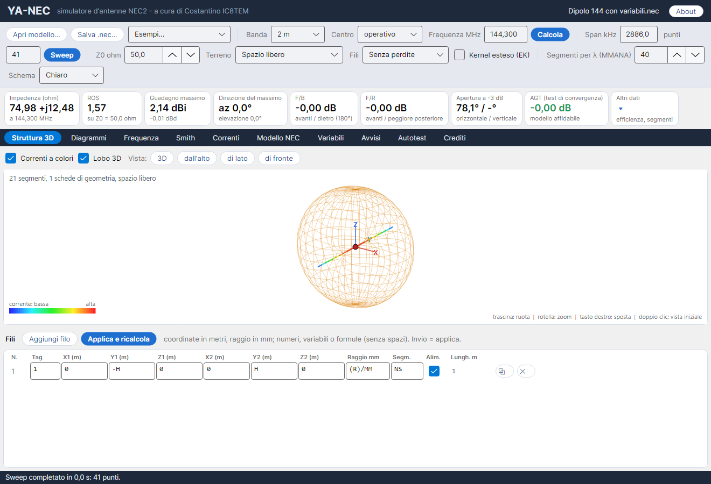
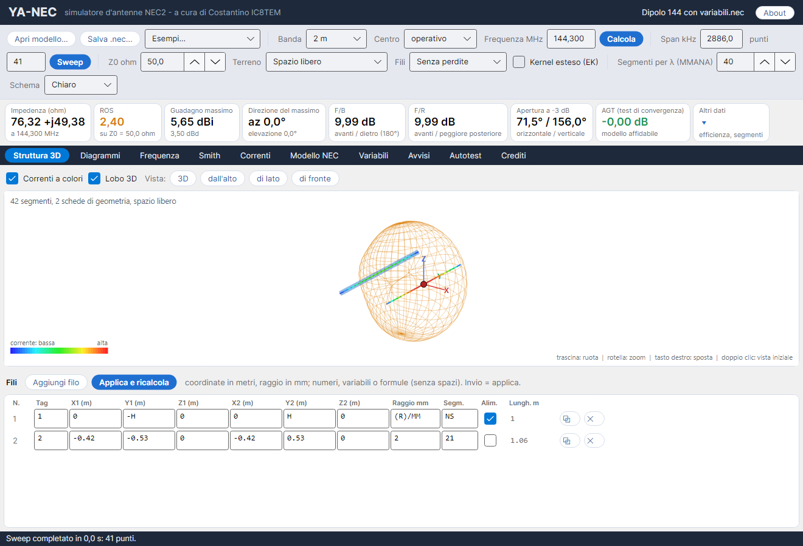
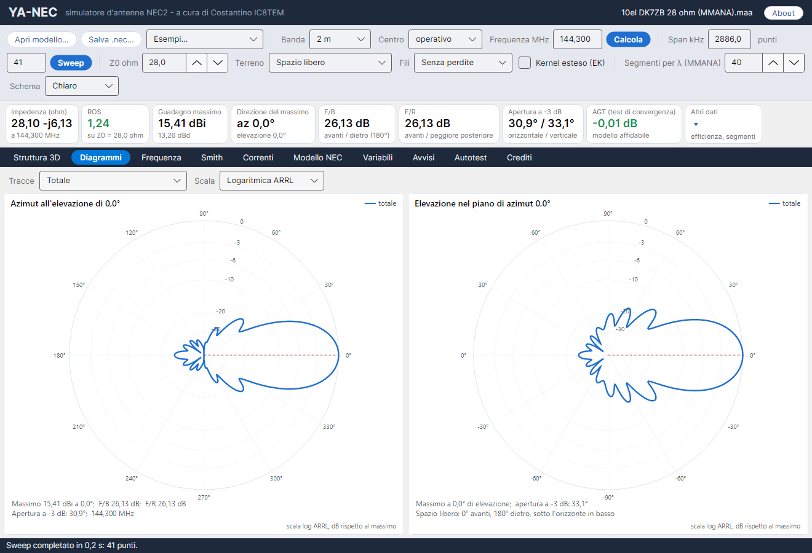
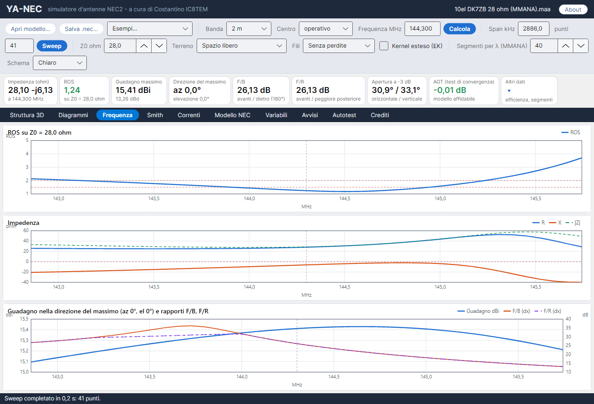
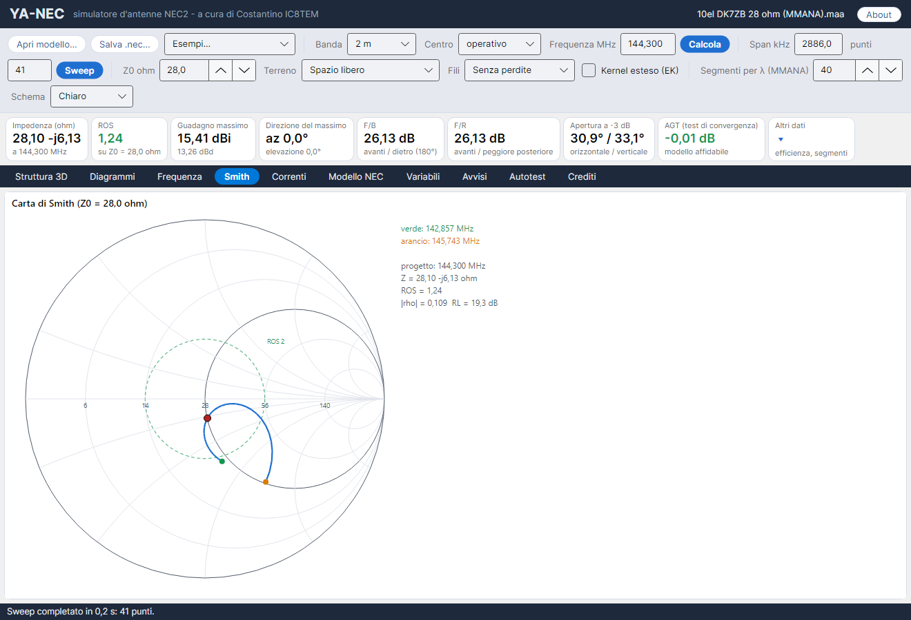
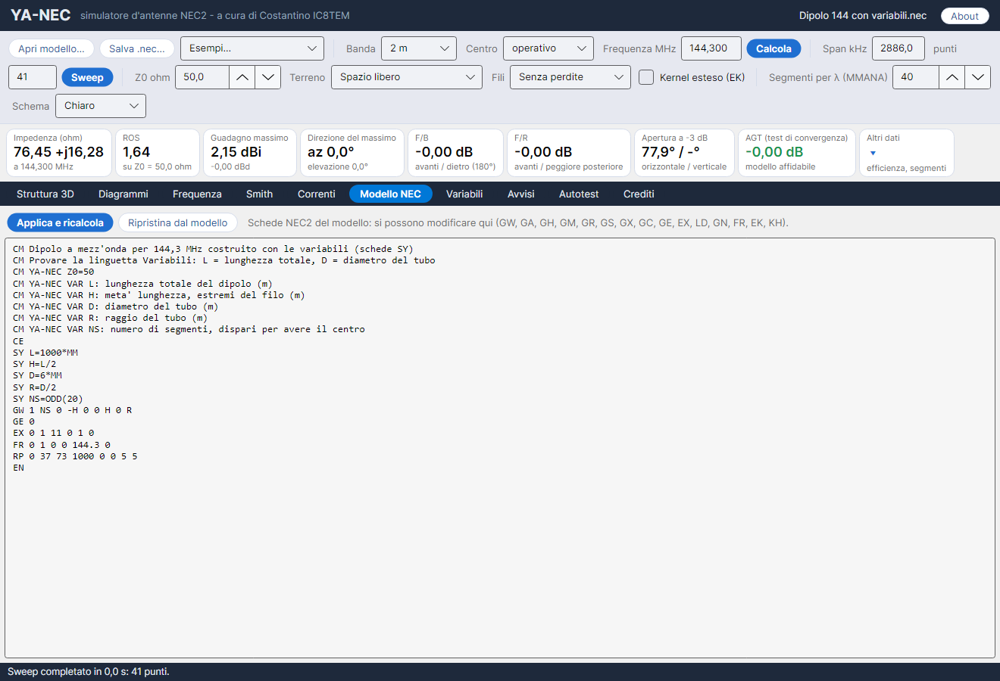
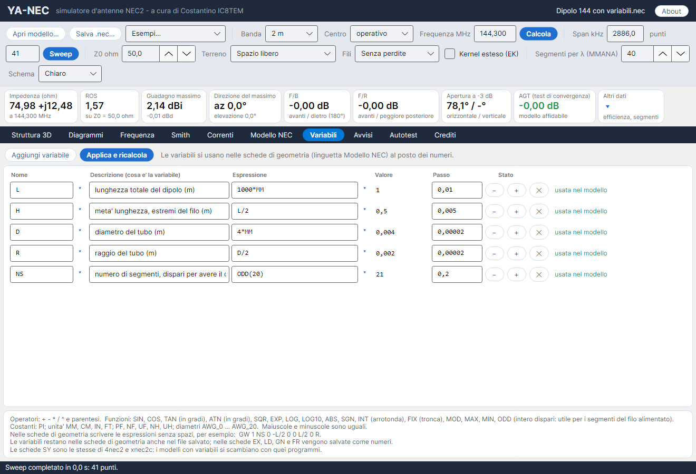
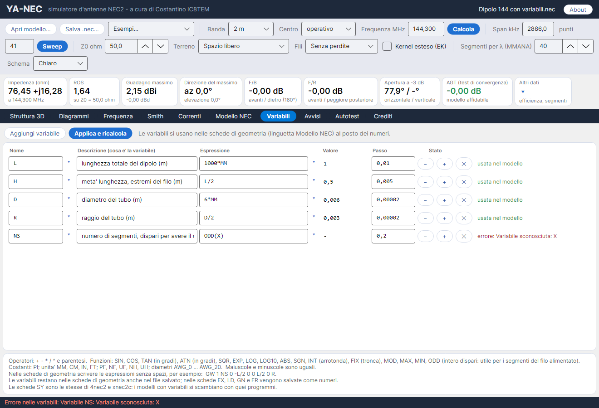

# YA-NEC - Manuale d'uso

## 1. Che cos'e' YA-NEC

> *La storia di questo programma la farete voi: con i vostri progetti, con le vostre idee, con la vostra genialità, con le vostre scoperte e con le vostre certezze.*

YA-NEC ("Yet Another NEC") e' un simulatore di antenne a fili basato sul NEC2, il metodo dei momenti del Lawrence Livermore National Laboratory. Il motore di calcolo e' la traduzione in C# di nec2c (Neoklis Kyriazis 5B4AZ), verificata punto per punto contro nec2c sui modelli di prova del documento di referenze. Il programma gira su Windows, Linux e Mac (.NET 8, Avalonia) e apre i modelli NEC2 (.nec), MMANA (.maa), AutoEZ/MultiNEC (.weq) ed EZNEC (.ez).

Le idee di alcune funzioni (variabili, oggetti inseriti, test di convergenza, terreni tipici) vengono da AutoEZ di Dan Maguire AC6LA: sono state riprese le idee, non il codice.

### MININEC e NEC-2: commento dall'analisi delle fonti

YA-NEC calcola con il NEC-2 (nec2c) e non ha un motore MININEC. I due metodi risolvono lo stesso problema (correnti su fili sottili, metodo dei momenti) in modo diverso, e molti programmi da radioamatore usano il MININEC (MMANA e MMANA-GAL, ELNEC, il motore MININEC di EZNEC, AO, NEC4WIN). Confronto delle fonti:

| Aspetto | MININEC (J. C. Logan e J. W. Rockway, NOSC, dal 1982) | NEC-2 (G. J. Burke e A. J. Poggio, LLNL, 1981) | Fonte |
|---|---|---|---|
| Dove si calcola la corrente | impulsi di corrente sulle giunzioni tra due segmenti; sorgenti e carichi stanno sulle giunzioni (dipolo alimentato al centro: segmenti pari) | al centro di ogni segmento, con tre termini (costante, seno, coseno); sorgenti e carichi sul segmento (dipolo: segmenti dispari) | Cebik, "Under the Limits: MININEC" (amod2); guida del NEC-2 |
| Terreno reale | impedenza e correnti come su terreno perfetto; costante dielettrica e conducibilita' servono solo al diagramma | Sommerfeld-Norton (GN 2): l'impedenza sente il terreno; radiali anche a pochi cm | Cebik amod2 e amod99 |
| Fili bassi | inaffidabile per fili orizzontali o inclinati sotto circa 0,2 lambda | affidabile molto piu' in basso (limiti al capitolo 11) | Cebik amod2, amod56 |
| Segmentazione | almeno 10 segmenti per mezza lunghezza d'onda, il doppio per antenne complesse; agli angoli servono molti segmenti o la rastremazione (MMANA la fa da se') | segmenti tra lambda/1000 e lambda/10, simili alle giunzioni | Cebik amod2; guida del NEC-2 |
| Frequenza | con il MININEC 3.13 originale la risonanza si sposta verso l'alto con la frequenza (circa 150 kHz, lo 0,5 %, a 28,5 MHz), corretto nelle versioni piu' recenti | riferimento del confronto | Cebik amod2 |
| Diametri a gradini | risultati accurati senza correzioni | serve la correzione di Leeson (YA-NEC la fa come EZNEC, capitolo 21) | Cebik, "When MININEC is Superior to NEC" (amod56) |
| Fili vicini di diametro diverso, giunzioni ad angolo tra diametri diversi | meglio del NEC-2 (folded dipole a salire: MININEC 530 ohm, come atteso; NEC-2 375 ohm) | errori frequenti; YA-NEC li segnala negli avvisi | Cebik amod56 |
| Dimensione dei modelli | storicamente 128-256 impulsi | migliaia di segmenti, superfici (patch), linee e reti (TL, NT), terreni a radiali (GN con NRADL) | Cebik amod2; guida del NEC-2 |

**Somiglianze.** Per una grande classe di antenne (Yagi monobanda alte, dipoli, verticali su terreno perfetto) i due metodi danno gli stessi risultati entro le tolleranze di costruzione: per Cebik "both NEC and MININEC are equally apt". Tutti e due chiedono fili sottili, segmenti non troppo corti e una prova di convergenza.

**Differenze che contano per YA-NEC.** Il MININEC e' piu' robusto dove il NEC-2 e' debole (diametri a gradini, diametri diversi vicini o ad angolo), ma non sa calcolare l'impedenza su terreno reale: per le verticali, i radiali, le antenne basse e le Beverage il NEC-2 con Sommerfeld e' l'unico dei due che risponde. Il NEC-2 ha poi i modelli grandi (parabole a superfici, stack, LPDA con le linee), le reti e il codice pubblico (nec2c).

**Scelta di YA-NEC.** Il motore resta il NEC-2; le sue debolezze si coprono come fa EZNEC: correzione di Leeson per i tubi telescopici, avvisi sulle giunzioni e sui fili vicini, verifica della segmentazione, AGT. Il "terreno MININEC" (GN 3, capitolo 11) c'e' solo per leggere e confrontare i file di EZNEC con quel terreno: le correnti restano quelle del NEC-2. I file MMANA si leggono risegmentati per il NEC-2 (capitolo 10).

## 2. Compilazione e collaudo

Serve il .NET 8 SDK (o successivo). Su Windows basta un doppio clic su `compila.bat` (su Linux e Mac `./compila.sh`). **Collaudo rapido:** `collaudo_rapido.bat` fa solo le prove che servono quando cambia la correzione dei tubi telescopici: compilazione, 2A autotest, 2B tutte le procedure, 2J archivio, 2K-2L elementi a gradini e 2L bis taratura, con i valori di EZNEC salvati (EZNEC non si apre), circa 20 minuti; salta interfaccia, Butternut, modelli pesanti e sensibili, calcolatori con EZNEC e varianti vicino al terreno. Prima di una pubblicazione con modifiche all'interfaccia resta il collaudo completo (`collaudo_automatico.bat`). **Windows 7 SP1, 8 e 8.1:** `compila_win7.bat` prepara `pubblicazione\YA-NEC-<versione>-win7-x64.zip` e `-win7-x86.zip` (con l'impronta .sha256), compilati con .NET 6 autonomo, l'ultimo che gira su Windows 7 (.NET 8 non parte: manca GetSystemTimePreciseAsFileTime), come YA-MS ed E-LAYER ANALYZER. Sul PC con Windows 7 non serve installare .NET; servono SP1 e gli aggiornamenti KB2533623 e KB2999226. Lo zip si estrae in una cartella e si avvia YA-NEC.exe; l'aggiornamento automatico scarica il pacchetto win7. Basta l'SDK 8: la prima volta i pacchetti di .NET 6 si scaricano da NuGet. Il collaudo ha 3 fasi e una sola pausa, alla fine:

| Fase | Cosa fa |
|---|---|
| 1 Compilazione | controlla il .NET SDK e compila; mostra gli avvisi del compilatore; se non riesce mostra le righe di errore (resoconto completo in compila_log.txt); controlla programma, modelli, cavi e manuale |
| 2 Collaudo | tutto di seguito: 2A autotest del motore contro nec2c (vedi Referenze), 2B procedure delle funzioni senza finestra, 2C prove dell'interfaccia (il programma si usa da solo e salva un'immagine a ogni passo; in ogni linguetta e sottolinguetta mostra tutti i fumetti, preme tutti i pulsanti tranne quelli che aprono finestre di file o siti, cambia tutte le caselle e le rimette, e apre tutti i modelli fino a 3000 segmenti); 2D la Butternut con 64 radiali: YA-NEC si riapre e la carica per ultima, solo se 2A, 2B e 2C sono superati (modello corretto, 1453 segmenti, confrontato con nec2c); 2E i 3 modelli piu' pesanti senza finestra (vecchia Butternut da 7877 segmenti tenuta solo per i tempi, Bowtie 91XG da 5327, 4x2SA13 da 4288): impedenza come nec2c e tempi di ogni fase del motore, vedi sotto; in fondo l'elenco dei passi con AVVISO o ERRORE, ognuno con la procedura, il passo, l'atteso e l'ottenuto |
| 3 Riepilogo | esito di ogni parte, durata, creazione di yanec-collaudo-<versione>.zip (resoconto, compila_log.txt e tutti i registri) |

| Comando | Compilazione | Programma in |
|---|---|---|
| compila.bat | veloce (usa il .NET installato, meno di un minuto) | build\win-x64\YA-NEC.exe |
| compila.bat /distribuzione | autonoma (gira anche dove .NET non c'e', qualche minuto) | pubblicazione\win-x64\YA-NEC.exe |
| compila.bat /completo | collaudo di tutto: ogni linguetta, fumetto, pulsante, casella e modello (piu' di mezz'ora); senza /completo solo le prove brevi (pochi minuti). Si puo' unire a /distribuzione | come sopra |
| prova_tutto.bat | compila.bat /completo: tutte le prove in coda, EZNEC compreso (circa un'ora) | build\win-x64\YA-NEC.exe |
| prova_senza_eznec.bat | tutte le prove, ma con i risultati di EZNEC salvati in data\prove (EZNEC non si apre, 15-20 minuti): per le modifiche al motore | build\win-x64\YA-NEC.exe |
| prova_mirata.bat | compila.bat /mirato, con EZNEC vero: solo i modelli NEC che escono dalle schede dei Calcolatori (2G-2H, anche le varianti nuove: Yagi DL6WU con le quattro alimentazioni, quad, loop Yagi da 6 e 12 piedi) e i modelli d'archivio che non stavano entro lo 0,1 % da EZNEC (2I-2J, elenco in data\prove\eznec_archivio\mirati.txt) con i loro elementi a gradini (2K-2L); circa 20-25 minuti | build\win-x64\YA-NEC.exe |
| compila_senza_collaudi.bat | compila.bat /distribuzione /solo: solo la versione autonoma e il pacchetto da dare ad altri (con il suo resoconto, compila_distribuzione.txt, senza toccare lo zip del collaudo) | pubblicazione\win-x64\YA-NEC.exe |
| collaudo_automatico.bat | collaudo **senza presidio**: chiede una conferma (dopo 30 secondi parte da solo), poi fa compila.bat /completo con EZNEC vero senza mai fermarsi. Alla fine scrive ESITO.txt (SUPERATO o NON SUPERATO, riepilogo delle fasi, passi con ERRORE o AVVISO) e lo mette nello zip del collaudo. **Solo se il collaudo e' superato** prepara il pacchetto da pubblicare (compila.bat /distribuzione /solo), che resta in pubblicazione\ e non viene pubblicato. Con /spegni il PC si spegne 2 minuti dopo la fine (shutdown /a per annullare). Circa un'ora e mezza | build\win-x64 e pubblicazione\win-x64 |

> NOTA: Durante le prove dell'interfaccia (anche piu' di mezz'ora) non toccare mouse e tastiera: la finestra si chiude da sola. Su Linux e Mac: `./compila.sh` e `./compila.sh --distribuzione`. Il file da mandare a chi sviluppa e' **yanec-collaudo-<versione>.zip**.

**Fase 2E, i modelli pesanti.** Serve a capire dove va il tempo sui modelli grandi e se conviene riscrivere una parte del motore. Per ogni modello il resoconto (data\prove_pesanti.txt) da' l'impedenza confrontata con nec2c, il numero di segmenti, la simmetria usata, la memoria della matrice (16 byte per elemento: N x N numeri complessi), i tempi delle fasi (tabelle di Sommerfeld, riempimento della matrice, fattorizzazione LU, soluzione, diagramma 3D a 5 gradi) e la **resa della fattorizzazione in GFLOPS** (miliardi di operazioni al secondo: una LU complessa fa circa 8 N^3 / 3 operazioni reali). In fondo una **prova di riferimento** misura quanti GFLOPS il computer da' con un prodotto di matrici complesse a blocchi, in parallelo e con le istruzioni vettoriali del processore: il rapporto fra i due numeri dice quanto si guadagnerebbe riscrivendo la fattorizzazione a blocchi. La tabella "Dove va il tempo" mette le fasi in percentuale e misura come cresce il tempo con N (teoria: N^3 per la fattorizzazione, N^2 per il riempimento). Patch.nec di 4nec2 (39020 segmenti) non si prova: la sola matrice chiederebbe circa 24 GB.

**compila.bat razionalizzato.** Ogni prova della fase 2 passa da un solo sottoprogramma (`:prova`: avvia YA-NEC con i suoi argomenti, accoda il resoconto, scrive l'esito); prima ogni prova ripeteva le stesse righe. compila.sh (Linux e Mac) fa lo stesso con la funzione `prova` e ha anche /completo (`--completo`), 2D e 2E.

**Fasi 2F, 2G e 2H.** Dopo i modelli pesanti:

| Fase | Cosa fa | Perche' |
|---|---|---|
| 2F modelli sensibili e aggressivi (`--prove-sensibili`, data\prove_sensibili.txt) | 14 modelli dell'archivio scelti dalla prova 6 con EZNEC: i piu' grandi (stack da 927 e 604 segmenti, Butternut corretta da 1431 con Sommerfeld e mozzo), i diametri a gradini (Leeson), i carichi, il terreno GN 0, la four-square. Per ognuno: YA-NEC come nec2c entro lo 0,05 %, la LU a blocchi come la LU classica entro 1e-8, e la **calibrazione con EZNEC**: il valore che IC8TEM ha misurato con EZNEC Pro/2+ 7.0, con lo stesso terreno, entro lo 0,5 % (1 % con i diametri a gradini, dove EZNEC usa la sua correzione). In fondo i sei controlli geometrici su tre modelli che EZNEC ferma e tre che calcola | sono i modelli dove un cambiamento del motore si vede per primo; la calibrazione lega YA-NEC a EZNEC e non solo a nec2c. Solo se 2A, 2B e 2C sono superate |
| 2G modelli dei calcolatori (`--esporta-eznec`, data\eznec_calcolatori) | il modello NEC di ogni sottolinguetta HF e VHF con i valori iniziali della scheda (forme semplici, schiere, satelliti, LPDA 144-432 e 13,5-30 MHz, loop magnetica, antenne riceventi a 1,83 e 3,6 MHz) salvato in .nec e in .ez; il .ez si **rilegge subito e si ricalcola**: se l'impedenza non torna entro lo 0,5 % il salvataggio e' un errore (un avviso se il .ez non puo' contenere una parte del modello, scritta nel resoconto: per esempio le terminazioni delle linee). Il file riferimento_YA-NEC.csv ha impedenza, guadagno, F/B ed efficienza di YA-NEC per ogni modello | i modelli che YA-NEC crea vanno provati in EZNEC per la calibrazione finale (IC8TEM: "mi raccomando al salvataggio ez") |
| 2H prove con EZNEC (tools\eznec\confronta_eznec.ps1) | EZNEC calcola i modelli della 2G con lo script del confronto: lo apre da solo se non e' aperto, legge le finestre Segmentation Check e Geometry Check (File > Save As in un file temporaneo) e mette i risultati in eznec-confronto-<data>.zip, che entra nello zip del collaudo con il riferimento di YA-NEC. Poi `YA-NEC.exe --confronta-eznec` mette a confronto EZNEC e YA-NEC modello per modello (confronto_eznec.txt): OK entro lo 0,5 % sull'impedenza; AVVISO quando la differenza viene da una parte che il .ez non contiene (stub della LPDA, conducibilita' per filo della loop: allora EZNEC deve coincidere con il .ez riletto da YA-NEC); ERRORE se EZNEC non lo calcola o differisce senza ragione nota. Sempre in automatico; senza EZNEC la fase dice "non eseguite" e il resto del collaudo vale lo stesso | il confronto si fa con lo stesso programma e la stessa procedura delle prove 5 e 6 |
| 2I e 2J, archivio con EZNEC | EZNEC calcola di nuovo i 460 modelli d'archivio che non combaciavano oltre lo 0,1 % (data\prove\eznec_archivio, prova 8), poi YA-NEC li rilegge con il suo lettore .ez, li calcola e li confronta con i valori di EZNEC appena calcolati (se EZNEC non c'e', con quelli della prova 6). I modelli che EZNEC ferma per geometria si controllano con le sei regole del Geometry Check di YA-NEC |
| pulizia dell'archivio | prima della 2I compila.bat cancella dalla cartella data\prove\eznec_archivio i .ez che non sono in elenco_modelli.txt, l'elenco dei modelli del sorgente, e li scrive nel resoconto | lo zip nuovo estratto sopra una cartella vecchia lascerebbe i modelli tolti |
| 2K e 2L, elementi a gradini con EZNEC | ogni elemento a tubi telescopici dei modelli d'archivio (catene di tubi in fila con almeno due diametri) si scrive da solo in un .ez: spazio libero, sorgente al centro, stessa testata del file d'origine (cosi' EZNEC usa la stessa Stepped Diameter Correction del modello). Gli elementi uguali (stessi tubi e stessa frequenza) si provano una volta sola. EZNEC li calcola (2K, circa 30 minuti), poi `YA-NEC.exe --confronta-gradini` mette accanto tre calcoli di YA-NEC: **L** com'e' (Leeson come nel motore: sempre sotto la risonanza, sopra entro il 45 %), **F** Leeson forzato anche lontano dalla risonanza, **0** senza correzione. Verdetto: "come YA-NEC" (L entro lo 0,5 %), "EZNEC corregge anche lontano dalla risonanza", "EZNEC non corregge", "EZNEC corregge diversamente" (con lo scarto per fasce di f/fs). Segue la fase **2L bis**, taratura di Leeson sotto la risonanza (`--tara-gradini`, taratura_gradini.txt: proposta di due numeri, il motore non cambia) | sul modello intero non si vede quale elemento sbaglia; elemento per elemento si ricavano le regole di EZNEC |
| 2M e 2N, varianti vicino al terreno con EZNEC | i 7 modelli d'archivio con terreno di Sommerfeld dove YA-NEC e nec2c concordano ma EZNEC si scosta del 2-6 % (ElevatRad, ELEVRAD1, ELEVRAD2, GndScreen, wa2wvl, i due 80hsbeam) vanno a EZNEC in quattro varianti: **A** originale; **B** ogni estremo con quota tra 0 e lambda/100 portato a lambda/100 (le giunzioni restano: estremi uguali restano uguali; non si applica ai due 80hsbeam e a wa2wvl, che sono gia' sopra); **C** segmenti raddoppiati su tutti i fili; **D** terreno "MININEC" al posto di "High Accuracy". YA-NEC calcola le stesse varianti con c = 299,792458 come EZNEC. Verdetto per modello: QUOTA se in B concordano entro l'1 %, SEGMENTAZIONE se in C lo scarto almeno si dimezza, TERRENO se in D concordano; altrimenti "serve un'altra variante" | spiegare lo scarto residuo prima di correggere il motore |
| prova_tutto.bat | un solo bat con tutte le prove in coda (compila.bat /completo), che non si ferma se una fase non e' superata e produce un solo zip, yanec-collaudo-<versione>.zip, con resoconto, registri e confronti con EZNEC |
| Confronto d'archivio (a mano: YA-NEC.exe --confronta-archivio <cartella>) | i soli modelli d'archivio oltre lo 0,1 % da EZNEC si rileggono con il lettore .ez di YA-NEC e si calcolano; lo scarto sull'impedenza della prima sorgente rispetto ai valori di EZNEC gia' misurati va in confronto_archivio.txt e .csv, con le classi 0,1 / 0,5 / 2 %. EZNEC non serve; il pacchetto ha confronta_archivio.bat |

Durante la 2H non usare mouse, tastiera e copia/incolla: lo script legge le finestre di EZNEC.

**LU a blocchi.** La fattorizzazione della matrice, l'88 % del tempo sui modelli grandi, e' riscritta nella forma a blocchi di LAPACK (zgetrf): per ogni blocco di 64 colonne si fattorizza il pannello, si applicano gli scambi di riga, si risolve la parte triangolare e si aggiorna il resto della matrice con un prodotto di matrici, a riquadri di 256 righe e 4 colonne tenuti nei registri del processore con le istruzioni AVX2/FMA (due numeri complessi per istruzione; senza AVX2 lo stesso conto senza istruzioni vettoriali). Lo stesso risultato della LU colonna per colonna di nec2c a meno degli arrotondamenti (la 2E e la 2F lo controllano: scarto sotto 1e-8). Prova dell'algoritmo in C++ prima della scrittura in C#: 23 GFLOPS su un solo processore del computer di prova (la LU colonna per colonna da' 11 GFLOPS su quattro processori di un i7-7700; il numero sul proprio computer lo da' la fase 2E). La LU colonna per colonna resta con la variabile d'ambiente `YANEC_LU=classica`. Con la simmetria (GX, GR) i blocchi grandi si fattorizzano uno dopo l'altro, perche' ognuno usa gia' tutti i processori. Il riempimento con Sommerfeld non crea vettori di appoggio a ogni coppia di segmenti.

Avvii a mano: `YA-NEC.exe --autotest`, `--collaudo`, `--prove-interfaccia`, `--prove-butternut`, `--prove-pesanti`, `--registro`, `--prove-sensibili`, `--esporta-eznec [cartella]` (programma normale che scrive ogni operazione in data\registro.txt). Tutti i file del programma (configurazione, modelli, resoconti) stanno nella cartella `data` accanto all'eseguibile: niente AppData.

## 3. La finestra principale

Schermi piccoli: se lo schermo utile e' piu' basso di 860 punti o piu' stretto di 1340 (per esempio 1366 x 768) la finestra si apre ingrandita; sotto gli 820 punti di altezza i riquadri dei risultati passano al formato compatto (valore piu' piccolo, senza la riga sotto), cosi' resta piu' spazio alla pagina. I calcolatori hanno le caselle su piu' colonne e le formule chiuse per lo stesso motivo.

Dall'alto in basso: barra del titolo (nome del modello, pulsante About), barra dei comandi, riquadri dei risultati, linguette, pagina della linguetta scelta, barra di stato (messaggi e avanzamento).

Ordine delle linguette: **Struttura 3D, Frequenza, Diagrammi, Smith, Rumore/GT/Stack, Correnti, NEC, Ottimizzatore, Calcolatori**, poi Antenne riceventi, Variabili, Avvisi, Impostazioni, Manuale, Crediti, Registro e Autotest. La linguetta "Oggetti inseriti" non c'e' piu': sorgenti, carichi, linee, stack, rastremazioni, trasformatori e reti sono nella zona in basso a destra della Struttura 3D (capitolo 14). "Modello NEC" si chiama ora **NEC**.

Questo manuale e' anche dentro il programma, nella linguetta **Manuale**: a sinistra l'indice dei capitoli, a destra un capitolo alla volta con le figure e, in fondo, i pulsanti per il capitolo precedente e seguente (il capitolo si impagina quando lo si apre, cosi' la linguetta si apre subito). Lo stesso testo e' in doc\Manuale_d_uso.pdf per la stampa.

**Piu' finestre di YA-NEC aperte insieme.** Si possono aprire piu' istanze di YA-NEC (per esempio per confrontare due modelli affiancati); ognuna calcola per conto suo e usa i suoi processori. Regole: le impostazioni (data/config.ini) sono in comune e vince l'ultima scelta fatta in una qualsiasi finestra (una finestra rilegge il file prima di salvare, cosi' non cancella le scelte delle altre); ogni finestra scrive il suo registro (nel nome c'e' anche il numero del processo); l'aggiornamento automatico da GitHub lo fa solo la prima finestra aperta, le altre lo dicono in Impostazioni > Aggiornamento. Prima di installare un aggiornamento conviene chiudere le altre finestre. Due finestre che salvano lo stesso file di modello: vale l'ultimo salvataggio. Con molte finestre che calcolano insieme i tempi si allungano, perche' i processori sono gli stessi.

## 4. Barra dei comandi

| Comando | A cosa serve |
|---|---|
| Nuovo | comincia un modello vuoto (nessun filo, spazio libero, frequenza della barra, nome "nuovo.nec"); i fili si aggiungono nella tabella dei Fili o con la barra Geometria. Se il modello aperto ha modifiche non salvate (il suo testo NEC e' diverso da quello dell'apertura o dell'ultimo salvataggio; i modelli creati dai calcolatori non sono mai salvati) chiede: "Salva e poi nuovo", "Nuovo senza salvare" o "Annulla". Lo stesso avviso compare con Apri modello, Esempi e alla chiusura del programma ("Salva e poi apri / chiudi", "Apri / Chiudi senza salvare", "Annulla"); la frequenza scritta nella barra non conta, perche' non cambia il file |
| Apri modello... | apre un file .nec, .maa, .weq o .ez |
| Salva .nec... | salva il modello in formato NEC2 (con variabili SY e descrizioni) |
| Esempi | apre uno dei modelli della cartella data/modelli |
| Calcola / Sweep | calcolo alla frequenza e sweep impostati nel riquadro "Frequenza e sweep" (capitolo 5); gli stessi pulsanti sono anche nel riquadro |
| Segmentazione... | verifica della segmentazione alla frequenza piu' alta dello sweep |
| Controlla... | controllo dei dati senza calcolare: frequenza, fili, terreno, sorgenti, carichi, linee, unita' di misura e variabili, con "come correggere" per ognuno (capitolo 11, "Controllo dei dati") |
| Terreno | spazio libero, perfetto, quello del modello, uno dei terreni tipici (vedi capitolo 11) o **Personalizzato**: le caselle er e sigma sono modificabili solo con Personalizzato, in sola lettura con i terreni tipici e con Dal modello, nascoste con spazio libero e perfetto; i valori si salvano in config.ini |
| Quota | compare solo con un terreno: punto piu' basso dell'antenna sopra il suolo (o sopra il solaio) in metri con due decimali; le frecce cambiano di 1 cm. Cambiandola tutta l'antenna si sposta in verticale ("Annulla" torna indietro); nei modelli con le variabili, se tutte le quote Z dei fili cominciano con la stessa variabile numerica (Z, Z+..., Z-...) cambia la variabile. Vedi capitolo 11, "Quota dell'antenna sul terreno" |
| Fili | materiale dei fili: aggiunge le perdite ohmiche |
| Kernel esteso (EK) | il NEC2 normale tratta ogni filo come sottile: va bene finche' il segmento e' almeno 8 volte il raggio. Con tubi grossi o segmenti corti (UHF, elementi vicini) il kernel esteso usa una formula piu' esatta. Serve per rapporti segmento/raggio fra 2 e 8 circa; sotto 2 nessuno dei due e' affidabile. Non va usato con fili che si incontrano ad angolo o con diametri diversi alla giunzione. Nel file .nec diventa la scheda EK. |
| Segmenti per lambda (MMANA) | quanti segmenti per lunghezza d'onda quando si apre un modello MMANA |
| Lingua e Colori (in alto a destra, a sinistra di About) | **Lingua**: le 37 lingue comuni ai programmi di IC8TEM (le stesse di YAEC: le 36 di YA-MS, E-LAYER ANALYZER e LIVETROPOVHF piu' lo slovacco); il cambio vale subito, la finestra si ridisegna. Le scritte si traducono dai file data/lingue/<codice>.txt (chiave italiana, TAB, traduzione); quelle non ancora tradotte restano in italiano. L'inglese copre linguette, barra, finestre principali ed elenchi dei calcolatori; le altre lingue arrivano a gruppi. I numeri restano nel formato di prima. **Colori**: i 18 schemi comuni ai programmi di IC8TEM, quelli di E-LAYER ANALYZER: Chiaro, Notte, Nero, otto pastelli (azzurro, arancione, acquamarina, verde, rosa, lilla, indaco, marrone), Scia meteorica, Chiaro, Notte e Nero di IP-TRX-CTRL, Blu, Viola, Verde. Tutte e due si salvano in config.ini |
| Didascalie (in alto a destra) | cursore dal 90 al 250 %: grandezza delle legende di tutti i grafici, salvata in config.ini |

> NOTA: Le stesse spiegazioni compaiono nei fumetti tenendo il mouse fermo sopra i comandi.

## 5. Riquadri dei risultati

| Riquadro | Significato |
|---|---|
| Impedenza | impedenza al punto di alimentazione (ohm) |
| ROS | rapporto di onde stazionarie su Z0 (verde fino a 1,5) |
| Guadagno massimo | in dBi e dBd |
| Direzione del massimo | azimut ed elevazione del massimo |
| F/B | rapporto avanti/dietro (dietro = 180 gradi) |
| F/R | avanti / peggior lobo nel semispazio posteriore |
| Apertura a -3 dB | orizzontale / verticale |
| Z0 (ohm) per il ROS | impedenza di riferimento per il ROS (50, 28 per le DK7ZB, 75...), con casella e frecce |
| Frequenza e sweep | quadro a scomparsa: da chiuso mostra frequenza, span e punti; aperto ha Banda, Centro, Frequenza MHz, Span kHz e Punti con le caselle e le frecce, e i pulsanti Calcola e Sweep |
| Altri dati | a tendina: AGT (test di convergenza, capitolo 13), efficienza e numero di segmenti |

**Il quadro "Frequenza e sweep".**

| Casella | A cosa serve |
|---|---|
| Banda | bande radioamatoriali da 2200 m a 3 cm (limiti IARU Regione 1). "Libera" lascia frequenza e span a scelta |
| Centro | **operativo**: la frequenza dove si lavora davvero (144,300 MHz in 2 m, 432,200 in 70 cm, 1296,200 in 23 cm), cioe' la frequenza di progetto delle antenne per DX, EME e meteor scatter. **aritmetico**: la meta' esatta tra i limiti della banda (145,000 MHz in 2 m), utile per antenne che devono coprire tutta la banda (FM, ripetitori, satelliti). Lo span dello sweep viene scelto per restare dentro la banda. |
| Frequenza MHz | frequenza del calcolo singolo (Invio = calcola); le frecce cambiano la terza cifra significativa (14,175 -> +-0,01 MHz; 144,3 -> +-0,1 MHz) |
| Span kHz | ampiezza dello sweep, centrata sulla frequenza di calcolo; le frecce cambiano la seconda cifra significativa |
| Punti | punti dello sweep; le frecce vanno di 2 in 2 (restano dispari, cosi' la frequenza di calcolo e' un punto dello sweep) |

## 6. Struttura 3D e tabella dei fili

Vista: trascinare = ruota, rotella = zoom, tasto destro = sposta, doppio clic = vista iniziale. Le caselle Correnti (a colori / solo curva), Lobo 3D, Terreno e quota e Fasi delle sorgenti sono spiegate nel capitolo 21. La tabella dei fili e' virtualizzata: si disegnano solo le righe visibili, anche con centinaia di fili. Oltre 4000 schede di geometria (per esempio la parabola a griglia di fili da 30546 schede), la tabella dei fili non si costruisce e non si applica: le righe da 10 caselle costavano 12 s e 2,5 GB all'apertura; i fili si modificano nella linguetta Modello NEC. Nella Struttura 3D i fili si disegnano tutti insieme, una geometria per colore, con lo spessore che scende da 2,2 px (fino a 3000 segmenti) a 0,6 px (oltre 15000): con decine di migliaia di linee singole la scheda grafica disegnava linee spurie fuori dalla vista.

**Correnti come curve** disegna sopra ogni filo l'andamento della corrente (zero agli estremi liberi, verso l'alto sui fili orizzontali, verso l'esterno su quelli verticali). **Terreno e quota** colora il piano del terreno secondo il tipo scelto nel menu Terreno (riga dei campioni sotto la vista) e disegna le quote dal suolo: una tacca a 0 m e una per ogni livello dell'antenna, con h dal suolo e la distanza tra i livelli (stack). Il terreno personalizzato ha un colore neutro con i valori scritti sopra. Se il modello contiene copie identiche della stessa antenna compare il pulsante **Stack di N antenne: distanze...** che porta alla scheda Stack.

**Tabella dei fili**: una riga per filo (scheda GW) con tag, coordinate degli estremi in metri, raggio in millimetri, segmenti e lunghezza; le sorgenti si mettono nella tabella Sorgenti (se cambiano il tag o i segmenti di un filo alimentato, la sorgente lo segue). Le celle accettano numeri (con la virgola o con il punto), variabili e formule. "Aggiungi filo" parte dall'estremo del filo precedente; il pulsante di copia duplica la riga, la x la elimina; "Applica e ricalcola" (o Invio) aggiorna modello e calcolo. Le schede GA, GH, GM, GR, GX, GS e i fili rastremati compaiono in sola lettura.

**Maniglia di riempimento (dalla 1.0.11).** Come in Excel, la cella attiva ha un quadratino blu nell'angolo in basso a destra. Trascinandolo in giu' o in su (stessa colonna) o di lato (stessa riga) le celle toccate si colorano di azzurro e, al rilascio, ricevono lo stesso testo della cella: un numero, una variabile o una formula. Se prima si scelgono piu' righe (Maiusc + frecce), il trascinamento in verticale ripete il blocco dei valori della colonna. Nella tabella dei fili il riempimento si applica e si ricalcola subito; **Ctrl+Z** subito dopo rimette i valori di prima. Solo copia: niente serie automatiche (0,8, 0,9, 1,0...). La colonna Tag non ha la maniglia (due fili con lo stesso tag sarebbero un errore). Si trascina solo sulle righe visibili: per riempire piu' righe si scorre la tabella e si ripete.

> NOTA: Un raggio scritto con una variabile (R) compare nella colonna in mm come `R/MM` e torna R nel modello.

**Barra Geometria** (sopra la vista 3D): **Sposta**, **Ruota**, **Scala**, **Specchia**, **Copia**. Ogni scheda apre a destra, al posto delle tabelle, un pannello con "Applica a" (tutta l'antenna o i fili scelti con un clic nella vista 3D, Ctrl per piu' fili), i valori dell'operazione, il centro (origine, centro dell'antenna, un punto, l'estremo E1 o E2 di un filo) e l'anteprima tratteggiata arancione nella vista 3D; il riquadro "Cosa cambia" mostra l'estremo E1 del primo filo prima e dopo. Nella rotazione "Angolo come variabile" crea la variabile ANG e scrive le coordinate come formule (SIN e COS di ANG), da usare nello sweep e nell'ottimizzatore; anche le coordinate gia' scritte con variabili restano formule. Scala con un fattore (anche 144,3/145) e, a scelta, i raggi; Specchia nei piani YZ, XZ, XY, tenendo o no l'originale; Copia con piu' copie, spostamento e rotazione a ogni copia (tag nuovi, senza sorgenti). Comandi rapidi: -90 e +90 gradi attorno a Z, orizzontale &harr; verticale (rotazione di 90 gradi attorno al boom), appoggia a terra (punto piu' basso a z = 0), centra (centro su X = 0, Y = 0); Annulla e Ripeti (30 passi, per il modello aperto). Dalla 1.0.10 il pulsante **Variabili ▾** apre la lista delle variabili del modello (nome, formula, valore, descrizione o uso, con la ricerca): un clic sul nome lo scrive nella cella attiva della tabella dei fili, nel punto del cursore. Nelle celle dei fili un conto di soli numeri (per esempio 1.42+.26) diventa il suo risultato quando si applica, come in Excel; le formule con le variabili restano scritte. Sorgenti, carichi, linee e rastremazioni sono agganciati al filo e lo seguono. Con archi, eliche o simmetrie nel modello, sposta, ruota e scala di tutta l'antenna aggiungono una scheda GM (e GS) in fondo; specchia e copia lavorano solo sui fili GW.

**Scheda Loop** della barra Geometria: crea un loop tondo (poligono di N lati), quadrato, ottagono o di N lati, anche di piu' spire su un cilindro (elica chiusa da un filo lungo l'asse che porta il condensatore), di tubo o di fascia larga (raggio equivalente = larghezza/4, Butler 1982), di rame o alluminio, nel piano verticale XZ o YZ o orizzontale, con la base alla quota scelta. Segmenti automatici con il massimo della regola dei 2,5 diametri; condensatore di accordo calcolato per la risonanza (o scritto); alimentazione con anello di Faraday (diametro D/k), gamma (asta lunga D/k) o diretta. L'**esito anticipato** confronta il NEC-2 (L, C, R di radiazione, R di perdita, efficienza e guadagno, Q e banda, Z e ROS con l'alimentazione scelta) con le formule del calcolatore Loop magnetica: per il loop di 1 m in tubo da 22 mm a 7,1 MHz 2,50 contro 2,45 uH, 6,00 contro 6,0 mOhm, 31,0 contro 31,6 mOhm, efficienza 16 %. "Sostituisci il modello" o "Aggiungi al modello" scrivono fili GW con il carico LD 0 del condensatore e le perdite LD 5. Con un Q di qualche migliaio la banda e' di pochi kHz: lo sweep va fatto stretto.

## 7. Diagrammi, Frequenza, Smith, Correnti

Nella barra dei Diagrammi: il cursore **Caratteri** (dal 100 al 200 %) ingrandisce tutte le scritte dei due diagrammi (titolo, gradi, anelli in dB, valori sotto e apertura a -3 dB); la casella **Azimut ruotato di 90° (0° in alto)** gira il diagramma azimutale di 90 gradi, con il lobo che punta in su come nei calcolatori: i gradi restano quelli del NEC (antiorari, 90 gradi a sinistra). Tutti e due si salvano in config.ini; il diagramma di elevazione non ruota. Il cursore "Didascalie" in alto a destra resta per le sole legende di tutti i grafici.

L'apertura a -3 dB si vede sempre nei diagrammi 2D: due raggi tratteggiati dal centro ai punti a -3 dB, con l'arco e il valore (il "triangolo"). 

**Misure sul diagramma (dalla 1.1).** Sotto ogni diagramma 2D, oltre all'apertura a -3 dB, ci sono altre due misure:

| Misura | Come si legge | Come si calcola |
|---|---|---|
| FNBW, apertura al primo nullo | con la casella **Mostra il primo nullo** due raggi viola tratteggiati sui primi minimi ai due lati del lobo principale; il valore e' l'angolo tra i due | dal massimo si scende da una parte e dall'altra fino al primo punto dove il livello smette di calare (minimo locale) |
| SLL, lobo laterale piu' alto | in dB sotto il massimo, con l'angolo dove si trova | il lobo piu' alto entro 100 gradi dal massimo, escluso il lobo posteriore (che ha gia' il suo F/B) |
| Cursori C1 e C2 | con la casella **Cursori** accesa, un clic sul diagramma mette C1, il clic dopo C2 (raggi arancioni); sotto il diagramma il livello di ciascuno, l'angolo e la differenza tra i due in gradi e in dB | il livello e' quello del diagramma nell'angolo cliccato; il pulsante **Togli i cursori** o il doppio clic li toglie; restano quando cambia la frequenza |

Le stesse misure sono quelle che danno i programmi di riferimento (la scheda "pattern" del MathWorks Antenna Toolbox, per esempio, riporta HPBW, FNBW e SLL della Yagi a 6 elementi: nel bozzetto la Yagi MathWorks con le sue misure ottimizzate da' 10,6 dBi come quelle pubblicate).

**F/B lungo l'asse (dalla 1.1).** Per i modelli in spazio libero con il fascio lungo l'asse Z (per esempio la Yagi del MathWorks Antenna Toolbox, che ha gli elementi lungo X e il boom lungo Z), il F/B si cercava all'indietro nel piano orizzontale e veniva sbagliato. Ora, se il massimo e' a theta sotto 1 grado o sopra 179 gradi e non c'e' terreno, la direzione posteriore e' quella opposta lungo l'asse (180 - theta) e il F/R e' il peggiore dell'emisfero opposto. Con il terreno o con il fascio nel piano orizzontale non cambia niente.

**Diagrammi**: azimut ed elevazione, scala logaritmica ARRL o lineare in dB, totale o totale + verticale + orizzontale. **Frequenza**: quattro grafici lungo lo sweep in una griglia 2 x 2: in alto ROS a sinistra e guadagno a destra, in basso impedenza (R, X, |Z|) a sinistra e rapporti F/B e F/R a destra; sotto, su tutta la larghezza, l'efficienza di radiazione. Passando il mouse si leggono i valori. **Smith**: impedenza lungo lo sweep sulla carta di Smith. **Correnti**: tabella delle correnti di ogni segmento.

## 8. NEC (modello NEC)

Le schede del modello si possono modificare a mano e applicare. Schede gestite: GW, GA, GH, GM, GR, GS, GX, GC, GE, EK, KH, LD 0-5, EX 0, TL, NT, FR, GN 0/1 (GN 2 calcolato come GN 0), SY. Le impostazioni di YA-NEC stanno nei commenti (`CM YA-NEC Z0=..`, `CM YA-NEC VAR nome: descrizione`, `CM YA-NEC CORRENTI=1` per le sorgenti a corrente, `CM YA-NEC CARICHI=0`), cosi' il file resta leggibile da 4nec2 e xnec2c.

## 9. Variabili e formule

Le schede SY sono le stesse di 4nec2 e xnec2c: `SY L=1000*MM, H=L/2`. Nelle schede di geometria le variabili sostituiscono i numeri: `GW 1 NS 0 -H 0 0 H 0 R`.

| Elemento | Dettagli |
|---|---|
| Operatori | + - * / ^ (potenza, da destra), parentesi; il meno davanti vale meno della potenza (-2^2 = -4) |
| Funzioni | SIN COS TAN ATN (gradi), SQR, EXP, LOG, LOG10, ABS, SGN, INT (arrotonda), FIX (tronca), MOD, MAX, MIN, ODD (intero dispari) |
| Condizioni | IF(condizione; se vera; se falsa) con le virgole, AND, OR, NOT e i confronti > < >= <= = <> (vero = 1, falso = 0), come in Excel: servono per i fogli di AutoEZ (LPDA di AC6LA) |
| Costanti | PI; MM, CM, IN, FT; PF, NF, UF, NH, UH; diametri AWG_0 ... AWG_20 |
| Unita' attaccate | 6MM = 6*MM, 2.5CM, 10PF |
| Virgola | 6,5MM vale come 6.5MM (fuori dalle parentesi) |
| Pulsanti - e + | cambiano il valore del passo e ricalcolano; su 1000*MM cambiano il numero e lasciano l'unita'; su una formula che dipende da altre variabili non agiscono |
| Descrizione | scritta a mano (salvata nel file) o, se vuota, ricavata da dove e' usata la variabile ("Y1, Y2 del filo 1") |
| Tendine | accanto al Nome: variabili tipiche delle antenne; accanto all'Espressione: inserisce variabili, unita' e funzioni |

> ATTENZIONE: Nel file salvato le espressioni restano nelle schede di geometria; nelle schede EX, LD, GN e FR vengono salvate come numeri.

**Ottimizzatore** (linguetta dopo Variabili): a sinistra gli **obiettivi** con un cursore di peso (a sinistra = ignora, a destra = conta di piu') e una soglia: jX, ROS (es. "&le; 1,3"), guadagno ("max" o un valore in dBi), F/B (es. "&ge; 22 dB"), elevazione voluta del massimo, impedenza voluta (es. "28 +j0" o "Z0 +j0"), corrente minima in un punto (notazione MMANA, es. w4c). Raggiunta la soglia, quell'obiettivo smette di pesare. Sotto, le **frequenze da rispettare**: il voto e' la media su tutte (clic = frequenza principale in grassetto, clic destro = la toglie, "+ aggiungi" per altre, anche di bande diverse). Al centro le **variabili** della linguetta Variabili con valore, minimo, massimo e passo (anche "1 mm"); quelle scritte come formula seguono le altre da sole; "tutti gli elementi" le rimette tutte, clic destro sul nome per spostarla in alto (provata prima) o toglierla; "mantieni lunghezza del boom" scarta le prove che cambiano il boom; metodo "una variabile alla volta" (come MMANA: passo che si dimezza fino al passo dato) o "simplesso" (Nelder e Mead, tutte insieme). Il **voto** va da 0 a 100: per ogni frequenza e obiettivo un punteggio da 0 a 1 (ROS e impedenza come potenza adattata, guadagno rispetto alla partenza, F/B 1 - e^(-F/B/15 dB)), media pesata. Il **registro dei passi** tiene gli ultimi 128 miglioramenti: clic su una riga per riprenderla (schede, diagramma e "Avvia" ripartono da li'). A destra l'andamento del voto, Avvia / Ferma, **Applica al modello** (copia i valori nella linguetta Variabili mantenendo le unita' scritte, es. 1018MM) e Annulla tutto; sotto il diagramma di azimut della partenza (tratteggiato) e del passo scelto. Mentre la linguetta e' aperta, le schede in alto mostrano stato, voto, guadagno, F/B, ROS (con il peggiore in banda) e impedenza.

## 10. Formati di file

| Formato | Come viene letto |
|---|---|
| NEC2 (.nec) | direttamente, schede elencate al capitolo 8. Anche le estensioni di 4nec2: EX 6 (sorgenti di corrente), LD 6 (trappola LC: R = Q x XL alla prima FR), GN 3 (MiniNec ground: impedenza su terreno perfetto, diagramma con er e sigma), commenti con ' in fondo alla riga, calibri #AWG, unita' separate da uno spazio ("135 ft"). LD 7 (filo isolato: costante dielettrica e raggio esterno in m) convertito come fa 4nec2 con il metodo di Cebik in un carico LD 2 di induttanza distribuita L = 2e-7 (er R/r)^(1/12) (1 - 1/er) ln(R/r) H/m. |
| MMANA (.maa) | la segmentazione rastremata di MMANA (MININEC) non viene copiata: ogni filo e' risegmentato per il NEC2 (segmento massimo lambda/40 regolabile, segmento/raggio almeno 4, numero dispari sul filo alimentato, segmenti simili alle giunzioni). La tabella dei fili risegmentati e' negli Avvisi. |
| AutoEZ / MultiNEC (.weq) | testo a colonne: frequenza e unita' dalla prima riga; fili con l'unita' nella prima colonna (le righe senza unita' sono zona di appoggio e non fanno parte del modello); formule Excel risolte (riferimenti $B$11, ODD, CEILING...); segmenti dalla formula di AutoEZ (=ODD(WireLen / WL * 20)); sorgenti con filo e percentuale. |
| YO di K6STI (.yag) | Yagi: frequenze, numero di elementi e unita', diametri dei tratti in mm, per ogni elemento posizione e meta' lunghezza di ogni tratto. Alimentato il secondo elemento (convenzione di YO); con "Height" la quota su terreno medio. |
| AO / NEC-Wires di K6STI (.ant) | formato descritto in ANTFILE.DOC (K6STI 1995): terreno, frequenza, fili con unita' per numero e calibri #AWG, materiale, simboli, sorgenti (anche a corrente), carichi RLC e impedenza, linee di trasmissione (Z= o D= e S=, L=, V=, untwisted). Tutto ANTFILE.DOC: simboli anche con espressioni (+ - * /, SIN, COS, SQR, unita' attaccate, #AWG) e con il segno meno, simboli per sorgenti, carichi e linee, Shift e Rotate, carichi di Laplace (scritti come impedenza alla frequenza del modello, con un avviso), condensatore con perdite, resistivita' / conducibilita' IACS / permeabilita' e materiale del singolo filo, "Free Space Symmetric" con la sola meta' +Y (l'altra meta' come immagine speculare). |
| EZNEC (.ez) | binario non documentato: lettura ricavata dai file di prova e dalla struttura di Ez2Nec (fili, segmenti, diametri, frequenza, sorgenti, carichi, linee incrociate e in gradi, terreno). Se un file non viene riconosciuto: in EZNEC File > Save As NEC, poi aprire il .nec. |

**File di K6STI (YO e AO / NEC-Wires).** YA-NEC li apre direttamente: Apri modello (filtri "YO di K6STI (.yag)" e "AO / NEC-Wires di K6STI (.ant)" o il filtro di tutti i modelli), trascinamento sulla finestra, esempi .yanec con dentro un .yag (Yagi Hy-Gain della raccolta di YO) o un .ant. Fonti del formato: B. Beezley K6STI, ANTFILE.DOC (NEC/Wires e AO, 1995) per il .ant; i file .YAG della raccolta YO651 e dell'ARRL Antenna Book (zipyagi) per il .yag, che non ha un documento proprio. Somiglianze: i due formati sono testo libero con unita' dichiarate, e YA-NEC li legge con le stesse regole dei programmi di K6STI (secondo elemento alimentato in YO, terreno a coefficiente di riflessione come il NEC-2 di NEC-Wires). Differenze: YO descrive solo Yagi (posizione e mezze lunghezze dei tratti), AO qualunque struttura di fili; i carichi di Laplace e le trappole RLC di AO non hanno un equivalente nel NEC-2 e valgono alla sola frequenza del modello (lo dice un avviso).

> ATTENZIONE: Per .weq ed .ez gli avvisi del modello dicono sempre che cosa non e' stato importato. Controllare il menu Terreno dopo l'apertura.

**Formato .yanec 2.** Tutti i modelli d'esempio (Apri modello > Esempi) e tutti quelli dell'archivio sono in .yanec. Un .yanec e' un file di testo con in cima l'**abaco della descrizione**, sempre con le stesse chiavi, e sotto il modello:

| Riga | Contenuto |
|---|---|
| CM YA-NEC FORMATO=yanec 2 | firma del formato (prima riga) |
| CM YANEC NOME= | nome del modello |
| CM YANEC DESCRIZIONE= | descrizione libera (all'inizio: il primo commento del file d'origine o il titolo del .maa) |
| CM YANEC CATEGORIA= | cartella o famiglia (Esempi di YA-NEC, ARRL Antenna Book, YO K6STI...) |
| CM YANEC FONTE= | da dove viene il modello (autore, libro, programma) |
| CM YANEC ORIGINALE= | il file d'origine con la sua estensione |
| CM YANEC CONTENUTO= | nec, maa, weq, ez, yag o ant: il formato del modello che segue |
| CM YANEC NOTA= | righe di nota, zero o piu' (per gli esempi di AC6LA il testo del file "(d).txt" che li accompagnava) |

Il testo dopo il segno = si puo' cambiare; le chiavi no. **Scelta di calcolo:** il modello resta nel suo formato d'origine, senza conversioni (le schede NEC cosi' come sono; il testo del .maa, del .weq, del .yag, del .ant; il .ez, che e' binario, in base64 a righe di 76 caratteri). YA-NEC lo legge con lo stesso importatore del file d'origine, quindi i risultati sono identici a quelli del file vecchio: convertire tutto in schede NEC avrebbe fissato per sempre la risegmentazione del .maa (che dipende da "Segmenti per lambda") e cambiato i numeri del confronto con EZNEC. Un .yanec con contenuto "nec" si apre anche con 4nec2 e nec2c: per loro le righe CM sono commenti. **Salva con nome > .yanec** scrive la testata con l'abaco del modello aperto (se veniva da un .yanec) e il modello in schede NEC. La versione 1 del formato (solo la firma e le schede NEC) si legge ancora. Se un collaudo o un vecchio percorso chiede il file d'origine (per esempio "Dipolo 144 MHz.nec"), YA-NEC apre il .yanec con lo stesso nome nella stessa cartella; se nella cartella ci sono due formati dello stesso modello (le verticali multibanda .nec e .maa) il secondo si chiama "<nome> (MMANA).yanec". I file .YW del corso EZNEC (formato YW dell'ARRL, che YA-NEC non legge), il Readme.doc di K6STI e il LEGGIMI della Butternut restano come sono.

**Esempi scelti da IC8TEM.** Gli esempi distribuiti sono quelli scelti da IC8TEM (un nome scelto vale per tutte le estensioni e per le copie nelle altre cartelle). Alcuni modelli non distribuiti servono solo da riferimento interno nelle prove del collaudo: stanno in data\prove\fissi, che non va nel pacchetto pubblico.

**Salva con nome**: cartella e nome del file, formato a schede - **Progetto YA-NEC (.yanec)** completo, **NEC-2 (.nec)** universale, **MMANA-GAL (.maa)**, **AutoEZ (.weq)** (variabili come lettere A, B, D..., formule Excel) ed **EZNEC (.ez)**. A destra la tabella "Cosa entra nel file" (si', valori, no, auto) e l'avviso giallo su cio' che si perde (per esempio le linee di trasmissione nel .maa). Opzioni (spiegate una per una nel capitolo 21): unisci i tubi in linea (.maa), formule come commento, separatore decimale con il punto, e **riapri e confronta**: dopo il salvataggio il file viene riletto e ricalcolato, e la barra di stato confronta impedenza e guadagno.

## 11. Terreni

| Terreno | Costante dielettrica | Conducibilita' S/m |
|---|---|---|
| Medio | 13 | 0,005 |
| Povero | 13 | 0,002 |
| Molto povero / citta' | 3 | 0,001 |
| Sabbioso, secco | 10 | 0,002 |
| Pascolo | 13 | 0,006 |
| Paludoso | 12 | 0,0075 |
| Fertile | 14 | 0,01 |
| Molto buono | 20 | 0,0303 |
| Acqua dolce | 80 | 0,001 |
| Acqua di mare | 81 | 5 |
| Acqua dolce 10 °C (fino a 100 MHz) | 84 | 0,001 |
| Acqua dolce 20 °C (fino a 100 MHz) | 80 | 0,005 |
| Mare 10 °C (fino a 1 GHz) | 80 | 4 |
| Mare 20 °C (fino a 1 GHz) | 73 | 4 |
| Ghiaccio marino | 4 | 0,001 |
| Ghiaccio polare | 3 | 0,0003 |
| Calotta polare | 1 | 0,0001 |
| Terra artica | 3 | 0,0005 |
| Citta' industriale | 3 | 0,0001 |
| Citta' industriale, attenuazione media | 5 | 0,001 |
| Citta' industriale, attenuazione massima | 3 | 0,0004 |

> NOTA: Gli ultimi undici terreni vengono dalla tabella di 4nec2 (A. Voors, data/Ground.txt, che cita la tabella dei suoli di pe2bz.philpem.me.uk). Nel menu Fili c'e' anche l'alluminio 6063-T832 (3,08e7 S/m, da data/Conduc.txt di 4nec2).

Il terreno reale si calcola in due modi (Impostazioni > Terreno > Modello): **coefficiente di riflessione** (GN 0, veloce, va bene per antenne alte piu' di circa 0,2 lambda) oppure **Sommerfeld** (GN 2, esatto: integrali di Sommerfeld e onda di terra di Norton, traduzione di SOMNEC di nec2c). I file con GN 2 sono sempre calcolati con Sommerfeld; le antenne riceventi e i calcolatori con il terreno usano Sommerfeld. Verifica contro nec2c (autotest): Beverage 175 m a 2,5 m Z = 701,1 - j146,5 ohm, verticale lambda/4 con 4 radiali a 0,5 m Z = 37,5 - j8,2 ohm, identici.

**I terreni di EZNEC e quelli del NEC-2.** EZNEC ha due terreni reali: **MININEC** (le correnti e l'impedenza si calcolano come su terreno perfetto, er e sigma servono solo al diagramma) e **High Accuracy** (Sommerfeld, come il GN 2). Il GN 0 del NEC-2 (coefficiente di riflessione) in EZNEC non c'e'. Scambiare i due terreni porta a scarti fino al 20 % (dipolo 20 m a 10 m: EZNEC MININEC 75,92 +j2,71 ohm, GN 0 74,24 +j10,68; con il terreno perfetto per l'impedenza 75,915 +j2,671, entro lo 0,5 %). Un .ez con terreno MININEC si legge come GN 3, il "MiniNec ground" di 4nec2 che YA-NEC ha gia' (impedenza su terreno perfetto, diagramma con er e sigma), con un avviso; un modello GN 0 si scrive nel .ez come High Accuracy, che da' impedenze vicine al GN 0 (il dipolo: 74,06 +j10,89 contro 74,24 +j10,68), con una nota nelle parti non salvate. Il MININEC va bene per antenne alte (l'impedenza sente poco il terreno), non per le verticali e le antenne basse.

> NOTA: Il NEC-2 anche con Sommerfeld non tratta fili sul terreno o interrati (BOG, radiali sepolti): serve il NEC-4. Il BOG si calcola con un'approssimazione dichiarata (filo a lambda/1000): vedi "Antenne a terra" qui sotto.

Con un terreno l'antenna deve stare sopra la quota 0: se un filo giace sul piano del terreno il programma lo segnala e non calcola.

**Solai in calcestruzzo.** Nel menu Terreno ci sono due voci in piu', i cui valori si ricalcolano a ogni frequenza (anche negli sweep): **Solaio in calcestruzzo, VHF-UHF (ITU-R P.2040)**, er = 5,24 e sigma = 0,0462 f^0,7822 S/m con f in GHz (0,0102 S/m a 144 MHz, 0,0240 a 432 MHz); **Solaio in calcestruzzo, HF (Perotoni 2019)**, er = 20 e tan delta = 0,012, sigma = 2 pi f eps0 er tan delta (9,5e-5 S/m a 7,1 MHz). Confronto delle fonti:

| Fonte | Somiglianze | Differenze |
|---|---|---|
| ITU-R P.2040 (tabella dei materiali da costruzione) | calcestruzzo a bassa perdita, conducibilita' che cresce con la frequenza | tarata da 1 a 100 GHz: sotto 1 GHz e' un'estrapolazione; er 5,24 |
| Perotoni, Vieira, dos Santos, Almeida, ACES Journal 34(10), 2019 (condensatore a piatti paralleli) | perdite piccole (tan delta 0,008-0,016), poca differenza tra calcestruzzo fresco e asciutto | misure da 0,1 a 2 MHz: er 17,7-28,3, molto piu' alta che a 1 GHz (il calcestruzzo e' dispersivo) |

Le due fonti non si raccordano e tra 2 MHz e 1 GHz non ho trovato misure pubblicate: per questo le voci sono due, una per banda, e per l'umidita' non c'e' una voce separata (Perotoni trova poca differenza). Limite di fondo: il NEC-2 tratta il terreno come omogeneo e infinito, mentre un solaio e' una lastra di 20-30 cm con la rete elettrosaldata e le stanze sotto. Le voci valgono solo come lastra sotto un'antenna bassa sul tetto; per il confronto con il terreno vero sotto il fabbricato c'e' Calcolatori > Antenna su tetto (solaio). Un avviso lo ricorda a ogni calcolo; il modello salvato porta la riga CM YA-NEC CALCESTRUZZO.

**Avviso alla scelta del solaio.** Quando nel menu Terreno si sceglie un solaio in calcestruzzo si apre una finestra che spiega quando usarlo (antenna VHF/UHF a pochi metri sopra il tetto; in HF meglio il terreno vero alla quota totale) e offre tre pulsanti: **Apri "Antenna su tetto"** porta alla linguetta Calcolatori sulla voce Antenna su tetto (solaio); **Continua con il solaio** tiene la scelta; **Annulla** rimette il terreno che c'era. La casella "Non mostrare piu' questo avviso" lo spegne; si riaccende da Impostazioni > Terreno, casella "Avviso quando scelgo un solaio in calcestruzzo". Nelle prove automatiche dell'interfaccia la finestra non si apre.

### Quota dell'antenna sul terreno

Con il terreno il NEC-2 vuole l'antenna sopra la quota 0: un modello disegnato in spazio libero attorno a z = 0 con un terreno o un solaio non si calcola ("il segmento giace sul piano del terreno"). Al posto dell'errore compare un riquadro arancione sotto la barra con la quota attuale e tre pulsanti:

| Pulsante | Cosa fa |
|---|---|
| Alza a 10 m (2 m sopra un solaio) | sposta tutta l'antenna in verticale finche' il punto piu' basso e' alla quota proposta: 10 m sopra un terreno, 2 m sopra un solaio |
| Scrivo io la quota | porta il cursore nella casella Quota della barra: si scrive la quota voluta in metri, al centimetro (per esempio 2,35) e Invio |
| Torna allo spazio libero | rimette il terreno Spazio libero |

La casella **Quota** della barra resta visibile finche' c'e' un terreno: mostra il punto piu' basso dell'antenna e si puo' cambiare in qualunque momento (frecce = 1 cm). Lo spostamento e' uguale per tutti i fili (come Geometria > Sposta in Z) e si annulla con "Annulla". Nei modelli con le variabili, se tutte le quote Z dei fili cominciano con la stessa variabile numerica (per esempio Z, Z+0.5, Z-0.2) il programma cambia il valore della variabile invece delle coordinate, cosi' il modello resta parametrico. Le quote sono misurate dal suolo o, con un solaio, dalla superficie del solaio.

### Limiti del NEC-2 vicino al terreno e avvisi automatici

Ogni calcolo controlla la geometria e mette gli avvisi nella linguetta Avvisi (soglie dalle fonti in CREDITI.txt):

| Avviso | Soglia | Perche' |
|---|---|---|
| fili orizzontali troppo bassi con il coefficiente di riflessione (GN 0) | sotto lambda/10 | il metodo tratta il terreno come uno specchio con un coefficiente: vicino al suolo il campo non e' un'onda piana e i risultati possono essere impossibili (Pellejero; Cebik consiglia di non scendere sotto 0,2 lambda) |
| fili orizzontali troppo bassi con Sommerfeld (GN 2) | sotto lambda/1000 (consigliato lambda/200) | il metodo e' esatto, ma il calcolo numerico (tabelle di interpolazione di SOMNEC) perde precisione quando il filo si avvicina al piano (Pellejero) |
| filo a meno di 3 raggi dal terreno | 3 raggi | l'approssimazione del filo sottile vuole la quota molto maggiore del raggio (manuale NEC-2, ripreso da Cebik e R. Fry) |
| fili sotto il terreno | quota negativa | il NEC-2 non ha fili interrati (NEC-4 si') |
| troppi fili in un punto | oltre 30 | il NEC-2 perde precisione nelle giunzioni con molti fili (Pellejero): si usa un piccolo mozzo |
| segmenti troppo lunghi | oltre lambda/10 | stessa guida: "Generally, Delta should be less than about 0.1 lambda". EZNEC li segnala nella "Segmentation Check" (oltre lambda/20 in arancione, oltre circa 0,12 lambda in rosso) ma calcola lo stesso: nella prova con EZNEC 24 modelli con questo avviso sono stati calcolati |
| segmenti troppo corti | sotto lambda/1000 | la guida del NEC-2 (Burke e Poggio, Part III, sez. II "Structure Modeling Guidelines"): "Extremely short segments, less than about 10^-3 lambda, should also be avoided". YA-NEC (come nec2c) li calcola lo stesso, con meno precisione; EZNEC li segnala ("segment length too short") e calcola lo stesso |
| fili che si toccano fuori dalle giunzioni | sei regole | le stesse del "Geometry Check" di EZNEC, l'unico controllo che ferma il suo calcolo (tabella sotto) |

**I sei controlli geometrici.** Nel NEC-2 due fili sono collegati solo se gli estremi dei loro segmenti coincidono (guida del NEC-2: entro circa un millesimo del segmento piu' corto). Ogni altro contatto disegna un'antenna diversa da quella calcolata. EZNEC, prima di calcolare, fa un "Geometry Check" e se trova uno di questi casi si ferma ("Geometry Error"); YA-NEC calcola lo stesso e scrive l'avviso con le parole di EZNEC tra parentesi, contando le coppie di fili come fa EZNEC:

| Avviso di YA-NEC | Parole di EZNEC | Che cosa e' |
|---|---|---|
| estremo appoggiato a meta' di un segmento | "Wire X end N intersects wire Y at other than a segment junction or end" | un filo finisce sul fianco di un altro, non in un estremo di segmento: non sono collegati |
| fili che si incrociano | "Wires X and Y intersect at other than a segment junction or end" | due fili si attraversano: non sono collegati e i campi si sovrappongono |
| fili troppo vicini | "contact improperly or are too close" | distanza minore della somma dei raggi senza giunzione (i conduttori si compenetrano) |
| fili paralleli che si toccano | "parallel and contacting" | due fili affiancati piu' vicini della somma dei raggi (due tubi in fila, estremo contro estremo, vanno bene) |
| fili sovrapposti | "overlap" | lo stesso tratto descritto due volte |
| centro del segmento finale dentro un altro filo | "Center of wire X end segment within wire Y" | un filo sottile entra in un tubo grosso con l'ultimo segmento piu' corto del raggio del tubo: il punto di calcolo cade dentro il conduttore |

Verifica (prova con EZNEC, testo della finestra letto dallo script su 735 modelli): dei 601 modelli confrontabili, i 26 che EZNEC ferma per geometria hanno tutti almeno uno di questi avvisi in YA-NEC, i 575 che EZNEC calcola nessuno. Il controllo si fa una volta per geometria fino a 4000 segmenti. Due precisazioni, per evitare falsi allarmi (per esempio sulla QFH del calcolatore, che EZNEC calcola): il centro del segmento finale che cade oltre l'estremo dell'altro filo (un filo che ne continua un altro, come le curve fatte di fili corti o i tubi in fila) conta solo se i due fili formano un angolo di almeno 45 gradi (il filo sottile che entra di fianco nel tubo della Butternut); due estremi vicini non uniti non sono un contatto se un terzo segmento li collega (la curva della QFH). Con queste regole la verifica sui 601 modelli da' 26 su 26, nessun falso allarme.

**Fumetti gialli e approssimazioni.** Nei calcolatori (forme semplici, schiere, four-square) e nelle antenne riceventi il pulsante che crea il modello NEC ha un fumetto su fondo giallo quando il modello ha avvisi del calcolo (fili vicini al terreno, segmenti fuori misura, giunzioni affollate, contatti fuori giunzione); gli stessi avvisi compaiono in giallo nella colonna degli avvisi della scheda, con la scritta "modello NEC". Per il BOG il fumetto dice anche l'approssimazione: filo nudo a lambda/1000 al posto del filo isolato sul suolo (sezione "Antenne a terra" qui sotto). I modelli creati dai calcolatori con i valori iniziali non devono avere contatti fuori giunzione: il collaudo lo controlla (procedura dei calcolatori, fase 2G) e confronta ognuno con EZNEC (fase 2H).

**YA-NEC ed EZNEC con i segmenti corti e lunghi.** Il NEC-2 li calcola comunque, ma la sua guida per l'utente (Burke e Poggio) consiglia di stare tra lambda/1000 e lambda/10: fuori il calcolo perde precisione. EZNEC non rifiuta i segmenti corti: la "Segmentation Check" da' solo avvisi (BetaMatch ed Elevrad2 hanno segmenti corti e sono calcolati), e quei modelli erano fermi per il "Geometry Check" (centri dei segmenti finali dentro i tubi). Le righe della "Segmentation Check" (segmenti vicini di lunghezza o diametro diversi alla sorgente, carichi, rapporto lunghezza/diametro sotto 1, segmenti oltre lambda/20, "Wire connected to real, non-MININEC ground") non predicono lo scarto tra YA-NEC ed EZNEC: nella prova con EZNEC compaiono con la stessa frequenza nei modelli uguali entro lo 0,5 % e in quelli diversi oltre il 2 %. YA-NEC segnala i segmenti corti e lunghi nella linguetta Avvisi a ogni calcolo e non si ferma. La guida del NEC-2 chiede anche lunghezza/raggio oltre 8 con il nucleo normale e oltre 2 con il nucleo esteso (EK): lo controlla la verifica della segmentazione (capitolo 21).

**Il caso della Butternut con 64 radiali.** La conversione diretta dal file MMANA dava Z = -0,6 +j20 ohm e guadagno -999 dBi: una resistenza negativa, impossibile. nec2c sullo stesso file da' lo stesso numero (-0,6076 +j20,222), quindi il motore era giusto e il modello no: 64 radiali a 3 cm da terra con il coefficiente di riflessione (GN 0, che non vale sotto lambda/10 = 4,2 m a 7,15 MHz), 66 fili uniti nello stesso punto e 84-159 segmenti per radiale (7877 in tutto). Il modello corretto: terreno di Sommerfeld, radiali a 10 cm (sopra lambda/1000 anche a 3,5 MHz), segmenti di circa 33 cm, un mozzo di 8 raggi da 25 cm a cui si collegano 8 radiali ciascuno (al massimo 10 fili per giunzione). Risultato: 1453 segmenti, Z = 15,90 +j20,88 ohm a 7,15 MHz come nec2c, efficienza 92 %, guadagno 0,9 dBi a 25 gradi. Ritocco per EZNEC (che fermava il modello: i centri dei segmenti finali dei fili 5, 13 e 14 cadevano dentro i tubi, e i segmenti di 1-4 cm erano sotto lambda/1000 = 4,2 cm) i fili 5, 6, 7 e 15 hanno meno segmenti e i collegamenti di 1-4 cm della base e della trappola sono portati a 4,5 cm: 1431 segmenti, Z = 17,57 +j25,18 ohm (nec2c), efficienza 92,6 %, 0,55 dBi a 25 gradi. La differenza (circa 4 ohm di reattanza) mostra quanto contano quei pochi centimetri vicino alla sorgente. Con questa correzione EZNEC calcola il modello: 17,585 +j25,021 ohm contro 17,565 +j25,175 di YA-NEC (0,5 %, dovuto alla diversa correzione dei diametri a gradini). Con i 64 radiali uniti in un solo punto l'impedenza cambia di poco (16,10 +j21,47): il mozzo serve a stare dentro i limiti, non cambia l'antenna. L'originale MMANA resta invariato in "Modelli IC8TEM (originali)" (MMANA tratta il terreno in un altro modo); la vecchia conversione resta in data\prove\pesanti solo per misurare i tempi.

### Radiali a terra: confronto delle fonti

La scheda "Verticale lambda/4 con radiali a terra" usa la Tab. 9-1 di ON4UN; le altre fonti si mostrano accanto per giudicarne l'attendibilita'.

| Fonte | Che cosa e' | Somiglianze | Differenze |
|---|---|---|---|
| G. H. Brown, R. F. Lewis, J. Epstein, "Ground Systems as a Factor in Antenna Efficiency", Proc. IRE, 1937 (RCA) | misure originali: campo a distanza fissa con 2-113 radiali interrati, lunghezze circa 0,14-0,41 lambda, circa 3 MHz, un solo terreno | e' la base comune: ON4UN e la scheda di YA-NEC ne derivano | un solo terreno e una sola frequenza; la parte teorica (rapporto tra corrente nel terreno e nei radiali) non concorda con i calcoli moderni (N6MW, 2016); le misure restano valide |
| ON4UN, Low-Band DXing, cap. 9, Tab. 9-1 e 9-3 | resistenza equivalente di terra per numero e lunghezza dei radiali; lunghezza ottima per numero | ricavata dalla Fig. 25 di Brown-Lewis-Epstein: verificata alla fonte, a 88 gradi coincide entro 0,2 ohm con 15 e 60 radiali (incertezza di lettura 2-4 ohm) | forma tabellare, valori interpolati da YA-NEC; Tab. 9-3 e' una regola pratica (0,10 lambda con 4 radiali ... 0,50 lambda con 120) |
| J. Sevick W2FMI (ARRL, misure su verticali in HF) | resistenza di terra con radiali sul suolo: circa 29 / 18 / 9 / 0 ohm con 4 / 8 / 16 / infiniti radiali | stessa tendenza: la resistenza cala con il numero di radiali e si stabilizza oltre qualche decina | con 16 radiali da 0,25 lambda da' circa 9 ohm, la Tab. 9-1 circa 15 ohm: altro terreno, altra frequenza, radiali sul suolo invece che interrati. Per questo la scheda la mostra solo come confronto |
| DJ8WL (misure riportate da ON4UN) | verticale con 8 radiali: "50 ohm perfetti" ma efficienza sotto il 50 % | conferma la Tab. 9-1: con pochi radiali la resistenza di terra e' grande quanto quella di radiazione | non e' una tabella: e' un caso misurato, usato nell'avviso della scheda |

Esempio con i numeri della scheda (16 radiali da 0,25 lambda, 36 ohm di radiazione): Tab. 9-1 circa 14,9 ohm, efficienza 71 %; Sevick circa 9 ohm, efficienza 80 %. La differenza (circa 1 dB) e' il margine da aspettarsi tra terreni diversi. Scelta di calcolo: YA-NEC usa la fonte con le misure originali verificabili (Brown-Lewis-Epstein attraverso ON4UN) e mostra Sevick accanto; il NEC-2 non tratta i radiali interrati (serve il NEC-4), quindi il modello NEC usa il terreno perfetto con la resistenza di terra in serie.

### Antenne a terra: il BOG e i fili vicini al suolo

**Che cos'e' il BOG.** Il Beverage On Ground e' un filo isolato steso sul terreno (a 160 m tipicamente 60-70 m, contro 1-2 lambda di una Beverage), con una resistenza e un picchetto all'estremo lontano e il trasformatore verso il cavo all'altro. Il filo e il terreno formano una linea con molte perdite: l'onda che arriva dalla direzione del carico si somma lungo il filo, quella che arriva da dietro finisce nel carico. Rispetto alla Beverage e' corto, poco efficiente (serve il preamplificatore) e poco sensibile alla quota; la direttivita' viene dalla velocita' dell'onda sul filo, bassa perche' il campo del filo sta in buona parte nell'isolante e nel terreno: VF misurato 0,5-0,77 (N4DJ). Impedenza misurata 200-300 ohm (N4DJ; K1FZ 200-250 ohm, con la terminazione da regolare a passi di 25 ohm).

**Perche' il NEC-2 non lo calcola esattamente.** (1) Il NEC-2 vuole tutti i fili sopra il terreno: niente fili appoggiati ne' interrati (manuale NEC-2; Cebik; Pellejero). (2) Non ha l'isolante: il carico LD 7 di 4nec2 approssima un filo isolato in aria, non un filo isolato a contatto con il suolo. (3) Il terreno di Sommerfeld e' esatto in teoria, ma il calcolo numerico perde precisione quando il filo si avvicina al piano: la soglia indicata e' lambda/1000 (lambda/200 per le fonti piu' prudenti), cioe' 16 cm a 160 m. (4) Il coefficiente di riflessione (GN 0) e' molto peggio: non va usato sotto lambda/10. Il NEC-4 ha i fili interrati e l'isolante: e' lo strumento giusto per il BOG vero.

**Cosa succede abbassando il filo (verifica con nec2c, stesso mazzo).** BOG 68 m, 1,83 MHz, terreno medio (13; 5 mS/m), terminazione 250 ohm + picchetto 20 ohm:

| Quota del filo | Z d'ingresso (nec2c) | Z con l'estremo aperto / in corto (senza carico ne' picchetti) |
|---|---|---|
| 2,5 m (e' una Beverage) | 442 - j103 ohm | 469 + j1341 / 160 - j178 |
| 20 cm | 1481 - j331 ohm | 3235 - j423 / 1314 - j341 |
| 17 cm (lambda/1000: la quota di YA-NEC) | 1639 - j417 ohm | |
| 10 cm | 2210 - j811 ohm | |
| 5 cm | 3302 - j1336 ohm | 3223 - j1519 / 3280 - j1322 |
| 1 cm | 13805 - j4059 ohm | 13779 - j4062 / 13786 - j4059 |

Sotto lambda/1000 l'impedenza sale senza limite (moltiplicata per 9 fra 20 cm e 1 cm) e l'estremo lontano smette di contare: con il filo aperto o in corto l'ingresso non cambia, come se l'onda si spegnesse prima di arrivare in fondo. E' il segno che il modello e' uscito dal suo campo. La prova del contrario: con un terreno perfetto il filo a 1 cm da' 236 + j65 ohm (la Z0 teorica 138 log10(4h/d) e' 193 ohm, piu' i picchetti) e sul mare (5 S/m) a 5 cm 300 ohm; a 5 cm con un terreno da 0,03 S/m 1092 ohm, con 0,3 S/m 397 ohm. Il problema e' il terreno con perdite trattato vicino al piano, non il filo. Il BOG vero invece misura 200-300 ohm: il filo reale tocca il suolo attraverso l'isolante, l'onda rallenta nel terreno e nell'isolante, e questo il modello con qualche centimetro d'aria non lo contiene.

**Cosa fa YA-NEC.** Nella pagina Antenne riceventi > BOG il modello e' un filo nudo alla quota minima che il NEC-2 accetta, **lambda/1000 arrotondato per eccesso al centimetro** (17 cm a 1,83 MHz, 9 cm a 3,6 MHz, 5 cm a 7,05 MHz), con le discese di un segmento ai picchetti, segmenti di circa 5 volte la quota (cosi' il rapporto con la discesa non supera 5, regola della segmentazione) e sempre il terreno di Sommerfeld. La quota si puo' cambiare: sotto lambda/1000 la scritta accanto diventa arancione e il calcolo mette l'avviso. Dopo il calcolo, oltre a guadagno, RDF, F/B e diagrammi, il riquadro **Z0 del filo nel modello** (radice di Z aperto per Z in corto) dice quanto il modello e' lontano dai 200-300 ohm reali; se Z aperto e Z in corto differiscono meno del 5 % compare l'avviso che la terminazione nel modello non conta.

**Di cosa fidarsi.** Si': la forma del lobo, la direzione, l'effetto della lunghezza, l'RDF per confrontare varianti dello stesso BOG o il BOG con le altre antenne della graduatoria (IV3PRK: BOG 63 m RDF 9,0 dB). No: l'impedenza, la terminazione, le perdite e il guadagno assoluto. La terminazione del BOG reale si regola sul campo (K1FZ) partendo da 200-300 ohm; "ottimizza per F/B" nel modello cerca fra 100 e 4000 ohm perche' il modello ha una Z0 alta, e il valore trovato non va portato sul filo vero.

### Controllo dei dati

YA-NEC controlla i dati con 46 controlli. Di questi, 43 sono controlli veri e propri, elencati nella tabella sotto. Gli altri tre sono il modo in cui i controlli si usano e si verificano: il pulsante, la procedura di collaudo e questo capitolo. Nessun controllo cambia il modello: dice cosa non va e come correggere.

**Dove compaiono.**

- **Pulsante "Controlla..."** nella barra in alto, accanto a Segmentazione (anche in Impostazioni > Segmentazione > Controllo dei dati). Fa tutti i controlli del modello aperto **senza calcolare**, alla frequenza della barra, e li mostra in una finestra: prima gli ERRORI (rossi), poi gli AVVISI (arancioni), ognuno con "come correggere". "Copia il testo" mette il resoconto negli appunti. I controlli sui risultati (r1-r5) richiedono il calcolo e quindi non compaiono qui.
- **Dopo ogni Calcola** i controlli del modello e dei risultati entrano nella linguetta Avvisi, con il codice tra parentesi quadre, per esempio "Controllo dei dati [s2]: ...". Finiscono anche nel registro, alla voce CONTROLLI. Qui non si ripetono gli avvisi che il calcolo dava gia', cioe' i contatti fuori giunzione e i fili nel terreno (capitolo 11, "Limiti del NEC-2 vicino al terreno").
- **Nei Calcolatori** gli avvisi dei controlli stanno tra quelli della scheda (triangolo arancione). Sono di due tipi: quelli sui parametri della scheda (proporzioni, fattore di velocita') e quelli sul modello NEC che la scheda crea. Sono controllati in modo simile anche la LPDA (sotto i valori ricavati), il dipolo multibanda (sotto il disegno 3D), lo stack degli Oggetti del modello (riga di stato dopo "Applica") e la parabola (avvisi della pagina).

**ERRORE o AVVISO.** Un ERRORE e' un dato che il NEC-2 non puo' calcolare, oppure con cui calcola qualcosa di diverso da quello che si voleva: la sorgente su un segmento che non esiste, due fili sovrapposti, un raggio scritto in mm al posto dei metri. Un AVVISO e' un dato possibile ma sospetto: la sorgente sulla punta di un filo, una trappola che risuona fuori dalle bande, una variabile mai usata. L'avviso si puo' ignorare se il dato e' voluto.

| Codice | Controllo | Livello | Soglia e perche' | Come correggere |
|---|---|---|---|---|
| c1 | frequenza fuori da 0,01-30 000 MHz, oppure fuori dalle bande | errore fuori dall'intervallo; avviso fuori dalle bande | l'intervallo e' quello dove il motore e' provato (da 136 kHz a 10 GHz con margine). Le bande sono quelle IARU Regione 1 della linguetta Banda. L'avviso "fuori banda" non compare nei Calcolatori (la QFH a 137,5 MHz e' voluta) | frequenza in MHz; se e' voluta (ricezione, satelliti) l'avviso si ignora |
| c2 | diametro del filo piu' grande della lunghezza | errore | un filo del NEC-2 e' un cilindro sottile e lungo; un "filo" piu' largo che lungo e' quasi sempre un raggio scritto al posto di una lunghezza. Non si segnalano i fili corti con i due estremi uniti ad altri fili: sono pezzi di una curva fatta a fili corti, come l'elica della QFH | nelle schede GW il quinto numero e' il raggio, in metri |
| c3 | diametro sopra lambda/10 o sotto 0,01 mm | errore sopra lambda/10; avviso sotto 0,01 mm | oltre lambda/10 non vale piu' l'approssimazione del filo sottile (guida del NEC-2, Burke e Poggio, Part III); sotto 0,01 mm non esiste un filo d'antenna, quindi e' un errore di unita' | un tubo cosi' grosso si descrive con una gabbia di fili; altrimenti si corregge l'unita' |
| c4 | terreno: costante dielettrica sotto 1, conducibilita' negativa o sopra 10 000 S/m | errore | l'aria ha er = 1 e niente puo' stare sotto; il mare arriva a 5 S/m e i metalli a 10^7: oltre 10 000 S/m non e' piu' un terreno | valori tipici nella tabella in cima al capitolo; per un piano metallico il terreno perfetto |
| c5 | antenna con il punto piu' basso sopra 10 lambda, con il terreno | avviso | cosi' in alto il terreno cambia solo i lobi bassi e il calcolo di Sommerfeld rallenta per niente; di solito e' una quota in cm scritta in m | controllare la quota; per l'impedenza basta lo spazio libero |
| c6 | segmenti oltre la memoria del PC | errore oltre l'80 % della memoria libera; avviso oltre il 40 % | la matrice del NEC-2 ha N x N numeri complessi da 16 byte (con la simmetria GX/GR divisa per il numero di copie). La memoria libera e' quella che .NET vede; prima della prima raccolta si assumono 8 GB | meno segmenti (Segmentazione, livello minimo lambda/10) o le simmetrie |
| g1 | fili doppi o sovrapposti | errore | lo stesso conduttore descritto due volte: per il NEC-2 sono due fili che si compenetrano, ed EZNEC li rifiuta ("overlap", "parallel and contacting") | togliere il filo ripetuto |
| g2 | fili a lunghezza zero | errore | estremi coincidenti: il NEC-2 si ferma ("il segmento ha lunghezza nulla") | dare la lunghezza giusta o togliere il filo |
| g3 | punte quasi coincidenti ma non unite | errore | il NEC-2 unisce due estremi solo se distano meno di un millesimo del segmento; due punte a meno di due raggi ma piu' lontane di quel millesimo restano staccate, e l'antenna calcolata e' diversa da quella disegnata. Qui finiscono anche gli altri contatti fuori giunzione del Geometry Check di EZNEC (capitolo 11) | scrivere le stesse coordinate nei due estremi (meglio con una variabile) o distanziarli |
| g4 | antenna sotto il suolo | errore | con il terreno acceso il NEC-2 non calcola fili interrati (servirebbe il NEC-4) | alzare l'antenna o usare lo spazio libero |
| g5 | elemento non simmetrico quando il resto della Yagi lo e' | avviso | YA-NEC riconosce una Yagi quando ci sono almeno 3 elementi diritti paralleli lunghi almeno 0,2 lambda. Scatta se almeno 2 elementi e il 60 % del totale hanno il centro sull'asse del boom (entro lo 0,5 % della lunghezza) e uno e' spostato di oltre il 2 %: di solito e' un Y1 o un Y2 scritto male | rendere uguali le due meta' dell'elemento |
| g6 | elementi che si accavallano (stessa posizione sul boom) | errore se due tratti sulla stessa retta si coprono; avviso se due elementi paralleli stanno a meno di tre volte la somma dei raggi | una spaziatura scritta due volte o a zero mette due elementi uno sull'altro | controllare le spaziature; i due conduttori di un dipolo ripiegato possono dare l'avviso e vanno bene |
| k1 | LPDA: tau e sigma fuori dall'intervallo di Carrel | avviso | i grafici di Carrel (Balanis fig. 11.13) vanno da tau 0,78 a 0,98 e da sigma 0,04 a 0,22. Un sigma oltre la retta dell'ottimo (0,243 tau - 0,051) allunga il boom senza dare guadagno | tornare nell'intervallo, sigma vicino all'ottimo |
| k2 | rastremazione con tubi che si allargano verso la punta | avviso | i tubi telescopici vanno dal piu' grosso all'attacco al piu' sottile in punta. Si controllano le righe di rastremazione (Oggetti del modello) e gli elementi a gradini delle Yagi, dal centro verso le due punte | scrivere i tratti dal centro (o dall'attacco) verso la punta |
| k3 | trappola su un dipolo piu' corto della banda nuova | errore | la trappola allunga elettricamente il dipolo verso una banda piu' bassa: su un dipolo gia' piu' lungo della banda nuova non puo' funzionare | mettere la trappola su un dipolo di banda piu' alta di quella nuova (15 m -> 30 m) |
| k4 | stack: antenne che si toccano, o spaziatura sotto meta' della DL6WU | errore se si toccano; avviso sotto meta' della DL6WU | sotto meta' della distanza DL6WU le antenne si accoppiano: il guadagno scende e le impedenze cambiano | partire dalla distanza DL6WU (pulsante DL6WU) |
| k5 | Moxon, Hexbeam, quad: proporzioni fuori dalle formule | avviso | Moxon: una misura scritta a mano che si scosta di oltre il 25 % da MOXGEN (Cebik). Hexbeam: raggio delle punte del 20 m oltre il 15 % dai 3,217 m di JN1GLB. Quad: spaziatura fuori da 0,1-0,25 lambda (ARRL: 0,14-0,2) | partire dalle formule e ritoccare poco alla volta guardando ROS e F/B |
| k6 | parabola: f/D fuori da 0,25-0,8 o feed fuori fuoco | errore sotto 0,26 (il calcolo si ferma); avviso sopra 0,8 e con il feed fuori fuoco oltre la tolleranza di 0,25 dB | sotto 0,26 il fuoco e' dentro il disco e il modello del feed non vale; sopra 0,8 servirebbe un feed lunghissimo. Spesso e' il rapporto scritto al contrario | f/D = fuoco / diametro; feed nel fuoco |
| k7 | manica aperta: elementi piu' vicini di 3 diametri | avviso sotto 3 diametri tra gli assi (almeno 2 cm); l'accordo automatico non scende sotto questa distanza (dalla 1.0.7) | con i tubi quasi a contatto il NEC-2 non e' affidabile: con tubi da 20 mm a 2,1 cm dava 10,6 dBi in 15 m, un valore impossibile | allontanare gli elementi o usare tubi piu' sottili |
| r1 | efficienza sopra il 100 % o negativa | errore | il bilancio di potenza del NEC-2 non torna: di solito per segmenti fuori misura, fili vicini al terreno o carichi con resistenza negativa. Per le loop magnetiche ad alto Q YA-NEC ricalcola gia' l'efficienza dal campo lontano (capitolo 13) | guardare gli altri avvisi e la segmentazione |
| r2 | AGT oltre +-0,5 dB | avviso | solo in spazio libero e senza perdite, dove l'AGT deve valere 0 dB; il collaudo accetta +-0,2 dB, sopra 0,5 dB impedenza e guadagno non sono affidabili (capitolo 13) | segmentazione e giunzioni tra diametri diversi |
| r3 | resistenza negativa con una sola sorgente | errore | con piu' sorgenti sfasate (four-square) una puo' essere negativa; con una sola e' impossibile | fili troppo vicini al terreno (Sommerfeld), segmenti troppo corti, giunzioni sbagliate |
| r4 | ROS sopra 10 alla frequenza di progetto | avviso | entro lo 0,5 % dalla frequenza del modello; di solito l'antenna non e' accordata, oppure la Z0 di riferimento e' sbagliata (un dipolo ripiegato va letto su 200-300 ohm) | Risonanza, rete di adattamento o Z0 giusta |
| r5 | guadagno sopra il massimo fisico per la lunghezza del boom | errore | solo per le Yagi semplici: una sorgente ed elementi allineati su un boom (gli stack e le schiere hanno un'apertura piu' grande e non si controllano). Il massimo e' quello di una schiera end-fire di Hansen e Woodyard (direttivita' circa 7,28 L/lambda), piu' 2,15 dB del diagramma dell'elemento a mezz'onda, piu' 1,5 dB di margine; con il terreno fino a 6 dB in piu'. Per boom molto corti il minimo e' 4 (2 elementi). La DL6WU 10 el. (2,1 lambda) ha 14,0 dBi contro un massimo di 15,6 | il modello e' sbagliato: guardare gli altri avvisi |
| s1 | sorgente su un filo o un segmento che non esiste | errore | il NEC-2 si fermerebbe nel calcolo | numero del filo (tag) e del segmento dalla Tabella dei fili |
| s2 | sorgente sul segmento di punta | avviso | in una punta libera la corrente e' quasi zero: impedenza altissima e poco precisa. Non scatta se la punta e' collegata a un altro filo o al terreno (alimentazione alla base di una verticale), ne' se dal segmento della sorgente parte una linea o una rete: e' il filo corto di alimentazione con la linea verso l'antenna, tecnica normale del NEC (G5RV) | spostare la sorgente verso il centro; per un end-fed aggiungere un filo corto di alimentazione |
| s3 | sorgente fuori centro su un filo con numero pari di segmenti | avviso | con un numero pari di segmenti non c'e' un segmento centrale: la sorgente sta mezzo segmento fuori centro e l'antenna non e' piu' simmetrica | numero dispari di segmenti (Segmentazione) |
| s4 | carichi R, L, C negativi o nulli dove non hanno senso | errore se negativi, se il filo non esiste o se la conducibilita' (LD 5) e' zero o negativa; avviso per un carico tutto a zero o per una resistenza negativa in LD 4 | un carico passivo non genera potenza; un carico tutto a zero non fa niente | valori positivi; per una reattanza negativa un condensatore |
| s5 | trappola LC che risuona fuori dalle bande | avviso | trappola LC parallela (LD 1) con la frequenza 1/(2 pi radice di LC) a oltre il 10 % da tutte le bande; di solito e' un'unita' sbagliata (8,2 uH = 8.2E-6 H, 60 pF = 60E-12 F). Nel dipolo multibanda la trappola deve risuonare nella banda del dipolo su cui sta | controllare L e C |
| s6 | Q della bobina sotto 5 o sopra 1000 | avviso | nel carico serie Q = 2 pi f L / R, nel parallelo Q = R / (2 pi f L), alla frequenza di calcolo. Le bobine vere stanno tra 50 e 500 | R = 2 pi f L / Q (serie) o R = Q 2 pi f L (parallelo) |
| s7 | due sorgenti sullo stesso segmento | errore | il NEC-2 tiene solo l'ultima | una sorgente per segmento |
| t1 | impedenza della linea nulla o fuori misura | errore se zero; avviso fuori da 5-2000 ohm | Z0 negativa nel NEC vuol dire linea incrociata (le LPDA): e' giusta e non si segnala | scrivere la Z0 della linea |
| t2 | fattore di velocita' sopra 1 o sotto 0,3 | errore | nessun cavo o linea e' piu' veloce della luce; sotto 0,3 non esistono linee. Si controllano gli stub e le caselle "fattore di velocita'" dei Calcolatori | 0,66 polietilene pieno, 0,8-0,85 espanso, 0,9-0,97 linea aperta |
| t3 | linea di lunghezza zero, o piu' corta della distanza | errore se zero tra due punti coincidenti; avviso se piu' corta della distanza | nel NEC la lunghezza e' quella elettrica = fisica / fattore di velocita', sempre maggiore o uguale alla fisica. Con 0 il NEC usa la distanza in linea d'aria, ed e' giusto (le LPDA): si segnala solo se i due punti coincidono | scrivere la lunghezza elettrica |
| t4 | linea collegata a un filo o a un segmento inesistente | errore | il NEC-2 si fermerebbe | collegarla a segmenti che esistono |
| u1 | lunghezze 1000 volte troppo grandi o troppo piccole | errore | l'antenna e' grande oltre 50 lambda (o sotto un millesimo di lambda), ma divisa (o moltiplicata) per 1000 tornerebbe tra 0,05 e 20 lambda: sono i mm scritti come m o il contrario | coordinate in metri |
| u2 | diametri in m invece che in mm (o il contrario) | errore per i diametri che sembrano mm scritti in metri; avviso per il contrario | un diametro sopra lambda/10 che, diviso per 1000, diventa un filo normale; un diametro sotto 0,01 mm che, moltiplicato per 1000, diventa un filo normale | raggio in metri nelle schede GW: 3 mm = 0,003 o 3MM |
| u3 | frequenza in kHz o in Hz invece che in MHz | errore | l'antenna sarebbe grande oltre 20 lambda; con la frequenza divisa per 1000 (o per un milione) cade in una banda e l'antenna torna tra 0,05 e 20 lambda | frequenza in MHz |
| u4 | file importati con l'unita' ambigua (pollici, piedi) | avviso | solo per i file importati (MMANA, AutoEZ, EZNEC, K6STI): l'elemento piu' lungo supera 1,3 lambda, ma con il fattore dei piedi (0,3048) o dei pollici (0,0254) tornerebbe a mezz'onda. Non si controllano gli elementi troppo corti: nei loop fatti a lati corti (loop Yagi a 1296 MHz) il lato piu' lungo e' corto per costruzione | riaprire con l'unita' giusta o scalare (barra Geometria, Scala) |
| v1 | variabile usata ma non definita | errore | anche se e' definita piu' in basso: le variabili si calcolano dall'alto in basso | definirla prima o correggere il nome |
| v2 | formule circolari (A usa B, B usa A) | errore | nessuna delle due ha un valore; YA-NEC mostra il giro completo (A -> B -> A) | scrivere un numero in una delle variabili del giro |
| v3 | divisione per zero, radice di un negativo, logaritmo di zero | errore | il valore non esiste, o e' infinito; si controllano anche le coordinate dei fili calcolate dalle formule | controllare la formula e i valori che usa |
| v4 | variabili definite e mai usate | avviso | non fanno danno, ma spesso dovevano cambiare il modello e non lo cambiano | scriverle nelle schede dei fili o toglierle |

**Collaudo (procedura "controllo dei dati").** Per ogni codice il collaudo crea un modello con l'errore voluto e verifica che il controllo lo trovi. Per i risultati usa valori costruiti apposta (efficienza 120 %, AGT +1 dB, resistenza negativa, ROS 15, una Yagi con 30 dBi). Verifica anche il contrario: un dipolo giusto, una Yagi giusta, un riflettore a gradini giusto e una linea incrociata di lunghezza 0 (come nelle LPDA) non devono dare controlli. Infine fa i controlli su tutti i modelli di esempio e su tutti i Calcolatori con i valori iniziali. Un ERRORE trovato qui e' quasi certamente un falso allarme, quindi diventa un AVVISO del collaudo: va guardato e la soglia va corretta. Fa eccezione l'Hex beam 6 bande di JN1GLB (file MMANA originale): ha 5 coppie di fili paralleli che si toccano, EZNEC lo ferma ("parallel and contacting") e MMANA lo calcola; il controllo g1 e' giusto e il collaudo verifica che lo trovi.

**Esito del collaudo.** Tutti i 43 controlli trovano il dato sbagliato messo apposta. Le soglie sono regolate per non dare falsi allarmi sui modelli giusti, in particolare c2 sull'elica della QFH, s2 sul filo di alimentazione della G5RV, u4 sulla loop Yagi a 1296 MHz di MMANA.

## 12. Abaco dei cavi e linee di accordo

Il file `data/cavi.csv` contiene 84 linee: i 29 cavi di prima (10 da 75 ohm e 19 da 50 ohm), 13 linee con altre impedenze trovate con una ricerca (coassiali da 75, 93, 95, 125 e 185 ohm, piattina 300 ohm, linea bifilare DX Engineering da 272 ohm misurati, linea a finestra 450 ohm, linea aperta 600 ohm) e i 42 cavi da 50 ohm del database di YAEC che mancavano (gli altri 11 di YAEC c'erano gia' con lo stesso nome). Per ognuna: fattore di velocita', perdita a 50, 144, 432 e 1296 MHz, diametro e fonte.

Come sono stati ricavati i numeri: per i cavi di YAEC le perdite della scheda del costruttore (valori segnati come misurati in YAEC) sono messe nella formula fisica alfa(f) = k1 sqrt(f) + k2 f (perdite nei conduttori e nel dielettrico) con i minimi quadrati pesati, come fa YAEC, e la formula da' i valori alle quattro frequenze; il fattore di velocita' non c'e' nella fonte, quindi e' quello tipico del dielettrico, scritto "VF tipico" nella colonna fonte (PE pieno 0,66, PTFE 0,69, PE espanso 0,84, Heliax/Cellflex 0,88, superflessibili 0,82). Per i coassiali delle altre impedenze le perdite in dB/100 piedi a 100, 400 e 1000 MHz delle tabelle di YB0EMJ e W4ZT sono convertite in dB/100 m e messe nella stessa formula. Per le linee bifilari la perdita cresce con sqrt(f): piattina 300 ohm dal catalogo citato da Electronics World (1,7 dB/100 piedi a 200 MHz, asciutta), linea DX Engineering dalla sua misura a secco (0,69 dB/100 piedi a 50 MHz); linea a finestra e linea aperta calcolate con le sole perdite nei conduttori di rame (alfa = 8,686 R / (2 Z0), R = 2 Rs / (pi d), asciutte: bagnate perdono di piu'). Le linee bifilari hanno diametro 0 (non sono coassiali) e vanno usate con un balun.

Somiglianze e differenze con le fonti: i valori YAEC a 50, 144 e 432 MHz restano entro qualche per cento delle schede (sono le stesse misure); a 1296 MHz sono estrapolati con la formula, come in YAEC. Le perdite delle linee bifilari sono dieci volte piu' basse di quelle dei coassiali, come dicono tutte le fonti, ma dipendono molto dall'umidita' (DX Engineering misura circa tre volte tanto con la linea bagnata). Su questi dati YA-NEC calcola le linee di accordo: trasformatore lambda/4 (anche 3/4 lambda) con uno o piu' cavi uguali in parallelo, impedenza all'ingresso di una linea con perdite, stub aperti e in corto, perdita reale con il disadattamento.

Esempio, adattamento DK7ZB: due cavi da 75 ohm in parallelo fanno 37,5 ohm; un tratto lambda/4 porta i 28 ohm della Yagi a 37,5²/28 = 50,2 ohm. A 144,3 MHz con RG-59 (VF 0,66) il tratto e' lungo 0,343 m. I calcoli sono nel collaudo e nel calcolatore Cavi.

> ATTENZIONE: VF e perdite sono valori tipici di catalogo: prima di tagliare un tratto lambda/4 misurare la VF del proprio cavo con l'analizzatore.

## 13. AGT e convergenza

La stessa media del guadagno serve anche a controllare l'efficienza: in spazio libero la media sulla sfera e' la potenza irradiata divisa per quella d'ingresso. Sui piccoli loop ad alto Q (la loop magnetica della linguetta Loop) il bilancio del NEC-2, ingresso meno perdite, dava efficienze negative (-20/-25 %), perche' la potenza d'ingresso e' la differenza di numeri quasi uguali. Se il bilancio non torna (efficienza negativa, oppure lontana piu' del 25 % dalla media del guadagno) l'efficienza si calcola come Prad / (Prad + perdite) e compare un avviso. Scelta di calcolo: il campo lontano viene dalle correnti, che il NEC calcola bene anche dove il bilancio e' impreciso.

L'AGT (Average Gain Test) e' il guadagno medio su tutta la sfera: in spazio libero e senza perdite deve valere 0 dB. Entro +-0,2 dB il modello e' affidabile (verde), oltre 0,5 dB va rivista la segmentazione. Non ha senso con il terreno reale (viene scritto n.a.).

> ATTENZIONE: L'AGT da solo non basta: nel collaudo la DK7ZB ha AGT a 0 con 20, 40 e 80 segmenti per lambda, ma l'impedenza passa da 26,0 a 28,1 a 30,4 ohm. Per l'impedenza conviene confrontare almeno due segmentazioni (prossima fase: AutoSeg).

### Modelli tipicamente critici: analisi delle fonti

Quali modelli mettono in difficolta' il NEC-2 (e in genere i programmi a fili), cosa dicono le fonti e cosa fa YA-NEC. Gli scarti citati vengono dai confronti con EZNEC del collaudo.

| Tipo di modello | Perche' e' critico | Cosa fa YA-NEC | Fonti |
|---|---|---|---|
| Elementi a tubi telescopici (diametri a gradini): Yagi HF, verticali a tubi | il NEC-2 fa risuonare l'elemento piu' in basso del vero (circa il 2 % sul riflettore 20 m della Force 12 XR-5); senza correzione il diagramma di una Yagi puo' rovesciarsi | correzione di Leeson come EZNEC (capitolo 21); senza, lo scarto mediano da EZNEC delle Yagi a gradini e' del 52,8 %, con la correzione lo 0,32 % sugli elementi | Leeson, Physical Design of Yagi Antennas (ARRL 1992), sez. 8.4; Cebik, "NEC Correctives" e "Tapering to Perfection"; EZNEC (Stepped Diameter Correction) |
| Fili molto vicini al terreno, radiali sul suolo, Beverage | sotto circa lambda/100 il NEC-2 perde precisione; con il terreno a coefficiente di riflessione (GN 0) l'impedenza delle antenne basse e' sbagliata; il MININEC sotto 0,2 lambda e' inaffidabile | avvisi automatici (capitolo 11), Sommerfeld consigliato; nel collaudo i soli modelli d'archivio ancora lontani da EZNEC (2-6 %) hanno fili entro lambda/100 dal suolo | guida del NEC-2 (Burke e Poggio); Cebik, "S-N, RCA, and MININEC Grounds" (amod99) e "Under the Limits: MININEC" (amod2) |
| Fili a 0,2-1 lambda su terreni molto conduttivi (mare) con Sommerfeld | il difetto di nec2c (corretto in YA-NEC) sbaglia proprio questa zona delle tabelle di Sommerfeld (fino al 5 % sull'impedenza) | evlua come il NEC-2 originale; 6 prove fisse contro necpp | doc/Sommerfeld_difetto_nec2c.md; necpp (T. Molteno) |
| Giunzioni ad angolo tra fili di diametro diverso; fili paralleli vicini di diametro diverso (folded dipole a salire, open-sleeve, hairpin, gamma) | il NEC-2 sbaglia spesso questi casi: folded dipole a salire 375 ohm contro 530 attesi; il MININEC li tratta meglio | avvisi delle giunzioni e dei fili vicini; verifica della segmentazione; con fili vicini segmenti allineati | Cebik, "When MININEC is Superior to NEC" (amod56); EZNEC, Geometry Check |
| Angoli acuti e loop (delta, quad, V invertite, Moxon) | agli angoli i centri dei segmenti si avvicinano all'altro filo; servono segmenti piu' corti vicino al vertice | regole del Geometry Check di EZNEC (centri dei segmenti dentro l'altro filo); la correzione di Leeson esclude gli elementi con fili attaccati alla punta | guida del NEC-2; EZNEC; Cebik amod2 (MININEC: angoli, rastremazione) |
| Segmenti troppo corti o troppo lunghi, rapporto lunghezza/raggio basso, segmenti diversi ai lati della sorgente | fuori da lambda/1000 - lambda/10 e con lunghezza/raggio sotto 8 (2 con il kernel esteso) il calcolo perde precisione; un segmento della sorgente piu' corto dei vicini cambia la resistenza (dipolo con la piastra centrale: circa 5 ohm) | verifica della segmentazione con correzione; kernel esteso a scelta | guida del NEC-2; prove del collaudo (staffe) |
| Piccoli loop magnetici e antenne molto corte ad alto Q | il bilancio di potenza del NEC-2 (ingresso meno perdite) diventa la differenza di due numeri quasi uguali | efficienza dal campo lontano quando il bilancio non torna, con un avviso; AGT | guida del NEC-2 (AGT); scelta di YA-NEC (capitolo 13) |
| Multibanda con elementi intercalati o con un solo punto di alimentazione | gli elementi delle altre bande disturbano; piu' generatori uguali danno resistenze negative su alcuni radiatori | modellare tutti gli elementi; una sorgente per banda o il collegamento vero (linea TL); trappole come carichi | ARRL Antenna Book 24a, 11.5; casi di studio del capitolo 18 |
| Trappole e carichi validi a una sola frequenza (trappole RLC e carichi di Laplace di AO, impedenze LD 4) | il valore e' giusto solo alla frequenza a cui e' stato calcolato | avviso all'importazione; negli sweep va rifatto il carico o usato l'RLC | ANTFILE.DOC (K6STI); guida del NEC-2 (LD) |
| Modelli molto grandi (stack, parabole a superfici, migliaia di segmenti) | tempi di calcolo e memoria; convergenza da verificare | LU a blocchi con le istruzioni vettoriali, AGT e prova di convergenza, collaudo dei modelli pesanti | guida del NEC-2; collaudo (fase 2E) |

**Somiglianze tra le fonti.** Tutte indicano gli stessi punti deboli dei programmi a fili sottili: salti di diametro, giunzioni, fili vicini tra loro o al suolo, segmentazione. Tutte chiedono una prova di convergenza (raddoppiare i segmenti) e l'AGT prima di fidarsi del risultato.

**Differenze.** La guida del NEC-2 da' limiti numerici generali (segmenti, raggi, kernel). Cebik confronta i motori sugli stessi modelli e mostra che il MININEC e' migliore sui salti di diametro e sulle giunzioni, il NEC-2 sul terreno reale. EZNEC traduce questi limiti in controlli automatici (Geometry Check, Segmentation Check), senza numeri sugli scarti. Il collaudo di YA-NEC aggiunge gli scarti misurati contro EZNEC sui modelli d'archivio.

## 14. Oggetti del modello (Struttura 3D, in basso a destra)

Gli oggetti non hanno piu' una linguetta: stanno nella zona in basso a destra della **Struttura 3D**, sotto la tabella dei fili. In alto una fila di pillole (Sorgenti, Carichi, Linee, Stack, Rastremazioni, Trasformatori, Reti L e di sfasamento, Balun) con il numero di oggetti nel modello; un clic apre quella tabella subito sotto. La riga tra la tabella dei fili e gli oggetti si trascina per dare piu' spazio; le note lunghe vanno a capo dentro la zona. La voce Balun non e' ancora disponibile nel modello (per costruirne uno: Calcolatori > Balun / Un-Un). Le tabelle sono quelle di prima: **Sorgenti**, **Carichi**, **Linee**, **Stack**, **Rastremazioni** (tubi telescopici, come il Taper wire set di MMANA), **Trasformatori** ideali, **Reti L** (con il calcolatore delle reti di sfasamento); il significato di ogni casella e' nel capitolo 21. Le tabelle usano la notazione di MMANA: `w4c` = filo 4 al centro, `w4b` inizio, `w4e` fine, `w4:7` segmento 7; la colonna grigia mostra il segmento NEC. Ogni riga ha i tre pulsanti: + (nuova riga sotto), copia della riga sopra, x rossa (togli); la riga "next" aggiunge. "Applica e ricalcola" scrive le schede e ricalcola. Dalla 1.0.11 anche Sorgenti, Carichi e Linee hanno la **maniglia di riempimento** (capitolo 6): il valore trascinato entra nelle righe e si applica con "Applica e ricalcola"; Ctrl+Z subito dopo lo toglie.

| Scheda | Cosa fa |
|---|---|
| Sorgenti | PULSE, tensione (o corrente), fase. Con "Sorgenti a corrente" i valori sono correnti: il programma ricava le tensioni a ogni frequenza (V = Z I), come serve per le schiere fasate e il four-square. Una sorgente al centro (c) rende dispari i segmenti del filo. |
| Carichi | LC (trappola: L uH e C pF in parallelo, Q della bobina, F = frequenza di risonanza; con F indicata, cambiando L si ricalcola C), R+jX, RLC serie; "Usa i carichi" come MMANA. Laplace (S) nella prossima versione. |
| Linee | linee di trasmissione ideali tra due punti (scheda TL del NEC-2): Z0, lunghezza (0 = distanza tra i centri dei segmenti), casella Incrociata (Z0 negativa, come nelle LPDA). Verificate contro nec2c nell'autotest. |
| Stack | riconosce le copie identiche spostate (stessi fili, raggi e segmenti); calcola l'antenna base in spazio libero e propone le distanze DL6WU D = lambda / (2 sin(a/2)) con la sua apertura nel piano giusto; "Applica e ricalcola" sposta le copie e la riga in basso alla quota scritta. |

> NOTA: Correzione approvata per lo stack: polarizzazione orizzontale, stack verticale -> apertura verticale, affiancate -> apertura orizzontale; con la polarizzazione verticale i piani si scambiano. A circa 2 lambda i lobi secondari sono al minimo (Yagi 15 el. di Balanis).

## 15. Calcolatori

**Le famiglie (dalla 1.1).** Sotto le linguette c'e' una fascia orizzontale con le famiglie dei calcolatori; la famiglia scelta e' arancione e il fascione a sinistra mostra solo le sue voci:

| Famiglia | Voci |
|---|---|
| HF | Dipoli, Dipoli multibanda, Yagi multibanda, Verticali, Verticali multibanda, Four-square, Delta loop, Loop rettangolare, Loop magnetica, Quad, Antenna EH, Moxon, Hexbeam 20-10 m, Loop orizzontale multibanda (Skywire), Discone |
| VHF | HB9CV, Big Wheel, HEN, LPDA, Yagi lunga DL6WU, Quagi, Loop Yagi, Boom, Eggbeater, QFH |
| Antenne riceventi | Beverage, BOG, EWE, DHDL, loop magnetica ricevente, verticale di riferimento (era una linguetta a parte) |
| Strumenti | Ridimensiona antenna, Tetto, Rete LC, Resistenza di radiazione, Cavi RG, Toroidi T, Toroidi FT, Balun / Un-Un, Staffe |
| Dischi e illuminatori | Parabola primo fuoco, Parabola offset, Trombe e illuminatori, Biquad |
| 2,4 GHz | Antenne su PCB |

La famiglia HF era "Forme semplici". Le **Distanze di stack** non sono piu' nei Calcolatori: stanno nella sopralinguetta **Rumore/GT/Stack** (capitolo 16), accanto al rumore e al G/T, perche' la scelta della distanza ora si fa anche sul G/T. Quando un'altra parte del programma apre un calcolatore (per esempio un collegamento negli Oggetti del modello), la famiglia giusta si sceglie da sola. Le voci con la freccia hanno piu' varianti, scelte con le pillole "Tipo" in alto (per esempio i dipoli: mezz'onda, V invertita, ripiegato, trappolato, OCF/Windom, G5RV, T2FD).

Tra l'elenco dei calcolatori e la scheda c'e' un **separatore mobile**: si trascina con il mouse per allargare o stringere l'elenco; la larghezza resta finche' il programma e' aperto, il doppio clic la riporta a quella iniziale. Lo stesso separatore c'e' nelle Antenne riceventi.

Le caselle numeriche stanno su 3 colonne (2 se la finestra e' stretta) con il suggerimento grigio sotto la casella, le scelte a pillole e i menu su una riga intera, le **formule e fonti** in una riga "Formule e fonti" che si apre con un clic, i riquadri dei risultati subito sotto i pulsanti e il disegno ridotto a destra: in una finestra 1366 x 768 si vedono anche il calcolo in tempo reale e gli avvisi senza scorrere. Ogni calcolatore ha la stessa impaginazione: a sinistra i dati (con le pillole per le scelte e i suggerimenti grigi), le **formule con le fonti** e i pulsanti **Crea il modello NEC e verificalo**, **Salva il modello (.nec / .yanec)**, Apri come modello, Porta in risonanza (NEC) e Carichi (C); a destra il **disegno** con le misure; sotto i riquadri dei risultati con il riquadro **Verifica NEC (modello creato)** (impedenza, guadagno, efficienza, ROS e polarizzazione calcolati dal motore), il **grafico** di un parametro e gli **Avvisi** (triangolo = attenzione, spunta = verificato).

| Calcolatore | Formule e fonti | Caso di prova |
|---|---|---|
| Loop magnetica | Rr = 31171 A²/λ⁴, Rperdita = C Rs/(pi d), L = mu0 (D/2)(ln(8D/d) - 2) (ARRL, W5QJR, AA5TB) | 1 m, tubo 22 mm, 7,1 MHz, 100 W: 6,0 / 31,6 mohm, 16 %, -6,2 dBi, 2,45 uH, 205 pF, Q 2900, 4,9 kHz, 52 A, 5,6 kV (nec2c: risonanza tra 200 e 205 pF) |
| HB9CV | DK7ZB: 150/f e 139/f, lambda/8, anteriore in ritardo di 135 gradi | 145 MHz: 6,32 dBi = 4,17 dBd (DK7ZB 4,15 dBd), F/B 32 dB (nec2c) |
| Hexbeam 20-10 m | G3TXQ broadband hexbeam, misure del modello MMANA di JN1GLB: esagono di raggio R per banda, alimentato a W = R + td R per lato, riflettore a U = 3 R + 2 tr R, spazio tra le punte (1 - td - tr) R; centri uniti da linee lungo il palo, alimentazione in alto (M0OXO, N4KC/K4KIO) | coassiale 50 ohm VF 0,66: ROS sotto 1,32 su 20/17/15/12/10 m (nec2c); dopo Risonanza 49,9-54,7 ohm con abs(X) sotto 1,2 ohm; G 5,5-6,4 dBi in spazio libero (G3TXQ 3,2-3,8 dBd) |
| Moxon | MOXGEN di Cebik in funzione di log10(d/lambda) | 28,5 MHz filo 2 mm: A 3,825 m (DK7ZB 3,86); NEC: 52,5 +j1,7 ohm, risonanza con le misure della formula |
| Dipolo trappolato | W3DZZ; esterno dal modello a linea del monopolo caricato | 7,05 MHz con 60 pF: 8,5 uH (W3DZZ 8,2) |
| Dipolo trappolato, singola banda | bobina di carico dal modello a linea: X = Z0 (cot(beta b) - tan(beta a)), Z0 = 60 (ln(b/r) - 1) | 7,1 MHz, braccio 6,5 m, bobina al 50 %, filo 2 mm: stima 13,1 uH, NEC 12,6 uH (scarto entro circa il 15 % tra il 20 e il 70 % del braccio) |
| HEN | hamuniverse: lati lambda/2, larghezza lambda/6, alimentazione a lambda/10 | 50,15 MHz: 5,0 dBi (2,9 dBd); Z 60 + j127 (misure "un po' lunghe", come dice la fonte) |
| J-pole | 3/4 + 1/4 lambda x 0,95, presa a circa 0,02 lambda | 145 MHz: presa 30 mm -> 45 + j23 ohm, 35 mm -> 60 + j24 ohm (nec2c) |
| Rete LC | reti L, Pi e T senza perdite (ARRL) | verifica automatica con i numeri complessi: ROS 1,000 |
| Delta loop | perimetro 306,3/f; polarizzazione dalla posizione del balun (ARRL, Cebik) | il riquadro NEC dice V, H o mista |

> NOTA: Le misure dei calcolatori sono di partenza: il riquadro della verifica NEC e il pulsante della risonanza dicono quanto vanno ritoccate. Con il terreno i modelli usano Sommerfeld.

**LPDA** (metodo di Carrel con le curve corrette di Butson e Thompson, Balanis 11.4.3): banda, tau e sigma (pulsante sigma ottimo = 0,243 tau - 0,051) oppure guadagno voluto, Rin, diametri (uguali, 3 gruppi, l/d costante), linea a due tubi (Z0 -> interasse s = d cosh(Z0/120)), stub in corto lambda max/8. Ricavati alfa, Bar, Bs, N, L, Za, sigma'. Tabella delle misure Calcolata / Tua (in arancione se diversa) / Posizione / Passo; "Apri come modello" carica il modello NEC con la linea incrociata (schede TL) e lo stub. I risultati NEC danno impedenza, ROS, guadagno, F/B e aperture ai due estremi e lungo la banda, con i diagrammi (avanti in alto, scala 30 dB).

> NOTA: Caso di prova: 144-432 MHz, tau 0,90, sigma 0,168, 6 mm -> 16 elementi, Z0 57 ohm; NEC a 144 MHz 56,3 +j7,4 ohm e 9,0 dBi, a 432 MHz 48,5 -j4,4 ohm e 9,7 dBi (nell'autotest come t_lpda_144_432).

**Four-square** con la grafica del bozzetto approvato: vista 3D con le etichette A 1∠0°, B e C 1∠-90°, D 1∠-180°, le quote e la freccia del lobo; a destra la tabella delle sorgenti a corrente con la **Z risultante** di ogni verticale (l'elemento A puo' avere resistenza negativa) e i diagrammi in azimut all'elevazione del massimo e in elevazione. Verticali con radiali sopraelevati (2,5 m) sul terreno medio di Sommerfeld, oppure su terreno perfetto con quota 0. I radiali di ogni verticale vanno verso l'esterno, a ventaglio di 135 gradi centrato sulla direzione dal centro del quadrato al verticale: prima, a 45 gradi e lunghi quanto il lato, arrivavano sulla base del verticale vicino e si sovrapponevano ai suoi (EZNEC fermava il modello con il Geometry Check; YA-NEC lo segnalava negli Avvisi).

**Parabola primo fuoco** (famiglia PARABOLE): dati a sinistra (diametro, f/D, taper al bordo, rete, errore RMS, puntoni, feed), a destra le pagine Riepilogo, Lobi, Meccanica, Centina, Bande ed EME, Fonti. Il diagramma si calcola con l'integrazione d'apertura (feed cos^q, oppure il feed del modello NEC aperto con il pulsante "Feed dal modello NEC": tagli E e H dalla direzione di massimo, oppure un diagramma da file CSV). Efficienze: spillover, taper, blocco pesato, superficie (Ruze), rete (Mumford); meccanica: vento sulla rete (Idelchik e disco attuatore), ghiaccio, pesi, baricentro e contrappeso; bande 1296-10368 MHz ed EME (fascio, fill della Luna, puntamento).

> NOTA: Il disco non si calcola col NEC: con maglie di lambda/10 un disco da 3 m a 2320 MHz chiederebbe circa 92 000 segmenti e 134 GB. Col NEC si calcola solo il feed; note e verifiche in doc/riferimenti/parabola.

### Le sottolinguette dei Calcolatori, una per una

Un manuale esplicativo per ogni sottolinguetta. Ogni scheda ha la stessa struttura: dati a sinistra (con le pillole per le scelte e il fumetto su ogni casella), formule e fonti sotto i dati, riquadri dei risultati, disegno, grafico di un parametro, avvisi (triangolo arancione) e conferme (spunta verde). I pulsanti: **Crea il modello NEC e verificalo** (calcola il modello della scheda con il motore e mostra impedenza, ROS e guadagno), **Salva .nec**, **Apri come modello** (lo porta nella finestra principale), **Porta in risonanza (NEC)** o **Ottimizza (NEC)** dove c'e', **Carichi** quando il modello ha carichi LD. Le tabelle qui sotto elencano i dati di ogni scheda con le spiegazioni dei fumetti.

**Dipoli (mezz'onda, V invertita, ripiegato, trappolato, OCF/Windom, G5RV, T2FD)**

A cosa serve: le misure di partenza dei dipoli filari piu' usati, ognuno con il suo modello NEC. Le pillole "Tipo" in alto scelgono la variante. Con l'altezza maggiore di 0 il NEC usa il terreno medio di Sommerfeld, con 0 lo spazio libero. Il pulsante "Porta in risonanza (NEC)" cambia la lunghezza finche' la reattanza della sorgente si annulla (passi di secante, sempre sulla risonanza con la pendenza giusta) e scrive la lunghezza in risonanza accanto a quella di formula. Per il trappolato la trappola entra nel modello come carico (LD), modificabile negli Oggetti del modello (Struttura 3D, in basso a destra) con il pulsante "Carichi". **Dipolo trappolato a singola banda (dalla 1.0.11).** La scheda del trappolato e' in tre sezioni: **1 · Modo di calcolo**, **2** (Trappole oppure Braccio e bobina), **3 · Filo e quota**. Con "due bande (trappole W3DZZ)" restano i dati di sempre (banda alta = risonanza delle trappole, banda bassa, condensatore, Q). Con "singola banda (bobina di carico)" si progetta un dipolo accorciato: si danno la **frequenza**, la **lunghezza del braccio** (dal centro alla punta, piu' corta di un quarto d'onda), la **posizione della bobina in % del braccio** misurata dal centro e il **Q della bobina**; la scheda calcola la bobina (uH e reattanza), il tratto interno e quello esterno, la lunghezza totale contro quella a grandezza piena. La formula e' lo stesso modello a linea della W3DZZ, risolto per la bobina invece che per il tratto esterno: X = Z0 (cot(beta b) - tan(beta a)), con a tratto interno, b tratto esterno e Z0 = 60 (ln(b/r) - 1), scelta tarata sul NEC (stima entro circa il 15 % tra il 20 e il 70 % del braccio; oltre l'80 % compare un avviso). Nel modello NEC la bobina e' un carico RL in serie (LD 0, R = X/Q) e **"Porta in risonanza (NEC)" ritocca la bobina, non le lunghezze**. Bobina vicina al centro = bobina piccola ma meno efficienza; verso la punta la bobina cresce in fretta. Fonti: ARRL Antenna Book (antenne corte caricate); Buchanan W3DZZ, QST marzo 1955 (stesso modello a linea).

Nell'OCF si sceglie il punto di alimentazione come frazione della lunghezza (0,33 = un terzo dalla punta, 200-300 ohm con balun 4:1); nel G5RV la linea di adattamento (aperta 600, scaletta 450, piattina 300 ohm).

**Dipolo a mezz'onda**

| Dato | Unita' / scelte | Spiegazione |
|---|---|---|
| Frequenza | MHz |  |
| Diametro del filo | mm |  |
| Altezza dal suolo (0 = spazio libero) | m | Con altezza maggiore di 0 il calcolo NEC usa il terreno medio (er 13, sigma 0,005 S/m). |

Fonti: ARRL Antenna Book: L = 468/f piedi = 142,6/f m.

**Dipolo a V invertita**

| Dato | Unita' / scelte | Spiegazione |
|---|---|---|
| Frequenza | MHz |  |
| Diametro del filo | mm |  |
| Altezza del vertice | m |  |
| Angolo tra i bracci | gradi |  |

Fonti: ARRL Antenna Book; lunghezza di partenza 142,6/f m, poi risonanza NEC.

**Dipolo ripiegato**

| Dato | Unita' / scelte | Spiegazione |
|---|---|---|
| Frequenza | MHz |  |
| Diametro del conduttore alimentato | mm |  |
| Diametro dell'altro conduttore | mm |  |
| Distanza tra i conduttori (centro-centro) | mm |  |
| Quota (0 = spazio libero) | m |  |

Fonti: ARRL Antenna Book (rapporto di trasformazione del dipolo ripiegato).

**Dipolo trappolato (tipo W3DZZ)**

| Dato | Unita' / scelte | Spiegazione |
|---|---|---|
| Banda alta (risonanza delle trappole) | MHz |  |
| Banda bassa | MHz |  |
| Condensatore della trappola | pF |  |
| Q della trappola | - |  |
| Diametro del filo | mm |  |
| Quota (0 = spazio libero) | m |  |

Fonti: W3DZZ (trappole a 7,05 MHz, 60 pF / 8,2 uH); modello a linea del monopolo caricato; C. L. Buchanan W3DZZ, "The Multimatch Antenna System", QST marzo 1955 pp. 22-23.

**Dipolo OCF / Windom**

| Dato | Unita' / scelte | Spiegazione |
|---|---|---|
| Frequenza piu' bassa | MHz |  |
| Punto di alimentazione (frazione) | - | 0,33 = un terzo dalla punta: impedenza 200-300 ohm, balun 4:1 |
| Diametro del filo | mm |  |
| Quota | m |  |

Fonti: OCF (alimentazione a 1/3, balun 4:1); Windom originale con filo singolo; L. G. Windom W8GZ, "Notes on Ethereal Adornments", QST set. 1929 pp. 19-22; F. Spillner DJ2KY, "Die FD4-Windom-Antenne", QRV dic. 1971 pp. 13-20; Belrose e Bouliane, "The Off-Center-Fed Dipole Revisited", QST ago. 1990 pp. 28-34.

**G5RV**

| Dato | Unita' / scelte | Spiegazione |
|---|---|---|
| Frequenza di progetto (3/2 lambda) | MHz |  |
| Diametro del filo | mm |  |
| Quota | m |  |
| Linea di adattamento | aperta 600 Ω / scaletta 450 Ω / piattina 300 Ω |  |

Fonti: L. Varney G5RV (RSGB Bulletin 1966): 102 piedi (31,1 m) + 34 piedi (10,36 m) di linea aperta.

**T2FD (dipolo ripiegato terminato)**

| Dato | Unita' / scelte | Spiegazione |
|---|---|---|
| Frequenza piu' bassa | MHz |  |
| Resistenza di terminazione | Ω |  |
| Potenza del trasmettitore | W |  |
| Diametro del filo | mm |  |
| Quota del centro | m |  |

Fonti: G. Countryman W3HH (QST 1949); B&W.

**Dipolo multibanda**

Tre modi di far lavorare un radiatore su piu' bande: bacchette parallele (dipoli di bande diverse alimentati nello stesso punto), manica aperta (open sleeve: i dipoli delle bande alte sono parassiti a pochi centimetri da quello alimentato) e i radiatori della Force 12 XR-5 (due radiatori collegati da una linea). La scheda calcola solo il suo modello: quello aperto nella finestra non viene toccato; "Apri come modello" lo porta nella finestra principale. L'accordo cerca le lunghezze che danno il ROS piu' basso su tutte le bande insieme (prima i dipoli senza trappole, poi le trappole). Approfondimento: capitolo 18 (Yagi multibanda) e documento tecnico delle casistiche.

**Yagi multibanda**

I radiatori della scheda Dipolo multibanda piu' un parassita per banda, riflettore o direttore a scelta banda per banda (configurazione riflettori-dipoli o dipoli-direttori). L'accordo prima porta in risonanza i soli radiatori, poi cerca insieme le misure dei radiatori e la lunghezza e la distanza di ogni parassita (somma sulle bande di ROS - 1 e del F/B mancante). Esempio passo per passo nel capitolo 21 (Ottimizzazioni, esempio 1); limiti delle Yagi intercalate nel capitolo 18.

**Verticali (lambda/4 e radiali, 5/8, ground plane, caricata con bobina, J-pole)**

Verticali con le formule dell'ARRL e il modello NEC: lambda/4 con radiali a terra (Sommerfeld), 5/8 con la bobina alla base, ground plane con radiali inclinati, verticale accorciata con la bobina (posizione e induttanza), J-pole. "Porta in risonanza" agisce sulla lunghezza del radiatore. I radiali a terra seguono la tabella di Brown, Lewis ed Epstein; per i fili vicini al suolo valgono gli avvisi del capitolo 11.

**Verticale lambda/4 con radiali a terra**

| Dato | Unita' / scelte | Spiegazione |
|---|---|---|
| Frequenza | MHz |  |
| Diametro del radiatore | mm |  |
| Numero di radiali | - |  |
| Lunghezza dei radiali | lambda |  |

Fonti: ARRL Antenna Book (radiatore 234/f piedi); ON4UN Low-Band DXing cap. 9 (Tab. 9-1, 9-3; misure DJ8WL); Sevick come confronto.

**Verticale 5/8 lambda**

| Dato | Unita' / scelte | Spiegazione |
|---|---|---|
| Frequenza | MHz |  |
| Diametro dello stilo | mm |  |
| Q della bobina | - |  |

Fonti: ARRL Antenna Book (5/8 lambda con bobina alla base); Z0 del monopolo 60 (ln(2h/a) - 1); Z0 del monopolo da C. E. Smith e E. M. Johnson, Proc. IRE ott. 1947.

**Verticale lambda/4 con radiali (ground plane)**

| Dato | Unita' / scelte | Spiegazione |
|---|---|---|
| Frequenza | MHz |  |
| Diametro del radiatore | mm |  |
| Numero di radiali | - |  |
| Inclinazione dei radiali verso il basso | gradi |  |
| Altezza della base (0 = spazio libero) | m | Con altezza maggiore di 0 il calcolo NEC usa il terreno medio (er 13, sigma 0,005 S/m). |

Fonti: ARRL Antenna Book: radiatore 234/f piedi = 71,3/f m, radiali 246/f piedi = 75/f m.

**Verticale accorciata con bobina**

| Dato | Unita' / scelte | Spiegazione |
|---|---|---|
| Frequenza | MHz |  |
| Altezza dello stilo | m |  |
| Diametro | mm |  |
| Q della bobina | - |  |
| Resistenza di terra | Ω | Radiali: 2-5 ohm con molti radiali, 10-20 ohm con pochi. |
| Posizione della bobina | alla base / a meta' / a 3/4 |  |

Fonti: linea del monopolo Z0 = 60 (ln(2h/a) - 1), X = Z0 cot(beta h); Rr = 160 pi^2 (heff/lambda)^2; C. E. Smith e E. M. Johnson, "Performance of Short Antennas", Proc. IRE ott. 1947 (Z0 = 60 (ln(h/r) - 1), X = Z0 cot h); R. Severns N6LF, "Some Ideas for Short 160 Meter Verticals", QEX mag./giu. 2013 (Q della bobina ed efficienza).

**J-pole**

| Dato | Unita' / scelte | Spiegazione |
|---|---|---|
| Frequenza | MHz |  |
| Diametro dei tubi | mm |  |
| Distanza tra i tubi | mm |  |
| Presa del cavo dal fondo | mm | Prova nec2c a 145 MHz (tubi 12 mm a 40 mm): 30 mm -> 45 + j23 ohm, 35 mm -> 60 + j24 ohm. |

Fonti: ARRL Antenna Book (J-pole: 3/4 lambda + 1/4 lambda, presa a circa 0,02 lambda).

**Verticale multibanda (DX Commander)**

Verticale a ventaglio con un elemento per banda attorno al palo, come la DX Commander. Si parte dal modello in archivio ("DX Commander A (modello in archivio)": lunghezze e distanze lette dal modello, scritte "(dal modello)") o da uno nuovo; la tabella elenca banda, elemento, lunghezza, distanza dal palo e se l'elemento e' attivo. Il terreno della scheda e' sempre di Sommerfeld (come la finestra o scelto qui), i radiali N x L alla quota data. Il calcolo e' in background e non tocca il modello aperto; "Verifica tutte le bande" calcola ROS e diagramma banda per banda. Le righe del terreno e dei radiali vanno a capo dentro la scheda, la spiegazione della quota dei radiali e' sotto la riga (negativa = interrati, 0 = sul terreno, positiva = sopraelevati) e i pulsanti "Apri come modello" e "Verifica tutte le bande" sono subito sotto i dati.

**Loop magnetica**

Piccolo loop trasmittente con il condensatore di accordo: resistenza di radiazione 31171 (A/lambda^2)^2, resistenza di perdita con l'effetto pelle, induttanza mu0 (D/2)(ln(8D/d) - 2), condensatore, Q, banda passante, tensione sul condensatore alla potenza data. Il modello NEC usa l'anello di Faraday o la gamma; l'efficienza si calcola dal campo lontano quando il bilancio di potenza del NEC-2 non torna (capitolo 13).

| Dato | Unita' / scelte | Spiegazione |
|---|---|---|
| Frequenza | MHz |  |
| Diametro | m | Per il quadrato: il lato; per l'ottagono: il diametro tra due vertici opposti. |
| Conduttore | - |  |
| ø del conduttore | mm |  |
| Potenza | W |  |
| Quota | m | Quota del centro per il calcolo con il terreno (0 = spazio libero). |
| Forma | cerchio / ottagono / quadrato |  |
| Accoppiamento | loop di Faraday D/5 / gamma |  |

Fonti: ARRL Antenna Book, W5QJR, AA5TB.

**HB9CV**

Due elementi alimentati sfasati (misure di DK7ZB: 150/f e 139/f, distanza lambda/8, anteriore in ritardo di 135 gradi); guadagno atteso circa 4,15 dBd (DK7ZB), F/B intorno a 30 dB.

| Dato | Unita' / scelte | Spiegazione |
|---|---|---|
| Frequenza | MHz |  |
| Diametro degli elementi | mm |  |
| Quota (0 = spazio libero) | m |  |

Fonti: DK7ZB (HB9CV: riflettore 150/f, radiatore 139/f, spaziatura lambda/8, 4,15 dBd, F/B oltre 20 dB).

**Quad (1-2-3 elementi, multibanda DK7ZB)**

Quad cubica: anelli da 1005/f (alimentato), 1030/f (riflettore), 975/f (direttore) piedi, distanze tipiche 0,14-0,2 lambda (40-60 ohm). La variante multibanda e' la 2 elementi di DK7ZB con gli anelli delle bande uno dentro l'altro. Per le quad a molti elementi in VHF e UHF c'e' la scheda "Quagi e quad a piu' elementi".

**Quad**

| Dato | Unita' / scelte | Spiegazione |
|---|---|---|
| Frequenza | MHz |  |
| Spaziatura | lambda |  |
| Diametro del filo | mm |  |
| Quota del centro (0 = spazio libero) | m |  |
| Elementi | 1 / 2 / 3 |  |

Fonti: ARRL Antenna Book: perimetri 1005/f (radiatore), 1030/f (riflettore), 975/f (direttore) piedi.

**Quad multibanda 2 el.**

| Dato | Unita' / scelte | Spiegazione |
|---|---|---|
| Boom (spaziatura unica) | m |  |
| Diametro del filo | mm |  |
| Banda alimentata nel NEC | 20 m / 15 m / 10 m |  |

Fonti: ARRL Antenna Book (perimetri per banda); impostazione degli anelli concentrici come DK7ZB.

**Antenna EH**

Misure dei due cilindri e della rete di accordo come pubblicate da T. Hart W5QJR, con l'avviso sulle prestazioni: il programma confronta l'antenna con la resistenza di radiazione del dipolo corto della stessa lunghezza (20 pi^2 (l/lambda)^2) e ne ricava l'efficienza realistica con il Q della rete. Al posto del disegno dei fili c'e' lo schema dell'antenna.

| Dato | Unita' / scelte | Spiegazione |
|---|---|---|
| Frequenza | MHz |  |
| Lunghezza totale dei due cilindri | m |  |
| Diametro dei cilindri | mm |  |
| Q della rete di accordo | - |  |

Fonti: T. Hart W5QJR (antenna EH); verifica con la resistenza di radiazione del dipolo corto 20 pi^2 (l/lambda)^2.

**Moxon**

Rettangolo di Moxon con le formule di Cebik (MOXGEN) e i controlli di DK7ZB: lati A, B, C, D in funzione della frequenza e del diametro del filo, impedenza circa 50 ohm, F/B alto. "Porta in risonanza" scala le misure per annullare la reattanza. Dalla 1.0.10, per chi ha un ingombro vincolato, la casella "E profondita'" fissa la distanza tra radiatore e riflettore e la scelta "Fissa A ed E" fissa anche la larghezza: il programma ricalcola con il NEC, in sottofondo, B, C e D (e A se libera) cercando il F/B migliore con ROS sotto 1,5 su 50 ohm (griglia di partenza, poi sezione aurea), e la scheda si aggiorna da sola. Prova con nec2c a 28,5 MHz, tubo da 20 mm: E 1,0 m con A libera da' A 4,12 m, 6,2 dBi, F/B 26,8 dB; E 1,7 m F/B 35,7 dB. Se con A ed E fisse il F/B resta sotto 10 dB compare un avviso.

| Dato | Unita' / scelte | Spiegazione |
|---|---|---|
| Frequenza | MHz |  |
| Diametro del filo | mm |  |
| Quota (0 = spazio libero) | m |  |
| A larghezza (0 = MOXGEN) | m |  |
| B coda del radiatore (0 = MOXGEN) | m |  |
| C spazio tra le code (0 = MOXGEN) | m |  |
| D coda del riflettore (0 = MOXGEN) | m |  |

Fonti: L.B. Cebik W4RNL, MOXGEN (formule in funzione di d/lambda); tabella DK7ZB.

**Hexbeam 20-10 m**

Hexbeam a larga banda di G3TXQ con le misure del modello di JN1GLB: per ogni banda un alimentato a W e un riflettore a U su un esagono di raggio R. Le bande sono collegate al centro con spezzoni di linea lungo il palo (coassiale come G3TXQ, oppure una bacchetta a due conduttori). Il pulsante Risonanza accorda ogni banda a 50 + j0 ohm cambiando la lunghezza dell'alimentato e la coda del riflettore (Newton, fino a 6 giri). Il kit 30/40 m non e' in questo modello. Dalla 1.0.10 la riga "6 m (50 MHz)" aggiunge il 6 m del modello di JN1GLB sotto il 10 m (stesso spezzone di linea): 2 elementi (riflettore a U e alimentato diritto 2 x 1,38 m) o 3 elementi (con il direttore a U); prova con nec2c a 50,15 MHz nello spazio libero: 2 el 44 +j6,5 ohm, 6,50 dBi, F/B 14,6 dB; 3 el 33 +j11 ohm, 6,96 dBi, F/B 19,6 dB. Il pulsante Risonanza accorda solo le bande da 20 a 10 m.

| Dato | Unita' / scelte | Spiegazione |
|---|---|---|
| Raggio delle punte del 20 m | m | Distanza dall'asse del palo al vertice dell'esagono del 20 m (JN1GLB 3,217 m). Le altre bande seguono le proporzioni di JN1GLB. |
| Diametro del filo | mm |  |
| Coassiale: impedenza | Ω |  |
| Coassiale: fattore di velocita' | - | 0,66 polietilene pieno (RG-58, RG-213), 0,8-0,85 dielettrico espanso. |
| Bacchetta: distanza tra i conduttori | mm | Da asse ad asse. |
| Bacchetta: diametro dei conduttori | mm |  |
| Quota del 20 m (0 = spazio libero) | m | Con quota maggiore di 0 il calcolo NEC usa il terreno medio (er 13, sigma 0,005 S/m). |
| Banda nel NEC | Nb | La banda di cui il motore calcola impedenza e diagramma (il modello contiene sempre tutte e cinque le bande). |
| Collegamento tra le bande | Coassiale (G3TXQ) / Bacchetta a due conduttori | Linea che unisce i centri degli alimentati lungo il palo centrale, dall'alimentazione in alto (20 m) fino al 10 m. |

Fonti: G3TXQ (broadband hexbeam), misure del modello MMANA di JN1GLB (2008); M0OXO, N4KC/K4KIO, MM0OPX.

**Big Wheel e tre dipoli (dalla 1.0.17)**

Antenna omnidirezionale a polarizzazione orizzontale per 144-432 MHz, in tre forme: la Big Wheel classica (W1IJD e W1FVY, QST 1961, misure di F1BKM) e i "tre dipoli" di W4RNL e WA1FXT (QST 2008), a triangolo o su un cerchio.

**Lo sfasamento dei conduttori.** Ogni petalo della Big Wheel e' un'onda intera di tubo alimentata ai due capi. Vicino al mozzo i bracci stanno su due livelli: quelli di sotto vanno al triangolo di massa (calza), quelli di sopra al triangolo del centrale. Il braccio di sopra di un petalo e quello di sotto del petalo vicino corrono a 20 gradi l'uno dall'altro, a quote diverse: insieme fanno una linea di lambda/4 che porta l'alta impedenza dei capi del petalo al mozzo. Ogni petalo cambia livello a meta' del lato esterno (il manicotto di F1BKM). I tre petali in parallelo danno circa 10 ohm; lo stub a U tra i due triangoli, in parallelo al connettore, li porta a 50 ohm. Nel disegno della scheda i bracci rossi sono sopra, quelli blu sotto.

| Dato | Unita' / scelte | Spiegazione |
|---|---|---|
| Tipo | Big Wheel / Tre dipoli a triangolo / Tre dipoli a cerchio | passando ai tre dipoli la scheda mette le misure di Cebik riscalate alla frequenza |
| Frequenza, Diametro del tubo | MHz, mm | cambiando la frequenza le misure in mm si riscalano |
| Lunghezza sviluppata, Apertura, Raggio delle curve | mm, gradi, mm | il petalo e' un triangolo arrotondato (dima di F1BKM: 2050 mm, 100 gradi, 140 mm interni); la distanza tra mozzo e lato esterno si trova dalla lunghezza |
| Distanza tra i due livelli | mm | lo sfasamento dei conduttori; 30 mm e' una stima dalla pila di piastre di F1BKM: le fonti non la scrivono |
| Raggio del mozzo | mm | dove i bracci si attaccano ai triangoli |
| Stub: lunghezza e larghezza | mm | striscia a U, nel NEC un filo di raggio larghezza/4 |
| Raggio al punto di alimentazione, Lunghezza del dipolo | mm | tre dipoli: diritti (triangolo) o ad arco (cerchio) |
| Tratto di lambda/4 | ohm | tre dipoli: dalla serie al mozzo (circa 150 ohm) a 50 ohm, 93 ohm (RG-62) come Cebik |
| Montaggio, Stack | spazio libero / altezza; 1 o 2 | stack a 5/8 lambda (Big Wheel) o 0,875 lambda (tre dipoli), nel modello in fase diretta |

"Porta in adattamento (NEC)": Big Wheel, alternando tre volte la lunghezza dello stub e quella del petalo per il ROS piu' basso a 50 ohm; tre dipoli, la lunghezza dei dipoli per il ROS dopo il lambda/4. Poi ROS su +-2 % di banda, guadagno all'orizzonte e circolarita' (differenza tra massimo e minimo sull'azimut). I tre dipoli si calcolano con correnti uguali sui tre punti di alimentazione (cavi a 50 ohm uguali) e la serie al mozzo e' la somma delle tre impedenze (Cebik, antenneX 145). "Dima di piegatura 1:1 (PDF)" stampa il petalo su fogli A4 da unire; "Dettaglio del mozzo (PDF)" mostra i due livelli, i triangoli e lo stub.

Verifica (autotest, spazio libero): Big Wheel a 145 MHz con tubo da 10 mm, petalo 1996 mm e stub 120 mm, 49,8 +j0,2 ohm, ROS 1,01, 1,5 dBi all'orizzonte, circolarita' 1,7 dB; tre dipoli a triangolo a 146 MHz, dipoli da 882 mm, serie 152 +j5 ohm, dopo il lambda/4 da 93 ohm ROS 1,14, circolarita' 0,24 dB; a cerchio 147 +j5 ohm, ROS 1,18, circolarita' 0,09 dB.

| Fonte | Somiglianze con il calcolo | Differenze |
|---|---|---|
| W1IJD e W1FVY, QST 9/1961 | petali di circa un'onda (80" = 2032 mm), stub da 5" (127 mm), 10 ohm in parallelo portati a 50, diagramma entro +-2 dB (il NEC: +-0,9 dB) | non da' il guadagno assoluto; stack a 5/8 lambda con 1 lambda di RG-11 e una baia capovolta, +4 dB sul dipolo |
| F1BKM, Radio-REF 764 (2004) | petalo da 2050 mm e stub da 127 mm: il NEC trova 1996 mm (-2,6 %) e 120 mm | dichiara circa 5 dB sui dipoli incrociati; stub da 152 mm su un'auto o in stack; stack a 1300 mm con le linee da 75 ohm di DM2ABK |
| W4RNL e WA1FXT, QST 3/2008 | tre dipoli: serie al mozzo circa 150 ohm (il NEC: 152), circa 57 ohm dopo il lambda/4 di RG-62 (il NEC: ROS 1,14), circolarita' entro 0,3 dB (il NEC: 0,24) | avvertono che la Big Wheel e' critica e che il NEC calcola male le linee dove la corrente e' bassa: lo stub si regola sempre sull'antenna vera |
| Cebik, antenneX 41 e 145 | sorgenti multiple con il verso dei fili coerente; linee in serie con correnti uguali | sono articoli di metodo, senza un'antenna da confrontare |
| OfficinaHF, Maignan (F1BKM) | ruota di circa 1,2 m, stub regolabile | nessuna misura nuova; temono vento e ghiaccio |

**Delta loop**

Loop triangolare di un'onda: equilatera, schiacciata o allungata (oppure con l'altezza del triangolo data), vertice in alto o in basso. Dalla 1.0.11 la scheda e' in tre sezioni: **1 · Dimensioni** (frequenza, filo, quota, altezza del triangolo, su due colonne), **2 · Forma** (forma e vertice sulla stessa riga), **3 · Balun / alimentazione** con quattro tessere, ognuna con la sua figurina e la polarizzazione che ne viene (centro del lato orizzontale e vertice: orizzontale; angolo: mista; lato a lambda/4: verticale). Il disegno a destra mostra solo il triangolo, la quota H, la freccia del campo E e il balun, con la didascalia sotto su due righe (prima le figurine stavano nel disegno e si sovrapponevano). Il perimetro parte da 1005/f piedi = 306,3/f m; "Porta in risonanza" lo scala. Con la quota maggiore di 0 il modello usa il terreno di Sommerfeld. Sulle posizioni di alimentazione e la polarizzazione: ARRL Antenna Book e Cebik.

| Dato | Unita' / scelte | Spiegazione |
|---|---|---|
| Frequenza | MHz |  |
| Diametro del filo | mm |  |
| Quota del punto piu' basso (0 = spazio libero) | m |  |
| Altezza del triangolo (0 = dalla forma) | m | Distanza tra il lato orizzontale e il vertice. Se e' data, la forma si ricava dal perimetro e da questa altezza. |
| Forma | equilatera / schiacciata / allungata |  |
| Vertice | in alto / in basso |  |
| Balun / alimentazione | centro del lato orizzontale / al vertice / all'angolo / lato a lambda/4 | Polarizzazione: orizzontale al centro del lato orizzontale o al vertice; verticale sul lato inclinato a lambda/4 dal centro del lato orizzontale; mista all'angolo. |

Fonti: ARRL Antenna Book: perimetro 1005/f piedi = 306,3/f m; posizioni di alimentazione e polarizzazione (ARRL Antenna Book, Cebik W4RNL).

**Loop orizzontale multibanda (Loop Skywire, dalla 1.0.17)**

Loop di filo orizzontale, alto e grande: un'onda sulla banda piu' bassa (160, 80 o 40 m) e due, tre, quattro onde sulle altre, usato su tutte le bande con l'accordatore (D. Fischer W7FB, "The Loop Skywire", QST 11/1985). Forma quadrata come W7FB, oppure triangolo (tre sostegni), rettangolo 2:1 o cerchio (poligono di 16 lati, l'area piu' grande). Alimentazione in un angolo (W7FB) o a meta' di un lato. La nota gialla ricorda perche' serve l'accordatore: l'impedenza al loop cambia molto da banda a banda.

| Dato | Unita' / scelte | Spiegazione |
|---|---|---|
| Banda piu' bassa | 160 / 80 / 40 | quella su cui il perimetro e' un'onda; cambiandola il perimetro torna a 1005/f piedi |
| Forma | quadrato / triangolo / rettangolo 2:1 / cerchio (poligono) | |
| Perimetro | m | 1005/f piedi = 306,3/f m al centro della banda piu' bassa (W7FB, ARRL) |
| Altezza | m | sotto lambda/4 della banda bassa irradia soprattutto verso l'alto (NVIS) |
| Diametro del filo | mm | |
| Discesa | coassiale 50 ohm (RG-213) / scala 450 ohm / scala 600 ohm | perdite dall'abaco cavi (data/cavi.csv) |
| Lunghezza della discesa | m | |
| Punto di alimentazione | angolo / meta' lato | |

"Calcola tutte le bande (NEC)" calcola il loop sopra il suolo medio (Sommerfeld) su ogni banda dalla piu' bassa ai 10 m: impedenza al loop, ROS sulla discesa, perdita della discesa, guadagno massimo ed elevazione. La perdita della discesa usa la formula della linea con perdite e disadattamento: potenza al carico / potenza in ingresso = (1 - |rho|^2) / (e^(2 alpha l) - |rho|^2 e^(-2 alpha l)). I riquadri con perdita oltre 3 dB sono evidenziati e il grafico mostra la perdita banda per banda.

Verifica (autotest): quadrato di 83,9 m a 14 m, filo da 2 mm, scala 450 ohm da 30 m; a 3,65 MHz circa 123 -j17 ohm e 7,1 dBi (stesso modello in nec2c: 122,9 -j17,2 ohm).

| Fonte | Somiglianze | Differenze |
|---|---|---|
| D. Fischer W7FB, QST 11/1985 | perimetro 1005/f piedi, quadrato orizzontale alimentato in un angolo, tutte le bande con l'accordatore | W7FB scende col coassiale; la scheda lascia scegliere e mostra la perdita |
| K. Kleinschmidt NT0Z | scala con accordatore bilanciato; con il ROS alto la scala perde molto meno del coassiale | NT0Z (Table 1) moltiplica la perdita adattata per un fattore del ROS; qui la formula esatta della linea |
| S. Ford WB8IMY, QST 12/1993 | la linea a scala con l'accordatore per un'antenna su tante bande | |

**Loop rettangolare**

Loop di un'onda rettangolare: quadrato, 2:1 (alto) o 1:2 (largo), alimentato al centro del lato basso (polarizzazione orizzontale) o al centro di un lato (verticale); perimetro 306,3/f m, poi risonanza NEC.

| Dato | Unita' / scelte | Spiegazione |
|---|---|---|
| Frequenza | MHz |  |
| Diametro del filo | mm |  |
| Quota del lato basso (0 = spazio libero) | m |  |
| Forma (altezza : larghezza) | quadrato / 2 : 1 (alto) / 1 : 2 (largo) |  |
| Alimentazione | centro in basso / centro di un lato |  |

Fonti: ARRL Antenna Book (perimetro 1005/f piedi = 306,3/f m).

**HEN (Hentenna)**

Loop rettangolare di JA (lati lambda/2, larghezza lambda/6) con l'alimentazione a lambda/10 dal lato basso; guadagno atteso 2,5-3 dBd.

| Dato | Unita' / scelte | Spiegazione |
|---|---|---|
| Frequenza | MHz |  |
| Diametro | mm |  |
| Barra di alimentazione dal basso | lambda |  |
| Quota del lato basso (0 = spazio libero) | m |  |

Fonti: hamuniverse.com, "Hentenna" (JA): lati lambda/2, larghezza lambda/6, alimentazione a lambda/10 dal basso, 2,5-3 dBd; Y. Someya JE1DEU (1972, Sagami club, e.as76.net).

**Discone**

Disco e cono fatti a fili (ARRL Antenna Book, Kandoian): cono lungo lambda/4 alla frequenza minima, disco 0,7 x lambda/4, semiapertura del cono 25-40 gradi, numero di fili a scelta; lavora dalla frequenza minima in su.

| Dato | Unita' / scelte | Spiegazione |
|---|---|---|
| Frequenza minima | MHz |  |
| Semiapertura del cono | gradi |  |
| Fili del cono e del disco | - |  |
| Diametro dei fili | mm |  |

Fonti: ARRL Antenna Book / Kandoian: cono lambda/4 alla frequenza minima, disco 0,7 x lambda/4, angolo 25-40 gradi.

**Ridimensiona antenna**

Strumento sul modello aperto: scala tutte le misure con k = f vecchia / f nuova (come la scheda GS del NEC), con i diametri in scala o uguali. Con i diametri uguali la risonanza si sposta un poco: va ricontrollata con il calcolo.

| Dato | Unita' / scelte | Spiegazione |
|---|---|---|
| Frequenza del modello | MHz |  |
| Nuova frequenza | MHz |  |
| Diametri | in scala / uguali |  |

Fonti: scala delle misure: k = f vecchia / f nuova (scheda GS del NEC).

**Antenna su tetto (solaio)**

Strumento sul modello aperto (che non viene toccato), l'antenna sopra il solaio di un fabbricato calcolata in due casi affiancati. **Caso HF**: il solaio e' sottile rispetto a lambda e quasi trasparente, l'antenna vede il terreno vero sotto il fabbricato alla quota totale (quota del solaio + quota sopra il solaio), con Sommerfeld. **Caso VHF/UHF**: il solaio con la rete elettrosaldata fa da piano sotto l'antenna (terreno "solaio in calcestruzzo" alla frequenza, oppure terreno perfetto se la rete ha maglie sotto lambda/10). La realta' sta tra i due: piu' la frequenza e' alta e il tetto grande, piu' vale il secondo. Il pulsante "Calcola i due casi (NEC)" scrive impedenza, ROS, guadagno e angolo di elevazione del massimo dei due casi; le pillole "Caso nel modello NEC" scelgono quello da verificare o da aprire. Le quote z del modello si intendono misurate dal solaio: per un modello in spazio libero attorno a z = 0 si scrive l'altezza nella casella "Quota da aggiungere al modello".

| Dato | Unita' / scelte | Spiegazione |
|---|---|---|
| Quota del solaio da terra | m | Altezza del tetto (del solaio) sopra il terreno vero intorno al fabbricato. |
| Quota da aggiungere al modello | m | Le quote z del modello aperto si intendono misurate dal solaio. Se il modello e' in spazio libero attorno a z = 0, scrivi qui l'altezza dell'antenna sopra il solaio. |
| Terreno sotto il fabbricato (caso HF) | Medio / Povero / Citta' / Molto buono | Terreno vero intorno al fabbricato, con Sommerfeld. |
| Caso nel modello NEC della scheda | HF: terreno vero / VHF/UHF: solaio | Il caso che il pulsante "Crea il modello NEC" e "Apri come modello" usano. |

Fonti: ITU-R P.2040 (calcestruzzo, 1-100 GHz); Perotoni e altri, ACES Journal 34(10), 2019 (calcestruzzo 0,1-2 MHz); terreni tipici dell'ARRL.

**Rete LC di adattamento**

Reti L, Pi e T da un'impedenza qualunque a quella voluta, con i valori dei componenti (formule dell'ARRL Antenna Book) e la banda passante dal Q. Non ha un modello NEC: e' un calcolo di circuito.

| Dato | Unita' / scelte | Spiegazione |
|---|---|---|
| Frequenza | MHz |  |
| Carico: resistenza | Ω |  |
| Carico: reattanza | Ω |  |
| Impedenza del trasmettitore | Ω |  |
| Q della rete (Pi e T) | - |  |
| Rete | L / Pi / T |  |

Fonti: ARRL Antenna Book / Handbook (reti L, Pi e T senza perdite).

**Resistenza di radiazione**

Resistenza di radiazione del dipolo corto 20 pi^2 (l/lambda)^2, del monopolo 40 pi^2 (h/lambda)^2 e del piccolo loop 31171 (N A/lambda^2)^2 (Kraus, Balanis), con l'efficienza data la resistenza di perdita.

| Dato | Unita' / scelte | Spiegazione |
|---|---|---|
| Frequenza | MHz |  |
| Lunghezza / altezza / diametro | m |  |
| Spire (loop) | - |  |
| Resistenza di perdita | Ω |  |
| Antenna | dipolo corto / monopolo corto / loop piccolo |  |

Fonti: Kraus, Balanis: dipolo corto 20 pi^2 (l/lambda)^2, monopolo corto 40 pi^2 (h/lambda)^2, loop piccolo 31171 (N A/lambda^2)^2.

**Cavi RG**

Un cavo dell'abaco di YA-NEC (data/cavi.csv, perdite da catalogo, capitolo 12) alla frequenza e alla lunghezza date, chiuso su un carico R + jX: impedenza riportata all'altro capo lungo la linea con perdite, perdita e ROS.

| Dato | Unita' / scelte | Spiegazione |
|---|---|---|
| Cavo | - | una delle 84 linee dell'elenco (capitolo 12): Z0, VF, perdite e fonte compaiono nel riquadro "Cavo" |
| Frequenza | MHz | frequenza di lavoro; vale anche per il cambio d'impedenza a destra |
| Lunghezza | m | lunghezza fisica del cavo |
| Carico: resistenza | Ω | parte reale dell'impedenza in fondo al cavo (l'antenna) |
| Carico: reattanza | Ω | parte immaginaria (positiva induttiva, negativa capacitiva) |

**Cambio d'impedenza con un tratto di cavo** - colonna destra della scheda. Esempio: un delta loop alimentato a 100 ohm con un cavo da 75 ohm in quarto d'onda. Un tratto di cavo di impedenza Z0 lungo un quarto d'onda trasforma l'impedenza dell'antenna Za in Z0² / Za: con 75 ohm i 100 ohm del delta loop diventano 56,25 ohm (ROS 1,13 su 50 ohm invece di 2). Il calcolo usa la formula completa della linea con perdite, Zin = Z0 (Za cosh gl + Z0 sinh gl) / (Z0 cosh gl + Za sinh gl), quindi vale anche con la reattanza dell'antenna e con qualunque lunghezza.

| Dato | Unita' / scelte | Spiegazione |
|---|---|---|
| Impedenza dell'antenna | R, X in Ω | l'impedenza da trasformare; "dal modello" la prende dall'ultimo calcolo del modello aperto (prima sorgente) |
| Impedenza da ottenere | Ω | quella del cavo di discesa (di solito 50): serve per il ROS e per la Z0 ideale |
| Cavo del trasformatore | elenco | tutte le linee dell'elenco con Z0 e VF; all'apertura il primo cavo da 75 ohm |
| Cavi in parallelo | 1 cavo / 2 in parallelo | due cavi uguali in parallelo hanno Z0 dimezzata (due 75 ohm = 37,5 ohm, adattamento DK7ZB) |
| Lunghezza elettrica | λ/4 / 3λ/4 / 5λ/4 / libera | λ/4 e' il trasformatore piu' corto e piu' largo di banda; 3λ/4 e 5λ/4 danno la stessa Z quando λ/4 non basta ad arrivare al punto di alimentazione (banda piu' stretta, piu' perdita); "libera" in lunghezze d'onda per qualunque tratto |

I riquadri: **Z0 ideale** = sqrt(Ra x Zdiscesa) (70,7 ohm per 100 -> 50); **Lunghezza da tagliare** = lunghezza elettrica x lambda x VF; **Z ottenuta** con le perdite del cavo; **ROS** sull'impedenza da ottenere (con il ROS senza trasformatore per confronto); **Perdita** in dB del tratto con il disadattamento. La **tabella dei trasformatori possibili** prova tutte le linee dell'elenco, una o due in parallelo, e per ogni Z0 tiene quella con meno perdita; l'ordine e' per ROS e un clic su una riga la sceglie. Pulsanti: **Usa questo cavo nella scheda Cavi RG** (mette cavo, lunghezza e carico nei dati a sinistra), **Metti la linea nel modello aperto (TL)** (copia del modello con una scheda TL del NEC tra il punto di alimentazione e un filo corto lontano che porta la sorgente: la lunghezza scritta nella TL e' quella fisica divisa per il VF, perche' la TL del NEC e' in aria e senza perdite; si annulla con "Annulla"), **Copia i valori**. Le linee bifilari (300, 450, 600 ohm) vanno con un balun.

Fonti: ARRL Antenna Book (trasformatore a quarto d'onda, linee con perdite); perdite e VF dall'elenco dei cavi (capitolo 12). Somiglianze e differenze: il risultato a λ/4 senza perdite e' identico alla formula Z0²/Za dei libri; con le perdite del cavo la Z ottenuta e' un po' piu' alta e il ROS non scende mai a 1, come succede misurando.

Fonti: abaco dei cavi di YA-NEC (data/cavi.csv, perdite da catalogo); trasformazione dell'impedenza lungo la linea con perdite.

**Toroidi iron powder (T) e ferrite (FT)**

Iron powder (T): spire per l'induttanza voluta, N = 100 sqrt(L/AL) con AL in uH/100 spire (tabella di ok1dxd), miscele -2, -6, -10. Ferrite (FT): induttanza e reattanza dalle spire, N = 1000 sqrt(L/AL) con AL in mH/1000 spire (Amidon, +-25 %), miscele 43 (choke 1-50 MHz) e 61 (trasformatori fino a 100 MHz).

**Toroidi iron powder (T)**

| Dato | Unita' / scelte | Spiegazione |
|---|---|---|
| Nucleo | - |  |
| Induttanza voluta | µH |  |
| Frequenza di lavoro | MHz |  |
| Miscela | -2 rosso / -6 giallo / -10 nero |  |

Fonti: Amidon (AL in uH/100 spire, tabella di ok1dxd): N = 100 sqrt(L/AL).

**Toroidi in ferrite (FT)**

| Dato | Unita' / scelte | Spiegazione |
|---|---|---|
| Nucleo | - |  |
| Spire | - |  |
| Frequenza | MHz |  |
| Miscela | 43 (1-50 MHz, choke) / 61 (trasformatori fino a 100 MHz) |  |

Fonti: Amidon (amidoncorp.com: AL in mH/1000 spire, +-25 %): N = 1000 sqrt(L/AL).

**Balun / Un-Un**

Balun e un-un con il disegno di costruzione. Il rapporto d'impedenza e' il quadrato del rapporto delle spire; il primario ha almeno 4 volte l'impedenza lato coassiale di reattanza alla frequenza piu' bassa (regola ARRL): L = 4 Z / (2 pi f), N = sqrt(L / AL), arrotondato in su.

| Dato | Unita' / scelte | Spiegazione |
|---|---|---|
| Rapporto | 1:1 / 2:1 / 4:1 / 6:1 / 9:1 / 16:1 / triplo 4 / 9 / 16 / 49:1 (EFHW) / 64:1 (EFHW) | 1:1 bifilare in corrente (choke). 2:1, 6:1 e 16:1: autotrasformatore a presa (un avvolgimento, spire totali = primario x sqrt(rapporto)). 4:1: Guanella o Ruthroff. 9:1: trifilare Ruthroff (tre fili in serie). Triplo: un avvolgimento con prese a 2, 3 e 4 volte le spire del primario (4:1, 9:1, 16:1 con un commutatore). 49:1 e 64:1 per l'antenna a mezz'onda alimentata in punta: rapporto spire 7 e 8 (2:14, 3:21; 2:16, 3:24) |
| Tipo (solo 4:1) | in corrente (Guanella) / in tensione (Ruthroff) | Guanella: due linee bifilari su due nuclei, ingressi in parallelo e uscite in serie, ferma le correnti sulla calza (dipoli, loop). Ruthroff: un bifilare su un nucleo, piu' semplice, adatto come un-un |
| Frequenza piu' bassa | MHz | decide le spire del primario (reattanza 4 x Z) |
| Frequenza piu' alta | MHz | per l'avviso di risonanza: troppe spire risuonano con la capacita' tra le spire (circa 15 pF) e il balun peggiora sopra quella frequenza |
| Impedenza lato coassiale | Ω | di solito 50 |
| Potenza | W | sceglie il filo (1 mm fino a 100 W, 1,5 mm in PTFE fino a 500 W, 2 mm oltre) e l'avviso di potenza dell'EFHW |
| Nucleo | FT-114-43, FT-140-43, FT-240-43, 2 x FT-240-43, FT-240-31, FT-240-61, T-200-2, T-200A-2, T-300-2, T-300A-2, T-400-2, T-400A-2, T-200-6 | ferrite (AL in nH/spira², Amidon; FT-240-31 2053) o polvere di ferro (AL in uH/100 spire della tabella di ok1dxd: T-200-2 120, T-200A-2 218, T-300-2 114, T-300A-2 228, T-400-2 180, T-400A-2 360, T-200-6 100) |

La colonna destra mostra il **disegno di costruzione** (nucleo visto di fronte, ogni spira e' un tratto attraverso l'anello, un colore per filo, prese in arancio, primario dell'EFHW in nero con il condensatore), i **passi numerati** (lunghezza dei fili, spire, collegamenti lato coassiale e lato antenna) e la **galleria di tutti i rapporti**: un clic su un disegno sceglie quel rapporto. Ferrite in grigio scuro, polvere di ferro -2 rossa e -6 gialla.

Avvisi: spire che non entrano in un solo strato nel foro del nucleo; risonanza delle spire sotto la frequenza piu' alta; autotrasformatori (un-un) che non fermano le correnti sulla calza; Ruthroff 4:1 sui dipoli; ferrite 61 sotto i 10 MHz; potenza dell'EFHW oltre il limite indicativo del nucleo (FT-114 25 W, FT-140 100 W, FT-240 300 W, due FT-240 600 W in SSB); EFHW su polvere di ferro (serve la ferrite 43). La polvere di ferro ha perdite basse e non satura, ma con la permeabilita' bassa servono molte piu' spire (28 su T-200-2 a 3,5 MHz contro 3 su FT-240-43).

Somiglianze e differenze con le fonti: Guanella (1944) e Ruthroff (1959) descrivono gli stessi rapporti con linee di trasmissione avvolte; Sevick li misura su nuclei di ferrite e trova che il 4:1 Guanella resta largo di banda anche con poche spire, mentre l'autotrasformatore a presa (2:1, 6:1, 16:1, triplo) e' piu' semplice ma meno largo di banda. Il 49:1 e il 64:1 dell'EFHW non sono nei libri classici: sono la pratica dei radioamatori (2:14 o 3:21 su FT-240-43 con 100-150 pF sul primario); il programma li calcola con la stessa regola delle spire.

Fonti: rapporto di impedenza = (spire)^2; regola della reattanza dell'avvolgimento almeno 4 volte l'impedenza (ARRL); G. Guanella, "Novel Matching Systems for High Frequencies", Brown-Boveri Review sett. 1944; W. K. Ruthroff, "Some Broad-Band Transformers", Proc. IRE ago. 1959; J. Sevick, Transmission Line Transformers, 4ª ed. Noble 2001.

**Log-periodica (LPDA)**

Metodo di Carrel con le curve corrette di Butson e Thompson (Balanis 11.4.3); i dati e la tabella delle misure sono descritti nel paragrafo LPDA all'inizio di questo capitolo. Il modello NEC ha la linea incrociata (schede TL) e lo stub in corto come ammettenza in parallelo.

**Four-square**

Quattro verticali alimentati a corrente (0, -90, -90, -180 gradi, ON4UN); grafica e regole nel paragrafo Four-square all'inizio di questo capitolo. La tabella mostra la Z risultante di ogni verticale.

| Dato | Unita' / scelte | Spiegazione |
|---|---|---|
| Frequenza | MHz |  |
| Diametro dei verticali | mm |  |
| Lato del quadrato | lambda |  |
| Quota dei radiali (0 = terreno perfetto) | m |  |
| Radiali per verticale | - |  |
| Direzione del lobo | 0° / 90° / 180° / 270° |  |

Fonti: ON4UN Low-Band DXing: lato lambda/4, correnti 0 / -90 / -90 / -180 gradi.

**Yagi lunga DL6WU**

Vedi il paragrafo dedicato piu' avanti in questo capitolo ("Yagi lunga DL6WU e Quagi: progetto e ottimizzazione").

| Dato | Unita' / scelte | Spiegazione |
|---|---|---|
| Frequenza di progetto | MHz |  |
| Banda da coprire (0 = solo la frequenza) | kHz | L'ottimizzazione guarda la frequenza di progetto e i due bordi della banda. |
| Numero di elementi | - | Riflettore, radiatore e direttori (da 3 a 60). Con "Lunghezza del boom" la casella e' grigia, non si scrive e mostra quanti elementi ci stanno. |
| Lunghezza del boom | m | Dal riflettore all'ultimo direttore; DL6WU vuole da 2,2 a 39 lambda. Con "Numero di elementi" la casella e' grigia, non si scrive e mostra il boom ricavato (in m e in lambda). |
| Diametro dei parassiti | mm | DL6WU: da 0,001 a 0,02 lambda. |
| Diametro del radiatore | mm |  |
| Diametro del boom | mm | Serve solo con gli elementi attraverso il boom o isolati dentro (massimo 0,06 lambda). |
| Dimensione data da | Numero di elementi / Lunghezza del boom / Tutti e due (fuori DL6WU) | Numero di elementi oppure lunghezza del boom (DL6WU mette i direttori finche' il boom li contiene). Con "Tutti e due" si scrivono entrambi: le spaziature si allungano o si accorciano in proporzione e l'ottimizzazione NEC e' obbligatoria (paragrafo "Elementi e boom" piu' avanti). Sotto i dati una nota gialla fissa ricorda il legame tra le due misure. |
| Montaggio degli elementi | Attraverso il boom / Isolati nel boom / Sopra il boom | Correzione del boom di G3SEK: piena per gli elementi che attraversano un boom metallico, meta' per quelli isolati dentro il boom, nessuna sopra il boom. |
| Alimentazione | vedi le pillole | Dipolo aperto (50 ohm), dipolo chiuso / folded (200 ohm con balun 4:1), anello LFA di G0KSC (50 ohm), radiatore piegato di DG7YBN (50 ohm). |
| Obiettivo dell'ottimizzazione | Guadagno / Bilanciato / F/B alto | Guadagno: F/B almeno 20 dB; bilanciato: F/B 25 e F/R 20 dB; F/B alto: 28 e 22 dB. Sempre ROS sotto 1,2 sulla banda. |

Fonti: G. Hoch DL6WU (VHF Communications 3/1982), programma BASIC di KY4Z e W6NBI con le modifiche di G3SEK (1986) e DL6WU (1988); G0KSC (LFA); DG7YBN e DK7ZB (radiatore piegato).

**Quagi e quad a piu' elementi**

Vedi il paragrafo dedicato piu' avanti in questo capitolo.

| Dato | Unita' / scelte | Spiegazione |
|---|---|---|
| Frequenza di progetto | MHz |  |
| Banda da coprire (0 = solo la frequenza) | kHz |  |
| Numero di elementi | - | Anello riflettore, anello alimentato e direttori (da 3 a 40). |
| Diametro del filo degli anelli | mm | N6NB: rame da 2 mm (#12). |
| Diametro delle bacchette | mm | N6NB: 1/8". |
| Direttori | Bacchette (quagi N6NB) / Anelli (quad) | Quagi di N6NB: direttori a bacchetta; quad: anche i direttori sono anelli. |
| Obiettivo dell'ottimizzazione | Guadagno / Bilanciato / F/B alto | Come nella Yagi DL6WU. |

Fonti: W. Overbeck N6NB (QST 4/1977, 2/1978), modello NEC di L. B. Cebik W4RNL (Quagi and Yagi on 2 Meters), tabelle di W3PM (QST 1/1990).

**Loop Yagi 1296 MHz**

Vedi il paragrafo dedicato piu' avanti in questo capitolo ("Loop Yagi tutta ad anelli").

| Dato | Unita' / scelte | Spiegazione |
|---|---|---|
| Frequenza di progetto | MHz | Le misure della tabella scelta si scalano a questa frequenza (in lunghezze d'onda). |
| Banda da coprire (0 = solo la frequenza) | kHz |  |
| Lunghezza del boom | m | N6CA: 6 piedi (1,83 m, circa 18 dBi) o 12 piedi (3,66 m, circa 20,5 dBi); dopo D6 i direttori sono tutti alla stessa distanza. |
| Larghezza della striscia | mm | N6CA: 1/4" (6,35 mm) per 0,0325"; nel NEC il raggio equivalente e' larghezza/4 (Butler). |
| Tabella di N6CA | 1296 MHz / 1283 MHz / 1270 MHz | 1296: segnali deboli; 1283: da 1280 a 1300 MHz; 1270: FM e satelliti (modo L). |
| Obiettivo dell'ottimizzazione | Guadagno / Bilanciato / F/B alto | Come nella Yagi DL6WU. |

Fonti: C. Angle N6CA, ARRL Antenna Book 24a ed. sez. 15.3.7 (fig. 15.47 e 15.48); M. Walters G3JVL (loop Yagi, RSGB VHF/UHF Manual; Loopquad).

**Distanze di stack DL6WU**

Distanze tra le antenne di uno stack, sovrapposte e affiancate, con la formula di DL6WU D = lambda / (2 sin(a/2)) e le aperture a -3 dB dell'antenna base calcolate in spazio libero. Il pulsante crea lo stack nel modello aperto (righe e colonne, ogni antenna con la sua sorgente uguale) o sposta le copie gia' presenti alle distanze calcolate.

| Dato | Unita' / scelte | Spiegazione |
|---|---|---|
| Frequenza | MHz |  |
| Apertura orizzontale a -3 dB | gradi |  |
| Apertura verticale a -3 dB | gradi |  |
| Boom dell'antenna | lambda | Per i limiti di validita' della formula (ARRL 24a ed.). |
| Antenne in verticale (righe) | - | Per il pulsante "Crea lo stack nel modello aperto": antenne una sopra l'altra, a passo DL6WU sovrapposte. |
| Antenne affiancate (colonne) | - | Per il pulsante "Crea lo stack nel modello aperto": antenne una accanto all'altra, a passo DL6WU affiancate, perpendicolari al lobo. |

Fonti: DL6WU: D = lambda / (2 sin(apertura/2)).

**Correzione del boom**

Correzione della lunghezza degli elementi che attraversano un boom metallico (DL6WU con il fit di G3SEK, boom quadro x 1,18 di SM5BSZ, staffa sopra il boom di DG7YBN), nei due versi: dal progetto all'antenna da tagliare e dall'antenna rilevata al modello elettrico. Caselle e pulsanti sono descritti nel capitolo 21 (Calcolatori: pillole, caselle e scelte di calcolo).

I dati sono in una scheda larga in alto: frequenza, diametro del boom e degli elementi su una riga, boom tondo o quadro, montaggio su due colonne, metodo e "applica a" affiancati, verso su una riga; le formule e le fonti in una riga "Formule e fonti" che si apre. Sotto, a tutta larghezza, i riquadri, il grafico con il confronto tra le fonti e il disegno con la tabella. Nel grafico "cond." = passante conduttivo, "isol." = passante isolato (tratteggio).

**Staffe di fissaggio**

Piastre che fissano gli elementi al boom: la piastra si comporta come un tratto di elemento piu' grosso (diametro equivalente 2 x 0,2235 (larghezza + spessore), ARRL 24a cap. 8) e accorcia la risonanza; la scheda calcola l'allungamento delle punte che la compensa (correzione di Leeson) e, a richiesta, aggiunge le piastre al modello aperto senza cancellarlo (con Annulla / Ripeti). Nota: il segmento della piastra diventa quello della sorgente e cambia la resistenza di qualche ohm, come in EZNEC.

**Eggbeater**

Due spire a onda intera incrociate a 90 gradi con la linea di fase lambda/4 (K5OE, F5VIF) e il riflettore a radiali a 1/8 lambda: polarizzazione circolare per i satelliti. La scheda avvisa se le correnti delle spire non sono in quadratura.

| Dato | Unita' / scelte | Spiegazione |
|---|---|---|
| Frequenza | MHz |  |
| Diametro del conduttore | mm |  |
| Base delle spire sopra il riflettore | lambda | F5VIF: 1/8 lambda dalla base delle spire. Piu' in basso l'impedenza delle spire scende (tamago). |
| Numero dei radiali | - |  |
| Lunghezza dei radiali | lambda |  |
| Linea di fase: impedenza | ohm | RG-62 93 ohm (F5VIF); 2 x RG-58 bilanciati = 100 ohm |
| Linea di fase: fattore di velocita' | - | RG-62: 0,84 (Belden 9269); F5VIF usa 0,86 |
| Distacco tra le spire nell'incrocio | mm |  |
| Forma delle spire | cerchio / quadrato |  |
| Perimetro | quadratura (NEC) / formula 1005/f | Quadratura: il NEC allunga le spire finche' le correnti delle due spire sono a 90 gradi (tamago). Formula: 1005/f piedi (F5VIF). |
| Riflettore | radiali / piano perfetto / nessuno |  |
| Polarizzazione | destra (RHCP) / sinistra (LHCP) |  |

Fonti: ON6WG/F5VIF "Eggbeater Antenna VHF/UHF" (perimetro 1005/f piedi, riflettore a radiali, 1/8 lambda, RG-62 lambda/4); K5OE; .

**QFH (quadrifilare a elica)**

Quadrifilare a elica con spira grande e spira piccola a mezzo giro (formule di Coppens): le due spire accordate sopra e sotto la risonanza danno la quadratura senza linea di fase.

| Dato | Unita' / scelte | Spiegazione |
|---|---|---|
| Frequenza | MHz |  |
| Giri dell'elica | - | Coppens: di solito mezzo giro |
| Lunghezza di una spira | lambda |  |
| Rapporto larghezza / altezza | - | Coppens: 0,44 diagramma quasi emisferico; valori piu' bassi lo stringono |
| Diametro del conduttore | mm |  |
| Raggio delle curve | mm |  |
| Distanza dei morsetti di alimentazione | mm |  |
| Polarizzazione | destra (RHCP) / sinistra (LHCP) |  |

Fonti: J. Coppens, calcolatore QFH (jcoppens.com, qfhcalc.js); geometria come helix2nec (uuki.kapsi.fi) e QFH2nec (oceantrotter).

**Antenne su PCB**

IFA, MIFA, dipolo stampato, Yagi su PCB e Big Wheel per 2,4 GHz: disegno quotato che si stampa in scala 1:1 e la stessa antenna nel modello NEC con il piano di massa fatto a griglia di fili (equivalente in aria). Il modello aperto non viene toccato.

**Biquad e doppia biquad (dalla 1.0.16)**

Due (o quattro) quadrati di filo di lato circa lambda/4, a rombo lungo la polarizzazione, davanti a un riflettore pieno (lamiera, PCB) o a rete, con i bordi rialzati se si vuole. Bande 1296, 2320, 2442, 3400 e 5760 MHz o frequenza libera: cambiando la frequenza lato, distanza e riflettore si riscalano.

| Dato | Unita' / scelte | Spiegazione |
|---|---|---|
| Banda, Frequenza | pillole, MHz | con una banda la frequenza e' grigia; con "libera" si scrive |
| Tipo | Biquad (2 quadrati) / Doppia biquad (4) | nella doppia biquad, tra il primo e il secondo quadrato di ogni lato, i fili si incrociano senza toccarsi (nel modello un ponte di circa 1,5 mm) |
| Lato del quadrato | mm | da centro filo a centro filo, circa lambda/4 |
| Diametro del filo, Filo nudo / isolato | mm | il NEC-2 non modella l'isolante: con il filo isolato la scheda avvisa che l'elemento va accorciato di circa il 4 % (W6PQL contro Marshall) |
| Distanza dal riflettore | mm | regola il ROS (0,1-0,13 lambda nelle fonti) |
| Riflettore pieno / rete, larghezza e altezza | mm | pieno: griglia di 0,07 lambda con il raggio dell'area uguale; rete: maglia e filo veri (oltre 1800 segmenti la rete diventa una griglia piena, con un avviso) |
| Bordi rialzati | nessuno / 2 lati / 4 lati, altezza | piegati verso l'elemento; "2 lati" sono i due bordi perpendicolari alla polarizzazione |
| Impedenza di riferimento | ohm | 50: il coassiale va direttamente al centro, senza balun, come in tutte le fonti |

"Porta in adattamento (NEC)" porta il lato alla risonanza (reattanza nulla) e cerca la distanza dal riflettore con il ROS piu' basso, due volte; poi calcola ROS, guadagno e F/B lungo l'asse su +-5 % di banda (riquadri e grafico del ROS). "Usa come feed della parabola" apre la biquad come modello (elemento a z = 0, fascio verso +Z, polarizzazione lungo Y, come le trombe) e passa alla Parabola primo fuoco, dove si preme "Feed dal modello NEC". "Dima 1:1 (PDF)" stampa il filo piegato con i punti di piega, il righello di 100 mm e le misure.

Verifica (autotest, 2442 MHz, adattamento NEC a 50 ohm): biquad con riflettore pieno 123 x 123 mm, lato 30,7 mm e distanza 15,2 mm, 10,54 dBi; doppia biquad con riflettore 132 x 282 mm, lato 30,5 mm e distanza 9,3 mm, 13,06 dBi.

| Fonte | Somiglianze | Differenze |
|---|---|---|
| T. Marshall (BYTE 10/2001) | lato 30,5 mm e 15 mm dal riflettore: il NEC della scheda trova 30,7 e 15,2 mm | dichiara 11 dBi, il NEC 10,5 dBi; bordi di 30 mm su due lati e riflettore di 110 mm come feed |
| martybugs.net | 15-17 mm, PCB 123 mm, 11-12 dBi | filo da 1,6 mm invece di 1,2; doppia biquad circa 13 dBi (il NEC: 13,1) |
| buildyourownantenna (2014, 4nec2) | doppia biquad con lato 30,9 mm | distanza 10-11 mm contro 9,3 del NEC della scheda; dichiara 13,6-14 dBi |
| W. Zwickel OE2TZL (QSP 10/93) | 23 cm, lamiera, alimentazione diretta | lato 0,258-0,264 lambda e 0,131 lambda dal riflettore, piu' grandi delle altre fonti; 8 dBd |
| W6PQL | 23 cm, alimentazione diretta, rete da 1/2 x 1 pollice | lato 0,238 lambda con filo isolato, 22 mm (0,095 lambda) dal riflettore |
| IK1ZYW (2012, MMANA) | 1/8 lambda come riferimento | a 1/16 lambda circa -0,5 dB e -3 dB di F/B |
| G6GVI e MW1FGQ | doppia biquad con rete | circa 12,5 dBi stimati a 3,4 GHz |
| nec2.org (biquad WLAN) | riflettore a griglia di 0,05-0,1 lambda, come nella scheda | circa 11 dBi dichiarati |
| MathWorks, Antenna Toolbox | biquad a 2,4 GHz | biquad Yagi con 4 direttori, solo grafici, nessun numero |

**Parabola primo fuoco, Trombe e illuminatori, Parabola offset**

Schede della famiglia PARABOLE: le caselle e le scelte sono descritte nel capitolo 21 (Parabola primo fuoco: caselle; Trombe e illuminatori; Parabola offset).

### Yagi lunga DL6WU e Quagi: progetto e ottimizzazione

La routine di calcolo delle Yagi di DL6WU in una sottolinguetta, con i passi di ottimizzazione, quattro alimentazioni (dipolo aperto, dipolo chiuso, LFA, radiatore piegato di DG7YBN) e lo stesso trattamento per la Quagi. Tutti i numeri di questo paragrafo vengono dalle prove fatte con nec2c (corretto come YA-NEC) sugli stessi modelli che le schede creano: 144,3 MHz (Quagi 145,9 MHz), elementi da 4 mm, radiatore da 10 mm, spazio libero, banda di 600 kHz (frequenza di progetto e i due bordi).

**Il metodo DL6WU.** Le misure vengono dal programma BASIC di KY4Z e W6NBI (1983-86) sulle misure di DL6WU, con le modifiche di G3SEK (1986) e di DL6WU (1988): riflettore a 0, radiatore a 0,2 lambda, direttori a spaziature crescenti da 0,075 a 0,4 lambda, lunghezze dei direttori da una formula interpolata sul diametro, correzione del boom di G3SEK, guadagno stimato 9,2 + 3,39 ln(L/lambda) dBd. Il modello NEC e' senza boom; le lunghezze "da tagliare" aggiungono la correzione per il montaggio scelto.

**Cosa e' venuto fuori dalle prove.** Il guadagno del metodo e' buono: il NEC conferma la stima di DL6WU entro 0,1-0,3 dB. Quello che il metodo non da' e' l'adattamento: con il dipolo aperto l'impedenza e' 51-61 +j6-17 ohm (ROS 1,2-1,5), con il folded 223-275 +j105-147 ohm. L'ottimizzazione aggiunge poco guadagno (0,1 dB sulle Yagi corte, 0,3 dB su quella da 10 lambda) e sistema soprattutto l'impedenza e il F/B sulla banda:

| Yagi DL6WU, alimentazione | Misure DL6WU (centro banda) | Dopo i 4 passi (obiettivo bilanciato) |
|---|---|---|
| 10 el. (2,15 lambda), dipolo aperto | 14,01 dBi, F/B 32,1 dB, ROS 1,33-1,46, 51,4 +j16,9 ohm | 14,10 dBi, F/B 25,0-36,6 dB, ROS 1,16-1,19, 46,0 +j6,0 ohm |
| 14 el. (3,62 lambda), dipolo aperto | 15,83 dBi, F/B 24,4-30,2 dB, ROS 1,36-1,47 | 15,92 dBi, F/B 25,0-30,1 dB, ROS 1,15-1,19, 49,0 +j7,1 ohm |
| 29 el. (9,62 lambda), dipolo aperto | 19,32 dBi, ROS 1,23 | 19,61 dBi (+0,29 dB), ROS 1,03-1,11, 48,9 -j1,3 ohm |
| 10 el., dipolo chiuso (200 ohm) | 13,98 dBi, ROS 1,80-1,99, 223 +j135 ohm | 14,13 dBi, ROS 1,14-1,20, 176 +j6,5 ohm |
| 14 el., dipolo chiuso | 15,80 dBi, ROS 1,89-2,04 | 15,94 dBi, ROS 1,12-1,18 |
| 29 el., dipolo chiuso | 19,28 dBi, ROS 1,69-1,72 | 19,60 dBi, ROS 1,15-1,20 |
| 10 el., LFA (partenza G0KSC) | 13,91 dBi, ROS 1,98-2,28, 27,6 +j17,6 ohm | 14,21 dBi, F/B 25,3-31,3 dB, ROS 1,06-1,19, 47,4 ohm |
| 14 el., LFA | 15,74 dBi, ROS 2,01-2,28, 29,2 +j21,0 ohm | 16,01 dBi, F/B 25,0-29,2 dB, ROS 1,04-1,20, 48,1 +j1,0 ohm |
| 29 el., LFA | 19,29 dBi, ROS 1,75-1,85 | 19,65 dBi, F/B 25,1-37,4 dB, ROS 1,14-1,19 |
| 10 el., radiatore piegato DG7YBN (8 gradi) | 13,99 dBi, ROS 2,08-2,11, 31,4 +j23,7 ohm | 14,12 dBi, ROS 1,12-1,15; angolo finale -3,8 gradi |
| 14 el., radiatore piegato DG7YBN (8 gradi) | 15,82 dBi, ROS 1,85-1,94 | 15,92 dBi, ROS 1,06-1,17; angolo finale -0,7 gradi |

Nota sul radiatore piegato: sulle Yagi DL6WU l'ottimizzazione riporta l'angolo quasi a zero (da 8 a -0,7/-3,8 gradi), cioe' torna al dipolo diritto. Il motivo e' che la Yagi DL6WU ha gia' circa 50 ohm con il dipolo aperto: il radiatore piegato serve a portare a 50 ohm le Yagi a bassa impedenza (le 28 ohm di DK7ZB, le 12,5 ohm delle OWL), dove piegare i bracci alza la resistenza (DK7ZB: piu' angolo per un'impedenza di partenza piu' bassa). Sulle DL6WU la scelta resta utile per il F/R, non per l'adattamento. L'LFA invece da' il guadagno piu' alto di tutte le alimentazioni, ma di poco: +0,04-0,11 dB sul dipolo aperto ottimizzato con lo stesso numero di elementi (G0KSC ne dichiara anche la banda piu' larga, che queste prove su 600 kHz non misurano); il riflettore resta molto vicino all'anello (0,054-0,064 lambda dopo l'ottimizzazione).

**Elementi e boom: uno ricavato dall'altro, oppure tutti e due (dalla 1.0.15).** Nel metodo DL6WU il numero di elementi e la lunghezza del boom non sono indipendenti: le spaziature sono fissate, quindi il numero di elementi da' il boom e il boom da' il numero di elementi. Esempio a 144,3 MHz: 7 elementi stanno su 2,493 m (1,20 lambda); su 3,5 m ci stanno 8 elementi, che occupano 3,116 m (1,50 lambda). La casella che il metodo non usa diventa grigia e mostra il valore ricavato. Con la terza pillola, "Tutti e due (fuori DL6WU)", si danno entrambi e si esce dal metodo: il riflettore resta a 0 e il radiatore a 0,2 lambda, le spaziature dei direttori si moltiplicano per k = (boom - 0,2) / (boom DL6WU - 0,2) (7 elementi su 3,5 m: k = 1,48). Le lunghezze di DL6WU non valgono piu' e nemmeno la stima del guadagno (la scheda scrive "non vale"): i numeri veri li da' il NEC, per questo il menu dei passi resta su "4 - tutto insieme". Al passo 4 si aggiunge la variabile "progressione delle spaziature" p, con il boom fisso: p = 0 tiene le proporzioni di DL6WU, p = 1 rende i direttori equidistanti, valori negativi (fino a -0,5) li rendono ancora piu' progressivi. Un riquadro arancio sotto i dati riporta k e, dopo l'ottimizzazione, il p trovato; sopra x1,3 (direttori radi) e sotto x0,7 (direttori fitti) compare un avviso.

Cosa dice la letteratura sul legame tra elementi e boom:

| Fonte | Somiglianze | Differenze |
|---|---|---|
| G. Hoch DL6WU (VHF Communications 3/1982) | il guadagno dipende dalla lunghezza del boom: 9,2 + 3,39 ln(L/lambda) dBd | spaziature che crescono da 0,075 a 0,4 lambda: il numero di elementi segue dal boom |
| P. Viezbicke, NBS Technical Note 688 (1976) | anche qui il guadagno cresce con il boom; progetti ottimizzati per sei lunghezze di boom, da 0,4 a 4,2 lambda | i direttori sono equidistanti (nella scheda: p = 1). Non usa meno elementi di DL6WU a parita' di boom: a 3,2 lambda sono 12 in tutte e due; la differenza vera e' che nella NBS le spaziature non crescono lungo il boom |
| D. K. Cheng e C. A. Chen (IEEE Trans. AP, 1973-75) | lunghezze e spaziature ottimizzate insieme, come al passo 4 con "Tutti e due" | metodo a perturbazioni su una 6 elementi, senza vincolo sulla lunghezza del boom |
| DL6WU e G3SEK, regola pratica | il guadagno dipende soprattutto dal boom e poco dal numero di elementi, purche' le spaziature siano ragionevoli | e' una regola, non un progetto: con direttori molto radi o molto fitti va verificata col NEC |

In pratica: a parita' di boom, togliere elementi rispetto a DL6WU (direttori radi) di solito costa guadagno; aggiungerne (direttori fitti) porta poco e stringe la banda. Il confronto si fa con la stessa scheda: stesso boom in modo "Lunghezza del boom" e in modo "Tutti e due".

**I passi.** 1) radiatore: lunghezza (e la grandezza propria dell'alimentazione: distanza dei conduttori del folded, larghezza dell'anello LFA, angolo dei bracci del radiatore piegato) per l'impedenza voluta; 2) riflettore: lunghezza e distanza per F/B e F/R; 3) direttori: fattore di lunghezza e rastremazione (i direttori si accorciano o si allungano tutti insieme, i primi piu' degli ultimi o al contrario) per il guadagno; 4) tutto insieme, compresa la distanza radiatore - primo direttore. Il metodo e' il simplesso di Nelder e Mead; il costo da rendere minimo e' meno il guadagno medio sulla banda piu' le penalita' per il ROS sopra 1,2 e per F/B e F/R sotto i limiti dell'obiettivo (guadagno: 20 e 18 dB; bilanciato: 25 e 20 dB; F/B alto: 28 e 22 dB). Il passo 2 usa sempre l'obiettivo F/B alto, gli altri quello scelto. Il pulsante e' "Ottimizza (NEC)"; la scheda elenca il risultato di ogni passo. Una Yagi da 10 lambda chiede qualche minuto.

**Le quattro alimentazioni.** Dipolo aperto: 50 ohm con un balun 1:1. Dipolo chiuso (folded): circa quattro volte l'impedenza del dipolo aperto, 200 ohm con il balun 4:1 a mezz'onda di coassiale; l'ottimizzazione regola anche la distanza tra i conduttori. LFA (loop fed array di G0KSC): un anello piatto nel piano degli elementi alimentato al centro del lato posteriore, molto vicino al riflettore (proporzioni del 6 el. 144 MHz: riflettore - anello 0,052 lambda, anello 0,422 x 0,084 lambda, anello - D1 0,089 lambda); fa da trasformatore verso 50 ohm (DK7ZB) e nelle prove da' il guadagno piu' alto sullo stesso numero di elementi (di 0,04-0,11 dB), con un boom un poco piu' corto. Radiatore piegato di DG7YBN: parte centrale diritta lunga al massimo 0,1 lambda e bracci piegati in avanti; l'angolo dei bracci regola l'impedenza (piu' angolo per un'impedenza di partenza piu' bassa) e migliora il F/R.

**La Quagi.** Quagi di N6NB: anello riflettore e anello alimentato (quadrati, alimentati al centro del lato basso: polarizzazione orizzontale) e direttori a bacchetta; boom isolante. Le spaziature e i direttori sono quelli della tabella 15.21 dell'ARRL Antenna Book (24a ed., quagi 8 el. a 144,5 MHz: riflettore 86 5/8", alimentato 82", direttori da 35 15/16" a passi di 3/16", spaziature 21, 15 3/4, 33, 17 1/2 e 26,1"); i perimetri degli anelli sono quelli del modello NEC del "Handbook quagi" di Cebik (riflettore 1,055 lambda, alimentato 1,038 lambda), perche' con le lunghezze di filo della tabella (alimentato 1,004 lambda) il NEC da' circa -j90 ohm: le misure della tabella sono lunghezze di filo da tagliare, non il perimetro elettrico del quadrato. Variante "quad": anche i direttori sono anelli.

| Quagi / quad (145,9 MHz) | N6NB/Cebik | Dopo i 4 passi (bilanciato) |
|---|---|---|
| Quagi 6 el. (1,39 lambda) | 12,31 dBi, F/B 13,0 dB, ROS 1,49-1,79 | 11,80 dBi, F/B 25-36 dB, ROS 1,14-1,20 (il F/B costa 0,5 dB: con l'obiettivo "guadagno" si tiene il guadagno) |
| Quagi 10 el. (2,67 lambda) | 14,45 dBi, F/B 27,3 dB, ROS 1,56-1,91 | 14,56 dBi, F/B 25-48 dB, ROS 1,10-1,20 |
| Quagi 16 el. (4,59 lambda) | 16,22 dBi, F/B 21,5 dB, ROS 1,43-1,75 | 16,44 dBi, F/B 28-32 dB, ROS 1,10-1,20 |
| Quad 6 el. (anelli) | 12,79 dBi, F/B 7,9 dB, ROS 1,85-2,18 | 12,58 dBi, F/B 13-25 dB, ROS 1,09-1,22 |
| Quad 10 el. (anelli) | 14,71 dBi, F/B 12,7 dB, ROS 2,26-2,62 | 14,63 dBi, F/B 25-34 dB, ROS 1,10-1,21 |

Confronto con la Yagi DL6WU sullo stesso boom (Cebik: "per una data lunghezza del boom la quagi non ha un vantaggio particolare sulla Yagi"): a 2,0-2,2 lambda Yagi 14,01 dBi, quagi 8 el. 13,43, quad 8 el. 14,13; a 3,6 lambda Yagi 15,83, quagi 15,45, quad 15,60; a 5,6-5,9 lambda Yagi 17,38, quagi 16,99, quad 17,27. La quagi sta 0,4-0,6 dB sotto la Yagi; la quad tutta ad anelli quasi la raggiunge ma con molto piu' materiale e vento. Il vantaggio della quagi e' costruttivo: anello alimentato a 50 ohm senza adattatori, misure poco critiche, boom di legno.

**Loop Yagi tutta ad anelli (1296 MHz).** Progetto di C. Angle N6CA (ARRL Antenna Book 24a ed., sez. 15.3.7, fig. 15.47 e 15.48), nato dalla loop Yagi di M. Walters G3JVL (RSGB VHF/UHF Manual; programma Loopquad): tutti gli elementi sono anelli circolari di striscia di alluminio da 1/4" (l'alimentato di rame), due riflettori uguali, alimentazione al centro del lato basso dell'anello (polarizzazione orizzontale), boom di alluminio da 3/4". Tre tabelle: 1296 (segnali deboli), 1283 (1280-1300 MHz), 1270 (FM e satelliti). Nel NEC gli anelli sono poligoni di 16 lati con la circonferenza esatta e il raggio equivalente della striscia e' larghezza/4 (Butler); con 12 o 24 lati il guadagno cambia di +0,1 / -0,3 dB, perche' oltre 16 lati il segmento scende sotto 8 volte il raggio e il NEC-2 perde precisione.

| Loop Yagi N6CA, misure 1296 | ARRL (misure su campo) | nec2c, misure di N6CA | Dopo i passi 1-3 (bilanciato) |
|---|---|---|---|
| boom 6 piedi (1,83 m), 25 el. | circa 18 dBi | 18,60 dBi, 50,0 +j9,5 ohm, ROS 1,03-1,54 su 1290-1302 MHz, F/B 19-23 dB | 18,70 dBi, ROS 1,19-1,20, F/B 25-38 dB |
| boom 12 piedi (3,66 m), 45 el. | circa 20,5 dBi | 21,21 dBi, 51,8 +j6,5 ohm, ROS 1,14-1,57 | - |

Il NEC da' 0,6-0,7 dB piu' dell'ARRL: il modello e' senza boom, senza perdite di connettori e senza tolleranze; le misure ARRL sono di campo (gare di guadagno ai convegni VHF). Nel passo 4 della prova in Python i due riflettori si erano sovrapposti all'alimentato: nella scheda le distanze sotto 0,03 lambda sono vietate.

**Confronto con le Yagi moderne (ARRL 24a ed., tab. 15.11, progetti di J. Johnson G0KSC).** Somiglianze: anche G0KSC dichiara guadagni vicini alla stima DL6WU per la stessa lunghezza. Differenze: a 144 MHz la LFA 9 el. su 5,26 m (2,53 lambda) dichiara 14,8 dBi e la 14 el. su 9,86 m (4,75 lambda) 17,0 dBi, contro 14,5 e 16,6 dBi della formula di DL6WU sugli stessi boom: circa 0,3-0,4 dB in piu', lo stesso ordine di quello che l'ottimizzazione della scheda trova (0,1-0,3 dB), con F/B 25-33 dB e ROS sotto 1,1 su tutta la banda. Il margine dei progetti moderni sta quindi soprattutto in adattamento, F/B, larghezza di banda e G/T, non nel guadagno massimo.

**Perche' il guadagno sale poco allungando l'antenna.** Il guadagno di una Yagi lunga cresce con il logaritmo della lunghezza del boom: 9,2 + 3,39 ln(L/lambda) dBd significa +2,35 dB per ogni raddoppio del boom, qualunque sia la lunghezza di partenza (il grafico della scheda lo mostra). Nelle prove con nec2c: 10 el. (2,15 lambda) 14,01 dBi, 14 el. (3,62 lambda) 15,83 dBi, 19 el. (5,62 lambda) 17,38 dBi, 29 el. (9,62 lambda) 19,32 dBi. Da 10 a 14 elementi ogni elemento in piu' porta circa 0,45 dB, da 19 a 29 circa 0,19 dB. Per la quagi: da 6 a 10 elementi 0,53 dB per elemento, da 10 a 16 0,30 dB, da 16 a 20 0,19 dB. Il motivo fisico (DL6WU, Cebik): oltre i primi lambda i direttori lontani ricevono sempre meno corrente e allargano poco l'apertura dell'antenna; l'apertura efficace cresce piu' lentamente della lunghezza. Conseguenze pratiche: oltre circa 6-8 lambda conviene di piu' accoppiare due antenne (stack: fino a 3 dB teorici, 2,5-2,8 dB in pratica, distanze nella scheda "Distanze di stack DL6WU") che raddoppiare il boom; e le tolleranze di costruzione e la flessione del boom pesano sempre di piu' sulle antenne lunghe. Anche l'ottimizzazione trova poco guadagno da aggiungere (0,1-0,3 dB): DL6WU aveva gia' tarato le lunghezze dei direttori per il guadagno; il margine vero e' nell'adattamento, nel F/B e nella larghezza di banda.

## 16. Antenne riceventi e Rumore/GT/Stack

**Antenne riceventi** (al posto della linguetta RDF): Beverage, BOG, EWE, DHDL, loop magnetica ricevente e verticale di riferimento, con il dimensionamento (lunghezza per l'angolo di arrivo L = lambda/(4(1/VF - cos theta)), N4DJ; impedenza Z0 = 138 log10(4h/d)) e il modello NEC con Sommerfeld e l'RDF (il BOG con il modello approssimato a lambda/1000, capitolo 11); graduatoria con i valori di IV3PRK, Hi-Z e AA7JV. Beverage 175 m: RDF 10,55 dB (IV3PRK 10,81). La DHDL ha la geometria ricostruita dalla descrizione di AA7JV: da confermare con i file di TX3A.

**RDF**: guadagno medio = potenza dell'emisfero superiore / 4 pi (con il terreno) o media sulla sfera (spazio libero), come EZNEC e IV3PRK; RDF = guadagno - guadagno medio. Il grafico mostra RDF e guadagno lungo l'elevazione.

Dalla 1.1 le Antenne riceventi sono una famiglia dei Calcolatori (fascia in alto), non piu' una linguetta.

### Sopralinguetta Rumore/GT/Stack (dalla 1.1)

La linguetta **Rumore/GT/Stack** ha a sinistra un fascione con tre voci: **Rumore e G/T** (la pagina di sempre, descritta qui sotto), **Rumore dal cielo vero** (nuova) e **Distanze di stack** (la scheda DL6WU che stava nei Calcolatori, con sotto lo studio dell'accoppiamento e della distanza migliore).

**Rumore e G/T** (come TANT e XLGTa): con il modello in spazio libero l'antenna viene puntata all'elevazione scelta; ogni direzione vede il cielo o il terreno. T dal diagramma, Tloss = 290 (1 - eta 10^(-L/10)) con L la perdita del cavo ed eta l'efficienza dell'antenna calcolata dal NEC (perdite dei conduttori come TANT, VE7BQH e YU7EF: verifica sulla EF0213 di YU7EF, Ta 223,8 K contro 223,6 K), T antenna, G/T antenna, T sistema con il preamplificatore e G/T di sistema; curva di T antenna con l'elevazione e ripartizione cielo/terreno; correzione KF2YN. Il diagramma 3D e' a 2 gradi (si riusa quello del calcolo, quasi istantaneo; scarto sotto 0,01 dB rispetto a 1 grado su una Yagi 10 el. e 0,03 dB su un gruppo con lobo di 10 gradi); 1 grado resta disponibile.

#### Rumore dal cielo vero

**A cosa serve.** Rumore e G/T (come TANT e le tabelle di VE7BQH) mette il cielo a una temperatura uniforme: e' il modo giusto per confrontare le antenne tra loro, ma il cielo vero non e' uniforme. A 144 MHz va da circa 150-200 K nelle zone fredde a oltre 20 000 K verso il centro della Via Lattea, e cambia con l'ora, perche' il cielo gira sopra il QTH. Questa pagina mette il diagramma dell'antenna (o dello stack) sopra la mappa vera del cielo, nel punto dove la si punta, all'ora scelta.

**Da dove viene.** Il calcolo e' quello di **skynoise 0.2.2 di John C. Sager G8ONH** (2025-2026, licenza MIT, in Python), portato in C# dentro YA-NEC. Le mappe sono quelle che G8ONH distribuisce con skynoise: la survey a 408 MHz di **C. G. T. Haslam e collaboratori** (A&AS 47, 1982) nella rielaborazione di **M. Remazeilles e collaboratori** (MNRAS 451, 2015), dal server LAMBDA della NASA, riportate da G8ONH a 144 e 432 MHz con l'indice spettrale 2,56. Il file `data/cielo/LICENCE-skynoise.txt` contiene la licenza; la nota completa e' nei Ringraziamenti e in CREDITI.txt.

**Come si calcola.**

| Passo | Cosa fa | Fonte |
|---|---|---|
| Mappa | HEALPix RING con nside 128 (196 608 pixel, circa 0,46 gradi), valori in kelvin; tra i pixel si interpola sui quattro vicini come fa healpy (get_interp_weights) | G8ONH, Haslam, Remazeilles |
| Frequenza | si sceglie la mappa piu' vicina (144 o 432 MHz) e si scala con T = T_mappa (f_mappa / f)^2,56 | G8ONH |
| Tempo siderale | tempo siderale medio locale dalla data UTC con l'espressione dell'USNO | G. H. Kaplan, USNO Circular 179 (2005) |
| Coordinate | ogni direzione del diagramma (azimut, elevazione) diventa angolo orario e declinazione, poi ascensione retta | trigonometria sferica classica |
| Luna | posizione della Luna con la teoria ridotta di Meeus, per puntarla | J. Meeus, Astronomical Algorithms, cap. 47 |
| Sotto l'orizzonte | ogni direzione sotto l'orizzonte vede il terreno, 290 K come in skynoise (modificabile) | G8ONH |
| T antenna | media della temperatura pesata sul diagramma di guadagno su tutta la sfera: T = somma(G T dOmega) / somma(G dOmega) | TANT, skynoise |

**Dati.**

| Dato | Spiegazione |
|---|---|
| QTH | locatore (JN70CN) oppure latitudine e longitudine in gradi; si salva in config.ini |
| Data e ora (UTC) | il pulsante "adesso" mette l'ora attuale |
| Puntamento | azimut ed elevazione; oppure **Luna** (azimut ed elevazione della Luna a quell'ora), oppure **cielo piu' freddo** (cerca la direzione sopra l'elevazione scelta con la T piu' bassa) |
| Antenna o stack | antenna singola oppure stack righe x colonne del modello aperto; di partenza 2 x 2 come le tabelle di VE7BQH |
| Distanze | DL6WU, quella proposta dalla pagina Distanze di stack, oppure scritta a mano |
| Temperature uniformi | per il confronto: TANT, rurale, residenziale, citta' (le stesse di Rumore e G/T) |

**Risultati.** Due G/T uno accanto all'altro: **G/T come VE7BQH** (cielo uniforme, 30 gradi di elevazione, stack 2 x 2 alla distanza DL6WU, spazio libero: confrontabile con le tabelle) e **G/T con il cielo vero** (QTH, ora, puntamento). Sotto, T antenna, T cielo e T terreno, la frazione del diagramma che vede il cielo e quella che vede il terreno, il peso della Via Lattea, il centro del fascio in ascensione retta e declinazione. Il pulsante **T antenna su 24 ore** calcola la curva con il puntamento fisso e ne riporta minimo e massimo: e' la differenza tra un'ora "fredda" e un'ora con la Via Lattea nel fascio.

**Prove (autotest).** Mappa 144 MHz: punto freddo (RA 142, Dec 30) 165,7 K, centro galattico circa 22 000 K; tempo siderale all'epoca J2000 = 18,697 h come l'USNO; posizione della Luna stampata come INFO.

> NOTA: Fuori da 50-1300 MHz la sola scala con l'indice 2,56 non basta: sotto i 50 MHz pesano l'assorbimento della ionosfera e il rumore artificiale, sopra 1-2 GHz il fondo cosmico a 2,7 K e l'atmosfera. La pagina lo scrive e il valore resta indicativo.

| Fonte | Somiglianze | Differenze |
|---|---|---|
| skynoise 0.2.2, G8ONH | stessa mappa, stessa interpolazione, stesso tempo siderale, stessa scala in frequenza e 290 K sotto l'orizzonte | skynoise usa un diagramma di Yagi da file o un modello gaussiano; qui il diagramma e' quello calcolato dal NEC del modello aperto o dello stack |
| VE7BQH, tabelle G/T | stesso G/T a 30 gradi, stack di 4 alla distanza DL6WU | VE7BQH usa il cielo uniforme (200 K): e' il primo dei due G/T della pagina |
| TANT (YT1NT, VE3EA; manuale DG7YBN) | temperatura dell'antenna dal diagramma pesato su cielo e terreno | TANT usa temperature uniformi e una legge di elevazione del cielo; non conosce l'ora ne' il QTH |
| KF2YN | correzione sul rumore di terreno vicino all'orizzonte | resta nella pagina Rumore e G/T |

#### Distanze di stack: accoppiamento e distanza migliore

La parte alta della pagina e' la scheda **Distanze di stack DL6WU** di sempre (formula di DL6WU sulle aperture a -3 dB, righe e colonne, pulsante "Crea lo stack nel modello aperto"). Sotto c'e' il riquadro nuovo **Accoppiamento e distanza migliore (NEC)**, con due modi.

**VHF/UHF (spazio libero, DL6WU).** La formula di DL6WU da' la distanza per cui i lobi di due antenne si sovrappongono a -3 dB circa: e' un buon punto di partenza, non sempre il migliore. Qui lo stack si calcola davvero con il NEC per una serie di distanze, di partenza da 0,5 a 2,0 volte quella di DL6WU a passi di 0,1 (si possono cambiare), e per ognuna si danno:

| Risultato | Spiegazione |
|---|---|
| Guadagno dello stack (dBi) | con tutte le antenne alimentate in fase con la stessa corrente |
| Lobo laterale piu' alto (dB) | nel piano dello stack, dove la distanza fa crescere i lobi di griglia |
| G/T | con le temperature di Rumore e G/T (cielo, terreno, elevazione): la distanza giusta per l'EME e' quella del G/T, non del guadagno (VE7BQH) |
| abs(Sij) max (dB) | accoppiamento tra le porte: quanta potenza passa da un'antenna all'altra |

La **matrice di accoppiamento** si fa come nec2-array di YO3IIU: si alimenta una porta alla volta (le altre con una sorgente quasi nulla, cioe' in cortocircuito), si leggono le correnti di tutte le porte e si ha la matrice delle ammettenze Y; poi Z = Y^-1 e S = (Z - Z0)(Z + Z0)^-1. Sulla diagonale c'e' il disadattamento di ogni antenna con le altre chiuse su Z0, fuori diagonale la potenza che passa da una porta all'altra.

Il **criterio** sceglie la distanza proposta: guadagno massimo, lobi laterali piu' bassi, G/T migliore, oppure (di partenza) guadagno massimo con i lobi sotto una soglia (-13 dB); se nessuna distanza tiene i lobi sotto la soglia si prende quella con i lobi piu' bassi. Il pulsante **Usa la distanza proposta per lo stack** la mette nella scheda di sopra e nella pagina Rumore dal cielo vero.

Prova (autotest): due Yagi a 6 elementi del MathWorks Antenna Toolbox (misure ottimizzate da MathWorks) una sopra l'altra alla distanza DL6WU: abs(S21) circa -27,6 dB e 12,08 dBi, come nec2c.

**HF (sopra il terreno).** In HF la formula di DL6WU non vale: le antenne sono sopra il terreno, il diagramma in elevazione e' fatto dalle riflessioni sul suolo e quello che conta e' l'angolo di partenza verso le zone da collegare (ARRL Antenna Book, capitolo sugli stack HF; N6BV con HFTA). Si danno il numero di antenne, l'altezza della piu' bassa, le distanze da provare (in lambda, a passi di 0,125; di partenza 0,5-1,25) e gli **angoli di partenza voluti** (di partenza 5-15 gradi, il DX in 20 m). Il terreno e' quello del modello; se il modello e' in spazio libero si usa il terreno medio (13 / 0,005 S/m, Sommerfeld). Per ogni distanza si calcola il diagramma in elevazione con tutte le antenne in fase (BIP) nell'azimut del lobo; la distanza proposta e' quella con la media del guadagno piu' alta tra gli angoli voluti, e per quella si calcolano anche la superiore da sola, l'inferiore da sola e, con due antenne, la controfase (BOP), disegnate nello stesso grafico.

Prova (autotest): due Yagi a 3 elementi per i 20 m, la piu' bassa a 15 m e la seconda 0,75 lambda sopra, terreno medio: BIP 15,63 dBi a 11 gradi, superiore da sola 13,28 dBi, inferiore da sola 12,88 dBi, come nec2c.

| Fonte | Somiglianze | Differenze |
|---|---|---|
| G. Hoch DL6WU | distanza dalle aperture a -3 dB, che resta il riferimento (fattore 1 nella tabella) | DL6WU da' una sola distanza; qui si prova una serie e si sceglie con un criterio |
| L. Edwards VE7BQH | il G/T come criterio per gli stack EME; le sue tabelle mettono a confronto stack alla distanza DL6WU | VE7BQH usa distanze ottimizzate per il G/T con il suo metodo; qui il G/T e' quello di Rumore e G/T sul diagramma NEC |
| nec2-array, YO3IIU (GPL-2 o successiva) | matrice di accoppiamento in ricezione con una sorgente per porta | qui scritta di nuovo in C# sul motore di YA-NEC, nessuna riga di codice copiata |
| ARRL Antenna Book 24a ed. | stack HF: in fase, BIP/BOP, scelta sugli angoli di partenza; distanze tra 0,5 e 1 lambda con differenze di frazioni di dB | l'ARRL usa HFTA con il profilo del terreno vero; qui il terreno e' piatto (Sommerfeld) |
| R. D. Straw N6BV, HFTA | BIP, BOP, antenna sola, statistiche degli angoli di arrivo | HFTA tiene conto del profilo del terreno; in YA-NEC il terreno con il profilo arrivera' in una sottolinguetta dedicata (prossimo sviluppo) |
| ON4UN, Low-Band DXing; L. B. Cebik W4RNL | stack e angoli di partenza in HF | descrittivi, senza un metodo di scelta automatica |

## 17. Impostazioni

Opzioni di calcolo a caselle in tre colonne: Motore, Segmentazione, Convergenza e controlli, Terreno (anche il campo lontano a bassa elevazione), Diagrammi, Stack e schiere, Perdite, Dove valgono. Z0, Terreno, Fili, Kernel esteso e Segmenti per lambda sono gli stessi della barra in alto. Le caselle in grigio arrivano nelle prossime versioni; ogni casella ha il suo fumetto e la sua riga nel capitolo 21.

## 18. Nota: Yagi multibanda (HF, VHF e UHF)

Le Yagi multibanda sono molte e di tipo diverso; in HF sono le piu' diffuse. Tutte sono un compromesso rispetto a una monobanda sullo stesso boom, e piu' si sale in frequenza meno si puo' spingere. Le famiglie principali, con quello che cambia nel modello:

| Famiglia | Come funziona | Cosa conta nel modello |
|---|---|---|
| A trappole (tribanda classiche) | stessi elementi per tutte le bande, separati da trappole LC; spaziatura unica | trappole come carichi LC con il loro Q; perdite e tolleranze strette; spaziatura giusta solo per la banda centrale |
| Elementi intercalati con radiatori separati collegati da una linea | un radiatore per gruppo di bande, alimentato tramite una linea tra i radiatori (es. Force 12 XR-5, caso di studio) | la linea vera (lunghezza, Z0, VF, verso N o R) e i tubi telescopici: servono la linea in TL e la correzione Leeson |
| Radiatori accoppiati, alimentazione unica | un solo punto di alimentazione; i radiatori delle altre bande sono collegati o accoppiati (per esempio tre radiatori, uno per gruppo di bande, con un solo punto di alimentazione) | non mettere una sorgente su ogni radiatore: con generatori uguali alcuni radiatori assorbono potenza (R negativa). Una sorgente per banda, o il collegamento vero |
| Open-sleeve / risonatori accoppiati | il radiatore della banda alta e' parassita, a pochi cm da quello alimentato | distanze di decine di mm: segmenti allineati tra gli elementi vicini, AGT e prova di convergenza |
| Elementi a lunghezza variabile | un motore allunga o accorcia gli elementi per ogni frequenza | per ogni banda e' un modello monobanda diverso: si calcola un modello per banda |

I fatti dall'analisi delle fonti:

| Fatto | Fonte |
|---|---|
| Gli elementi della banda bassa fanno da riflettori "retrogradi" per quelli della banda alta e ne disturbano i direttori: le lunghezze e le spaziature si possono ritoccare, ma il risultato e' raramente uguale a una monobanda ottimizzata. | ARRL Antenna Book 24a, 11.5 (Interlacing Elements) |
| Nelle tribanda a trappole la spaziatura e' unica: ottimizzata per la banda centrale, troppo lunga per la piu' alta e troppo corta per la piu' bassa; le trappole hanno perdite e tolleranze strette. | ARRL 24a, 11.5 (Trap Multibanders) |
| Lo "sfalsamento in avanti" (forward stagger: gli elementi della banda alta davanti a quelli della bassa) e l'alimentazione a open-sleeve riducono l'interazione, ma servono boom lunghi (K5RR: 57 piedi) o elementi pochi per banda (Force 12 C-3: tre 2 elementi). | ARRL 24a, 11.5; K5RR, QEX 9/1996 |
| Anche i "Christmas tree" di monobanda interagiscono: la 10 m tra la 20 m e la 15 m scende da circa 9 a 5 dBi in spazio libero (W6NL, calcolo N6BV/K1VR). | ARRL 24a, 11.5 |
| Con i risonatori accoppiati (K9AY) le distanze vanno da poche decine di mm; lungo un boom gli elementi della banda alta diventano direttori retrogradi (esempio 28/21/14 MHz: F/B 2,6 dB all'indietro a 28 MHz). Il modello vuole molti segmenti allineati tra gli elementi vicini, AGT e prova di segmentazione. | ARRL 24a, 10.5 (Coupled resonators) |
| I tubi telescopici (diametri a gradini) fanno risuonare il modello NEC-2 piu' in basso della realta': serve la correzione di Leeson, come la Stepped Diameter Correction di EZNEC. | D. Leeson W6NL, Physical Design of Yagi Antennas (ARRL 1992); Help di EZNEC 7 |
| In VHF/UHF gli elementi da 2 m risuonano a 3/2 lambda sui 70 cm (rapporto di frequenza circa 3): un dipolo da 2 m usato a 432 MHz ha un diagramma anomalo; con un elemento open-sleeve da 70 cm la corrente maggiore passa sull'elemento parassita e l'alimentazione unica da 50 +j0 ohm diventa possibile. | DK7ZB, Duoband-Yagis 2m/70cm principles |
| Le Yagi lunghe devono il guadagno al profilo delle correnti dei direttori (zona a onda viaggiante, spaziatura non oltre 0,45 lambda, correnti che calano piano verso la fine del boom): ogni elemento estraneo rompe questo profilo, e la banda utile di una Yagi lunga e' gia' stretta. | DK7ZB, Longyagi construction principles |
| Negli stack di multibanda la distanza fissa in metri vale lambda diverse per ogni banda: e' ottima solo per una; in HF la regola pratica e' 0,65 lambda e la differenza tra 0,5 e 1 lambda e' di frazioni di dB. | ARRL 24a, 14.4 |

**Il caso di studio HF** (dati e calcoli completi nel documento tecnico delle casistiche):

| Antenna | Com'e' fatta | Cosa abbiamo trovato |
|---|---|---|
| Force 12 XR-5 (20, 17, 15, 12, 10 m) | 10 elementi (70 fili) con tubi telescopici; il coassiale da 50 ohm che va alla radio e' collegato al radiatore 12 m, e da li' una linea da 450 ohm (0,5334 m, VF 0,91, non incrociata) va all'altro radiatore alimentato, il 20 m; 17, 15 e 10 m si eccitano per accoppiamento | senza correzione il NEC-2 sbaglia il ROS su 20, 17 e 15 m; con la correzione Leeson di YA-NEC il ROS coincide con EZNEC (SDC): 2,33 / 1,91 / 3,47 / 1,71 / 1,45 contro 2,30 / 1,90 / 3,45 / 1,73 / 1,45 a 14,1 / 18,1 / 21,2 / 24,915 / 28,5 MHz. Con le misure di fabbrica del manuale (pag. 19): 10 e 12 m come dichiarato (non sopra 29 MHz), 20 m ROS 3,0-3,1 e F/B 9-11 dB, 17 e 15 m ROS 5-12: su queste due bande il disegno non da' l'antenna dichiarata |

> NOTA: Conseguenze pratiche in YA-NEC: modellare sempre tutti gli elementi di tutte le bande insieme; controllare diagrammi e F/B su ogni banda (non solo il ROS); usare la correzione Leeson con i tubi telescopici (Impostazioni, Tubi telescopici), la linea vera tra i radiatori e una sorgente per banda quando l'alimentazione e' unica; segmenti allineati tra elementi vicini, AGT e prova di convergenza. Le Yagi duobanda 2 m / 70 cm restano un caso di studio previsto (SQ9OUB 10/19 elementi, DK7ZB): servono le misure degli elementi, che nelle pagine sono solo nelle immagini.

## 19. Cosa non c'e' ancora

Radiali nel terreno (GN con NRADL) e fili interrati (serve il NEC-4); superfici SP/SM; campi vicini NE/NH; onda piana EX 1-4; sweep sulle variabili, AutoSeg, prova di convergenza automatica; confronto con un secondo modello; Taper wire set con raggi diversi nel .maa; controllo geometrico completo in stile SEGCHK del NEC-4.2 (ci sono i controlli del terreno vicino e delle giunzioni); fili isolati sul terreno (il BOG vero: NEC-4).

**Velocita'**: diagramma 3D e G/T calcolati in parallelo su tutti i processori, con due funzioni trigonometriche per punto invece di sei; matrice riempita in parallelo (anche con Sommerfeld, ogni processore con le sue tabelle di interpolazione); simmetrie GX e GR sfruttate nella soluzione come nec2c (si riempiono solo le righe della prima copia e si fattorizzano N blocchi piccoli invece della matrice intera; usate solo se la geometria e i carichi le rispettano davvero); **sweep rapido** (Impostazioni, Motore, attivo di partenza): un punto su quattro calcolato, gli altri stimati con funzioni razionali (MBPE di Miller e Burke) e calcolati davvero dove due stime non concordano (ROS entro 0,01 %, guadagni entro 0,07 dB; dipolo 15 soluzioni su 41, DK7ZB 21 su 41); G/T a 2 gradi che riusa il diagramma del calcolo; con la correzione Leeson il confronto "senza correzione" si chiede in Impostazioni (pillola "Leeson + confronto senza"), altrimenti si fa una sola soluzione. I risultati non cambiano.

## 20. Registro delle operazioni e tempi

Il registro e' **sempre attivo**, in testo semplice, nella cartella `Registri` accanto al programma (se non e' scrivibile: Documenti\YA-NEC\Registri). Un file per ogni sessione, `YA-NEC_registro_AAAA-MM-GG_hh-mm-ss.txt`; si tengono gli ultimi 30. La linguetta **Registro** mostra il file in corso, il punteggio delle funzioni e il pulsante per aprire la cartella.

| Riga | Cosa contiene |
|---|---|
| colonne | numero, ora al millisecondo, millisecondi dalla riga precedente, categoria, messaggio |
| COMPUTER | sistema, processore, scheda grafica (con la memoria video), RAM totale e libera, disco del programma (SSD o HDD, bus, spazio libero), come disegna l'interfaccia (scheda grafica o software) |
| AZIONE / RISPOSTA | ogni azione dell'utente e il tempo finche' l'interfaccia torna libera |
| TEMPO | durata di ogni funzione misurata (calcolo, sweep, apertura e salvataggio, calcolatori, G/T, RDF...), tempo proprio, CPU, memoria allocata; oltre 1 s compare [LENTO] |
| RISORSE | ogni 2 s mentre il programma lavora (e comunque ogni 30 s): CPU di YA-NEC e del sistema, RAM, GPU (Windows: 3D totale e di YA-NEC, memoria video), letture e scritture su disco |
| BLOCCO | interfaccia ferma oltre 250 ms, con l'ultima azione |
| in fondo | il **punteggio delle funzioni**: quanto ognuna pesa sulla lentezza (quota del tempo proprio, chiamate, media, massimo, CPU, memoria); anche in `Registri\punteggio_funzioni.txt` |

Linguetta **Registro**: a sinistra il punteggio delle funzioni della sessione, a destra le ultime 300 righe del file (aperte gia' in fondo). I due riquadri hanno le barre di scorrimento verticale e orizzontale sempre visibili; *Aggiorna* rilegge il file, *Copia il punteggio* lo mette negli appunti.

> NOTA: Soglie dei tempi di risposta: 0,1 s immediato, 1 s il filo del pensiero non si interrompe, 10 s l'attenzione si perde (J. Nielsen, Usability Engineering, 1993, da R. B. Miller, 1968). Per segnalare una lentezza basta mandare il file del registro della sessione.

## 21. Caselle, scelte grafiche e scelte di calcolo

Questo capitolo spiega il significato di ogni casella che cambia qualcosa, di ogni soluzione grafica adottata e delle scelte che hanno portato alle soluzioni di calcolo. Le caselle in grigio sono funzioni approvate che arrivano nelle prossime versioni: restano visibili per mostrare cosa e' previsto, e il fumetto dice cosa faranno.

### Schemi dei colori e scelte grafiche generali

| Scelta | Perche' |
|---|---|
| 18 schemi di colori, gli stessi di E-LAYER ANALYZER, scelti in alto a destra (Colori) e salvati in config.ini | Chiaro e pastelli per il giorno e la stampa delle schermate; Notte, Nero, Scia meteorica e i temi scuri di IP-TRX-CTRL per la stazione di sera, dove uno schermo bianco abbaglia; gli stessi schemi in tutti i programmi di IC8TEM (YAEC ne ha 14) |
| Colori con significato fisso in tutti gli schemi: verde = buono (ROS fino a 1,5, AGT entro 0,2 dB, spunta di verifica), giallo/arancio = da guardare, rosso = errore o fuori soglia | lo stesso colore vuol dire la stessa cosa in ogni linguetta: non serve leggere il numero per capire se va bene |
| Prima serie dei grafici nel colore d'accento, seconda in arancio, tratteggio = valore di confronto (partenza, isolato, senza correzione) | un grafico con due curve si legge senza legenda |
| Didascalie regolabili dal 90 al 250 % | gli schermi grandi e la lettura da lontano |
| Numeri con la virgola, unita' accanto al numero, tre decimali per le frequenze in MHz | e' la scrittura italiana e quella delle frequenze radioamatoriali (144,300) |
| Fascione a sinistra con famiglie e voci nei Calcolatori e negli Oggetti del modello | bozzetto approvato: le voci si trovano per famiglia senza aprire menu |
| Pillole (pulsanti arrotondati) per le scelte tra poche voci, tendine per le liste lunghe | le pillole mostrano tutte le scelte e quella attiva in un colpo d'occhio |
| Avvisi a tutta larghezza quando il calcolatore non ha grafico | le righe lunghe non si spezzano accanto al disegno (bozzetto 12 dell'antenna EH) |
| Disegni dei calcolatori senza scritte sovrapposte e senza sfondo colorato, quote con le frecce | bozzetti approvati alla lettera: il disegno deve servire a tagliare i pezzi |

### Barra Geometria: caselle e scelte

| Casella o scelta | Cosa fa | Perche' |
|---|---|---|
| Applica a: tutta l'antenna / fili selezionati | l'operazione vale per tutto o per i fili scelti nella vista 3D (Ctrl per piu' fili) | spostare un elemento solo o tutta l'antenna e' la differenza piu' frequente |
| Asse X / Y / Z, verso antiorario / orario (Ruota) | asse e verso della rotazione | verso antiorario positivo, come in matematica e nel NEC (GM) |
| Scala anche i raggi dei fili | con il fattore cambiano anche i diametri | per portare un'antenna su un'altra banda (scala completa) o solo le misure (tubi uguali) |
| Specchia: YZ (cambia X) / XZ (cambia Y) / XY (cambia Z) | piano dello specchio | il nome dice quale coordinata cambia segno: non si sbaglia |
| Tieni anche l'originale (copia speculare, come GX ma scritta in fili GW) | specchia e tiene i due lati | con i fili GW il modello resta modificabile filo per filo, cosa che una scheda GX non permette |
| Copia: asse | direzione dello spostamento delle copie | |
| Anteprima nella vista 3D | disegna in arancio tratteggiato il risultato prima di applicarlo | si vede l'errore prima di farlo |
| Angolo come variabile | crea la variabile ANG e scrive le coordinate come formule (SIN e COS di ANG) | per lo sweep e l'ottimizzatore dell'angolo (V invertita, elementi a V) |
| Centro: E1 / E2 | ruota o scala attorno a un estremo del filo | per ruotare un elemento attorno al punto dove e' fissato |

**Scheda Loop**: forma cerchio / quadrato / ottagono / N lati; conduttore tubo / fascia larga (raggio equivalente = larghezza/4, Butler 1982); rame / alluminio (perdite LD 5); piano verticale XZ / YZ / orizzontale; accordo condensatore / nessuno; alimentazione anello di Faraday / gamma / diretta / nessuna (anello passivo, per gli anelli parassiti). Il cerchio e' un poligono con il **perimetro esatto**: un poligono inscritto e' piu' corto del cerchio e la risonanza di un anello dipende dal perimetro.

### Calcolatori: pillole, caselle e scelte di calcolo

| Calcolatore | Pillola o casella | Cosa cambia e perche' |
|---|---|---|
| tutti | Formule e fonti | riga che si apre con un clic: le formule e le fonti del calcolatore (prima erano sempre aperte e spingevano in basso i risultati) |
| Cavi RG | Cavi in parallelo, Lunghezza elettrica, dal modello, tabella dei trasformatori | vedi capitolo 15, "Cambio d'impedenza con un tratto di cavo": due cavi in parallelo dimezzano Z0; λ/4, 3λ/4 e 5λ/4 danno la stessa Z con banda via via piu' stretta; la tabella sceglie per ogni Z0 il cavo con meno perdita |
| Balun / Un-Un | Rapporto, Tipo, Nucleo, galleria dei disegni | vedi capitolo 15: ogni rapporto ha il suo avvolgimento e il suo disegno; i nuclei in polvere di ferro chiedono molte piu' spire della ferrite |
| tutti con il disegno | Crea il modello NEC e verificalo | il riquadro "Verifica NEC" ricalcola con il motore le misure delle formule: le formule sono di partenza, il NEC dice quanto ritoccarle |
| tutti con il modello | Calcolo in tempo reale | a ogni modifica, dopo 0,4 s, il NEC calcola solo il modello della scheda in secondo piano: ROS minimo e limiti a ROS 2 (griglia di 21 punti in parallelo e bisezione), guadagno, F/B, fronte/lato, sopra i 28 MHz aperture e stack DL6WU |
| Hexbeam | Banda nel NEC | sceglie la banda di cui il motore calcola impedenza e diagramma; il modello contiene sempre le cinque bande, perche' gli elementi delle altre bande cambiano l'impedenza (come nella realta') |
| Hexbeam | Raggio delle punte del 20 m | distanza dall'asse del palo al vertice dell'esagono del 20 m; le altre bande e le quote seguono le proporzioni di JN1GLB. Oltre il 10 % da 3,217 m compare l'avviso di accordare con Risonanza |
| Hexbeam | Collegamento tra le bande: coassiale / bacchetta | la linea che unisce i centri degli alimentati lungo il palo, dall'alimentazione in alto (20 m) al 10 m. Coassiale: impedenza e fattore di velocita' (la lunghezza elettrica nel NEC e' il dislivello diviso per il VF). Bacchetta: due conduttori, Z0 = 120 acosh(s/d), VF 0,97. Scelta di calcolo: la distribuzione funziona con una linea di circa 50 ohm (prova con nec2c: con 120-300 ohm il ROS delle bande alte va da 2 a 9), per questo sopra 75 ohm compare un avviso |
| Hexbeam | pulsante Risonanza | non cerca un solo fattore di lunghezza come nelle altre schede: per ogni banda risolve due incognite (lunghezza dell'alimentato e coda del riflettore, cioe' lo spazio tra le punte) per avere 50 + j0 ohm, con tre giri perche' le bande si influenzano. Riferimento 50 ohm e jX vicina a zero come chiesto da IC8TEM. Cambiando un dato si torna alle misure di JN1GLB |
| Staffe di fissaggio | Lunghezza, larghezza, spessore della piastra | la piastra al centro dell'elemento si tratta come un tubo corto di diametro equivalente 2 x 0,2235 (W + t) (sezione rettangolare, Balanis); lo spessore comprende i morsetti. Scelta di calcolo: la piastra e' un gradino in piu' dell'elemento, come in Leeson cap. 9 e ARRL 24a ed. cap. 8 |
| Staffe di fissaggio | Applica a | tutti gli elementi, tutti tranne il radiatore (normale: il radiatore spesso e' isolato), solo il radiatore |
| Staffe di fissaggio | allunga le punte della compensazione | con la spunta il pulsante aggiunge la piastra e allunga le punte della compensazione calcolata (risonanza del modello a linee riportata a quella senza piastra); senza spunta aggiunge solo la piastra, per vedere di quanto la staffa sposta l'antenna |
| Staffe di fissaggio | Aggiungi le piastre al modello | modifica il modello aperto: il filo centrale di ogni elemento scelto si divide in tubo, piastra e tubo, sorgente e carichi del centro passano sulla piastra; Annulla nella barra Geometria toglie la modifica. Con tubi a gradini va accesa la correzione di Leeson |
| Elica (barra Geometria) | Modo, circonferenza e passo in lambda, rastremazione, fili per spira, riflettore | assiale: C 1 lambda e passo 0,23 lambda (12-14 gradi, Kraus); normale: elica corta su piano perfetto; libera: i valori scritti. Ogni spira e' un poligono di fili diritti come NECBOL (G1OJS); la rastremazione cambia il raggio linearmente dalla base alla cima. Riflettore perfetto = terreno perfetto (solo asse Z); radiali = disco di fili (rende meno di un piano pieno: 7,8 contro 11,0 dBi nella prova a 435 MHz). Esito: Z, guadagno circolare lungo l'asse e verso dal campo lontano del NEC, contro Kraus (140 C/lambda, 15 C^2 N S) ed Emerson (G = 10,25 + 1,22 L - 0,0726 L^2) |
| Verticale multibanda (DX Commander) | Modello, terreno di questa scheda, radiali, Verifica tutte le bande | il calcolo usa solo i dati della scheda e il suo terreno (sempre Sommerfeld), non il modello aperto; i radiali sotto 1 cm si calcolano a 1 cm (il NEC-2 non tratta i radiali interrati). Per ogni banda attiva: 41 punti sulla banda +-3 %, ROS minimo su 50 ohm, guadagno a 10 gradi di elevazione, efficienza = potenza irradiata sopra il terreno / potenza d'ingresso, e l'elemento di un'altra banda con piu' del 30 % della corrente dell'elemento della banda |
| Dipolo multibanda: Modo | bacchette parallele, manica aperta, radiatori Force 12 XR-5 | bacchette: un dipolo per banda, il piu' lungo in alto, gli altri sotto a distanza d, i bracci di ogni lato uniti da un filo verticale ai morsetti del dipolo di sopra; manica: si alimenta solo il dipolo della banda piu' bassa, i parassiti delle altre bande sono nello stesso piano, alternati davanti e dietro; XR-5: i cinque radiatori con i tubi di fabbrica (correzione di Leeson accesa), coassiale al 12 m, linea da 450 ohm al 20 m, senza riflettori e direttore |
| Dipolo multibanda: Bande, Diametro, Bacchette, Terreno | 40-10 m; mm; distanza e morsetti; spazio libero o terreno medio alla quota | con la XR-5 le bande e i tubi sono quelli di fabbrica; il terreno medio e' calcolato con Sommerfeld (er 13, sigma 0,005) |
| Dipolo multibanda: Accorda e verifica | accordo di tutte le bande insieme, poi Z, ROS, guadagno, elemento che ruba | variabili: lunghezze; nella manica anche le distanze dei parassiti; nella XR-5 l'allungamento delle punte di ogni radiatore, le posizioni del 17, 15 e 10 m lungo il boom e la lunghezza elettrica della linea. Obiettivo: somma su tutte le bande di (ROS al centro - 1)^2, perche' le bande si influenzano; ricerca aurea su una variabile per volta, 4 giri, e il nuovo valore si tiene solo se migliora. "Verifica" calcola senza accordare. Il modello aperto non viene toccato |
| Dipolo multibanda: quanti dipoli, distanza d | da 1 a 7 bande (40-10 m); d 0,1 m di partenza | con le bacchette i bracci di ogni lato salgono ai morsetti con un filo verticale: con quattro dipoli a 0,3 m quel filo e' lungo 0,9 m e sul 10 m fa da stub (nec2c: ROS 7,6 al centro); con 0,05-0,1 m tutte le bande si adattano (40/20/15/10 m: 1,53 / 1,09 / 1,69 / 1,58). Il 40 m risuona in 3/2 lambda vicino ai 21 MHz e disturba il 15 m: si vede nella colonna "ruba" |
| Dipolo multibanda: Esporta .nec per Yagi HF | .nec o .yanec | il sistema di radiatori com'e' nella scheda (accordato o no), boom sull'asse X ed elementi lungo Y; nelle righe CM, per ogni banda, le etichette dei fili, le misure e il ROS al centro da solo, cosi' si aggiungono riflettori (x negativo) e direttori (x positivo) e si riaccorda tutto con l'Ottimizzatore |
| Dipolo multibanda: Trappole (bande in piu') | dipolo, nuova banda, tipo di accorciamento, C, Q, supporto e filo; + trappola; Proposta: 6 bande da 40/20/15/10 m | solo con le bacchette. In tutti e due i bracci del dipolo scelto, dopo la punta, una trappola lunga 10 cm (carico LD) e una coda per la nuova banda (piu' bassa). Sola bobina: la capacita' e' quella propria della bobina (Medhurst, C = H x D, H dalla tabella in funzione di lunghezza/diametro), le spire si cercano perche' risuoni sulla banda del dipolo (Wheeler, spire accostate a 1,05 volte il filo): sopra la risonanza isola la coda, sotto la carica; con pochi pF la reattanza resta alta e va bene solo per bande circa all'ottava. Bobina di carico: induttanza in serie trovata dall'accordo, non isola la coda. Trappola LC: L = 1/(w^2 C) con il condensatore scelto (25 pF di partenza), per bande vicine. Perdite dal Q. L'accordo cerca le code con una griglia e poi insieme alle lunghezze; la tabella dei risultati da' induttanza, capacita', spire, lunghezza della bobina e coda per lato |
| Rastremazione (Dipolo multibanda, Yagi multibanda, verticali, ground plane, four-square, LPDA) | casella Tubi rastremati e schema dei tubi | schema "diametro mm x lunghezza m" per lato, dal centro (o dalla base) alla punta, separati da ";", l'ultimo senza lunghezza arriva alla punta: si usa la tabella Rastremazioni (come il Taper wire set di MMANA) e la correzione di Leeson. Nei calcolatori si rastremano solo i fili piu' grossi (i tubi) lunghi almeno 1 m: dalla base se un estremo e' collegato (verticale), dal centro se il filo e' isolato (elemento con la sorgente o parassita); nella LPDA tutti gli elementi lunghi almeno 1 m. Gli elementi piu' corti della schema usano solo i primi tubi. Esclusi i design filari e la verticale caricata (bobina in mezzo al tubo) |
| Yagi multibanda: Radiatori | modo, bande da 80 m a 70 cm, conduttore, bacchette, rastremazione, trappole, terreno | lo stesso editor del Dipolo multibanda; le bande delle trappole entrano nell'accordo e nella tabella senza parassita |
| Yagi multibanda: Distanza dei parassiti e Spaziatura consigliata | accordata, 0,10 / 0,12 / 0,15 / 0,20 lambda | con una distanza fissa l'accordo muove solo le lunghezze. Consigliato: riflettore 0,15-0,20 lambda, direttore 0,10-0,12 lambda (ARRL Antenna Book 24ª ed. cap. 11 §11.3.3; 19ª ed. cap. 8, 10, 18; confronto delle fonti in doc/Spaziatura_parassiti_ARRL.md) |
| Yagi multibanda HF: Configurazione per banda | riflettore-dipolo, dipolo-direttore; tutti in un senso o nell'altro | riflettore dietro (x negativo), partenza 0,51 lambda a 0,15 lambda, accordo tra 0,48 e 0,56 lambda e tra 0,08 e 0,25 lambda; direttore davanti (x positivo), partenza 0,45 lambda a 0,10 lambda, accordo tra 0,40 e 0,48 lambda e tra 0,07 e 0,20 lambda. Il lobo e' sempre verso x positivo; si possono mescolare, come la XR-5 (riflettori su 20-12 m, direttore sul 10 m). Con tutti direttori quelli delle bande basse stanno davanti alle bande alte e ne abbassano il F/B (nec2c: 10 m 2,7 dB) |
| Yagi multibanda HF: Parassiti, Obiettivo, Accorda e verifica | tubo dei parassiti; F/B obiettivo e peso | obiettivo: somma su tutte le bande di (ROS al centro - 1)^2 piu' peso x (F/B obiettivo - F/B)^2 quando il F/B e' sotto l'obiettivo (peso 0 = solo ROS); variabili: quelle dei radiatori piu' lunghezza e distanza di ogni parassita, 3 giri di ricerca aurea una variabile per volta. F/B tra 0 e 180 gradi all'orizzonte in spazio libero, a 20 gradi di elevazione sul terreno. Esporta .nec: boom sull'asse X, righe CM con fili, misure ed esito di ogni banda |
| Antenne su PCB 2,4 GHz: Tipo | IFA, MIFA, dipolo, Yagi su PCB, Big Wheel su PCB | IFA: corto a massa sul bordo, presa a S dal corto, braccio L ad altezza H; MIFA: la stessa con il braccio a meandro (altezza e passo); dipolo: due bracci con alimentazione bilanciata, con o senza piano di massa vicino; Yagi: riflettore 0,50, direttori 0,44-0,01 per elemento lambda_g, passi 0,20 / 0,15 / 0,20 lambda_g, radiatore accordato; Big Wheel: tre petali in parallelo (radiale sopra, arco, foro, radiale sotto) lunghi circa una lambda_g |
| Antenne su PCB: Scheda, er, spessore, pista | FR4 4,4; Rogers 4003C 3,55; libero 1; altro | il NEC-2 non conosce il dielettrico: si usa la permittivita' efficace (er+1)/2 (pista sul bordo, meta' campo in aria e meta' nel substrato) e il NEC risolve la geometria vera a f x radice di eeff, che equivale a scalare le misure; lo spessore serve solo alla Big Wheel (distanza tra lato sopra e sotto); la pista larga w e' un filo di raggio w/4 |
| Antenne su PCB: Piano di massa, Altezza H, Meandro, Dipolo, Yagi, Big Wheel | larghezza x altezza; H; altezza e passo; casella "piano di massa vicino" e distanza; numero di elementi; apertura dei petali | il piano di massa e' una griglia di fili con maglia fino a lambda_g/20 (massimo 3 mm) e raggio maglia/2 pi (regola dell'area uguale, Ludwig 1987, come NECBOL); il corto e la presa prendono il posto del nodo di griglia piu' vicino sul bordo, cosi' le giunzioni sono vere. Con H alta l'IFA non arriva a 50 ohm (nec2c: H 3 mm si', 4-6 mm no): la nota lo dice |
| Antenne su PCB: Calcola questa antenna | accordo, ROS, banda a ROS 2, guadagno | IFA e MIFA: griglia 9 x 7 su braccio (0,6-1,8 lambda_g/4) e presa (fino a meta' braccio), poi Newton smorzato su presa e braccio che accetta solo passi che migliorano il ROS, fino a Z0 +j0; dipolo, Yagi e Big Wheel: secante sulla lunghezza per X = 0 (la R resta quella che e': la nota propone il tratto lambda/4 da radice di R x Z0 e il balun). Poi ROS da fmin-100 a fmax+100 MHz ogni 10 MHz e guadagno massimo con passo di 5 gradi. Il modello aperto non viene toccato |
| Antenne su PCB: Apri come modello, PDF 1:1, anche specchiato, DXF | | "Apri come modello" apre la geometria equivalente in aria (misure x radice di eeff) alla frequenza vera, cosi' diagrammi e sweep sono in MHz veri; il PDF stampa il disegno quotato a scala 1:1 su A4 (A3 se non ci sta) con il righello di 100 mm e la tabella delle misure; "anche specchiato" aggiunge la pagina per il trasferimento del toner; il DXF (mm, R12) ha contorni e assi delle piste, massa, scheda, fori e alimentazione su livelli separati |
| Moxon | A, B, C, D (0 = MOXGEN) | la forma si scrive a mano e il calcolo in tempo reale ne da' subito l'effetto: serve per inserire una Moxon in un progetto piu' grande (Yagi bibanda). Con 0 la misura viene da MOXGEN di Cebik |
| Delta loop | Altezza del triangolo (0 = dalla forma) | l'altezza si fissa in ogni caso: la forma viene dal perimetro P e dall'altezza H con base b = P/2 - 2H²/P (triangolo isoscele); avviso se H e' troppo grande per il perimetro |
| Antenna EH | disegno del bozzetto 12 | schema senza scritte; gli avvisi stanno sotto a tutta larghezza |
| LPDA | tau e sigma / guadagno voluto | si parte dai parametri di Carrel o dal guadagno (tau e sigma ottimi dalle curve corrette di Butson e Thompson) |
| LPDA | diametri uguale / 3 gruppi / l/d costante | l/d costante e' la LPDA ideale della teoria; 3 gruppi e' quella che si costruisce con tre tubi; uguale e' la piu' semplice |
| LPDA | spazio libero / terreno medio a h | il diagramma da tavolo o quello vero sul tetto |
| Distanze di stack DL6WU | Prendi i dati dal modello (finestra principale) | usa le aperture del modello aperto invece di quelle scritte a mano. L'antenna base del modello (in spazio libero) si calcola in sottofondo: la scheda si apre subito con i valori delle caselle e la riga "calcolo in corso", poi si aggiorna da sola; prima il calcolo bloccava la finestra finche' non finiva |
| Distanze di stack DL6WU | Antenne in verticale (righe), Antenne affiancate (colonne), pulsante "Crea lo stack nel modello aperto" | lo stack si crea da qui. Il pulsante copia l'antenna del modello aperto in righe (una sopra l'altra, dalla quota attuale verso l'alto, a passo DL6WU "sovrapposte") e colonne (affiancate, centrate sulla posizione attuale, perpendicolari alla direzione del lobo dell'antenna base, a passo DL6WU "affiancate"); ogni copia ha i suoi fili (tag nuovi), la sua sorgente uguale in ampiezza e fase (cavi uguali e divisore ideale: le impedenze delle singole antenne sono impedenze attive), i suoi carichi e le sue linee. Se il modello e' gia' uno stack, sposta le copie esistenti alle distanze DL6WU. Solo modelli fatti di fili GW (archi, eliche e simmetrie vanno prima convertiti in fili); stub, trasformatori e reti L restano sull'antenna base (lo dice la riga di stato). Con "Prendi i dati dal modello" il pulsante aspetta il calcolo dell'antenna base, che da' aperture e direzione del lobo. Il file su disco non cambia. Da Struttura 3D > Oggetti del modello > Stack, con un'antenna sola, il pulsante "Vai a Distanze di stack DL6WU" porta qui |
| Four-square | Fasi delle sorgenti, Lobo 3D, Terreno e quota | le stesse caselle della Struttura 3D, nella vista del calcolatore |
| Antenne riceventi | 160 / 80 / 40 m | banda del dimensionamento (lunghezza per l'angolo di arrivo) |
| Raggio da sezione (intestazione della colonna raggio) | tondo / quadrato / rettangolo / piatto / U | raggio equivalente di una sezione non tonda (formule di Balanis, valore di Rothammel), perche' il NEC-2 conosce solo fili tondi |
| Rastremazioni | raggio / diametro, mm-m / pollici | i tubi telescopici si comprano in diametro e in pollici negli USA |

**Correzione del boom** (anche in negativo): formula di DL6WU con il fit di G3SEK, C = (25,195 B - 229 B²) x diametro del boom, B = boom in lunghezze d'onda, valida fino a 0,055 lambda.

| Scelta o casella | Cosa cambia | Perche' |
|---|---|---|
| Boom tondo / quadro (x1,18 SM5BSZ) | il quadro vale come un tondo di lato x 1,18 | equivalenza di SM5BSZ |
| Montaggio: passante a contatto / passante isolato / sopra il boom isolato (distanza) / sopra il boom con staffa conduttiva | correzione intera / meta' / quasi nulla e decrescente con la distanza / 0,65 | i quattro montaggi reali (DL6WU, DG7YBN on-boom) |
| Verso: progetto NEC → elementi da realizzare | dal modello (progetto elettrico, fili senza boom) alle misure da tagliare; il modello non cambia. Tabella: filo NEC, correzione, da realizzare, per lato, nota; riquadri "il modello NEC resta elettrico", correzione, validita' (boom fino a 0,055 lambda); pulsanti Copia la tabella, Esporta CSV, Scheda PDF da costruire | progetto nuovo |
| Verso: rilievo → modello elettrico per il NEC | dalle misure dell'antenna reale scritte nei fili (rilievo, con il boom) al modello elettrico idoneo alla simulazione. Tabella: rilievo nel NEC, correzione, elettrico per il NEC, differenza in %, nota; riquadri del confronto (rilievo calcolato cosi' com'e': risonanza e ROS; modello elettrico: risonanza e ROS; guadagno e F/R dopo e prima); pulsanti Calcola il rilievo com'e', Confronta i due, Crea il modello elettrico per il NEC (fumetto giallo con i limiti della correzione) | rilievo di un'antenna esistente |
| Applica a: direttori / tutti tranne il radiatore / tutti | elementi da correggere | il radiatore di solito e' isolato dal boom |
| calo verso le estremita' del boom (SM5BSZ) | in grigio, in arrivo | serve la curva di SM5BSZ (BC.exe) |

La scheda mostra sopra la tabella il percorso a tre riquadri del verso scelto e, a sinistra, il disegno di boom ed elementi: blu la misura fisica (con il boom), arancio tratteggiato il filo elettrico del NEC (senza boom), con la differenza esagerata per vederla. **Confronta i due** calcola il rilievo cosi' com'e' e il modello elettrico senza cambiare il modello aperto: risonanza cercata con le secanti sulla reattanza entro +-10 % della frequenza, ROS su Z0 del modello, guadagno massimo e F/R con il diagramma a 5 gradi.

**Crea il modello elettrico per il NEC** (solo con il verso rilievo): si apre il modello con le misure **rilevate** dell'antenna reale; il pulsante crea una copia del modello con gli elementi scelti accorciati della correzione, meta' per lato attorno al centro, con una riga CM che ricorda i dati del boom, e la apre nella Struttura 3D gia' calcolata. E' il modello elettrico preciso da calcolare al NEC; il modello rilevato non cambia. **Crea la scheda PDF** fa la scheda con boom, montaggio, correzione e tabella degli elementi. Un elemento si riconosce se e' un filo unico diritto lungo almeno lambda/4.

### Tubi telescopici: perche' l'algoritmo del libro di Leeson

**Regole della correzione (Cebik, "NEC Correctives", amod82).** La correzione si applica solo a fili diritti, simmetrici rispetto al centro, con le punte libere (un filo attaccato a una punta, come le code della Moxon o i lati di un delta, esclude l'elemento), con sorgenti e carichi sul segmento centrale, entro circa il 15 % dalla risonanza; EZNEC e NEC-Win Plus non la applicano se l'elemento non rispetta una delle condizioni. Eccezione: il monopolo verticale con la base a terra e la sorgente accanto al suolo, che YA-NEC corregge come meta' di elemento (l'immagine nel terreno fa l'altra meta'). **Segmentazione dell'elemento sostituito (scelta di calcolo).** Ogni filo dell'elemento tiene il suo numero di segmenti e le sue giunzioni, avvicinate al centro dello stesso fattore k = l'/l (per il monopolo il centro e' la base); tutti i fili prendono il diametro equivalente. E' quello che fa EZNEC: su 543 elementi a gradini lo scarto mediano da EZNEC e' dello 0,32 %, contro il 3,86 % con tutti i segmenti resi uguali (entro lo 0,5 %: 468 elementi contro 55; ARRL 0,34 % contro 3,94 %, Hy-Gain 0,26 % contro 1,84 %). Cebik ricorda che il risultato dipende dalla segmentazione: con i segmenti uguali la resistenza viene circa il 4 % piu' alta di EZNEC negli elementi ARRL con molti tubi corti. Conseguenza da sapere: un segmento della sorgente piu' corto dei vicini (per esempio la piastra centrale) cambia la resistenza anche di qualche ohm, esattamente come in EZNEC; e' un effetto del NEC-2, non della correzione.

**Linee di fase.** Un elemento con una linea (TL o NT) sul segmento centrale si corregge, come in EZNEC (XR-5 di fabbrica a 14,175 MHz: 61,3 +j42,8 ohm, EZNEC 61,2 +j42,6; senza correggere quell'elemento 81,1 +j73,8). Restano esclusi gli elementi con linee, sorgenti o carichi fuori dal centro. Nota sul nome: l'"equazione di Leeson" che si trova in rete (per esempio su Wikipedia) e' un'altra cosa, il rumore di fase degli oscillatori (D. B. Leeson, Proc. IEEE 1966); la correzione dei tubi viene dal libro di D. Leeson W6NL sulle Yagi (ARRL 1992).

**NEC-4 al posto della correzione?** Il NEC-4 di Burke (LLNL, 1992) tratta i salti di diametro direttamente, senza sostituire l'elemento. Confronto delle fonti:

| Fonte | Somiglianze | Differenze |
|---|---|---|
| L. B. Cebik W4RNL, "NEC-4 vs. NEC-2 With Stepped-Diameter Correction" | NEC-4 e NEC-2 con la correzione danno risultati ragionevoli; NEC-2 senza correzione e' inaffidabile (come nel nostro confronto d'archivio: mediana 52,8 % senza, 2,7 % con Leeson) | il NEC-4 converge male con salti grandi dove la corrente e' alta: 40 m 2 el. 6,23 contro 7,13 dBi, 20 m 3 el. 7,74 contro 10,23 dBi; servono modelli molto grandi |
| A. I. Bauerle, "Accurate Modeling of Stepped-Radii Antennas", ACES Journal 1995 (LP8 10-30 MHz) | NEC-2 con lunghezze equivalenti e NEC-4 diretto concordano entrambi con il ROS misurato | per il NEC-2 le lunghezze equivalenti venivano da un altro programma (ELNEC); nessun numero dell'errore nel riassunto |
| D. Leeson W6NL (1992), EZNEC (Stepped Diameter Correction) | e' la correzione che YA-NEC applica, la stessa di EZNEC, il nostro riferimento | lavora sul singolo elemento e solo vicino alla risonanza; le fasi 2K e 2L del collaudo ne verificano le regole |

Scelta: il codice del NEC-4 non e' pubblico (licenza LLNL) e, secondo Cebik, sui salti di diametro grandi non e' piu' affidabile della correzione. YA-NEC resta con il NEC-2 e la correzione di Leeson come EZNEC; la teoria R9 e' chiusa con questo confronto.

Il limite di correzione e' una variabile del motore. Cebik indica per EZNEC il 15 % dalla risonanza, ma le prove del collaudo (617 elementi a gradini calcolati da soli in EZNEC con la Stepped Diameter Correction, fasi 2K/2L) mostrano che EZNEC corregge anche molto piu' lontano, almeno fino a f/fs = 0,58: per gli elementi tra 0,58 e 0,85 la correzione porta lo scarto mediano dal 9,8 % al 3,0 % (410-14H dell'ARRL dal 30,8 % al 2,9 %, radiatori XR-5 dal 10,6 % all'1,9 %). **Scelta di calcolo:** sotto la risonanza la correzione si applica sempre, a qualunque distanza; sopra la risonanza il limite e' il 45 % (fino a f/fs 1,45). Motivo: gli elementi sotto f/fs 0,55 non corretti scartano da EZNEC fino al 14,4 %, corretti al massimo il 2,8 %, e nessun elemento peggiora; sopra la risonanza non ci sono dati (nessun elemento oltre f/fs 1,05) e l'XR-5 intera a 24,9 e 28,5 MHz, con i radiatori dei 20 m non corretti, coincide con EZNEC. La differenza sistematica sulla resistenza negli elementi ARRL e Hy-Gain con molti tubi si spiega con la segmentazione (vedi sopra, "Segmentazione dell'elemento sostituito"). **Taratura sotto la risonanza.** Tra f/fs 0,55 e 0,9 EZNEC corregge un po' diversamente dal libro di Leeson. Con s = 1 - f/fs (nulla alla risonanza, crescente sotto) YA-NEC corregge la lunghezza equivalente: k' = 1 - (1 - k)(1 + a s); il diametro si potrebbe correggere con D' = D exp(g s). La fase 2L bis del collaudo (`YA-NEC.exe --tara-gradini`) cerca a e g sui valori di EZNEC e scrive la proposta in taratura_gradini.txt. **Scelta di calcolo (IC8TEM):** a = 0,05 sulla lunghezza, nessuna correzione del diametro (g = 0). Sui 508 elementi sotto la risonanza lo scarto medio da EZNEC scende da 0,41 a 0,37 %, la mediana da 0,36 a 0,29 % e gli elementi oltre lo 0,5 % da 118 a 67 (oltre il 2 %: da 6 a 9). Con anche il diametro (a = g = 0,10) 30 elementi peggioravano di oltre 0,3 punti. La 520-40H a 14,0 MHz va piu' vicina a EZNEC (0,14 % invece di 0,26 %), l'XR-5 a 14,175 MHz un po' meno (0,66 % invece di 0,59 %).

Il NEC-2 con diametri a gradini fa risuonare l'elemento piu' in basso della realta'. YA-NEC usa l'algoritmo del libro di D. Leeson W6NL (Physical Design of Yagi Antennas, ARRL 1992, sez. 8.4): per ogni elemento si calcolano il logaritmo del raggio medio pesato sulle lunghezze, le somme AN, AM, AN', AM' sulle sezioni, poi Ka = 120 (ln 2l - ln ae - 1), Xo, Zo, il rapporto r = 1 - 2 (Xo - Xo') / (pi Zo), la lunghezza equivalente l' = l / r e il diametro equivalente d' = 4 l' e^-(Ka'/120 + 1). Prova: esempio del libro 95,70" / 0,594"; riflettore 20 m della XR-5 5,3234 m e 18,58 mm contro EZNEC 5,3243 m e 18,60 mm. Nel confronto con EZNEC su 916 modelli l'algoritmo del libro sta entro il 2 % in 51 casi contro 37 di un fattore fisso 1,075 sul raggio medio (errore mediano 3,0 % contro 4,2 %): EZNEC usa proprio questo algoritmo.

### Parabola primo fuoco: caselle

| Casella | Cosa cambia | Perche' |
|---|---|---|
| Superficie piena (lamiera) | pannelli pieni invece della rete: niente perdite di rete, ma vento come un disco pieno | confronto tra rete e lamiera nello stesso progetto |
| Aggiungi la sfaccettatura della rete piana | caso peggiore: rete tesa piatta tra due centine, senza sagomatura: errore di superficie della freccia della rete (Ruze) e bordo a poligono tra le punte delle centine (area del poligono di N lati / area del cerchio = N sin(2 pi/N) / 2 pi: 16 centine -0,11 dB) | e' l'errore di superficie piu' comune nelle parabole a centine. Verifica con il NEC (griglia di fili ideale e sfaccettata, 1296 MHz, f/D 0,42, 16 centine; EZNEC da' gli stessi numeri): 1,2 m -0,13 dB, 3 m -0,34 dB. La stima e' buona sul disco piccolo e ottimista su quello grande: per i casi dubbi c'e' il modello NEC qui sotto |
| Modello NEC del disco (griglia di fili), pulsante | crea il disco come griglia di fili per il NEC-2 (maglia 0,087 lambda, cosi' nessun segmento supera lambda/10; anelli e raggi, centine, rete ideale o piana tra le centine secondo la casella sopra; raggio dei fili con la regola dell'area uguale, 2 pi a = lato della maglia, Rubinstein 2005) con un dipolo e un riflettore nel fuoco, e lo apre nella finestra principale. Oltre 12000 segmenti non lo crea e dice perche' (un disco da 3 m a 1296 MHz avrebbe circa 40000 segmenti, 25 GB) | il calcolo d'apertura e' una stima; il NEC calcola la superficie vera. Verifica: disco da 1,2 m a 1296 MHz con segmenti fino a lambda/10, YA-NEC (nec2c) 63,78 +j45,60 ohm e 21,72 dBi, EZNEC 63,79 +j45,63 ohm e 21,72 dBi (prova di IC8TEM). Il modello grande si calcola alla sola frequenza centrale (Impostazioni > Calcolo automatico all'apertura) Limiti: diametro fino a 1,2 m e al massimo 12000 segmenti, cioe' circa 7 lambda (f/D 0,42, 16 centine: 1296 MHz 1,2 m, 6950 segmenti; 2320 MHz 0,9 m; 3400 MHz 0,6 m; 5760 MHz 0,35 m; 10368 MHz 0,2 m); oltre, il pulsante non crea il modello e rimanda al calcolo d'apertura, che vale per qualsiasi diametro (prova del disco da 3 m a 1296 MHz: 30566 segmenti, 16,5 GB di memoria, decine di minuti). |
| Arcarecci diritti dimensionati dal calcolo | attiva, accesa di partenza | ogni anello e' un poligono di tratti di tubo diritti da centina a centina. Per ogni anello il calcolo sceglie il tubo commerciale piu' leggero (tondo da 10x1 a 60x3 mm, o quadro) che regge vento e peso: trave appoggiata sulle due centine, campata = corda 2 r sin(pi/N), carico = pressione del vento x Cd della rete a disco x fascia di rete portata (passo degli anelli, meta' al bordo) + 1,2 x diametro del tubo, piu' il peso di rete e tubo; tutta la rete e' messa a carico degli arcarecci, niente sulle centine (a favore di sicurezza). Limiti: tensione <= snervamento / sicurezza (1,5 metalli, 3 vetroresina), freccia col vento <= L/200, freccia permanente (peso) <= lambda/40 alla frequenza del calcolo (resta come errore di superficie). Col ghiaccio (rete chiusa, Cd 1,42) si controlla solo che non si superi lo snervamento (avviso). Accesa: massa e larghezza al vento di ogni anello, al suo raggio e alla sua quota, sostituiscono "Massa lineare anello" e "Anello visto dal vento" nella spinta, nel baricentro e nel contrappeso (pesi distribuiti, richiesta delle 18:21). Con gli arcarecci diritti la rete appoggia su poligoni: va spuntata la sfaccettatura (avviso se manca). Tabella e elenco di taglio CSV nella pagina Centina. Fonti: EN 755-2, EN 1999-1-1, EN 10025-2, EN 13706-3; Roark's Formulas for Stress and Strain, tab. 8.1 |
| Materiale degli arcarecci | attiva | alluminio 6060 T6 (E 70 GPa, Rp0,2 150 MPa) o 6082 T6 (260 MPa), acciaio S235 zincato (E 210 GPa, 235 MPa), vetroresina pultrusa E23 (E 23 GPa, flessione 240 MPa, sicurezza 3) |
| Arcarecci: lato e spessore minimo del tubo | attivi, di partenza 16 x 1,5 mm | senza minimo, sul disco da 3 m il calcolo sceglieva tubi 10x1 e 12x1 mm (2,1 kg di anelli), poco realistici per fissare la rete e troppo leggeri per il contrappeso. Il calcolo parte dal tubo minimo e sale solo se vento, peso o frecce lo chiedono |
| Arcarecci in tubo quadro | attiva, spenta di partenza | elenco dei tubi quadri da 10x10x1 a 60x60x3 invece dei tondi |
| Raggio del mozzo e Altezza della centina (dima) | attive | da dove parte la centina e quanto e' alta dietro la faccia: servono solo alla dima |
| Dima della centina in PDF / DXF, pulsanti nella pagina Centina | attivi | (costole e centine sono la stessa cosa: nel programma si dice centine). Faccia z = r^2/4F dal mozzo al bordo (dove appoggia la rete), dorso parallelo all'altezza scritta lungo la normale, tacche ogni 10 mm di raggio (r e z ogni 100 mm), tacche rosse degli anelli (arcarecci) e blu dell'attacco dei puntoni. PDF a scala 1:1 su fogli A4 o A3, verticali o orizzontali, da unire (caselle "Dima su fogli A3" e "Dima su fogli orizzontali"; area utile 190 x 277 mm in A4, 277 x 400 mm in A3; sovrapposizione 10 mm con crocette di registro, righello di 100 mm per controllare la stampa al 100 %, ultimo foglio con la legenda); DXF R12 in millimetri (strati FACCIA, DORSO, ANELLI, PUNTONI, RIGHELLO, TESTI) per taglio laser o CNC |
| Mostra la curva senza blocco | nel grafico anche il diagramma senza il blocco del feed e dei puntoni | si vede quanto costa il blocco |
| Usa la fase del feed (se c'e') | con la fase (dal modello NEC o da un file W1GHZ a 3 colonne) calcola il centro di fase, la perdita per errore di fase e i centri dei piani E e H | il feed va messo con il centro di fase nel fuoco, non con il dipolo: la fase dice dove sta |
| Centro di fase automatico | cerca lo spostamento lungo l'asse del feed che rende massimo il guadagno del disco (criterio di W1GHZ); spenta, si usa il valore scritto in "Centro di fase manuale" | e' il criterio pratico: conta il guadagno, non la definizione geometrica |

**Pagina Feed**: quattro grafici. 1) ampiezza del feed nei piani E e H, con il triangolino a -3 dB, il tratteggio all'angolo di bordo e il punteggiato a -10 dB; 2) fase nei piani E e H corretta al centro di fase, quella riferita all'origine del modello in punteggiato, la fascia di +-22,5 gradi (limite di W1GHZ) e il residuo entro il bordo; 3) efficienza in funzione di f/D (la figura classica di W1GHZ): spillover, illuminazione, asimmetria E/H, fase, totale e totale senza fase tratteggiato, con il disco segnato; 4) efficienza in funzione della posizione del feed, asse in mm sotto e in lambda sopra, con la fascia entro -0,25 dB. Il piano a 45 gradi compare tratteggiato nei grafici 1 e 2 quando viene dal modello NEC: e' solo da vedere e non entra nel calcolo. Con il modello NEC la fase e' quella della componente lungo la polarizzazione del feed, riferita all'origine del modello (+ verso il disco).

### Parabola: come si calcola l'efficienza

Il guadagno di una parabola e' quello di un'apertura circolare uniforme moltiplicato per l'efficienza totale:

G = (pi D / lambda)^2 x eta_totale, in dBi: G = 10 log10[(pi D / lambda)^2] + 10 log10(eta_totale)

YA-NEC calcola eta_totale come prodotto di sei fattori, ognuno nella pagina Riepilogo con la sua perdita in dB:

eta_totale = eta_apertura x eta_blocco x eta_superficie x eta_rete x eta_bordo x eta_varie

**1. Apertura (illuminazione del feed): eta_apertura = eta_taper x eta_fase x eta_spillover x eta_pol.** Il feed illumina il disco con il suo diagramma; sulla superficie si aggiunge l'attenuazione spaziale (1 + cos theta)/2, perche' il bordo e' piu' lontano dal fuoco del centro (distanza 2F/(1 + cos theta)). Senza diagramma del feed, YA-NEC usa il feed cos^q(theta) e ricava q dal taper al bordo scritto (feed + attenuazione spaziale, 10 dB come consiglia W1GHZ): q = ln(10^(-taper/20) / s) / ln(cos psi0), con s = (1 + cos psi0)/2 e psi0 = 2 atan(1 / (4 f/D)) il semiangolo del bordo visto dal fuoco.

| Fattore | Formula | Cosa misura |
|---|---|---|
| taper (illuminazione) | eta_taper = (integrale di E rho drho)^2 / [(a^2/2) x integrale di E^2 rho drho], a = raggio del disco | quanto l'illuminazione si allontana da quella uniforme: bordo troppo scuro = disco usato in parte |
| spillover | feed cos^q: 1 - cos^(2q+1)(psi0); feed dal NEC o tabellato: potenza entro psi0 / potenza totale | la potenza del feed che passa oltre il bordo e non arriva al disco (e vede il terreno caldo) |
| fase | modulo dell'integrale del campo complesso al quadrato / (integrale del modulo)^2 | il feed non ha un centro di fase unico: solo con la fase dal NEC o da file W1GHZ, altrimenti 1 |
| polarizzazione | potenza del termine medio (E + H)/2 entro psi0 / potenza entro psi0 (Kildal 1985) | asimmetria tra i piani E e H del feed (polarizzazione incrociata): solo con i due piani, altrimenti 1 |

Taper e spillover tirano in direzioni opposte: un bordo poco illuminato riduce lo spillover ma spreca il disco. Il massimo di eta_taper x eta_spillover si ha intorno a 10-12 dB di taper totale al bordo, circa 82 %: e' la figura della pagina Feed (efficienza in funzione di f/D).

**2. Blocco: eta_blocco = |1 - b_c - b_p|^2.** Il feed e i puntoni fanno ombra sul disco. Il blocco non si conta come area tolta, ma come campo tolto pesato con l'illuminazione: b_c = campo sotto l'ombra del feed (raggio pari a meta' del suo diametro) diviso il campo totale; b_p = N puntoni x larghezza / (2 pi) x campo lungo l'ombra dei puntoni, dal bordo del feed al punto d'attacco sulle centine, diviso il campo totale. Il centro e' la zona piu' illuminata, per questo un feed piccolo pesa piu' della sua area (Galt Telescope; Lamb e Olver; Ruze per i puntoni). Dalla 1.0.14 b_p comprende anche l'ombra sull'onda sferica (Baars 2007, eq. 4.36c-f): l'onda che va dal fuoco al disco incontra i puntoni anche oltre il punto d'attacco, fino al bordo; per ogni raggio si trova dove taglia il puntone e l'ombra sul disco vale larghezza x (distanza fuoco-disco / distanza fuoco-puntone). Con i puntoni attaccati al 65 % del raggio questa parte e' la maggiore (esempio sotto: 1,45 % del campo contro 1,05 % dell'onda piana). La pagina Riepilogo la indica a parte.

**3. Superficie (Ruze): eta_superficie = exp[-(4 pi sigma / lambda)^2].** sigma e' lo scostamento RMS della superficie dal paraboloide (centine, rete, montaggio). lambda/40 costa 0,4 dB, lambda/20 costa 1,7 dB, lambda/16 circa 2,7 dB. Con la casella "Aggiungi la sfaccettatura della rete piana" si somma (in quadratura) l'errore della rete tesa piatta tra due centine: freccia della corda k2 s^2/8 (s = corda tra le centine, k2 = curvatura del paraboloide in quel punto), RMS circa 0,298 volte la freccia, media pesata con l'illuminazione. Dalla 1.0.14 conta solo la componente assiale dell'errore, eps_assiale = eps_normale / sqrt(1 + (r/2F)^2) (Baars, eq. 4.43): verso il bordo la superficie e' inclinata e lo stesso errore normale sposta meno la fase. La pagina Meccanica mostra tutti e due i valori.

**4. Rete (Mumford): eta_rete = 1 - T.** Una parte dell'onda passa attraverso i fori della rete: T = 1 / (1 + x^2), x = lambda / [2 s ln(s / (pi d))], con s = passo (foro + filo) e d = diametro del filo. La potenza trasmessa va dietro il disco e porta rumore del terreno (T x 290 K, pagina Riepilogo). Con "Superficie piena" il fattore vale 1.

**5. Bordo a poligono: eta_bordo = N sin(2 pi / N) / (2 pi).** Solo con la sfaccettatura accesa: con la rete piana tra N centine il bordo e' un poligono, che ha meno area del cerchio (16 centine: 0,975, -0,11 dB).

**6. Perdite varie: eta_varie = 10^(-L/10).** Una perdita fissa scritta a mano (di partenza 0,7 dB): ROS del feed, linea fino al punto di misura, polarizzazione incrociata, piccoli errori di fase e di montaggio. W1GHZ osserva che i dischi reali rendono almeno il 15 % meno del calcolo: questa casella serve a tenerne conto.

**Esempio con i valori di partenza del calcolatore** (disco da 3 m, 1296,1 MHz, f/D 0,42, taper totale 10 dB, feed cos^q, ombra del feed 0,20 m, 3 puntoni da 20 mm attaccati al 65 % del raggio, rete 6 mm con filo 0,8 mm, errore RMS 3 mm, perdite varie 0,7 dB):

| Passo | Valore | Fattore | Perdita |
|---|---|---|---|
| lambda, semiangolo del bordo psi0 | 231,3 mm, 61,5 gradi | | |
| attenuazione spaziale al bordo, taper del solo feed, q | 2,63 dB, 7,37 dB, q = 1,14 | | |
| taper (illuminazione) | | 90,3 % | -0,44 dB |
| spillover | | 91,3 % | -0,40 dB |
| apertura (taper x spillover; fase e polarizzazione = 1 con il feed cos^q) | | 82,4 % | -0,84 dB |
| blocco (feed 0,75 % del campo, puntoni 1,05 % onda piana + 1,45 % onda sferica) | | 93,6 % | -0,29 dB |
| superficie, 3 mm = lambda/77 (Ruze) | | 97,4 % | -0,12 dB |
| rete 6 mm = lambda/38 (Mumford, T = 0,34 %) | | 99,7 % | -0,01 dB |
| perdite varie | | 85,1 % | -0,70 dB |
| **totale** | | **63,8 %** | **-1,95 dB** |
| guadagno: apertura uniforme 32,20 dBi - 1,95 dB | **30,25 dBi** | | |

Si vede che a 1296 MHz rete e superficie quasi non contano: pesano illuminazione e perdite varie. Alle bande alte i numeri cambiano: con la stessa rete e lo stesso errore RMS, a 10368 MHz (lambda 28,9 mm) la superficie da 3 mm (lambda/10) costa circa 7 dB e la rete 6 mm diventa trasparente per una parte importante della potenza; la pagina Bande ed EME fa lo stesso conto per le quattro bande.

Con il diagramma del feed dal modello NEC (pulsante "Feed dal modello NEC") o da un file W1GHZ, taper e spillover si calcolano sul diagramma vero, anche diverso nei piani E e H; con la fase si aggiungono eta_fase ed eta_pol, e il centro di fase si cerca dove l'efficienza e' massima (criterio di W1GHZ).

**Controlli di letteratura (dalla 1.0.14).** Accanto al calcolo, la scheda mostra i valori delle formule chiuse di Baars e Balanis, per vedere quanto il disco si scosta dai casi ideali:

| Dove | Cosa | Formula e fonte | Somiglianze e differenze con il calcolo |
|---|---|---|---|
| pagina Feed, nota | free-space taper | Tf = 20 log[1 + (D/4f)^2] (Baars 4.3): 2,63 dB a f/D 0,42, 4,58 dB a f/D 0,3 | e' la stessa attenuazione spaziale gia' calcolata; la nota da' anche il taper totale al bordo |
| pagina Feed, grafico 4 | guadagno contro fuori fuoco | eta = [sin(beta/2) / (beta/2)]^2, beta = 2 pi delta / lambda x (1 - cos psi0) (Baars 4.22) | Baars vale per l'apertura uniforme, il calcolo usa il feed vero: la curva tratteggiata e' un controllo, non la sostituisce. Il Riepilogo da' anche la perdita per l'apertura quadratica (Baars 4.23) |
| Riepilogo, sotto la fase | limite inferiore dell'efficienza di fase | (1 - m^2/2)^2, m = scarto massimo di fase sull'apertura (Balanis cap. 15) | e' un minimo garantito: il valore calcolato sta sempre sopra. Serve la fase del feed |
| Riepilogo | guadagno massimo con questa superficie | lambda_max = 4 pi sigma, G_max = 20 log10(D/sigma) - 16,38 dB + perdite non di superficie (Balanis 15-67...71) | oltre quella frequenza il guadagno cala anche se la frequenza sale; c'e' un avviso quando la frequenza scelta e' gia' oltre |
| pagina Lobi, tabella | apertura a -3 dB e primo lobo | HPBW = b lambda/D, b = 1,269 - 0,566 t + 0,534 t^2 - 0,208 t^3; primo lobo -24,6 + 7,37 t dB; t = campo al bordo (feed + spazio) (Baars 4.13 e 4.14a) | distribuzione quadratica su piedistallo, senza blocco: il primo lobo calcolato con il blocco e' di solito piu' alto |
| pagina Lobi, grafico | fascio d'errore | larghezza 1,06 lambda/c, potenza circa 1,1 (e^(s^2) - 1), s = 4 pi sigma / lambda, c = distanza tra le centine a 2/3 del raggio (Baars 4.44-4.46) | e' una stima (curva tratteggiata arancio), non un calcolo: dice dove va l'energia che Ruze toglie al lobo principale |

L'autotest ha la sezione 10 con i casi della letteratura: feed cos^2...cos^8 a f/D 0,3, 0,42 e 0,6 contro l'integrale di Balanis (15-55), fatto con un integrale indipendente, e contro il motore; forma chiusa per cos^2 e massimo della curva (0,829); distribuzione quadratica a -12 dB (0,893, HPBW 66,3 gradi lambda/D); gaussiana a -12 dB (0,866); Tf 4,58 dB a f/D 0,3; fuori fuoco con beta = 1 (0,919); Ruze con sigma = lambda/20 (-1,71 dB). Le misure di PA0PLY a 10 GHz (disco da 3 m, f/D 0,3: guida aperta 13,5 dB contro choke 15,2 dB di rapporto sole/rumore; choke avvitata -0,6 dB; cappuccio dell'LNB -0,5 dB) sono riportate come riferimento: il diagramma di quei feed non ha una formula e va calcolato col NEC.

Fonti: Stutzman e Thiele, Antenna Theory and Design, eq. 9-233 (feed cos^q, spillover, efficienza d'illuminazione); P. Wade W1GHZ, Online Microwave Antenna Book, cap. 4 e 6 (taper ottimo, fase, efficienza reale); P.-S. Kildal, IEEE Trans. AP-33, 1985 (fattori dell'efficienza del feed); J. Ruze, Proc. IEEE 1966 (errori di superficie) e Microwave Journal 1968 (puntoni); W.W. Mumford, Proc. IRE 1961 (trasmissione della rete); Galt Telescope, arXiv 1607.06436, e Lamb e Olver (blocco pesato); J.W.M. Baars, The Paraboloidal Reflector Antenna in Radio Astronomy and Communication, Springer 2007, cap. 4 (controlli, ombra sferica dei puntoni, componente assiale, fascio d'errore); C.A. Balanis, Antenna Theory, cap. 15 (feed cos^n, limite di fase, guadagno massimo); PA0PLY (misure di feed a 10 GHz).

### Trombe e illuminatori: caselle e scelte

Sottolinguetta dei Calcolatori preparata da IC8TEM (motore Engine/TrombaEngine.cs, 28 prove nell'autotest con i valori attesi controllati in Python). Tipi: coffee-can, VE4MA, Super-VE4MA, Chaparral, W2IMU dual-mode, tromba conica e piramidale, sulle quattro bande delle parabole o a frequenza libera. Pagine a pillola: **Misure** (quote interne in mm, sezione in scala, modi che si propagano in guida, posizione della sonda), **Diagramma** (piani E e H con le righe a -3 e -10 dB e il livello voluto al bordo del disco), **Sulla parabola** (efficienza in funzione di f/D e centro di fase rispetto alla bocca, con lo stesso motore della pagina Feed), **Modello NEC** (file .nec da salvare o da aprire in YA-NEC), **Fonti**.

| Casella | Cosa fa | Perche' |
|---|---|---|
| Banda / Frequenza | 1296, 2320, 5760, 10368 MHz o frequenza libera | le stesse bande della parabola, cosi' il feed si porta sul disco senza conversioni |
| Tipo e Progetto | per f/D (primo fuoco), per theta* (offset, il semiangolo dei bordi della sottolinguetta offset), per guadagno (solo conica e piramidale, metodo di Balanis) o misure libere | un feed si dimensiona sull'illuminazione del disco (W1GHZ), non sul guadagno massimo della tromba da sola (Balanis): la tromba ottima di Balanis come feed e' di solito troppo corta e larga |
| Taper | per f/D: taper totale al bordo (feed + attenuazione spaziale), 10 dB come W1GHZ; per l'offset: livello del solo feed a theta* | nell'offset l'attenuazione spaziale e' diversa in alto e in basso, quindi si fissa quella del feed |
| Misure libere e guide | bocca, lato E della piramidale, svasatura, ingresso circolare (fra 0,586 e 0,766 lambda passa solo il TE11), guida rettangolare (0 = WR standard della banda) | per rifare una tromba gia' costruita |
| Maglia della griglia | lato della maglia di fili delle pareti, di partenza lambda/10 | regola di 4nec2 e W1GHZ; piu' larga = calcolo piu' veloce e meno preciso. Il peso cresce in fretta: coffee-can circa 750 segmenti, Super-VE4MA a 1296 MHz 4683 (matrice di circa 335 MB), piramidale da 15 dBi circa 5900; oltre 6000 segmenti la pagina avvisa |
| Polarizzazione circolare | due dipoli incrociati sfasati di 90 gradi al posto del septum | polarizzatore ideale: il diagramma non cambia (W1GHZ), cambia solo la polarizzazione |
| Diametro della parabola | solo per l'efficienza sulla parabola (0 = 20 lambda) | |
| Apri in YA-NEC | apre il modello nella finestra principale e lo calcola | bocca nel piano z = 0, fascio verso +Z, polarizzazione lungo Y, schede RP per phi 90, 0 e 45: e' la convenzione di "Feed dal modello NEC", quindi il diagramma passa alla parabola (primo fuoco o offset) senza conversioni e il centro di fase e' riferito alla bocca |

> NOTA: Limiti dichiarati nella scheda: VE4MA e Chaparral hanno solo le misure pubblicate da W1GHZ (gli anelli non si calcolano in forma chiusa), quindi il loro diagramma viene solo dal NEC; il diagramma calcolato dalla bocca vale nel lobo principale, i lobi posteriori li vede solo il NEC. Nella W2IMU la proporzione TM11/TE11 di Potter dava il piano E piu' largo del piano H (63 contro 52 gradi a -10 dB): il TM11 e' stato dosato per avere i due piani uguali; il primo modello NEC della W2IMU dira' quale versione e' giusta.

### Parabola offset: caselle e scelte

Sottolinguetta dei Calcolatori, famiglia PARABOLE, con cinque pagine: Riepilogo, Lobi, Geometria, Bande ed EME, Fonti. Calcola le misure del disco (assi dell'ellisse, inclinazione, profondita', distanze dal fuoco ai bordi da controllare col metro), le dime verticale e orizzontale (esportabili in CSV), l'efficienza integrata su tutta l'apertura, l'illuminazione separata per bordo inferiore, superiore e laterali, i lobi orizzontali e verticali, EME, vento e il confronto sulle quattro bande.

| Casella o pulsante | Cosa fa | Perche' |
|---|---|---|
| Feed dal modello NEC / Feed da file / Feed teorico | illuminatore calcolato sul modello aperto (con la fase), letto da file (CSV di YA-NEC o W1GHZ) o cos^q | lo stesso aggancio del primo fuoco: il feed vero conta piu' della formula |
| Puntamento del feed ottimo | cerca l'angolo del feed tra -10 e +10 gradi dalla bisettrice dei bordi che da' l'efficienza massima | in un offset l'attenuazione spaziale e' piu' forte verso il bordo superiore: conviene puntare un po' oltre la bisettrice (disco da 1 m a 10 GHz: +4 gradi, efficienza da 79,6 a 80,8 %) |
| Centro di fase calcolato | come nel primo fuoco, solo con la fase del feed | |
| Superficie piena (lamiera) | niente perdite di rete, vento come un disco pieno | |

> NOTA: Nell'offset il campo "Feed a theta*" e' l'attenuazione del solo feed ai bordi, senza l'attenuazione spaziale (che in un offset e' diversa in alto e in basso); nel primo fuoco il taper e' quello totale.

**Squint in polarizzazione circolare**: il fascio si sposta nel piano perpendicolare a quello dell'offset, con verso che dipende dal senso della polarizzazione: sin(squint) = lambda sin(psiO) / (4 pi F) (Adatia e Rudge 1975). Sul disco da 1 m a 10 GHz sono 0,15 gradi per verso, 0,30 gradi tra trasmissione e ricezione, il 16 % della larghezza del fascio: in EME a 10 GHz pesa. **1296 MHz**: l'offset si usa anche a 23 cm sui dischi grandi da EME (OK1DFC 8 m, OE5JFL 7,3 m, OK2AQ 1,8 m con septum allungato); sui dischi piccoli in lambda il programma avvisa, non vieta la banda.

**Feed a septum**: il septum resta fuori dal modello NEC (in letteratura e' analizzato solo con programmi 3D: HFSS, CST); si modella la sola tromba eccitata con due sonde perpendicolari sfasate di 90 gradi, che fanno da polarizzatore ideale, e l'imperfezione del septum si mette nelle perdite varie (note tecniche, sezione 8).

### Struttura 3D: caselle della vista

Vista: trascinare = ruota, rotella = zoom, tasto destro = sposta, doppio clic = vista iniziale. Sotto la vista ci sono le caselle che cambiano solo il disegno, mai il calcolo:

| Casella | Cosa cambia | Perche' cosi' |
|---|---|---|
| Correnti | accende o spegne la corrente sui fili | con molti elementi (Yagi lunghe, stack) la geometria si legge meglio senza colori; la corrente serve per capire quali elementi lavorano |
| a colori | ogni segmento prende il colore della sua corrente (blu bassa, rosso alta) con la scala in basso | e' la convenzione di 4nec2 ed EZNEC: a colpo d'occhio si vede dove la corrente e' alta (zona attiva) e dove e' quasi nulla |
| solo curva | i fili restano nel colore normale e sopra ognuno compare la curva della corrente (zero agli estremi liberi, verso l'alto sui fili orizzontali, verso l'esterno su quelli verticali) | la curva fa vedere la forma della distribuzione (mezz'onda, onda intera, punto di massimo), che i colori non mostrano |
| Lobo 3D | disegna il diagramma di radiazione in 3D attorno all'antenna | il lobo nella stessa vista della struttura fa capire subito dove "guarda" l'antenna rispetto agli assi |
| Terreno e quota | colora il piano del terreno secondo il tipo scelto nel menu Terreno e disegna le quote dal suolo (tacca a 0 m e una per ogni livello, con la distanza tra i livelli) | l'altezza dal suolo cambia il diagramma verticale piu' di qualsiasi altra misura: deve essere sempre visibile. Il terreno personalizzato ha un colore neutro con i valori scritti sopra |
| Fasi delle sorgenti | con piu' sorgenti scrive ampiezza e fase su ogni elemento alimentato e disegna la freccia del lobo | nelle schiere fasate l'errore piu' comune e' una fase sbagliata: vederla sul disegno lo evita |

**Tabella dei fili**: una riga per filo (scheda GW) con tag, coordinate degli estremi in metri, raggio in millimetri, segmenti e lunghezza. Le celle accettano numeri (con la virgola o con il punto), variabili e formule. "Aggiungi filo" parte dall'estremo del filo precedente; il pulsante di copia duplica la riga, la x la elimina; "Applica e ricalcola" (o Invio) aggiorna modello e calcolo. Il filo su cui si scrive viene evidenziato nella vista 3D. Le schede GA, GH, GM, GR, GX, GS e i fili rastremati compaiono in sola lettura (si cambiano nella linguetta Modello NEC), perche' una tabella a estremi non li puo' descrivere senza perdere informazioni.

> NOTA: Un raggio scritto con una variabile (R) compare nella colonna in mm come `R/MM` e torna R nel modello: la tabella mostra millimetri perche' i tubi si comprano in millimetri, ma il modello resta in metri come vuole il NEC-2.

### Segmenti e verifica della segmentazione

Il NEC-2 divide ogni filo in segmenti e calcola una corrente per segmento: una segmentazione sbagliata da' risultati sbagliati senza nessun messaggio di errore. Per questo la segmentazione si controlla prima di ogni calcolo e gli avvisi vanno nella linguetta Avvisi. Regole usate (EZNEC, ARRL Antenna Book, manuale NEC-2 di Burke e Poggio): segmento non piu' lungo di lambda/10 (minimo) e di lambda/20 (prudente); rapporto segmento/raggio almeno 4 (prudente) o 2 (minimo, con il kernel esteso); segmenti di lunghezza simile alle giunzioni; numero dispari di segmenti sui fili alimentati al centro.

La finestra **Verifica della segmentazione** elenca i fili con un problema e propone la correzione. Le caselle:

| Casella | Cosa fa | Perche' |
|---|---|---|
| numero dispari di segmenti sui fili alimentati al centro | aggiunge un segmento dove serve | con un numero pari il centro cade tra due segmenti e la sorgente finisce di lato: l'impedenza cambia |
| pareggia i segmenti ai lati di sorgenti e porte delle linee | rende uguali i segmenti vicini alla sorgente | il NEC-2 calcola la tensione sul segmento: segmenti diversi ai lati spostano il punto elettrico |
| segmenti piu' corti vicino alle giunzioni (rastremazione) | accorcia i segmenti dove due fili si incontrano | e' la regola di EZNEC: alla giunzione la corrente cambia in fretta e servono segmenti fitti |
| se il rapporto segmento/raggio non basta: proponi il kernel esteso | propone EK invece di allungare i segmenti | con tubi grossi (UHF, elementi vicini) accorciare i segmenti peggiora il rapporto; il kernel esteso e' la via prevista dal NEC-2 |
| la casella della riga (colonna di sinistra) | sceglie quali fili correggere | le correzioni si applicano solo dove le si vuole |
| apri questa finestra da sola prima di ogni calcolo se ci sono avvisi | la finestra compare da sola | per chi vuole essere sicuro di non calcolare mai con avvisi aperti; spenta, gli avvisi restano nella linguetta Avvisi |

### Oggetti del modello: sorgenti, carichi, linee

Le tabelle usano la notazione di MMANA: `w4c` = filo 4 al centro, `w4b` inizio, `w4e` fine, `w4:7` segmento 7; la colonna grigia mostra il segmento NEC. La notazione e' quella di MMANA perche' e' la piu' conosciuta dai radioamatori e non dipende dal numero di segmenti: se il filo viene risegmentato la sorgente resta al centro.

| Casella o scelta | Cosa cambia | Perche' |
|---|---|---|
| Sorgenti a corrente (schiere fasate) | i valori della tabella sono correnti (A e gradi); il programma ricava le tensioni a ogni frequenza (V = Z I) | in una schiera gli elementi si accoppiano: con generatori di tensione uguali le correnti escono diverse e il diagramma sbaglia. EZNEC e l'ARRL usano sorgenti a corrente per lo stesso motivo. Si salva nel file come `CM YA-NEC CORRENTI=1` |
| tipo V / I della riga | V = tensione, I = corrente (come MMANA) | con una sola I tutte diventano a corrente: mescolare i due tipi non ha senso fisico |
| Usa i carichi | spenta, i carichi restano nel modello ma non entrano nel calcolo | per vedere quanto pesa un carico (trappola, resistenza di perdita) senza cancellarlo. Si salva come `CM YA-NEC CARICHI=0` |
| Incrociata (linee) | la linea viene scritta con Z0 negativa (una trasposizione) | e' il modo del NEC-2 per scrivere la linea incrociata delle LPDA |
| Inv (trasformatori) | scambia primario e secondario | per usare la stessa riga in salita o in discesa |

Le linee TL del NEC-2 sono ideali (senza perdite): le perdite dei cavi si calcolano a parte con l'abaco dei cavi.

### Diagrammi: angolo a -3 dB e definizioni

**Diagrammi**: azimut ed elevazione, scala logaritmica ARRL o lineare in dB, totale o totale + verticale + orizzontale. L'apertura a -3 dB si vede sempre: due raggi tratteggiati dal centro ai punti a -3 dB, con l'arco e il valore (il "triangolo"). Scelte grafiche: la scala ARRL (logaritmica modificata) e' quella dei libri e delle riviste, cosi' i diagrammi si confrontano a occhio con quelli pubblicati; la scala lineare in dB serve per leggere i lobi piccoli (F/R oltre 25 dB). Il triangolo e' sempre acceso perche' l'apertura e' il dato che serve per lo stack (DL6WU) e per il puntamento.

**Angolo a -3 dB**: dalla direzione del massimo si scende a passi di mezzo grado verso i due lati finche' il guadagno va sotto il massimo - 3 dB; il punto esatto si trova per interpolazione lineare tra gli ultimi due valori, e l'apertura e' la somma dei due lati. Mezzo grado basta: con le aperture di una Yagi VHF (25-60 gradi) l'errore e' sotto 0,1 gradi.

**Frequenza**: quattro grafici lungo lo sweep in una griglia 2 x 2: in alto ROS a sinistra e guadagno a destra, in basso impedenza (R, X, |Z|) a sinistra e rapporti F/B e F/R a destra; sotto, su tutta la larghezza, l'efficienza di radiazione. Passando il mouse si leggono i valori. **Smith**: impedenza lungo lo sweep sulla carta di Smith, normalizzata su Z0. **Correnti**: tabella delle correnti di ogni segmento (ampiezza e fase).

Definizioni usate (le stesse in tutto il programma): **F/B** = guadagno avanti / guadagno a 180 gradi esatti; **F/R** = guadagno avanti / peggior lobo in tutto il semispazio posteriore (90-270 gradi), che e' il dato piu' severo e quello che conta per il rumore; **fronte/lato** = avanti / peggior valore tra 60 e 120 gradi.

### Ottimizzatore: caselle e voto

L'ottimizzatore generale lavora sulle variabili del modello aperto (linguetta Variabili). A sinistra gli **obiettivi** con un cursore di peso (a sinistra = ignora) e una soglia: jX, ROS (es. "<= 1,3"), guadagno ("max" o un valore), F/B, elevazione del massimo, impedenza voluta, corrente minima in un punto (w4c). Raggiunta la soglia, quell'obiettivo smette di pesare: cosi' l'ottimizzatore non sacrifica il guadagno per migliorare un ROS gia' buono. Sotto, le **frequenze da rispettare**: il voto e' la media su tutte.

| Casella o scelta | Cosa fa | Perche' |
|---|---|---|
| casella della variabile (colonna Usa) | la variabile entra nell'ottimizzazione | spenta di partenza per le variabili che sembrano altezze (H, ALT, QUOTA): l'altezza si sceglie per il traffico, non per il ROS; grigia per le variabili scritte come formula, che seguono le altre da sole |
| mantieni lunghezza del boom | scarta le prove che cambiano la lunghezza del boom | il boom spesso e' gia' tagliato: si ottimizza dentro quello |
| metodo: una variabile alla volta | come MMANA: ogni variabile con un passo che si dimezza fino al passo dato | prevedibile, si segue a occhio |
| metodo: simplesso (Nelder e Mead) | tutte le variabili insieme | piu' veloce con molte variabili che si influenzano (Yagi lunghe) |

Il **voto** va da 0 a 100: per ogni frequenza e obiettivo un punteggio da 0 a 1 (ROS e impedenza come potenza adattata, guadagno rispetto alla partenza, F/B 1 - e^(-F/B / 15 dB)), media pesata. La potenza adattata e' scelta perche' e' cio' che conta davvero (un ROS 1,5 perde il 4 %), mentre il ROS in se' cresce senza limite. Il **registro dei passi** tiene gli ultimi 128 miglioramenti (clic per riprenderne uno); **Applica al modello** copia i valori nella linguetta Variabili mantenendo le unita' scritte.

### Ottimizzazioni: esempi passo per passo

YA-NEC ha due modi
di ottimizzare: l'**accordo delle schede** dei Calcolatori (Dipolo multibanda, Yagi multibanda, Antenne su PCB, Hexbeam: ogni scheda sa
quali misure muovere) e l'**Ottimizzatore** generale (linguetta dopo Variabili), che muove le variabili del modello aperto. I numeri degli
esempi 1 e 2 vengono dalle prove con nec2c; nella scheda possono cambiare di poco (velocita' della luce,
correzione di Leeson).

**Esempio 1 - Yagi a due elementi per banda, 20/15/10 m, con l'accordo della scheda**

1. Calcolatori > Yagi multibanda. Nel riquadro Radiatori: modo **bacchette parallele**, bande **20, 15, 10 m**, diametro 2 mm, distanza tra i dipoli **0,1 m**, spazio libero.
2. Configurazione per banda: **tutti riflettore-dipolo**. Distanza dei parassiti: **accordata** (oppure una fissa, 0,15 o 0,20 lambda: vedi "Spaziatura consigliata").
3. Obiettivo dell'accordo: F/B **20 dB**, peso **0,002** (con peso 0 conta solo il ROS).
4. **Accorda e verifica**. L'accordo muove le lunghezze dei tre dipoli e lunghezza e distanza dei tre riflettori, tutto insieme (3 giri, una misura per volta, si tiene solo cio' che migliora). La barra mostra il giro e l'obiettivo che scende.
5. Risultato atteso (nec2c): ROS al centro 1,02 / 1,09 / 1,19, guadagno 6,7 / 6,2 / 5,8 dBi, F/B circa 10 dB; riflettori 10,66 m a 3,91 m, 7,26 m a 2,78 m, 5,51 m a 2,34 m (0,185 / 0,197 / 0,222 lambda).
6. Si guarda la colonna **ruba**: se un elemento di un'altra banda prende piu' del 30 % della corrente, si prova a spostare quella banda in configurazione dipolo-direttore o ad aumentare la distanza tra i dipoli. Con tutti direttori il 10 m scende a F/B 2,7 dB: i direttori di 20 e 15 m gli stanno davanti.
7. **Esporta .nec** per tenere il risultato (righe CM con fili, misure ed esito di ogni banda) o **Apri come modello** per i diagrammi completi.

**Esempio 2 - sei bande da quattro dipoli, con le trappole**

1. Calcolatori > Dipolo multibanda, modo bacchette parallele, pulsante **Proposta: 6 bande da 40/20/15/10 m**: spunta 40, 20, 15, 10 m, distanza 0,1 m, trappola LC da 25 pF sul 15 m (nuova banda 30 m) e sul 10 m (nuova banda 17 m).
2. Per ogni trappola si scelgono il tipo di accorciamento (sola bobina, bobina di carico, trappola LC), il Q, il diametro del supporto e del filo: la scheda calcola subito induttanza, spire e lunghezza della bobina.
3. **Accorda e verifica**: prima una griglia sulla lunghezza delle code (la discesa da sola si ferma lontano), poi la discesa su lunghezze e code di tutte le bande insieme.
4. Risultato atteso (nec2c): ROS al centro 1,18 / 1,12 / 1,03 / 1,14 / 1,06 / 1,10 (40 / 30 / 20 / 17 / 15 / 10 m); code 2,66 m (30 m) e 1,00 m (17 m) per lato; bobine 2,25 e 1,25 uH.
5. Rifatto con **sola bobina** (autorisonante, pochi pF): 1,95 / 1,47 / 1,87 / 2,49 / 1,59 / 1,58. La tabella lo dice subito: la sola bobina va bene tra bande all'ottava, per 15 -> 17 m serve il condensatore.

**Esempio 3 - lo stesso lavoro con l'Ottimizzatore generale, sul modello esportato**

1. Dall'esempio 1, Esporta .nec e aprilo (Apri modello). Nella linguetta **Variabili** scrivi, per esempio per il 20 m, RL = 10,66 (lunghezza del riflettore) e RS = 3,91 (distanza); nella tabella dei fili sostituisci le coordinate del riflettore del 20 m con le formule: X = -RS, Y1 = -RL/2, Y2 = RL/2.
2. Linguetta **Ottimizzatore**: obiettivi ROS "<= 1,3" (peso alto), F/B ">= 15 dB" (peso medio), guadagno "max" (peso basso). Frequenze da rispettare: 14,0 / 14,175 / 14,35 MHz (piu' quelle di 15 e 10 m se si vuole proteggere anche le altre bande).
3. Variabili: RL da 10,3 a 11,0 m passo 1 cm, RS da 2,5 a 4,5 m passo 5 cm. Metodo **simplesso** (due variabili che si influenzano) oppure **una variabile alla volta** se si vuole seguire il percorso.
4. **Avvia**: il voto sale; il registro dei passi tiene gli ultimi 128 miglioramenti, un clic su una riga la riprende. Con le soglie raggiunte un obiettivo smette di pesare: il ROS gia' buono non toglie guadagno.
5. **Applica al modello** copia i valori nella linguetta Variabili; Annulla tutto torna alla partenza. Se il voto non sale, allargare i limiti delle variabili o togliere un obiettivo troppo stretto.

**Esempio 4 - Yagi VHF 10 elementi bvo (144 MHz) con l'Ottimizzatore generale**

Si parte dal 10elm-bvo.maa di IC8TEM, gia' preparato con le variabili: modello **"10el bvo IC8TEM con variabili (esempio Ottimizzatore)"** in Apri modello.

1. Apri il modello. Nella linguetta **Variabili** ci sono L1 (meta' riflettore, 507 mm), L2 (meta' radiatore, 485 mm), L3 e X3 (meta'
   lunghezza e posizione del primo direttore, 478,5 e 669 mm), L10 (meta' ultimo direttore, 455 mm). Gli altri elementi restano fissi.
2. Calcola: a 144,0 / 144,3 / 144,6 MHz la prova con nec2c da' ROS 1,07 / 1,20 / 1,65, guadagno 15,7 dBi, F/B 22,3 / 18,4 / 15,5 dB.
   Il guadagno e' gia' quello del progetto; da migliorare sono il F/B e il ROS in alto.
3. Linguetta **Ottimizzatore**: obiettivi ROS "<= 1,3" (peso alto), F/B ">= 22 dB" (peso medio), guadagno "max" (peso basso);
   frequenze da rispettare 144,0, 144,3 (principale) e 144,6 MHz.
4. Variabili e limiti: L1 da 490 a 530 mm, L2 da 470 a 500 mm, L3 da 465 a 490 mm, X3 da 550 a 800 mm, L10 da 430 a 470 mm; passo 0,5 mm
   (X3: 1 mm). Spunta "mantieni lunghezza del boom" (X3 resta dentro il boom). Metodo **una variabile alla volta**: si vede quale
   misura conta di piu'; con il **simplesso** si arriva di solito allo stesso punto in meno prove.
5. **Avvia**. La prova con nec2c (5 giri, una variabile per volta) arriva a L1 492,6, L2 480,2, L3 475,5, X3 665,6, L10 458,5 mm:
   ROS 1,35 / 1,09 / 1,40, guadagno 15,35 / 15,49 / 15,58 dBi, F/B 34,2 / 26,3 / 19,2 dB. Il F/B sale di 8-12 dB e il ROS in alto
   scende da 1,65 a 1,40, pagando 0,2-0,3 dB di guadagno e il ROS a 144,0 (da 1,07 a 1,35): e' il compromesso scelto dai pesi.
6. Se si vuole tenere il guadagno: peso del guadagno piu' alto o soglia F/B ">= 20 dB"; se conta solo la parte bassa della banda: togliere
   144,6 dalle frequenze. Il **registro dei passi** permette di tornare a un punto intermedio che piace di piu'.
7. **Applica al modello** e salva con un altro nome: il file originale resta com'era.

Il passo 5 e' verificato anche nel collaudo (passo 1n: modello di partenza e misure ottimizzate contro nec2c).

Differenza tra i due modi: l'accordo della scheda conosce l'antenna (sa quali misure muovere e come partire) ma ha un obiettivo fisso;
l'Ottimizzatore lavora su qualunque modello e con qualunque obiettivo, ma le variabili e i limiti li sceglie chi lo usa.

### Impostazioni: ogni casella

**Velocita' della luce.** Due scelte: 299,792458 m/us (come EZNEC, normale) e 299,8 (come il NEC-2 originale e nec2c). Il motore la usa per la lunghezza d'onda e per i carichi. La differenza e' di 2,5 parti su 100000: sposta l'impedenza di circa lo 0,15 % (lo scarto di fondo che si vedeva con EZNEC) e, sulle loop magnetiche ad alto Q, anche del 2-10 %, perche' la reattanza della struttura si sposta rispetto a quella del condensatore, che e' esatta. Scelta di calcolo: normale come EZNEC; il collaudo usa 299,8 nelle prove che confrontano con nec2c, cosi' i valori di riferimento restano quelli di nec2c. La segmentazione dei file MMANA si calcola sempre con 299,8, per non cambiare i modelli importati.

Opzioni a caselle in tre colonne. Le caselle attive cambiano il calcolo; quelle in grigio sono funzioni approvate che arrivano nelle prossime versioni (il fumetto dice cosa faranno): restano visibili per mostrare cosa e' gia' previsto.

| Casella o scelta | Stato | Cosa fa e perche' |
|---|---|---|
| Kernel esteso (EK) | attiva | la stessa della barra in alto: formula esatta del filo per tubi grossi e segmenti corti (segmento/raggio fra 2 e 8 circa); non va usata con fili ad angolo o diametri diversi alla giunzione |
| Processori usati | informazione | il calcolo (matrice, fattorizzazione, sweep, diagramma) usa tutti i processori logici meno uno, che resta alla finestra: con tutti i processori la finestra restava ferma fino a 1,2 s quando calcolo e sweep occupavano tutti gli 8 processori. Con 1 o 2 processori si usano tutti; il collaudo senza finestra li usa tutti |
| Calcolo automatico all'apertura: sempre / solo modelli leggeri / mai | attiva, di partenza "solo modelli leggeri" | cosa succede quando si apre o si crea un modello. "sempre": calcolo alla frequenza centrale e subito lo sweep, come nei programmi classici. "solo modelli leggeri": oltre 1500 segmenti, o se il calcolo dura piu' di 2 s, lo sweep non parte da solo (si preme Sweep) e il diagramma 3D si fa prima a 5 gradi e poi a 2 gradi in sottofondo, solo se la Struttura 3D, i Diagrammi o il Rumore/GT/Stack sono aperti. "mai": si disegna la struttura e il calcolo parte con Calcola. Perche': nei registri il disegno 3D costava 0,1 s in tutto; pesavano la fattorizzazione e lo sweep partito da solo sui modelli grandi. Il disegno 3D del modello resta sempre automatico. Le prove automatiche del collaudo usano sempre "sempre" |
| Sweep rapido (MBPE adattivo, Burke-Miller) | attiva, accesa di partenza | calcola un punto su quattro e stima gli altri con funzioni razionali (Model Based Parameter Estimation di Miller e Burke); dove due stime non concordano calcola davvero. Verificato con nec2c: ROS entro 0,01 %, guadagno e F/B entro 0,07 dB. Spenta = ogni punto calcolato (piu' lento, per i confronti) |
| Sorgenti a corrente in questo modello | attiva | come negli Oggetti del modello (schiere fasate) |
| Tubi telescopici: nessuna / correzione Leeson / Leeson + confronto senza | attiva | elementi a diametri a gradini: per il calcolo diventano un elemento di diametro uniforme con la lunghezza corretta, ricalcolata a ogni frequenza, con l'algoritmo del libro di D. Leeson W6NL (Physical Design of Yagi Antennas, ARRL 1992, sez. 8.4), lo stesso della Stepped Diameter Correction di EZNEC. "Leeson + confronto senza" fa anche il calcolo senza correzione (negli Avvisi): dura il doppio |
| Terreno: coefficiente di riflessione (GN 0) / Sommerfeld (GN 2) | attiva | GN 0 e' veloce e va bene sopra circa 0,2 lambda; Sommerfeld e' esatto (onda di terra di Norton) e serve per antenne basse e verticali. in VHF le antenne stanno molte lunghezze d'onda sopra il suolo e GN 0 basta |
| Avviso quando scelgo un solaio in calcestruzzo | attiva | accesa: alla scelta di un solaio nel menu Terreno si apre la finestra che porta ad Antenna su tetto (capitolo 11); spenta: nessuna finestra. Si spegne anche dalla finestra stessa |
| Usa i carichi del modello | attiva | come negli Oggetti del modello |
| Diagrammi: Caratteri 100-200 % e Azimut ruotato di 90° | attiva | sono nella barra della linguetta Diagrammi (capitolo 7): grandezza delle scritte dei due diagrammi e azimut con 0 gradi in alto; si salvano in config.ini |
| Mostra l'angolo a -3 dB | attiva | il triangolo nei diagrammi 2D |
| Schiere fasate: proponi sorgenti a corrente | in arrivo | avviso automatico quando ci sono piu' sorgenti sfasate |
| Segmenti piu' corti vicino alle giunzioni / rapporto segmento-raggio / rastrematura stile MMANA | in arrivo | regole automatiche di segmentazione all'importazione |
| AGT a ogni calcolo | gia' attivo nel riquadro AGT | |
| Prova di convergenza con segmenti raddoppiati | in arrivo | avviso se il guadagno cambia piu' di 0,2 dB o l'impedenza piu' del 2 % |
| Controlli geometrici prima del calcolo | attivi come avvisi | le sei regole del Geometry Check di EZNEC (capitolo 11), a ogni calcolo fino a 4000 segmenti; le regole SEGCHK del NEC-4.2 sulle sorgenti e i radiali arriveranno dopo |
| Spia guadagno Yagi (WA2PHW) / avviso lobi nello stack (DL6WU) | in arrivo | confronto con il guadagno atteso per la lunghezza del boom; lobi della singola sopra -15 dB |
| Secondo terreno, mare lontano, divergenza, rugosita' | in arrivo | campo lontano a bassa elevazione |
| Campo vicino (NE/NH) | in arrivo | |
| Aggiornamento automatico dal GitHub (ogni 30 minuti) | attiva, accesa di partenza | controlla in silenzio l'ultima versione pubblicata nel repository scritto sotto (di partenza ic8tem/YA-NEC); se e' piu' nuova la scarica, ne verifica l'impronta SHA-256 e la installa per il prossimo avvio (copia della precedente in data/aggiornamenti). Spenta durante il collaudo perche' la versione non deve cambiare a meta' prova; spenta e grigia per i pacchetti .deb e .rpm, che si aggiornano con il gestore dei pacchetti (servono i permessi di amministratore). Il pulsante Controlla adesso non aspetta i 30 minuti |
| Impedenza attiva nello stack, confronto NEC / fattore di schiera | in arrivo | |
| Perdite dei cavi, perdita nel terreno delle verticali | in arrivo | |

### Formati e Salva con nome: caselle

| Formato | Lettura | Scrittura |
|---|---|---|
| NEC-2 (.nec) | tutte le schede del capitolo Modello NEC, anche le estensioni di 4nec2 (EX 6, LD 6, LD 7, GN 3, calibri #AWG, unita' "135 ft") | si', con variabili SY e descrizioni |
| MMANA (.maa) | ogni filo risegmentato per il NEC-2 (la segmentazione di MMANA e' per il MININEC) | si', con i tipi di carico giusti |
| AutoEZ (.weq) | variabili, formule Excel, fili, sorgenti, carichi, linee | si': variabili come lettere A, B, D..., formule Excel |
| EZNEC (.ez) | fili, sorgenti, carichi, linee, terreno | si' (struttura di Ez2Nec) |
| YA-NEC (.yanec) | formato 2: abaco della descrizione e modello nel formato d'origine (nec, maa, weq, ez, yag, ant); formato 1 (solo NEC) | formato 2: abaco della descrizione e schede NEC complete |

**Salva con nome**: formato a schede, a destra la tabella "Cosa entra nel file" (si', valori, no, auto) e l'avviso giallo su cio' che si perde. Le caselle:

| Casella | Cosa fa | Perche' |
|---|---|---|
| Unisci i tubi in linea in un filo con rastremazione (solo .maa) | i tubi allineati dello stesso elemento diventano un solo filo MMANA | in MMANA un elemento telescopico si scrive come un filo con il Taper wire set, non come tanti fili |
| Scrivi anche le formule come commento | le espressioni finiscono in commento accanto ai numeri | i formati che non hanno variabili perderebbero le formule: cosi' restano leggibili |
| Separatore decimale con il punto | numeri con il punto | tutti i programmi d'antenna leggono il punto; la virgola italiana li confonderebbe |
| Dopo il salvataggio riapri il file e confronta i risultati | rilegge il file salvato, lo ricalcola e confronta impedenza e guadagno nella barra di stato | e' il controllo che non si sia perso niente nella conversione |

### Antenne riceventi > BOG: caselle e riquadri

| Casella o riquadro | Cosa fa | Perche' |
|---|---|---|
| Quota del filo nel modello NEC | quota del filo nudo che sostituisce il BOG nel modello; di partenza lambda/1000 arrotondato per eccesso al cm (cambia con la banda) | e' la quota piu' bassa che il terreno di Sommerfeld del NEC-2 accetta; il BOG vero sta sul suolo, che il NEC-2 non tratta (capitolo 11) |
| scritta accanto alla quota (grigia o arancione) | mostra lambda/1000; diventa arancione se la quota e' piu' bassa | sotto quella quota l'impedenza del modello cresce senza limite (tabella del capitolo 11) |
| Picchetti di terra | resistenza in serie alle due discese, come nella Beverage | il BOG reale ha i picchetti (K1FZ: una buona terra conta) |
| Crea il modello NEC e calcola l'RDF / Apri come modello | come per le altre riceventi, ora anche per il BOG | con l'avvertenza di approssimazione |
| riquadro "Z0 del filo nel modello" | radice di Z aperto per Z in corto, due soluzioni in piu' senza carico e senza picchetti | mostra quanto il modello e' lontano dai 200-300 ohm misurati e se la linea del modello perde tanto da rendere inutile la terminazione |
| note arancioni "APPROSSIMAZIONE" e "Modello approssimato" | sempre presenti nella pagina e dopo il calcolo | chi guarda i numeri deve sapere che impedenza, perdite e guadagno assoluto non sono quelli del BOG vero |
| ottimizza per F/B | cerca la terminazione fra 100 e 4000 ohm (le altre riceventi 200-1500) | la Z0 del modello e' alta; il valore trovato vale solo nel modello |

### Avvisi del terreno e delle giunzioni
**Schermo di radiali del NEC-2.** La scheda GN con NRADL (numero di radiali, poi lunghezza e raggio dei fili in F3 e F4) descrive uno schermo di radiali come impedenza superficiale: i radiali non sono fili del modello. YA-NEC la usa come nec2c nelle interazioni con il terreno e, nel campo lontano, come la RP con I1 = 4 (schermo dentro il cerchio dei radiali, terreno fuori). Vale solo con il terreno a coefficiente di riflessione (GN 0): con Sommerfeld nec2c si ferma, YA-NEC la ignora con un avviso. Idea presa da cocoaNEC 3 (W7AY).

C'e' anche la regola di EZNEC dei fili nel terreno ("One or more wires extend into or are lying on the ground"): un estremo di filo a z = 0 entro un millesimo del segmento e' collegato al terreno (regolare); un estremo sotto zero, o sopra zero ma piu' in basso del raggio del filo, e' dentro il terreno (la superficie del tubo passa sotto il suolo); un filo con i due estremi entro il raggio dal suolo e' disteso sul terreno. Ricavata dal GPR di IC8TEM (radiali a 2 mm con raggio 8 mm) e provata su tutti i modelli d'archivio con terreno: segnala solo i modelli che EZNEC ferma.

Gli avvisi della tabella del capitolo 11 compaiono nella linguetta Avvisi a ogni calcolo e nel registro. Sono solo avvisi: il calcolo si fa lo stesso, perche' a volte serve vedere cosa succede fuori dai limiti (come nella tabella del BOG). La giunzione si riconosce dagli estremi dei segmenti che cadono nello stesso punto entro 0,1 mm; dentro un filo ogni punto ha due estremi, quindi conta solo dove si incontrano piu' fili.

Si aggiungono i sei controlli geometrici del capitolo 11 (con le parole di EZNEC tra parentesi, contati per coppia di fili come fa EZNEC) e i segmenti fuori da lambda/1000-lambda/10. Le tolleranze: due estremi sono uniti se distano meno di un millesimo del segmento piu' corto (guida del NEC-2); due fili si toccano se la distanza e' minore della somma dei raggi; due segmenti sono paralleli se l'angolo e' sotto 0,8 gradi (coseno oltre 0,9999), e due tubi in fila, estremo contro estremo senza tratto in comune, non sono un contatto (EZNEC non li segnala: le Yagi a diametri a gradini dell'ARRL e di K6STI passano).

### Collaudo dei modelli sensibili e prove con EZNEC: scelte

| Scelta | Perche' |
|---|---|
| 14 modelli dalla prova 6, i piu' grandi tra quelli che EZNEC calcola uguali a nec2c entro lo 0,5 %, uno per parte delicata del motore | un modello che gia' differisce da EZNEC per ragioni note (diametri a gradini, linee non scritte nel .ez) non dice nulla del motore |
| YA-NEC come nec2c entro lo 0,05 % (0,2 % con Leeson) | la LU nuova e il riempimento senza allocazioni non devono cambiare i risultati |
| LU a blocchi come LU classica entro 1e-8 | le due LU fanno le stesse operazioni in ordine diverso: la differenza e' solo negli arrotondamenti |
| calibrazione con EZNEC entro lo 0,5 % (1 % con i diametri a gradini) | e' lo scarto misurato nella prova 6 sui modelli senza differenze note; con i gradini EZNEC usa la sua correzione, YA-NEC quella di Leeson |
| modelli dei calcolatori con i valori iniziali delle schede, HF e VHF | sono i modelli che l'utente crea davvero; parabole e trombe (microonde) restano fuori |
| .ez riletto e ricalcolato entro lo 0,5 % | il salvataggio .ez deve dare lo stesso modello: se manca qualcosa (linee terminate, carichi distribuiti) il resoconto lo dice |
| prove con EZNEC sempre in automatico | scelta di IC8TEM |

### Collaudo dei modelli pesanti: scelte

| Scelta | Perche' |
|---|---|
| tre modelli: vecchia Butternut 7877 segmenti, Bowtie 91XG 5327, 4x2SA13 4288 | i tre piu' pesanti che si calcolano; la vecchia Butternut ha un risultato non fisico ma e' il modello piu' grande e serve per i tempi; Patch.nec (39020) chiederebbe 24 GB |
| impedenza confrontata con nec2c sullo stesso mazzo, entro l'1 % | la velocita' non deve cambiare i risultati; nec2c e' il riferimento di tutto il motore |
| GFLOPS = 8 N^3 / 3 diviso il tempo della LU | e' il conto delle operazioni della fattorizzazione complessa: permette di confrontare modelli di dimensioni diverse e computer diversi |
| prodotto di matrici complesse 768 x 768 a blocchi, in parallelo, con Vector<double> | e' il nucleo di una LU a blocchi: misura quanto il computer puo' dare con un codice pensato per la memoria cache e le istruzioni vettoriali; il rapporto con la LU attuale e' il guadagno possibile |
| tempi presi dentro il motore (Stopwatch) e non dal registro | il registro somma anche il lavoro dell'interfaccia; qui servono le fasi pure del calcolo |

### Rumore/GT/Stack: scelte

**Stack.** Un'antenna sola non dice molto del G/T di una stazione EME o satellitare: si calcola anche lo stack. Nel riquadro Stack dei dati: **Antenne** singola / 2 affiancate / 2 sovrapposte / 2 x 2; **Distanza verticale** e **orizzontale** in metri, con accanto quella suggerita dalla formula DL6WU D = lambda / (2 sin(apertura/2)) (apertura a -3 dB in elevazione per la verticale, in azimut per l'orizzontale, dall'antenna in spazio libero); se le caselle sono vuote si usano le suggerite; **Perdita del divisore** (divisore e cavi di fase, si somma alle perdite); **Usa le distanze suggerite**; **Crea lo stack nel modello aperto** (come Calcolatori > Distanze di stack DL6WU). Lo stack si calcola con il NEC completo (le quattro antenne con le loro sorgenti in fase, accoppiamento compreso), sempre in spazio libero come TANT, e poi con lo stesso integrale del rumore. I riquadri mostrano lo stack con accanto la singola (guadagno, guadagno di stack con il valore ideale +3 o +6 dB, T antenna, G/T antenna, T sistema, G/T sistema); il grafico ha le due curve di T antenna e la tabella le due ripartizioni cielo/terreno/perdite. Lo stack 2 x 2 richiede circa quattro volte il tempo della singola (quattro volte i segmenti). Se il modello aperto e' gia' uno stack si calcola com'e'.

**Sotto i 28 MHz** compare un riquadro arancione: il G/T non ha senso di paragone, perche' il rumore esterno (atmosferico, artificiale, galattico) supera di molto quello dell'antenna e del ricevitore; il calcolo si fa lo stesso, senza stack (la parte Stack e' spenta).

**Fumetti.** Tenendo il mouse su ogni riquadro dei risultati compare la spiegazione: cosa misura, la formula e un esempio (0,1 dB di cavo = circa 6,6 K; preamplificatore con NF 0,3 dB = circa 20,7 K). La scelta "Riflessione del suolo: si', terreno medio", mai realizzata, e' tolta: il metodo e' sempre quello di TANT (spazio libero, terreno solo come temperatura).

Come TANT e XLGTa: l'antenna viene puntata all'elevazione scelta; ogni direzione vede il cielo o il terreno. T dal diagramma, Tloss = 290 (1 - eta 10^(-L/10)) con L la perdita del cavo ed eta l'efficienza calcolata dal NEC, T antenna, G/T antenna, T sistema con il preamplificatore e G/T di sistema. Scelte:

| Casella o scelta | Cosa fa | Perche' |
|---|---|---|
| passo del diagramma 1 / 2 / 5 gradi | risoluzione dell'integrale | 2 gradi riusa il diagramma del calcolo (quasi istantaneo, scarto sotto 0,01 dB su una Yagi 10 el.); 1 grado per i lobi stretti; 5 gradi per una stima veloce |
| Ambiente (cielo / terreno): rurale, residenziale, citta' | cielo galattico medio e rumore artificiale dell'ambiente dalla ITU-R P.372 | valori di ogni banda per chi vuole il proprio ambiente |
| Ambiente: VE7BQH vecchio (TANT) | 144 MHz cielo 200 K e terreno 1000 K; 432 MHz 20 K e 350 K; da 1296 MHz 10 K e 290 K | e' il riferimento preimpostato in TANT con cui VE7BQH ha fatto le tabelle G/T (manuale di TANT; appendice di DG7YBN, Dubus 2/2012, tabella 4 per i 432 MHz): con questo e 30 gradi di elevazione i numeri si confrontano con le sue tabelle |
| Ambiente: VE7BQH nuovo, rurale / residenziale / citta' | 144 MHz cielo 290 K, terreno 1600 / 5400 / 14 550 K | il riferimento delle tabelle G/T di VE7BQH piu' recenti (yu7ef.com, ITU-R P.372-14); sulle altre bande cielo freddo del riferimento e terreno ITU dello stesso ambiente |
| Correzione KF2YN (guadagno medio del modello) | divide per il guadagno medio vero del modello invece che per 4 pi | se il modello non converge perfettamente (AGT diverso da 0 dB) la temperatura sarebbe sbagliata della stessa quantita' |

## 22. Licenza e crediti

YA-NEC e' distribuito con licenza GPL-3.0 (file COPYING), come nec2c e xnec2c da cui deriva il motore. Crediti completi nella linguetta Crediti e nel file CREDITI.txt: NEC2 (G. Burke, A. Poggio, LLNL), nec2c (N. Kyriazis 5B4AZ; correzioni di Eric KJ7LNW), xnec2c, xnec2c-optimize, xnecview (PA3FWM), AutoEZ (AC6LA, solo idee), MMANA (JE3HHT, titolare del copyright) e MMANA-GAL (DL2KQ, DL1PBD; freeware): da MMANA vengono il formato .maa, i file .maa degli esempi (dei loro autori) e una libera interpretazione delle sue schede (tabella dei fili, posizione di sorgenti e carichi come filo e punto del filo, w4c), senza codice; Avalonia e .NET (MIT), font Inter (OFL). Autore: Costantino Cerrotta IC8TEM. Ringraziamenti: Luis Mansutti IV3PRK, per le pubblicazioni gratuite sul suo sito (iv3prk.it).

## 23. Novita' della 1.2

Questo capitolo spiega le pagine nuove della 1.2: ogni casella, le scelte di calcolo, le approssimazioni (i fumetti gialli) e le fonti, con le somiglianze e le differenze rispetto alla letteratura. Le pagine seguono i bozzetti approvati (HF 1 rev. 3, 3, 5, 7, 11 A-D; VHF 1 rev. 2, 4, 5, 6, 8, 9, 10 rev. 2, 11, 12).

### 23.1 La fascia dei Diagrammi

Sotto la linguetta **Diagrammi** c'e' una fascia con sei voci: **Diagrammi** (azimut ed elevazione, come prima), **Tabelle**, **Misure VNA**, **Terreno reale**, **Ricezione (RDF)**, **Tolleranze**. La voce aperta e' in arancio; ogni voce si aggiorna da sola dopo un calcolo o uno sweep.

**Tabelle.** Grafico del F/B e del **F/R medio** su tutta la banda dello sweep e tabella dei valori. F/R medio = guadagno avanti meno la media della potenza sull'emisfero posteriore (azimut da 90 a 270 gradi intorno alla direzione avanti, elevazioni da 2,5 a 87,5 gradi a passi di 5, pesate con il coseno dell'elevazione, cioe' con l'angolo solido). E' lo stesso denominatore del DMF di ON4UN (Low-Band DXing, capitolo sulle antenne riceventi). Il F/R medio e' anche un obiettivo dell'Ottimizzatore ("F/R medio (emisfero posteriore)", per esempio "≥ 18 dB").

| Grandezza | Come si calcola | Perche' |
|---|---|---|
| F/B | avanti meno il punto esattamente opposto | e' il numero dei cataloghi, ma un nullo stretto proprio dietro lo fa sembrare ottimo |
| F/R (peggiore) | avanti meno il lobo posteriore piu' alto | il caso peggiore |
| F/R medio | avanti meno la media della potenza dietro | dice quanto rumore e quante stazioni arrivano da dietro; non dipende da un nullo stretto |

### 23.2 Terreno reale (alla HFTA)

Il diagramma di elevazione su un profilo vero del terreno, come HFTA di N6BV (ARRL Antenna Book). Il diagramma dell'antenna viene dal NEC (le correnti calcolate); il terreno aggiunge i raggi riflessi su ogni tratto del profilo e la diffrazione sui crinali. La stessa pagina vale in HF (direzioni di traffico, scala angolare doppia 0-45 gradi) e in VHF (vista intera 0-180 gradi e zoom 0-15 gradi).

**Posizione dell'antenna.** Il **locatore** da 8 a 12 caratteri (spunta verde se valido); sotto, latitudine e longitudine del centro del quadrato e la quota del suolo dal DEM. Con meno di 8 caratteri compare il fumetto giallo: con 6 caratteri il punto puo' sbagliare di chilometri. **Scegli sulla mappa** apre la finestra della mappa (sotto).

**Profilo del terreno.**

| Scelta | Cosa fa |
|---|---|
| Da HorizonProfiler (.csv / .hpr) | legge un file di coppie distanza / quota (distanze in m o in km; righe di intestazione ignorate) |
| DEM TINITALY / SRTM1 | campiona il profilo lungo l'azimut fino alla **distanza massima** (400 punti): prima TINITALY 1.1 (Italia, celle di 10 m), poi SRTM1 (tutto il mondo, celle di circa 30 m). Punti senza dato o a quota sotto 0,5 m = mare |
| Terreno piatto (confronto) | profilo piatto alla quota del sito: serve a confrontare |

Il DEM si scarica al primo uso e resta nella cartella **data/dem** accanto al programma (niente in AppData): TINITALY a ritagli di 0,05 gradi dal servizio WCS dell'INGV, SRTM1 a mattonelle di 1 grado. Senza rete e senza file gia' scaricati il profilo DEM non si puo' fare: il programma lo dice.

**Sito.** Quota sito (dal DEM o dal file), **altezza antenna** (dal modello: il segmento della sorgente; 10 m se il modello e' in spazio libero) e **distanza max** (5 km in HF, 20 km in VHF). Se l'altezza scritta e' diversa da quella del modello, il diagramma del NEC si sposta in quota con le stesse correnti (fumetto giallo: impedenza e accoppiamento col suolo restano quelli del modello).

**Azimut.** **Per direzione di traffico**: sei pillole (USA costa est, USA costa ovest, Giappone, VK4, PY5, Caraibi) con azimut e distanza ortodromici ricalcolati a ogni cambio di locatore (sfera di 6371 km; punti di riferimento New York, San Francisco, Tokyo, Brisbane, Curitiba, Porto Rico). **Azimut libero**: si scrive l'azimut. L'antenna e' rivolta verso l'azimut scelto (antenna rotativa).

**Superfici.** Terra (dalla tabella dei terreni: quella del modello se c'e'), Mare (acqua salata εr 81, σ 5 S/m; acqua dolce εr 80, σ 0,003 S/m), caselle **Superficie del mare**, **Rugosita' mare** (fattore di Ament per onde di 0,25 m), **Divergenza** (terra curva con raggio efficace 4/3 e fattore di divergenza), **Diffrazione sui crinali**, **Tutti gli azimut** (rosa della figura di merito ogni 10 gradi, solo con il DEM).

**Vista.** Polare (come la linguetta Verticale) o cartesiana dBi / gradi; **zoom angolare** 0-45 (x2), 0-30 (x3), 0-15 (x6), 0-90, 0-180. In HF un quarto di cerchio con la scala angolare allargata; in VHF il diagramma intero a sinistra e lo zoom a destra. Curve: profilo reale (blu), terreno piatto (arancio tratteggiato), spazio libero (grigio); linee a -3 dB del primo lobo; settore dell'orizzonte ostruito. **Sovrapponi alla linguetta Verticale** aggiunge il lobo reale al diagramma di elevazione dei Diagrammi. **Esporta CSV**: elevazione, reale, piatto, spazio libero.

**Risultati (stile HFTA).** Figura di merito sulla rotta (dB rispetto al piatto), guadagno a 5 / 10 gradi (in VHF a 1 / 3 gradi) reale e piatto, primo massimo, angoli coperti a -3 dB, altezza migliore (con la casella **Scansione dell'altezza**: da 6 a 30 m in HF, da 2 a 30 m in VHF). Tabella del guadagno a 0,5 - 1 - 2 - 3 - 5 - 10 gradi (piatto, reale, differenza), primo lobo, primo minimo, punto di riflessione (sul mare o sul terreno) e angolo dell'orizzonte.

**Metodo di calcolo.**

| Parte | Come | Fonte |
|---|---|---|
| Raggio diretto | campo del NEC senza l'immagine del suolo (le correnti sono quelle calcolate sopra il suolo del modello) | NEC-2 (ffld) |
| Raggi riflessi | per ogni tratto del profilo: immagine dell'antenna nella retta del tratto, coefficiente di Fresnel orizzontale e verticale (le stesse formule del NEC), fase dall'immagine dell'origine; il tratto conta solo se vede l'antenna e il cielo | HFTA (N6BV); NEC-2 per i coefficienti |
| Tratti corti | ogni tratto riflette solo la parte di prima zona di Fresnel che copre: fattore = integrale di Fresnel tra i suoi estremi diviso per l'integrale su tutto il piano; il primo tratto continua sotto l'antenna e l'ultimo oltre il profilo. Su un profilo piatto la somma vale 1 | ottica fisica (zone di Fresnel) |
| Diffrazione | lama di coltello sul crinale piu' alto (integrale di Fresnel), solo se e' un crinale vero | ITU-R P.526; HFTA |
| Mare rugoso, terra curva | fattore di Ament; raggio 4/3 e divergenza | ITU-R P.453 / P.530 (k = 4/3); Ament 1953 |

Collaudo: su un profilo piatto la curva reale deve coincidere con il NEC sul suolo piano entro 0,1 dB (dipolo di 20 m a 10 m, 1-80 gradi: scarto 0,003 dB); integrali di Fresnel contro Abramowitz-Stegun; direzioni di traffico da JN70CN82WE entro 1 grado e 10 km.

**Somiglianze e differenze con HFTA.** Come HFTA: raggi riflessi tratto per tratto, diffrazione sui crinali, direzioni di traffico, figura di merito. Diversamente da HFTA: il diagramma viene dal NEC del modello aperto (HFTA usa diagrammi suoi di dipoli e Yagi); il profilo puo' venire direttamente dal DEM; le **statistiche degli angoli di arrivo** dell'ARRL (per banda e regione) non ci sono ancora: la casella e' grigia finche' non arrivano le tabelle, e la figura di merito e' la media uniforme su 1-15 gradi in HF (0,5-5 gradi in VHF) invece della media pesata con le percentuali di apertura (fumetto giallo).

**Mappa (Scegli sulla mappa).** Sfondo **Foto aerea** (Esri World Imagery), **OpenStreetMap** o **Solo griglia**; griglia dei locatori a 6, 8 o 10 caratteri, che si infittisce con lo zoom fino a 12 (bordo spesso = quadrato a 6 caratteri). Clic = punto dell'antenna; trascina = sposta; rotella = zoom. **Cerca** accetta un locatore o il nome di una localita' (Nominatim di OpenStreetMap). A destra: locatore a 10 caratteri con il lato del quadrato, coordinate, quota del suolo dal DEM (+ altezza dell'antenna) e lo zoom sul quadrato a 8 caratteri con il sotto-quadrato a 10 in rosso. Sotto: i lati dei quadrati a 6, 8, 10 e 12 caratteri alla latitudine del punto (calcolati, non fissi). Le mattonelle restano in **data/mappe** per 60 giorni.

### 23.3 Ricezione (RDF)

Cifre di merito delle antenne riceventi: **RDF** (guadagno nella direzione voluta meno guadagno medio su tutto il semispazio; non dipende dalle perdite), **DMF** (media sul settore avanti meno media sull'emisfero posteriore), guadagno, F/B e F/R medio, rumore d'antenna ai morsetti (ITU-R P.372) e margine sul ricevitore (avviso sotto 6 dB). Antenne: Beverage, BOG, K9AY, Flag / Pennant, EWE, 4-square in ricezione, 8 verticali in cerchio, modello aperto. Rumore: isotropo, dal piano, sorgente locale. Riferimento tratteggiato: verticale lambda/4. Grafico dell'RDF in frequenza e tabella di confronto con i valori di letteratura (W8JI, ON4UN, IV3PRK). Fumetto giallo sul DMF: ON4UN lo definisce con il solo guadagno a 20 gradi; qui si usa la media sul settore del bozzetto. Collaudo: dipolo corto 1,76 dB (teorico), verticale lambda/4 tra 4,6 e 5,4 dB.

### 23.4 Misure VNA

Confronto tra il calcolo e le misure del VNA. **Misura**: file Touchstone .s1p (formati RI, MA, DB; frequenze in Hz, kHz, MHz o GHz; parametri S, Z o Y) oppure CSV (NanoVNA-Saver e simili: frequenza, parte reale e immaginaria di S11). **Cavo tra VNA e antenna**: con la casella **Togli il cavo dalla misura** la Z misurata si riporta all'antenna togliendo la linea (cavo dall'abaco, lunghezza, VF; perdita dalla tabella dei cavi): e' l'inversa esatta della formula dell'impedenza all'ingresso di una linea con perdite. **Mostra**: ROS, carta di Smith (piu' curve), R e X separate, perdita di ritorno. **Aggiungi altra** sovrappone altre misure.

Il calcolo del NEC si rifa' da solo sul campo di frequenze della misura (61 punti). La tabella confronta frequenza del ROS minimo (con l'affinamento parabolico sui tre punti vicini), ROS minimo, banda con ROS sotto la soglia e Z alla frequenza del modello; lo **scarto in %** e' in rosso oltre 0,3 %. L'**interpretazione** dice se lo spostamento e' uniforme (boom, staffe, dielettrico non modellati) o no (adattamento, balun, cavo) e la **proposta** indica di quanto accorciare o allungare il radiatore per lato, oppure di attivare la correzione del boom: il programma non cambia nulla da solo. Collaudo: lettura RI e DB; un carico 37 + j22 ohm dietro 18,4 m di cavo con perdite torna esatto.

### 23.5 Tolleranze costruttive

Quanto contano gli errori di costruzione di una Yagi. **Metodo**: **Monte Carlo** (prove con errori casuali; seme fisso = risultati ripetibili) o **Sensibilita' rapida** (un elemento alla volta). **Tolleranze**: lunghezza degli elementi, posizione sul boom, diametro (± mm); distribuzione uniforme o gaussiana (la tolleranza = 2 sigma); **foratura del boom** (errore di posizione) e **errore della staffa** (elemento fuori centro lungo il suo asse; fumetto giallo). **Prove**: numero, frequenze (inizio e fine della banda: ogni prova e' un calcolo NEC a tre frequenze), seme. **Obiettivo della lista di taglio**: calo massimo del F/B e ROS massimo.

Gli elementi sono i fili diritti (un tag = un elemento), ordinati lungo il boom e chiamati R, DR, D1, D2... Gli errori si applicano alla geometria a segmenti: la lunghezza si allunga o si accorcia in modo simmetrico rispetto al centro. Risultati: guadagno, F/B e ROS nominali e nel 5 % delle prove peggiori, istogramma del F/B con le linee "5 % peggiore" e "nominale", **sensibilita'** di ogni elemento (calo del F/B per 1 mm di errore di lunghezza; in rosso i critici) e **lista di taglio** con la **tolleranza ammessa**: l'errore di lunghezza che da solo fa calare il F/B del calo massimo diviso per la radice del numero degli elementi (errori indipendenti) e non porta il ROS sopra l'obiettivo (se il ROS nominale lo supera gia', conta solo l'aumento). In rosso gli elementi che chiedono meno della tolleranza di costruzione. **Stampa lista di taglio** (PDF) ed **Esporta CSV**. Collaudo: con tolleranze nulle ogni prova coincide con il nominale; nomi R DR D1 su una Yagi a 3 elementi.

### 23.6 Avvisi: test AGT

Nella linguetta Avvisi il **test del guadagno medio (AGT)** si fa da se': il programma toglie perdite e terreno reale e calcola il guadagno medio in spazio libero (atteso 1,000), su terreno perfetto (atteso 2,000) e con i segmenti raddoppiati. Oltre ±0,2 dB l'avviso propone di verificare la segmentazione; il guadagno si puo' mostrare corretto con l'AGT. Si esegue da solo all'apertura della linguetta fino a 1500 segmenti. Fonte: guida del NEC-2 (Burke), EZNEC (W7EL).

### 23.7 Oggetti del modello: linea e accordatore, cavo e balun, telaio dello stack

**Linea e accordatore** (nella voce Linee): perdita di una linea con perdite e ROS, come TLW dell'ARRL, piu' la stima della perdita dell'accordatore.

**Cavo e balun** (bozzetto VHF 10 rev. 2, comprende il bozzetto HF 5). La calza del cavo diventa un filo NEC attaccato a un lato del punto di alimentazione (com'e' nella realta' senza balun): 5 cm sotto il radiatore, **lungo il boom** fino al palo, **discesa sul palo** e, in HF, **fino alla stazione** (con la **messa a terra all'ingresso**). Con **calza a massa sul palo** la calza e' collegata al palo (anche lui un filo). Il balun e' un'impedenza di modo comune (scheda LD 4, R + jX alla frequenza) sul primo tratto della calza. L'elenco dei balun cambia con la banda (in grigio quelli dell'altra banda):

| Balun | Modello di modo comune | Approssimazione (fumetto giallo) |
|---|---|---|
| Choke a spire di coax (HF) | 8 spire di RG-213 su 110 mm: L di Wheeler, capacita' propria di Medhurst, Q 50 | l'impedenza vera va misurata |
| Toroide 1:1, mix 31/43 (HF) | RLC parallelo, 5 kohm al picco (10 MHz mix 31, 25 MHz mix 43), Q 0,6 | valori tipici di 12 spire su 2 x FT-240 |
| λ/2 coassiale 4:1 (VHF/UHF) | 600 ohm risonanti a f0, Q 3 | dipende dal montaggio |
| Manicotto λ/4 (VHF/UHF), Pawsey stub | linea λ/4 in corto con perdite (Z0 50 o 100 ohm, 0,08 dB) | |
| Ferriti a perline | 10 perline, 40 ohm ciascuna a 144 MHz (mix 61), 100 ohm sopra 30 MHz (mix 43) | valori dei cataloghi |

Confronto: corrente sulla calza (% della corrente al punto di alimentazione), F/B, F/R medio, guadagno, Z e ROS, perdita nel balun e **potenza dissipata a 1 kW**, banda con la calza sotto il 5 %. Vista laterale con la calza colorata secondo la corrente e grafico della corrente lungo la calza. Collaudo: il manicotto a f0 supera 1000 ohm e riduce la corrente sulla calza di un dipolo a 144 MHz di oltre tre volte.

**Telaio a H e palo nello stack** (bozzetto VHF 4, nella voce Stack). Con **Includi telaio nel calcolo** montanti, traversa, palo e calze dei cavi di fase diventano fili NEC (acciaio zincato o alluminio con la loro conducibilita'; la vetroresina non entra nel NEC). Tipi: H (un montante per colonna e una traversa a meta' altezza), croce, solo palo, traliccio (palo con il raggio equivalente di un traliccio da 30 cm). I montanti passano per il boom a meta' tra due elementi, per non toccarli. I cavi di fase partono da un lato del punto di alimentazione, seguono boom, montante e traversa fino al divisore al centro. Tabella dei pezzi e confronto senza / con telaio: guadagno, F/B, F/R medio, lobo laterale peggiore nel piano E, Z all'ingresso del divisore (impedenze attive in parallelo), Tant e G/T (elevazione 10 gradi, cielo 200 K, suolo 290 K, come la linguetta Rumore/GT). Fumetto giallo sulla polarizzazione: in orizzontale pesano la traversa e i cavi, in verticale i montanti.

### 23.8 Calcolatori: Carichi HF, Divisori, Yagi incrociate

**Carichi HF** (famiglia HF): trappola LC, trappola coassiale, bobina di carico con l'autorisonanza (Medhurst), linear loading, cappello capacitivo, bobina dalle misure. Per la trappola coassiale: cavo dall'abaco, spire, collegamento **standard** o **W8NX bassa impedenza** (la trappola vista come Z/4: L/4 e C x 4), pulsante "Calcola spire per f0"; grafico di R e X in frequenza con la banda da bloccare; tabella per banda (Z, comportamento, tensione alla potenza scelta, potenza persa). Avvisi gialli: tensione di lavoro del cavo superata (MIL-DTL-17), autorisonanza sotto tre volte la frequenza di lavoro. Collaudo: la trappola W8NX dell'ARRL Antenna Book (8,75 spire di RG-59 su PVC da 60,3 mm, 4 µH, 123 pF, 7,15 MHz) da' 3,97 µH, 123 pF, 7,19 MHz.

**Divisori e cavi di fase** (famiglia VHF, bozzetto VHF 5). Tipi: λ/4 in tubo quadro, in tubo tondo, in cavo (due cavi da 75 ohm in parallelo), **Wilkinson** (rami λ/4 da Zin · √N e resistenze a stella: isola le uscite anche in 144 MHz), solo cavi di fase.

| Formula | Uso |
|---|---|
| Zcarico = Zantenna / N; Z0 = √(Zin · Zcarico) | trasformatore λ/4 |
| tubo quadro con conduttore tondo: Z0 = 138 · log(1,0787 · D/d) / √εr | diametro del conduttore interno (ARRL, DL6WU) |
| tubo tondo: Z0 = 138 · log(D/d) / √εr | coassiale |
| λ/4 = 299 792 / f / 4 · VF (mm), meno l'accorciamento dei connettori | lunghezza da tagliare |
| cavi di fase: n · λ/2 · VF | l'impedenza attiva si ripete al divisore |
| tilt: allungamento di una riga = dv · sin(tilt) · VF | lobo inclinato |

Accorciamento dei connettori: 4 mm per estremo con i connettori N, 3 BNC, 1,5 SMA (fumetto giallo: tarare con il VNA). Con **Collega allo Stack** il carico e' l'insieme delle impedenze attive dello stack aperto e la lunghezza minima dei cavi viene dalle distanze. Banda con ROS sotto 1,1, perdita stimata (alluminio in aria o cavo), tabella dei cavi di fase con la tolleranza di fase. Numero dispari di antenne: avviso con la proposta (due trasformatori in cascata o Wilkinson). **Disegno 1:1 (PDF)**: vista laterale quotata e sezione su fogli A4 orizzontali con 10 mm di sovrapposizione e un segmento di controllo di 50 mm. Collaudo: 4 vie da 50 ohm -> Z0 25 ohm, conduttore 14,2 mm nel tubo quadro da 20 mm, λ/4 519,7 mm a 144,2 MHz.

**Yagi incrociate** (famiglia VHF, bozzetto VHF 6). Due Yagi uguali (il modello aperto) ruotate di ±45 gradi (X) o 0/90 gradi (+) attorno al boom, sfalsate di λ/4 lungo il boom oppure sullo stesso punto (ritardo con il cavo). Commutazione: orizzontale, verticale, RHCP, LHCP, X-pol (due ricevitori, EME). Per ogni modo il programma prova le quattro fasi della rete sul piano B (0, 90, 180, 270 gradi) e tiene quella con la componente voluta piu' forte in asse; dice quale fase serve (λ/4 di ritardo, λ/2 in piu'). Componenti circolari con la convenzione IEEE. Risultati: guadagno in dBic, **rapporto assiale** in asse e a -3 dB, rifiuto della polarizzazione opposta, Z all'ingresso (con il cavo di ritardo), **isolamento tra i due piani** (dalle correnti con un solo piano alimentato, S21 su 50 ohm). Grafici: co-polare e cross-polare, rapporto assiale nel lobo, rapporto assiale e ROS in frequenza. **Includi rele' e cavi reali**: perdita del cavo di ritardo e 0,1 dB di rele' (fumetto giallo). La stessa rete serve per un turnstile.

### 23.9 Calcoli meccanici

Nuova linguetta principale dopo i Calcolatori, con le sottolinguette **Vento**, **Bilanciamento**, **Boom e tirante**, **Palo e plinto**, **Sollecitazioni elementi (HF)**; le ultime tre sono previste (bozzetto 13 da approvare) e restano spente. Tutte le forze e i momenti si leggono in **N e kgf affiancati**, solo N o solo kgf (scelta **Mostra**; 1 kgf = 9,80665 N).

**Vento.** Norma: NTC 2018 con la Circolare 7/2019 per velocita' e pressione; CNR-DT 207 R1/2018 ed EN 1991-1-4 per i coefficienti. TIA-222-H, ASCE 7-22, AS/NZS 1170.2 e AIJ sono visibili ma spente finche' non ci sono i testi. **Sito**: locatore (la zona NTC si propone da sola: Capri = zona 9, 31 m/s; confini approssimati, fumetto da verificare sulla tabella 3.3.I), zona, quota del sito (ca), **periodo di ritorno** (cr = 0,75 √(1 - 0,2 ln(-ln(1 - 1/Tr))), NTC 3.3.2), categoria di esposizione (ce alla quota dell'antenna), coefficiente di topografia ct. **Struttura**: antenna da terra, palo sopra il rotore e suo diametro, boom; caselle per usare elementi e boom del modello e per includere telaio, palo e cavi.

| Grandezza | Formula | Fonte |
|---|---|---|
| vb | vb,0 · ca · cr | NTC 2018 3.3.1-3.3.2 |
| qr | ½ · ρ · vb² (ρ = 1,25 kg/m³) | NTC 2018 3.3.6 |
| q | qr · ce · ct | NTC 2018 3.3.4 |
| cf0 dei tubi tondi | dal numero di Reynolds (sotto 2·10^5: 1,2) | EN 1991-1-4 §7.9.2; CNR-DT 207 App. G |
| sezioni quadre | cf0 = 2,1 | EN 1991-1-4 §7.6 |
| ψλ | dalla snellezza | EN 1991-1-4 §7.13 |
| direzione del vento | conta solo la componente perpendicolare all'asse del tubo: forza con il quadrato di quella componente (flusso trasversale) | K5IU; ARRL Antenna Book, appendice sui carichi del vento |

Risultati: tabella delle forze per parte con il vento lungo il boom (gli elementi sono di fianco), forza totale e momento torcente sul rotore in funzione della direzione del vento, forza massima con la sua direzione, momento flettente alla staffa del rotore, momento torcente sul rotore. **Relazione PDF**. Avviso: e' un predimensionamento, non sostituisce la verifica di un tecnico abilitato. Collaudo: zona NTC di Capri, Milano, Palermo e Cagliari; un elemento con il vento a 0, 45 e 90 gradi dal boom da' 1200, 600 e 0 N (flusso trasversale).

**Bilanciamento.** **Da bilanciare**: peso e vento insieme (compromesso a meta' tra baricentro e centro dell'area), solo peso, solo vento. **Masse dal modello**: elementi (alluminio, tondino pieno o tubo con lo spessore tipico), boom (dalla tabella), staffe e isolatori (g ciascuno), dipolo + scatola, cavo fino al palo (kg/m). **Staffa al palo**: posizione attuale dal riflettore, contrappeso (massa e distanza), vento dalla linguetta Vento (altrimenti 600 N/m²). Vista laterale con baricentro, centro di spinta e staffa; momenti del peso e del vento in funzione della posizione della staffa; tabella di masse e aree; risultati: bilanciamento del peso, del vento, posizione consigliata e torcente sul rotore con la staffa attuale e con quella consigliata. Gli elementi non contano per il torcente: con il vento di traverso sono paralleli al vento (flusso trasversale). **Sposta staffa nel modello** trasla tutto il modello lungo il boom in modo che la staffa consigliata cada nell'origine (si annulla con Annulla della Struttura 3D).

### 23.10 Opzione NEC-4 per le giunzioni (in prova)

Il NEC-4 tratta meglio le giunzioni tra fili di diametro diverso (carica alla giunzione calcolata con un piccolo sistema per ogni giunzione). YA-NEC la riproduce come opzione, spenta di partenza, scritta nel file del modello con la riga CM GIUNZIONI_NEC4=1; non e' nell'interfaccia finche' il confronto con gli esempi del manuale del NEC-4.2 non e' finito. Fonte: G. J. Burke, NEC-4.2 Method of Moments Code, parte II (teoria), LLNL.

### 23.11 Crediti delle fonti della 1.2

| Fonte | Usata per |
|---|---|
| N6BV (R. D. Straw), HFTA, ARRL Antenna Book | metodo del terreno reale, direzioni di traffico, figura di merito |
| TINITALY 1.1, INGV: Tarquini S., Isola I., Favalli M., Battistini A., Dotta G. (2023), doi 10.13127/tinitaly/1.1, licenza CC BY 4.0 | DEM dell'Italia |
| SRTM1 (NASA / USGS), mattonelle "skadi" di AWS Terrain Tiles (Mapzen) | DEM del mondo |
| Esri World Imagery (Esri, Maxar, Earthstar Geographics e la comunita' GIS); OpenStreetMap (© i contributori di OpenStreetMap, ODbL) e Nominatim | sfondi della mappa e ricerca delle localita' |
| ITU-R P.526, P.372, P.453; Ament (1953) | diffrazione, rumore, raggio efficace, rugosita' |
| ON4UN, Low-Band DXing; W8JI; IV3PRK | RDF, DMF, antenne riceventi, ghiaccio |
| W8NX, ARRL Antenna Book 24a ed. | trappola coassiale a bassa impedenza |
| K5IU (flusso trasversale); ARRL Antenna Book, appendici A e B | vento sui tubi |
| NTC 2018 e Circolare 7/2019; CNR-DT 207 R1/2018; EN 1991-1-4 | vento |
| DL6WU, ARRL (linee in tubo quadro); Wilkinson (1960) | divisori |
| VE7BQH (TANT), KF2YN | Tant e G/T nel confronto del telaio |
| G. J. Burke, NEC-2 e NEC-4.2 (LLNL); 4nec2 (A. Voors); L. B. Cebik W4RNL | AGT, giunzioni NEC-4, confronti |
| ARRL, TLW | linea e accordatore |
| Abramowitz e Stegun, Handbook of Mathematical Functions | integrali di Fresnel |
