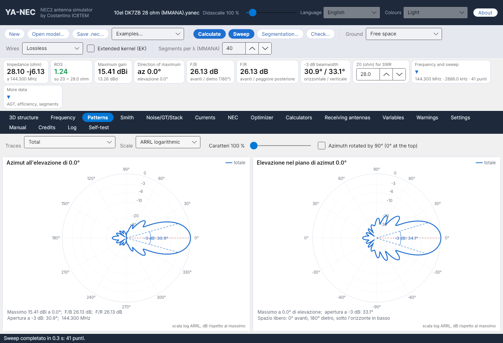

[Italiano](Home) · [English](Home-en) · **Deutsch** · [Français](Home-fr) · [Español](Home-es) · [Português](Home-pt)

# YA-NEC

**Drahtantennen-Simulator auf Basis von NEC-2** für Windows, Linux und macOS. Von Costantino Cerrotta **IC8TEM**. Lizenz GPL-3.0.

> *Die Geschichte dieses Programms schreibt ihr: mit euren Projekten, euren Ideen, eurer Genialität, euren Entdeckungen und euren Gewissheiten.*

<table><tr><td width="25%" align="center"> 3D-Struktur</td><td width="25%" align="center"> Diagramme</td><td width="25%" align="center"> Smith-Diagramm</td><td width="25%" align="center"> Rauschen, G/T und Gruppierung</td></tr></table>

## Seiten

- [Installation](Installazione-de): welches Paket herunterladen und wie man es unter Windows, Linux, Raspberry Pi und Mac startet
- [Erste Schritte](Primi-passi-de): ein Modell öffnen, rechnen, die Ergebnisse lesen
- [Rechner](Calcolatori-de): die Unterreiter, die eine Antenne entwerfen und ihr NEC-Modell erzeugen
- [Dateiformate](Formati-di-file-de): NEC, MMANA, AutoEZ, EZNEC, K6STI und .yanec
- [Rechenentscheidungen](Scelte-di-calcolo-de): wie YA-NEC rechnet und warum (Rechenkern, Böden, Teleskoprohre)
- [Automatische Aktualisierung](Aggiornamento-automatico-de)
- [Danksagung und Kontakt](Crediti-e-contatti-de)

Das vollständige Handbuch, das jedes Kontrollkästchen und jede Rechenentscheidung erklärt, ist im Programm (Reiter Handbuch) und in `doc/Manuale_d_uso.pdf` (italienisch). Die Oberfläche ist italienisch, teilweise englisch (Menü Sprache, oben rechts); weitere Sprachen folgen.
