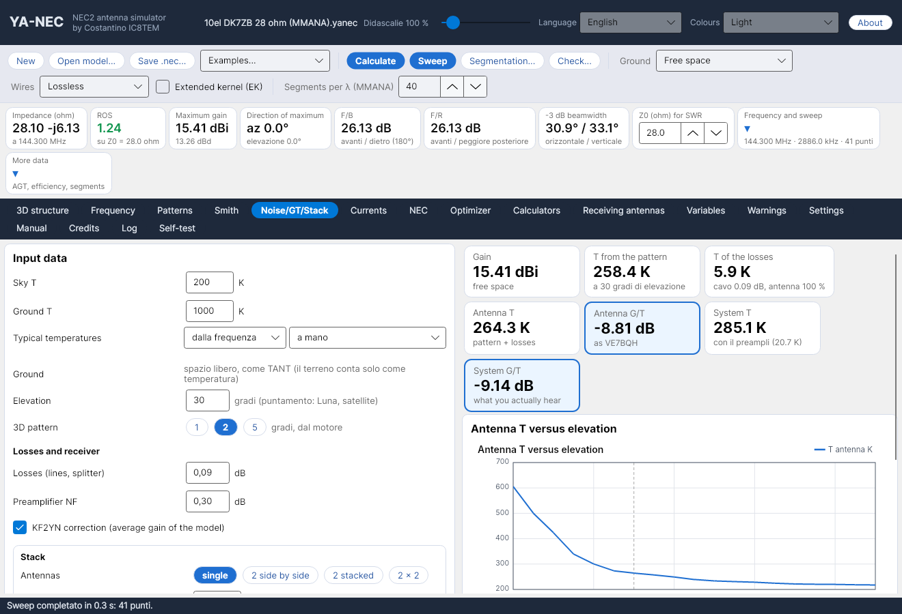

[Italiano](Home) · [English](Home-en) · [Deutsch](Home-de) · [Nederlands](Home-nl) · [Français](Home-fr) · [Español](Home-es) · [Português](Home-pt) · [Português (Brasil)](Home-pt-br) · [Dansk](Home-da) · [Norsk](Home-nb) · [Svenska](Home-sv) · [Íslenska](Home-is) · [Eesti](Home-et) · [Lietuvių](Home-lt) · [Latviešu](Home-lv) · [Polski](Home-pl) · [Čeština](Home-cs) · [Slovenčina](Home-sk) · [Magyar](Home-hu) · [Română](Home-ro) · **Ελληνικά** · [Русский](Home-ru) · [Українська](Home-uk) · [Türkçe](Home-tr) · [Afrikaans](Home-af) · [العربية](Home-ar) · [עברית](Home-he) · [हिन्दी](Home-hi) · [Bahasa Indonesia](Home-id) · [Tagalog](Home-tl) · [日本語](Home-ja) · [한국어](Home-ko) · [中文](Home-zh) · [中文 (繁體)](Home-zh-tw)

# YA-NEC

**Προσομοιωτής συρμάτινων κεραιών βασισμένος στο NEC-2** για Windows, Linux και macOS. Από τον Costantino Cerrotta **IC8TEM**. Άδεια GPL-3.0.

> *Την ιστορία αυτού του προγράμματος θα τη γράψετε εσείς: με τα σχέδιά σας, τις ιδέες σας, την ευφυΐα σας, τις ανακαλύψεις σας και τις βεβαιότητές σας.*

<table><tr><td width="25%" align="center"> Τρισδιάστατη δομή</td><td width="25%" align="center"> Διαγράμματα</td><td width="25%" align="center"> Χάρτης Smith</td><td width="25%" align="center"> Θόρυβος, G/T και συστοιχίες</td></tr></table>

## Σελίδες

- [Εγκατάσταση](Installazione-el): ποιο πακέτο να κατεβάσετε και πώς να το ξεκινήσετε σε Windows, Linux, Raspberry Pi και Mac
- [Πρώτα βήματα](Primi-passi-el): άνοιγμα μοντέλου, υπολογισμός, ανάγνωση αποτελεσμάτων
- [Υπολογιστές](Calcolatori-el): οι υποκαρτέλες που σχεδιάζουν μια κεραία και φτιάχνουν το μοντέλο NEC της
- [Μορφές αρχείων](Formati-di-file-el): NEC, MMANA, AutoEZ, EZNEC, K6STI και .yanec
- [Επιλογές υπολογισμού](Scelte-di-calcolo-el): πώς και γιατί υπολογίζει το YA-NEC (μηχανή, έδαφος, τηλεσκοπικοί σωλήνες)
- [Αυτόματη ενημέρωση](Aggiornamento-automatico-el)
- [Ευχαριστίες και επικοινωνία](Crediti-e-contatti-el)

Το πλήρες εγχειρίδιο, που εξηγεί κάθε πλαίσιο επιλογής και κάθε επιλογή υπολογισμού, βρίσκεται μέσα στο πρόγραμμα (καρτέλα Εγχειρίδιο) και στο `doc/Manuale_d_uso.pdf` (στα ιταλικά). Η διεπαφή είναι στα ιταλικά, εν μέρει στα αγγλικά (μενού Γλώσσα, πάνω δεξιά)· θα ακολουθήσουν κι άλλες γλώσσες.
