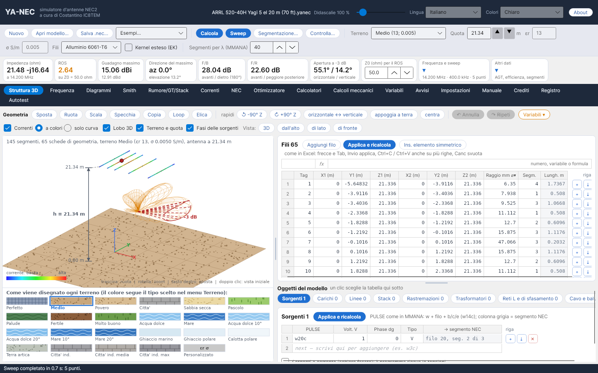

[Italiano](Home) · [English](Home-en) · [Deutsch](Home-de) · [Nederlands](Home-nl) · [Français](Home-fr) · [Español](Home-es) · [Português](Home-pt) · [Português (Brasil)](Home-pt-br) · [Dansk](Home-da) · **Norsk** · [Svenska](Home-sv) · [Polski](Home-pl) · [Čeština](Home-cs) · [Slovenčina](Home-sk) · [Magyar](Home-hu) · [Română](Home-ro) · [Ελληνικά](Home-el) · [Русский](Home-ru) · [Українська](Home-uk) · [Türkçe](Home-tr) · [Bahasa Indonesia](Home-id) · [Tagalog](Home-tl) · [日本語](Home-ja) · [한국어](Home-ko) · [中文](Home-zh) · [中文 (繁體)](Home-zh-tw)

# YA-NEC

**Trådantennesimulator basert på NEC-2** for Windows, Linux og macOS. Av Costantino Cerrotta **IC8TEM**. Lisens GPL-3.0.

> *Historien til dette programmet skriver dere: med prosjektene deres, ideene deres, genialiteten deres, oppdagelsene deres og vissheten deres.*

<table><tr><td width="25%" align="center"> 3D-struktur</td><td width="25%" align="center"> Diagrammer</td><td width="25%" align="center"> Smith-diagram</td><td width="25%" align="center"> Støy, G/T og stabling</td></tr></table>

## Sider

- [Installasjon](Installazione-nb): hvilken pakke du skal laste ned, og hvordan du starter den på Windows, Linux, Raspberry Pi og Mac
- [Kom i gang](Primi-passi-nb): åpne en modell, beregne, lese resultatene
- [Kalkulatorer](Calcolatori-nb): underfanene som konstruerer en antenne og lager NEC-modellen
- [Filformater](Formati-di-file-nb): NEC, MMANA, AutoEZ, EZNEC, K6STI og .yanec
- [Beregningsvalg](Scelte-di-calcolo-nb): hvordan YA-NEC regner og hvorfor (motor, jord, teleskoprør)
- [Automatisk oppdatering](Aggiornamento-automatico-nb)
- [Takk og kontakt](Crediti-e-contatti-nb)

Den fullstendige håndboken, som forklarer hver avkrysningsboks og hvert beregningsvalg, finnes i programmet (fanen Håndbok) og i `doc/Manuale_d_uso.pdf` (på italiensk). Grensesnittet er på italiensk, delvis på engelsk (menyen Språk øverst til høyre); flere språk kommer.
