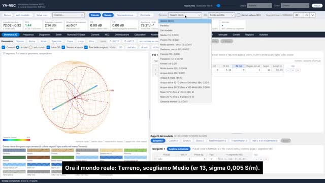
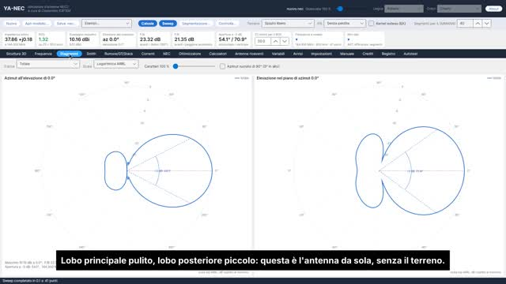
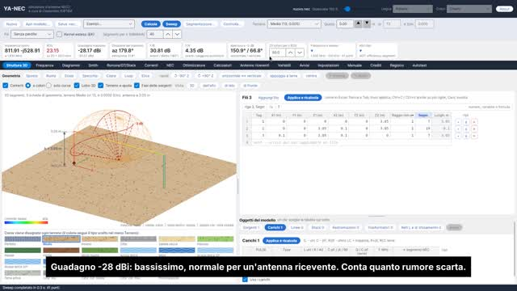

[Italiano](Videocorso) · **English**

# Video course

Three short lessons (3-5 minutes), recorded with YA-NEC 1.0.4: from an empty model to the patterns, step by step. Subtitles are burnt into each video; the .srt file is there if you want them separately (for example on YouTube).

<table><tr><td width="40%"></td><td>

### Lesson 1 - 14 MHz dipole

From an empty model: frequency, one wire, the source in the centre. The 142.5/f formula gives a short dipole (67 - j32 ohm): it is brought to resonance at 10.28 m (72 ohm, 2.14 dBi). Then free space, 5 m and 10 m above average ground: impedance, gain and radiation angle change with height.

▶ [Watch the video](https://github.com/ic8tem/YA-NEC/blob/main/docs/videocorso/YA-NEC_course_1_dipole_14MHz_EN.mp4) · [.srt subtitles](https://raw.githubusercontent.com/ic8tem/YA-NEC/main/docs/videocorso/YA-NEC_course_1_dipole_14MHz_EN.srt)

</td></tr></table>
<table><tr><td width="40%"></td><td>

### Lesson 2 - 5-element VHF Yagi (144 MHz)

Dimensions become variables (as in 4nec2) and the wires use the variable names. The Optimizer takes F/B from 12.9 to 23.3 dB and SWR from 2.09 to 1.32 in a few seconds. Then the lobes in free space and at 3 m above two grounds (Average and Very good).

▶ [Watch the video](https://github.com/ic8tem/YA-NEC/blob/main/docs/videocorso/YA-NEC_course_2_yagi_5el_144MHz_EN.mp4) · [.srt subtitles](https://raw.githubusercontent.com/ic8tem/YA-NEC/main/docs/videocorso/YA-NEC_course_2_yagi_5el_144MHz_EN.srt)

</td></tr></table>
<table><tr><td width="40%"></td><td>

### Lesson 3 - EWE for 160 m (WA2WVL)

The receiving antenna by Floyd Koontz WA2WVL (QST, February 1995): Sommerfeld ground, three wires connected to the soil, source and termination resistor. How the termination sets the rear null, then RDF and "optimize for F/B" in the Receiving antennas tab.

▶ [Watch the video](https://github.com/ic8tem/YA-NEC/blob/main/docs/videocorso/YA-NEC_course_3_EWE_160m_EN.mp4) · [.srt subtitles](https://raw.githubusercontent.com/ic8tem/YA-NEC/main/docs/videocorso/YA-NEC_course_3_EWE_160m_EN.srt)

</td></tr></table>

The videos use the English interface; a few labels are still in Italian (the translation is in progress).
