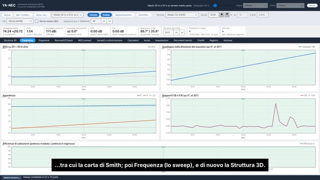
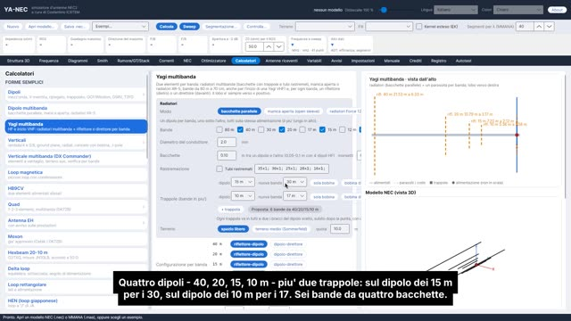
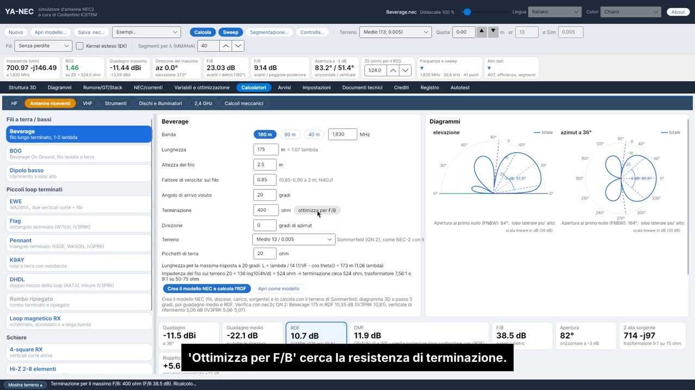

[Italiano](Videocorso) · **English**

# Video course

A complete course in 22 short lessons (3-5 minutes), in Italian and English, recorded with YA-NEC 1.0.4 and later. Every video has burnt-in subtitles; the .srt file is for those who want them separately (for example on YouTube). Lessons are released one after another: those without a link are in preparation.

<table><tr><td width="40%"></td><td>

### Lesson 0 - The program in 5 minutes

Installation, the top bar, the result cards and the tabs. Examples, the file formats it opens (NEC2, MMANA, AutoEZ/MultiNEC, EZNEC, K6STI YO and AO, .yanec) with an AutoEZ file by AC6LA and an MMANA file by IC8TEM. Settings, automatic update, colours, Manual, Log and Self-test.

▶ [Watch the video](https://github.com/ic8tem/YA-NEC/blob/main/docs/videocorso/YA-NEC_course_00_program_EN.mp4) · [subtitles .srt](https://raw.githubusercontent.com/ic8tem/YA-NEC/main/docs/videocorso/YA-NEC_course_00_program_EN.srt)

</td></tr></table>
<table><tr><td width="40%"></td><td>

### Lesson 1 - A 14 MHz dipole three ways

With the Dipoles calculator (bring to resonance: 10.36 m, 72.7 ohm, 7.10 dBi at 29.5°), by hand with numbers, and with variables (L and H in the wire formulas). Then height (at 5 m: 82 + j29 ohm), wire material (copper, aluminium) and the extended kernel.

▶ [Watch the video](https://github.com/ic8tem/YA-NEC/blob/main/docs/videocorso/YA-NEC_course_01_dipole_EN.mp4) · [subtitles .srt](https://raw.githubusercontent.com/ic8tem/YA-NEC/main/docs/videocorso/YA-NEC_course_01_dipole_EN.srt)

</td></tr></table>
<table><tr><td width="40%"></td><td>

### Lesson 2 - Single-element wire antennas

Inverted V for 40 m; 20 m delta loop with its RG-59 quarter wave placed in the model as a TL line (from 120 to 47 ohm); lambda/4 vertical with radials, 5/8, coil-loaded, J-pole and a DX Commander-style multiband vertical checked band by band.

▶ [Watch the video](https://github.com/ic8tem/YA-NEC/blob/main/docs/videocorso/YA-NEC_course_02_wire_antennas_EN.mp4) · [subtitles .srt](https://raw.githubusercontent.com/ic8tem/YA-NEC/main/docs/videocorso/YA-NEC_course_02_wire_antennas_EN.srt)

</td></tr></table>
<table><tr><td width="40%"></td><td>

### Lesson 3 - Special dipoles

Folded (about 290 ohm), OCF/Windom (W8GZ) seen from 3 to 30 MHz on 200 ohm, the G5RV by Louis Varney G5RV with its 600 ohm ladder line as a TL card, the W3HH T2FD: SWR on 300 ohm and radiation efficiency across the band.

▶ [Watch the video](https://github.com/ic8tem/YA-NEC/blob/main/docs/videocorso/YA-NEC_course_03_special_dipoles_EN.mp4) · [subtitles .srt](https://raw.githubusercontent.com/ic8tem/YA-NEC/main/docs/videocorso/YA-NEC_course_03_special_dipoles_EN.srt)

</td></tr></table>
<table><tr><td width="40%"></td><td>

### Lesson 4 - Parallel dipoles

Parallel rods for 20, 15 and 10 m tuned together with "Tune and verify"; adding 40 m, the 40 m dipole resonates on 15 m (three half waves) and steals current; then the N6BT open sleeve, with the parasitic elements tuned in length and spacing.

▶ [Watch the video](https://github.com/ic8tem/YA-NEC/blob/main/docs/videocorso/YA-NEC_course_04_parallel_dipoles_EN.mp4) · [subtitles .srt](https://raw.githubusercontent.com/ic8tem/YA-NEC/main/docs/videocorso/YA-NEC_course_04_parallel_dipoles_EN.srt)

</td></tr></table>
<table><tr><td width="40%"></td><td>

### Lesson 5 - Traps and the trapped dipole

The W3DZZ (C.L. Buchanan, QST 1955) for 80 and 40 m from the Dipoles calculator: 60 pF and 8.49 uH trap at 7.05 MHz, bring to resonance, traps as LC loads in the model, sweep from 3.4 to 7.4 MHz with losses and efficiency, zoom on 40 m.

▶ [Watch the video](https://github.com/ic8tem/YA-NEC/blob/main/docs/videocorso/YA-NEC_course_05_traps_EN.mp4) · [subtitles .srt](https://raw.githubusercontent.com/ic8tem/YA-NEC/main/docs/videocorso/YA-NEC_course_05_traps_EN.srt)

</td></tr></table>
<table><tr><td width="40%"></td><td>

### Lesson 6 - The model tools

From the Examples dipole: Move (at 15 m the lobe drops from 29.5 to 19.6 degrees), horizontal <-> vertical, Undo. Then a deliberate mistake (3 segments), the Warnings tab, Check and Segmentation with preview and automatic fix.

▶ [Watch the video](https://github.com/ic8tem/YA-NEC/blob/main/docs/videocorso/YA-NEC_course_06_model_tools_EN.mp4) · [subtitles .srt](https://raw.githubusercontent.com/ic8tem/YA-NEC/main/docs/videocorso/YA-NEC_course_06_model_tools_EN.srt)

</td></tr></table>

<table><tr><td width="40%"></td><td>

### Lesson 7 - Simple HF beams: Moxon and 2-element Yagi

A 20 m Moxon (Les Moxon G6XN, dimensions from L.B. Cebik's MOXGEN): F/B 41 dB in free space, 11 dBi at 12 m over average ground, 58 ohm straight on the coax; then the 2-element Yagi from the Multiband Yagi calculator, with a reflector (12.2 dBi, F/B 13.6 dB) and with a director (10.6 dBi, F/B 4.8 dB).

▶ [Watch the video](https://github.com/ic8tem/YA-NEC/blob/main/docs/videocorso/YA-NEC_course_07_moxon_yagi2_EN.mp4) · [subtitles .srt](https://raw.githubusercontent.com/ic8tem/YA-NEC/main/docs/videocorso/YA-NEC_course_07_moxon_yagi2_EN.srt)

</td></tr></table>
<table><tr><td width="40%"></td><td>

### Lesson 8 - HF beam with traps and ground

A six-band multiband Yagi (40-30-20-17-15-10 m) from the calculator's proposal: four parallel-rod dipoles, two traps and the reflectors, tuned together over average ground at 10 m. Centre SWR 1.13-1.35, gain and F/B per band, band edges and the 'steals' column showing the compromises.

▶ [Watch the video](https://github.com/ic8tem/YA-NEC/blob/main/docs/videocorso/YA-NEC_course_08_traps_ground_EN.mp4) · [subtitles .srt](https://raw.githubusercontent.com/ic8tem/YA-NEC/main/docs/videocorso/YA-NEC_course_08_traps_ground_EN.srt)

</td></tr></table>
<table><tr><td width="40%"></td><td>

### Lesson 9 - Other beams

HB9CV (Rudolf Baumgartner HB9CV) at 145 MHz with its crossed phase line; 2 and 3 element quads for 20 m and a DK7ZB-style 20-10 m multiband quad; Hexbeam 20-10 m with the G3TXQ/JN1GLB dimensions; 144-432 MHz log-periodic by the Carrel method with a NEC sweep of the whole band.

▶ [Watch the video](https://github.com/ic8tem/YA-NEC/blob/main/docs/videocorso/YA-NEC_course_09_other_beams_EN.mp4) · [subtitles .srt](https://raw.githubusercontent.com/ic8tem/YA-NEC/main/docs/videocorso/YA-NEC_course_09_other_beams_EN.srt)

</td></tr></table>
<table><tr><td width="40%"></td><td>

### Lesson 10 - Receiving antennas: Beverage and EWE

A 175 m Beverage for 160 m and the EWE by Floyd Koontz WA2WVL (QST February 1995) in the Receiving antennas tab: NEC model over Sommerfeld ground, RDF and DMF, optimize the termination for F/B, suggested preamplifier and the RDF ranking with the IV3PRK and Hi-Z measurements.

▶ [Watch the video](https://github.com/ic8tem/YA-NEC/blob/main/docs/videocorso/YA-NEC_course_10_beverage_ewe_EN.mp4) · [subtitles .srt](https://raw.githubusercontent.com/ic8tem/YA-NEC/main/docs/videocorso/YA-NEC_course_10_beverage_ewe_EN.srt)

</td></tr></table>
<table><tr><td width="40%"></td><td>

### Lesson 11 - Four-square and other receiving antennas

A 40 m Four-square from the calculator (ON4UN): current sources at 0/-90/-90/-180 degrees and the resulting impedances; then the Flag (K6SE, W7IUV) with RDF 7.8 dB and optimize for F/B, the Waller Flag (NX4D, N4IS, IV3PRK model) with RDF 11.6 dB and the RDF ranking.

▶ [Watch the video](https://github.com/ic8tem/YA-NEC/blob/main/docs/videocorso/YA-NEC_course_11_foursquare_rx_EN.mp4) · [subtitles .srt](https://raw.githubusercontent.com/ic8tem/YA-NEC/main/docs/videocorso/YA-NEC_course_11_foursquare_rx_EN.srt)

</td></tr></table>
<table><tr><td width="40%"></td><td>

### Lesson 12 - Loaded loop, toroids, L-C network and model objects

A 1 m magnetic loop for 40 m (16 % efficiency, 52 A and 5.6 kV at 100 W) and the effect of the wire material in the NEC; L-C network; iron powder and ferrite toroids; 4:1 Guanella balun on FT-240-43; the model objects: lines, transformers, L networks and current sources.

▶ [Watch the video](https://github.com/ic8tem/YA-NEC/blob/main/docs/videocorso/YA-NEC_course_12_loop_toroids_EN.mp4) · [subtitles .srt](https://raw.githubusercontent.com/ic8tem/YA-NEC/main/docs/videocorso/YA-NEC_course_12_loop_toroids_EN.srt)

</td></tr></table>
<table><tr><td width="40%"></td><td>

### Lesson 13 - The other functions for HF

On the ARRL 520-40H (5 elements for 20 m from the ARRL Antenna Book): result cards, patterns with rotated azimuth and ARRL or linear scale, frequency sweep, More data (efficiency, AGT, segments), Smith chart, editable NEC cards and the Noise/GT/Stack tab.

▶ [Watch the video](https://github.com/ic8tem/YA-NEC/blob/main/docs/videocorso/YA-NEC_course_13_hf_functions_EN.mp4) · [subtitles .srt](https://raw.githubusercontent.com/ic8tem/YA-NEC/main/docs/videocorso/YA-NEC_course_13_hf_functions_EN.srt)

</td></tr></table>
<table><tr><td width="40%"></td><td>

### Lesson 14 - DK7ZB 6-element Yagi with the designer's dimensions

The DK7ZB 6-element 2 m Yagi (28 ohm, 2.40 m boom, qsl.net/dk7zb) typed in with the dimensions from his page, no variables: 30.2 - j3.5 ohm, 12.06 dBi = 9.91 dBd as stated, SWR 1.15 on 28 ohm, 2 MHz sweep and patterns.

▶ [Watch the video](https://github.com/ic8tem/YA-NEC/blob/main/docs/videocorso/YA-NEC_course_14_dk7zb_6el_EN.mp4) · [subtitles .srt](https://raw.githubusercontent.com/ic8tem/YA-NEC/main/docs/videocorso/YA-NEC_course_14_dk7zb_6el_EN.srt)

</td></tr></table>
<table><tr><td width="40%"></td><td>

### Lesson 15 - The Optimizer

The DK7ZB 6-element Yagi of lesson 14 with variables, optimized for 50 ohm (SWR 1.23, 12.00 dBi, F/B 32.4 dB: 0.06 dB less gain); then a 3-element 20 m HF Yagi from rule-of-thumb dimensions, F/B from 21.6 to 35 dB with the impedance staying around 30 ohm.

▶ [Watch the video](https://github.com/ic8tem/YA-NEC/blob/main/docs/videocorso/YA-NEC_course_15_optimizer_EN.mp4) · [subtitles .srt](https://raw.githubusercontent.com/ic8tem/YA-NEC/main/docs/videocorso/YA-NEC_course_15_optimizer_EN.srt)

</td></tr></table>
<table><tr><td width="40%"></td><td>

### Lesson 16 - Advanced VHF/UHF

A 10-element DL6WU long Yagi (Günter Hoch DL6WU) for 144 MHz: formula estimate, real-time NEC and step optimization; boom correction (DL6WU/G3SEK compared with YU7EF, VE7BQH, K1FO, I0JXX, DJ9BV, DG7YBN); mounting plates in the model and why the Leeson correction is needed.

▶ [Watch the video](https://github.com/ic8tem/YA-NEC/blob/main/docs/videocorso/YA-NEC_course_16_vhf_uhf_advanced_EN.mp4) · [subtitles .srt](https://raw.githubusercontent.com/ic8tem/YA-NEC/main/docs/videocorso/YA-NEC_course_16_vhf_uhf_advanced_EN.srt)

</td></tr></table>
<table><tr><td width="40%"></td><td>

### Lesson 17 - VHF antennas on a roof

The DK7ZB 7-element EME Yagi (MMANA example) 3 m above a slab at 15 m: the Antenna on a roof tool computes both cases, real ground under the building (19.28 dBi at 1.7 degrees) and an ITU-R P.2040 concrete slab (18.19 dBi at 9.1 degrees); then the elevation pattern over the slab.

▶ [Watch the video](https://github.com/ic8tem/YA-NEC/blob/main/docs/videocorso/YA-NEC_course_17_vhf_roof_EN.mp4) · [subtitles .srt](https://raw.githubusercontent.com/ic8tem/YA-NEC/main/docs/videocorso/YA-NEC_course_17_vhf_roof_EN.srt)

</td></tr></table>
## Coming next

- **18** · VHF stacks of short (DK7ZB) and long (DL6WU) antennas, noise and G/T
- **19** · Loop Yagi for 1296 MHz
- **20** · Satellites: Eggbeater, QFH, Quagi
- **21** · Dishes: prime focus, offset and horns

Model files are built by following the video; to try right away, the program Examples already contain many ready antennas. Sources and designers named in the videos are also listed in the program Credits tab.
