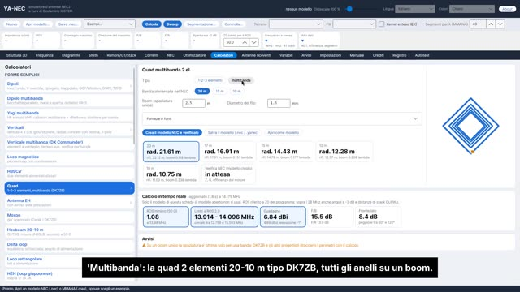
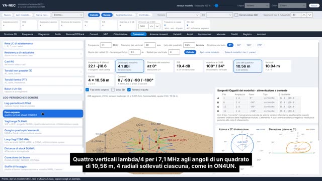
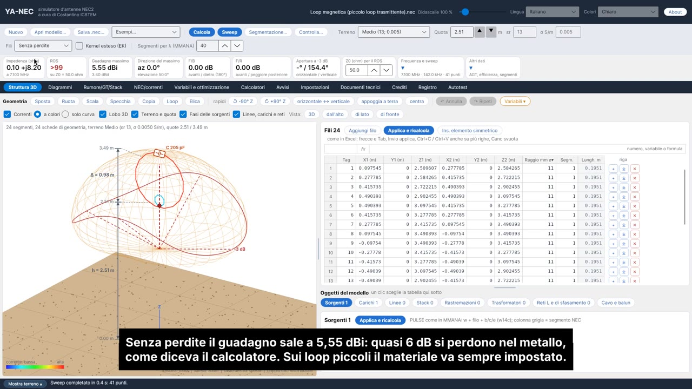
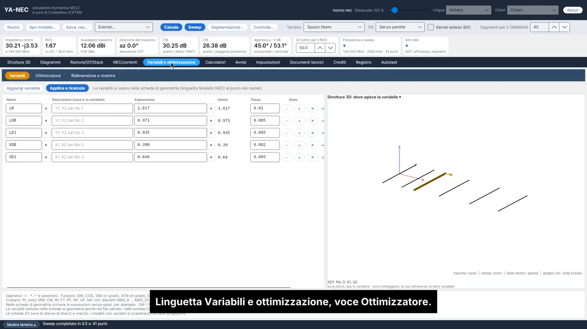
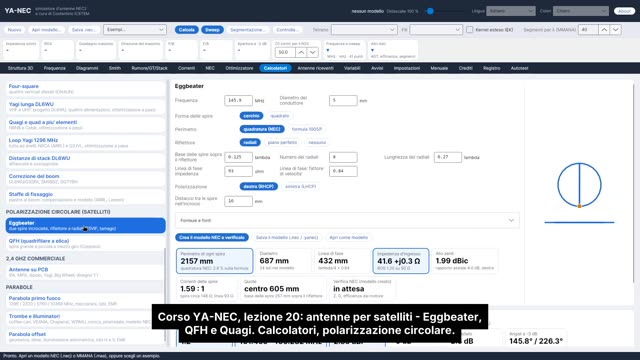
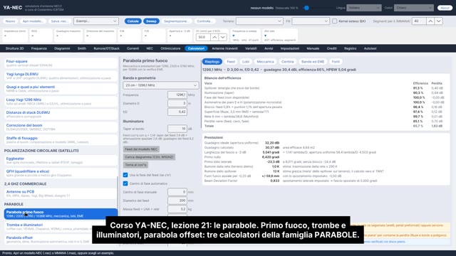

**Italiano** · [English](Videocorso-en)

# Videocorso

Un corso completo in 22 lezioni brevi (3-5 minuti), in italiano e in inglese, girate con YA-NEC 1.0.4 e successive. Ogni video ha i sottotitoli impressi; il file .srt serve per chi li vuole a parte (per esempio su YouTube). Le lezioni escono man mano: quelle senza collegamento sono in preparazione.

<table><tr><td width="40%"></td><td>

### Lezione 0 - Il programma in 5 minuti

Installazione, la barra in alto, i riquadri dei risultati e le linguette. Gli Esempi, i formati che si aprono (NEC2, MMANA, AutoEZ/MultiNEC, EZNEC, YO e AO di K6STI, .yanec) con un file AutoEZ di AC6LA e un MMANA di IC8TEM. Impostazioni, aggiornamento automatico, colori, Manuale, Registro e Autotest.

▶ [Guarda il video](https://github.com/ic8tem/YA-NEC/blob/main/docs/videocorso/YA-NEC_corso_00_programma_IT.mp4) · [sottotitoli .srt](https://raw.githubusercontent.com/ic8tem/YA-NEC/main/docs/videocorso/YA-NEC_corso_00_programma_IT.srt)

</td></tr></table>
<table><tr><td width="40%"></td><td>

### Lezione 1 - Dipolo per i 14 MHz in tre modi

Con il calcolatore Dipoli (porta in risonanza: 10,36 m, 72,7 ohm, 7,10 dBi a 29,5°), a mano con i numeri e con le variabili (L e H nelle formule dei fili). Poi l'altezza (a 5 m: 82 + j29 ohm), il materiale del filo (rame, alluminio) e il kernel esteso.

▶ [Guarda il video](https://github.com/ic8tem/YA-NEC/blob/main/docs/videocorso/YA-NEC_corso_01_dipolo_IT.mp4) · [sottotitoli .srt](https://raw.githubusercontent.com/ic8tem/YA-NEC/main/docs/videocorso/YA-NEC_corso_01_dipolo_IT.srt)

</td></tr></table>
<table><tr><td width="40%"></td><td>

### Lezione 2 - Antenne filari a un elemento

V invertita per i 40 m; delta loop per i 20 m (scheda in sezioni della 1.0.11, balun a tessere con la polarizzazione) e il suo quarto d'onda di RG-59 messo nel modello come linea TL (da 120 a 47 ohm); verticali λ/4 con radiali, 5/8, caricata con bobina, J-pole e la multibanda tipo DX Commander con la verifica banda per banda.

▶ [Guarda il video](https://github.com/ic8tem/YA-NEC/blob/main/docs/videocorso/YA-NEC_corso_02_filari_IT.mp4) · [sottotitoli .srt](https://raw.githubusercontent.com/ic8tem/YA-NEC/main/docs/videocorso/YA-NEC_corso_02_filari_IT.srt)

</td></tr></table>
<table><tr><td width="40%"></td><td>

### Lezione 3 - I dipoli speciali

Ripiegato (circa 290 ohm), OCF/Windom (W8GZ) visto da 3 a 30 MHz su 200 ohm, G5RV di Louis Varney G5RV con la scaletta da 600 ohm come scheda TL, T2FD di W3HH: ROS su 300 ohm ed efficienza di radiazione lungo tutta la banda.

▶ [Guarda il video](https://github.com/ic8tem/YA-NEC/blob/main/docs/videocorso/YA-NEC_corso_03_dipoli_speciali_IT.mp4) · [sottotitoli .srt](https://raw.githubusercontent.com/ic8tem/YA-NEC/main/docs/videocorso/YA-NEC_corso_03_dipoli_speciali_IT.srt)

</td></tr></table>
<table><tr><td width="40%"></td><td>

### Lezione 4 - I dipoli paralleli

Bacchette parallele per 20, 15 e 10 m accordate insieme con "Accorda e verifica"; aggiungendo i 40 m il dipolo dei 40 risuona sui 15 (tre mezze onde) e ruba corrente; poi la manica aperta (open sleeve) di N6BT, con i parassiti accordati in lunghezza e distanza.

▶ [Guarda il video](https://github.com/ic8tem/YA-NEC/blob/main/docs/videocorso/YA-NEC_corso_04_dipoli_paralleli_IT.mp4) · [sottotitoli .srt](https://raw.githubusercontent.com/ic8tem/YA-NEC/main/docs/videocorso/YA-NEC_corso_04_dipoli_paralleli_IT.srt)

</td></tr></table>
<table><tr><td width="40%"></td><td>

### Lezione 5 - Le trappole e il dipolo trappolato

Il W3DZZ (C.L. Buchanan, QST 1955) per 80 e 40 m dal calcolatore Dipoli: trappola da 60 pF e 8,49 uH a 7,05 MHz, porta in risonanza, le trappole come carichi LC nel modello, sweep da 3,4 a 7,4 MHz con le perdite e l'efficienza, zoom sui 40 m. Dalla 1.0.11 il modo a singola banda: braccio da 6,5 m con bobina di carico al 50 % e al 30 % (13,1 e 9,4 uH), risonanza NEC sulla sola bobina.

▶ [Guarda il video](https://github.com/ic8tem/YA-NEC/blob/main/docs/videocorso/YA-NEC_corso_05_trappole_IT.mp4) · [sottotitoli .srt](https://raw.githubusercontent.com/ic8tem/YA-NEC/main/docs/videocorso/YA-NEC_corso_05_trappole_IT.srt)

</td></tr></table>
<table><tr><td width="40%"></td><td>

### Lezione 6 - Gli strumenti del modello

Dal dipolo degli Esempi: Sposta (a 15 m il lobo scende da 29,5 a 19,6 gradi), orizzontale <-> verticale, Annulla. Poi un errore voluto (3 segmenti), la linguetta Avvisi, Controlla e la Segmentazione con anteprima e correzione automatica. Dalla 1.0.11 la maniglia di riempimento nella tabella dei fili (come in Excel), con Ctrl+Z.

▶ [Guarda il video](https://github.com/ic8tem/YA-NEC/blob/main/docs/videocorso/YA-NEC_corso_06_strumenti_modello_IT.mp4) · [sottotitoli .srt](https://raw.githubusercontent.com/ic8tem/YA-NEC/main/docs/videocorso/YA-NEC_corso_06_strumenti_modello_IT.srt)

</td></tr></table>

<table><tr><td width="40%"></td><td>

### Lezione 7 - Direttive HF semplici: Moxon e Yagi 2 elementi

Moxon per i 20 m (Les Moxon G6XN, misure dal MOXGEN di L.B. Cebik): F/B 41 dB nello spazio libero, 11 dBi a 12 m su terreno medio, 58 ohm direttamente sul coassiale; poi la Yagi 2 elementi dal calcolatore Yagi multibanda, con riflettore (12,2 dBi, F/B 13,6 dB) e con direttore (10,6 dBi, F/B 4,8 dB).

▶ [Guarda il video](https://github.com/ic8tem/YA-NEC/blob/main/docs/videocorso/YA-NEC_corso_07_moxon_yagi2_IT.mp4) · [sottotitoli .srt](https://raw.githubusercontent.com/ic8tem/YA-NEC/main/docs/videocorso/YA-NEC_corso_07_moxon_yagi2_IT.srt)

</td></tr></table>
<table><tr><td width="40%"></td><td>

### Lezione 8 - Direttiva HF con trappole e terreno

Yagi multibanda a sei bande (40-30-20-17-15-10 m) dalla proposta del calcolatore: quattro dipoli a bacchette parallele, due trappole e i riflettori, accordati insieme su terreno medio a 10 m. ROS a centro banda 1,13-1,35, guadagno e F/B per banda, estremi di banda e la colonna 'ruba' che mostra i compromessi.

▶ [Guarda il video](https://github.com/ic8tem/YA-NEC/blob/main/docs/videocorso/YA-NEC_corso_08_trappole_terreno_IT.mp4) · [sottotitoli .srt](https://raw.githubusercontent.com/ic8tem/YA-NEC/main/docs/videocorso/YA-NEC_corso_08_trappole_terreno_IT.srt)

</td></tr></table>
<table><tr><td width="40%"></td><td>

### Lezione 9 - Altre direttive

HB9CV (Rudolf Baumgartner HB9CV) a 145 MHz con la linea di fase incrociata; Quad 2 e 3 elementi per i 20 m e multibanda 20-10 m tipo DK7ZB; Hexbeam 20-10 m con le misure G3TXQ/JN1GLB; log-periodica 144-432 MHz col metodo Carrel e sweep NEC di tutta la banda.

▶ [Guarda il video](https://github.com/ic8tem/YA-NEC/blob/main/docs/videocorso/YA-NEC_corso_09_altre_direttive_IT.mp4) · [sottotitoli .srt](https://raw.githubusercontent.com/ic8tem/YA-NEC/main/docs/videocorso/YA-NEC_corso_09_altre_direttive_IT.srt)

</td></tr></table>
<table><tr><td width="40%"></td><td>

### Lezione 10 - Antenne riceventi: Beverage ed EWE

Beverage da 175 m per i 160 m e la EWE di Floyd Koontz WA2WVL (QST febbraio 1995) nella linguetta Antenne riceventi: modello NEC su terreno di Sommerfeld, RDF e DMF, ottimizza per F/B sulla terminazione, preamplificatore consigliato e graduatoria RDF con le misure IV3PRK e Hi-Z.

▶ [Guarda il video](https://github.com/ic8tem/YA-NEC/blob/main/docs/videocorso/YA-NEC_corso_10_beverage_ewe_IT.mp4) · [sottotitoli .srt](https://raw.githubusercontent.com/ic8tem/YA-NEC/main/docs/videocorso/YA-NEC_corso_10_beverage_ewe_IT.srt)

</td></tr></table>
<table><tr><td width="40%"></td><td>

### Lezione 11 - Four-square e altre riceventi

Four-square per i 40 m dal calcolatore (ON4UN): sorgenti di corrente a 0/-90/-90/-180 gradi e impedenze risultanti; poi la Flag (K6SE, W7IUV) con RDF 7,8 dB e ottimizza per F/B, la Waller Flag (NX4D, N4IS, modello IV3PRK) con RDF 11,6 dB e la graduatoria RDF.

▶ [Guarda il video](https://github.com/ic8tem/YA-NEC/blob/main/docs/videocorso/YA-NEC_corso_11_foursquare_riceventi_IT.mp4) · [sottotitoli .srt](https://raw.githubusercontent.com/ic8tem/YA-NEC/main/docs/videocorso/YA-NEC_corso_11_foursquare_riceventi_IT.srt)

</td></tr></table>
<table><tr><td width="40%"></td><td>

### Lezione 12 - Loop caricato, toroidi, rete L-C e oggetti del modello

Loop magnetica da 1 m per i 40 m (efficienza 16 %, 52 A e 5,6 kV con 100 W) e l'effetto del materiale dei fili nel NEC; rete L-C; toroidi in polvere di ferro e in ferrite; balun 4:1 Guanella su FT-240-43; gli oggetti del modello: linee, trasformatori, reti L e sorgenti a corrente.

▶ [Guarda il video](https://github.com/ic8tem/YA-NEC/blob/main/docs/videocorso/YA-NEC_corso_12_loop_toroidi_IT.mp4) · [sottotitoli .srt](https://raw.githubusercontent.com/ic8tem/YA-NEC/main/docs/videocorso/YA-NEC_corso_12_loop_toroidi_IT.srt)

</td></tr></table>
<table><tr><td width="40%"></td><td>

### Lezione 13 - Le altre funzioni per l'HF

Sulla ARRL 520-40H (5 elementi per i 20 m dall'ARRL Antenna Book): riquadri dei risultati, diagrammi con azimut ruotato e scala ARRL o lineare, sweep di frequenza, Altri dati (efficienza, AGT, segmenti), carta di Smith, schede NEC modificabili e la linguetta Rumore/GT/Stack.

▶ [Guarda il video](https://github.com/ic8tem/YA-NEC/blob/main/docs/videocorso/YA-NEC_corso_13_funzioni_hf_IT.mp4) · [sottotitoli .srt](https://raw.githubusercontent.com/ic8tem/YA-NEC/main/docs/videocorso/YA-NEC_corso_13_funzioni_hf_IT.srt)

</td></tr></table>
<table><tr><td width="40%"></td><td>

### Lezione 14 - Yagi 6 elementi DK7ZB con le misure del progettista

La 6 elementi per i 2 m di DK7ZB (28 ohm, boom 2,40 m, qsl.net/dk7zb) inserita con le misure del sito, senza variabili: 30,2 - j3,5 ohm, 12,06 dBi = 9,91 dBd come dichiarato, ROS 1,15 su 28 ohm, sweep su 2 MHz e diagrammi.

▶ [Guarda il video](https://github.com/ic8tem/YA-NEC/blob/main/docs/videocorso/YA-NEC_corso_14_dk7zb_6el_IT.mp4) · [sottotitoli .srt](https://raw.githubusercontent.com/ic8tem/YA-NEC/main/docs/videocorso/YA-NEC_corso_14_dk7zb_6el_IT.srt)

</td></tr></table>
<table><tr><td width="40%"></td><td>

### Lezione 15 - L'Ottimizzatore

La 6 elementi DK7ZB della lezione 14 con variabili e ottimizzata per 50 ohm (ROS 1,23, 12,00 dBi, F/B 32,4 dB: 0,06 dB di guadagno in meno); poi una Yagi HF 3 elementi per i 20 m dalle misure di partenza, con il F/B da 21,6 a 35 dB e l'impedenza che resta sui 30 ohm.

▶ [Guarda il video](https://github.com/ic8tem/YA-NEC/blob/main/docs/videocorso/YA-NEC_corso_15_ottimizzatore_IT.mp4) · [sottotitoli .srt](https://raw.githubusercontent.com/ic8tem/YA-NEC/main/docs/videocorso/YA-NEC_corso_15_ottimizzatore_IT.srt)

</td></tr></table>
<table><tr><td width="40%"></td><td>

### Lezione 16 - VHF/UHF avanzato

Yagi lunga DL6WU (Günter Hoch DL6WU) 10 elementi per i 144 MHz: stima della formula, NEC in tempo reale e ottimizzazione a passi; correzione del boom (DL6WU/G3SEK confrontata con YU7EF, VE7BQH, K1FO, I0JXX, DJ9BV, DG7YBN); piastre di fissaggio nel modello e perche' serve la correzione di Leeson.

▶ [Guarda il video](https://github.com/ic8tem/YA-NEC/blob/main/docs/videocorso/YA-NEC_corso_16_vhf_uhf_avanzato_IT.mp4) · [sottotitoli .srt](https://raw.githubusercontent.com/ic8tem/YA-NEC/main/docs/videocorso/YA-NEC_corso_16_vhf_uhf_avanzato_IT.srt)

</td></tr></table>
<table><tr><td width="40%"></td><td>

### Lezione 17 - Antenne VHF su un tetto

La Yagi 7 elementi EME di DK7ZB (esempio MMANA) a 3 m sopra un solaio a 15 m: lo strumento Antenna su tetto calcola i due casi, terreno vero sotto il fabbricato (19,28 dBi a 1,7 gradi) e solaio in calcestruzzo ITU-R P.2040 (18,19 dBi a 9,1 gradi); poi il diagramma di elevazione sul solaio.

▶ [Guarda il video](https://github.com/ic8tem/YA-NEC/blob/main/docs/videocorso/YA-NEC_corso_17_vhf_tetto_IT.mp4) · [sottotitoli .srt](https://raw.githubusercontent.com/ic8tem/YA-NEC/main/docs/videocorso/YA-NEC_corso_17_vhf_tetto_IT.srt)

</td></tr></table>
<table><tr><td width="40%"></td><td>

### Lezione 18 - Stack VHF, rumore e G/T

La Yagi 10 elementi DK7ZB (esempio) nella linguetta Rumore/GT/Stack: temperatura d'antenna e G/T come VE7BQH, poi 2 sovrapposte (+3,0 dB) e 2 x 2 (+6,03 dB, G/T -2,86 dB) con le distanze DL6WU; infine una Yagi lunga DL6WU 17 elementi in 2 x 2 (22,54 dBi, +5,8 dB, G/T -1,89 dB).

▶ [Guarda il video](https://github.com/ic8tem/YA-NEC/blob/main/docs/videocorso/YA-NEC_corso_18_stack_gt_IT.mp4) · [sottotitoli .srt](https://raw.githubusercontent.com/ic8tem/YA-NEC/main/docs/videocorso/YA-NEC_corso_18_stack_gt_IT.srt)

</td></tr></table>
<table><tr><td width="40%"></td><td>

### Lezione 19 - Loop Yagi per i 1296 MHz

La loop Yagi N6CA (tabelle ARRL) / G3JVL a 25 elementi su 1,78 m: stima ARRL e tempo reale (18,6 dBi), modello NEC da 400 fili, sweep di frequenza e ottimizzazione NEC a passi del solo anello alimentato (ROS minimo 1,04 a 1296,8 MHz).

▶ [Guarda il video](https://github.com/ic8tem/YA-NEC/blob/main/docs/videocorso/YA-NEC_corso_19_loop_yagi_1296_IT.mp4) · [sottotitoli .srt](https://raw.githubusercontent.com/ic8tem/YA-NEC/main/docs/videocorso/YA-NEC_corso_19_loop_yagi_1296_IT.srt)

</td></tr></table>
<table><tr><td width="40%"></td><td>

### Lezione 20 - Antenne per satelliti

Eggbeater F5VIF per 145,9 MHz (41,6 ohm, 1,99 dBic allo zenit, riflettore a radiali), QFH elica quadrifilare per i satelliti meteo a 137,5 MHz con le tabelle di Coppens e il suo modello NEC, Quagi N6NB a 8 elementi per l'inseguimento (13,34 dBi).

▶ [Guarda il video](https://github.com/ic8tem/YA-NEC/blob/main/docs/videocorso/YA-NEC_corso_20_satelliti_IT.mp4) · [sottotitoli .srt](https://raw.githubusercontent.com/ic8tem/YA-NEC/main/docs/videocorso/YA-NEC_corso_20_satelliti_IT.srt)

</td></tr></table>
<table><tr><td width="40%"></td><td>

### Lezione 21 - Parabole

Parabola primo fuoco da 3 m a 23 cm (30,4 dBi, efficienza 66 %, bilancio di spillover, illuminazione, blocco, Ruze e rete), lobi, meccanica, bande ed EME; trombe e illuminatori (W2IMU dual-mode: 10,5 dBi, -10 dB a 54 gradi, f/D migliore 0,50); parabola offset a 10 GHz (38,9 dBi, nessun blocco, squint in circolare).

▶ [Guarda il video](https://github.com/ic8tem/YA-NEC/blob/main/docs/videocorso/YA-NEC_corso_21_parabole_IT.mp4) · [sottotitoli .srt](https://raw.githubusercontent.com/ic8tem/YA-NEC/main/docs/videocorso/YA-NEC_corso_21_parabole_IT.srt)

</td></tr></table>

I file del modello si costruiscono seguendo il video; per provare subito, gli Esempi del programma contengono già molte antenne pronte. Fonti e progettisti citati nei video sono elencati anche nella linguetta Crediti del programma.
