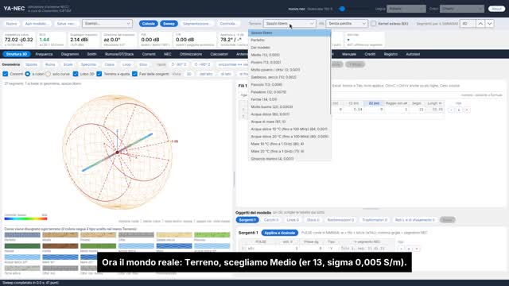
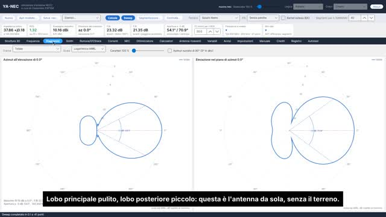
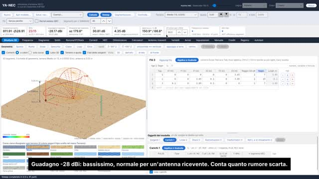

**Italiano** · [English](Videocorso-en)

# Videocorso

Tre lezioni brevi (3-5 minuti), girate con YA-NEC 1.0.4: si parte dal modello vuoto e si arriva ai diagrammi, passo per passo. Ogni video ha i sottotitoli impressi; il file .srt serve per chi li vuole a parte (per esempio su YouTube).

<table><tr><td width="40%"></td><td>

### Lezione 1 - Dipolo per i 14 MHz

Dal modello vuoto: frequenza, un filo, la sorgente al centro. La formula 142,5/f dà un dipolo corto (67 - j32 ohm): lo si porta a risonanza a 10,28 m (72 ohm, 2,14 dBi). Poi spazio libero, 5 m e 10 m sopra un terreno medio: impedenza, guadagno e angolo di radiazione cambiano con l'altezza.

▶ [Guarda il video](https://github.com/ic8tem/YA-NEC/blob/main/docs/videocorso/YA-NEC_corso_1_dipolo_14MHz_IT.mp4) · [sottotitoli .srt](https://raw.githubusercontent.com/ic8tem/YA-NEC/main/docs/videocorso/YA-NEC_corso_1_dipolo_14MHz_IT.srt)

</td></tr></table>
<table><tr><td width="40%"></td><td>

### Lezione 2 - Direttiva VHF a 5 elementi (144 MHz)

Le misure diventano variabili (come in 4nec2), i fili usano i nomi delle variabili. L'Ottimizzatore porta il F/B da 12,9 a 23,3 dB e il ROS da 2,09 a 1,32 in pochi secondi. Poi i lobi nello spazio libero e a 3 m sopra due terreni (Medio e Molto buono).

▶ [Guarda il video](https://github.com/ic8tem/YA-NEC/blob/main/docs/videocorso/YA-NEC_corso_2_yagi_5el_144MHz_IT.mp4) · [sottotitoli .srt](https://raw.githubusercontent.com/ic8tem/YA-NEC/main/docs/videocorso/YA-NEC_corso_2_yagi_5el_144MHz_IT.srt)

</td></tr></table>
<table><tr><td width="40%"></td><td>

### Lezione 3 - EWE per i 160 m (WA2WVL)

L'antenna ricevente di Floyd Koontz WA2WVL (QST, febbraio 1995): terreno Sommerfeld, tre fili collegati al suolo, sorgente e resistenza di terminazione. Come la terminazione regola il minimo posteriore, poi RDF e "ottimizza per F/B" nella linguetta Antenne riceventi.

▶ [Guarda il video](https://github.com/ic8tem/YA-NEC/blob/main/docs/videocorso/YA-NEC_corso_3_EWE_160m_IT.mp4) · [sottotitoli .srt](https://raw.githubusercontent.com/ic8tem/YA-NEC/main/docs/videocorso/YA-NEC_corso_3_EWE_160m_IT.srt)

</td></tr></table>

I file del modello si costruiscono a mano seguendo il video; per provare subito, gli Esempi del programma contengono già dipoli e Yagi pronti.
