**Italiano** · [English](Videocorso-en)

# Videocorso

Un corso completo in 37 lezioni brevi (2-5 minuti), in italiano e in inglese. Girate con la 1.5.3 (la 32 con la 1.5.8, la 33 con la 1.5.9, dalla 34 alla 36 con la 1.7.0) (Calcolatori a famiglie, Lobi e Parametri nella fascia dei Diagrammi). Ogni video ha i sottotitoli impressi; il file .srt serve per chi li vuole a parte (per esempio su YouTube).

<table><tr><td width="40%"></td><td>

### Lezione 0 - Il programma in 5 minuti

Installazione, la barra in alto, i riquadri dei risultati e le linguette. Gli Esempi, i formati che si aprono (NEC2, MMANA, AutoEZ/MultiNEC, EZNEC, YO e AO di K6STI, .yanec) con un file AutoEZ di AC6LA e un MMANA di IC8TEM. Le linguette (nella fascia dei Diagrammi Lobi, Parametri - lo sweep - e la carta di Smith) e il pulsante Mostra terreno nella barra di stato. Impostazioni, aggiornamento automatico, colori, Documenti tecnici, Registro e Autotest.

▶ [Guarda il video](https://github.com/ic8tem/YA-NEC/blob/main/docs/videocorso/YA-NEC_corso_00_programma_IT.mp4) · [sottotitoli .srt](https://raw.githubusercontent.com/ic8tem/YA-NEC/main/docs/videocorso/YA-NEC_corso_00_programma_IT.srt)

</td></tr></table>
<table><tr><td width="40%"></td><td>

### Lezione 1 - Dipolo per i 14 MHz in tre modi

Con il calcolatore Dipoli (porta in risonanza: 10,36 m, 72,7 ohm, 7,10 dBi a 29,5°), a mano con i numeri e con le variabili (L e H nelle formule dei fili). Poi l'altezza (a 5 m: 82 + j29 ohm), il materiale del filo (rame, alluminio) e il kernel esteso.

▶ [Guarda il video](https://github.com/ic8tem/YA-NEC/blob/main/docs/videocorso/YA-NEC_corso_01_dipolo_IT.mp4) · [sottotitoli .srt](https://raw.githubusercontent.com/ic8tem/YA-NEC/main/docs/videocorso/YA-NEC_corso_01_dipolo_IT.srt)

</td></tr></table>
<table><tr><td width="40%"></td><td>

### Lezione 2 - Antenne filari a un elemento

V invertita per i 40 m; delta loop per i 20 m (scheda in sezioni della 1.0.11, balun a tessere con la polarizzazione) e il suo quarto d'onda di RG-59 messo nel modello come linea TL (da 120 a 47 ohm); verticali λ/4 con radiali, 5/8, caricata con bobina, J-pole e la multibanda tipo DX Commander con la verifica banda per banda.

▶ [Guarda il video](https://github.com/ic8tem/YA-NEC/blob/main/docs/videocorso/YA-NEC_corso_02_filari_IT.mp4) · [sottotitoli .srt](https://raw.githubusercontent.com/ic8tem/YA-NEC/main/docs/videocorso/YA-NEC_corso_02_filari_IT.srt)

</td></tr></table>
<table><tr><td width="40%"><a href="https://github.com/ic8tem/YA-NEC/blob/main/docs/videocorso/YA-NEC_corso_03_dipoli_speciali_IT.mp4">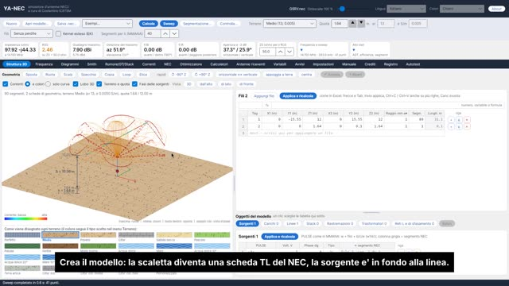</a></td><td>

### Lezione 3 - I dipoli speciali

Ripiegato (circa 290 ohm), OCF/Windom (W8GZ) visto da 3 a 30 MHz su 200 ohm, G5RV di Louis Varney G5RV con la scaletta da 600 ohm come scheda TL, T2FD di W3HH: ROS su 300 ohm ed efficienza di radiazione lungo tutta la banda.

▶ [Guarda il video](https://github.com/ic8tem/YA-NEC/blob/main/docs/videocorso/YA-NEC_corso_03_dipoli_speciali_IT.mp4) · [sottotitoli .srt](https://raw.githubusercontent.com/ic8tem/YA-NEC/main/docs/videocorso/YA-NEC_corso_03_dipoli_speciali_IT.srt)

</td></tr></table>
<table><tr><td width="40%"></td><td>

### Lezione 4 - I dipoli paralleli

Bacchette parallele per 20, 15 e 10 m accordate insieme con "Accorda e verifica"; aggiungendo i 40 m il dipolo dei 40 risuona sui 15 (tre mezze onde) e ruba corrente; poi la manica aperta (open sleeve) di N6BT, con i parassiti accordati in lunghezza e distanza.

▶ [Guarda il video](https://github.com/ic8tem/YA-NEC/blob/main/docs/videocorso/YA-NEC_corso_04_dipoli_paralleli_IT.mp4) · [sottotitoli .srt](https://raw.githubusercontent.com/ic8tem/YA-NEC/main/docs/videocorso/YA-NEC_corso_04_dipoli_paralleli_IT.srt)

</td></tr></table>
<table><tr><td width="40%"></td><td>

### Lezione 5 - Le trappole e il dipolo trappolato

Il W3DZZ (C.L. Buchanan, QST 1955) per 80 e 40 m dal calcolatore Dipoli: trappola da 60 pF e 8,49 uH a 7,05 MHz, porta in risonanza, le trappole come carichi LC nel modello, sweep da 3,4 a 7,4 MHz con le perdite e l'efficienza, zoom sui 40 m. Dalla 1.0.11 il modo a singola banda: braccio da 6,5 m con bobina di carico al 50 % e al 30 % (13,1 e 9,4 uH), risonanza NEC sulla sola bobina.

▶ [Guarda il video](https://github.com/ic8tem/YA-NEC/blob/main/docs/videocorso/YA-NEC_corso_05_trappole_IT.mp4) · [sottotitoli .srt](https://raw.githubusercontent.com/ic8tem/YA-NEC/main/docs/videocorso/YA-NEC_corso_05_trappole_IT.srt)

</td></tr></table>
<table><tr><td width="40%"></td><td>

### Lezione 6 - Gli strumenti del modello

Dal dipolo degli Esempi: Sposta (a 15 m il lobo scende da 29,5 a 19,6 gradi), orizzontale <-> verticale, Annulla. Poi un errore voluto (3 segmenti), la linguetta Avvisi, Controlla e la Segmentazione con anteprima e correzione automatica.

▶ [Guarda il video](https://github.com/ic8tem/YA-NEC/blob/main/docs/videocorso/YA-NEC_corso_06_strumenti_modello_IT.mp4) · [sottotitoli .srt](https://raw.githubusercontent.com/ic8tem/YA-NEC/main/docs/videocorso/YA-NEC_corso_06_strumenti_modello_IT.srt)

</td></tr></table>

<table><tr><td width="40%"><a href="https://github.com/ic8tem/YA-NEC/blob/main/docs/videocorso/YA-NEC_corso_07_moxon_yagi2_IT.mp4">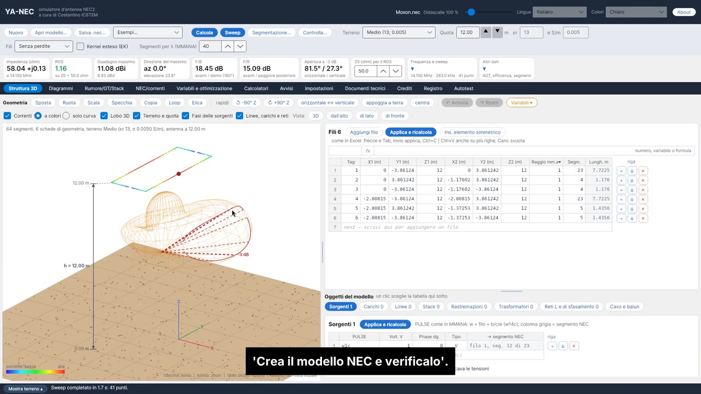</a></td><td>

### Lezione 7 - Direttive HF semplici: Moxon e Yagi 2 elementi

Moxon per i 20 m (Les Moxon G6XN, misure dal MOXGEN di L.B. Cebik): F/B 41 dB nello spazio libero, 11 dBi a 12 m su terreno medio, 58 ohm direttamente sul coassiale; poi la Yagi 2 elementi dal calcolatore Yagi multibanda, con riflettore (12,2 dBi, F/B 13,6 dB) e con direttore (10,6 dBi, F/B 4,8 dB).

▶ [Guarda il video](https://github.com/ic8tem/YA-NEC/blob/main/docs/videocorso/YA-NEC_corso_07_moxon_yagi2_IT.mp4) · [sottotitoli .srt](https://raw.githubusercontent.com/ic8tem/YA-NEC/main/docs/videocorso/YA-NEC_corso_07_moxon_yagi2_IT.srt)

</td></tr></table>
<table><tr><td width="40%"></td><td>

### Lezione 8 - Direttiva HF con trappole e terreno

Yagi multibanda a sei bande (40-30-20-17-15-10 m) dalla proposta del calcolatore: quattro dipoli a bacchette parallele, due trappole e i riflettori, accordati insieme su terreno medio a 10 m. ROS a centro banda 1,13-1,35, guadagno e F/B per banda, estremi di banda e la colonna 'ruba' che mostra i compromessi.

▶ [Guarda il video](https://github.com/ic8tem/YA-NEC/blob/main/docs/videocorso/YA-NEC_corso_08_trappole_terreno_IT.mp4) · [sottotitoli .srt](https://raw.githubusercontent.com/ic8tem/YA-NEC/main/docs/videocorso/YA-NEC_corso_08_trappole_terreno_IT.srt)

</td></tr></table>
<table><tr><td width="40%"></td><td>

### Lezione 9 - Altre direttive

HB9CV (Rudolf Baumgartner HB9CV) a 145 MHz con la linea di fase incrociata; Quad 2 e 3 elementi per i 20 m e multibanda 20-10 m tipo DK7ZB; Hexbeam 20-10 m con le misure G3TXQ/JN1GLB; log-periodica 144-432 MHz col metodo Carrel e sweep NEC di tutta la banda.

▶ [Guarda il video](https://github.com/ic8tem/YA-NEC/blob/main/docs/videocorso/YA-NEC_corso_09_altre_direttive_IT.mp4) · [sottotitoli .srt](https://raw.githubusercontent.com/ic8tem/YA-NEC/main/docs/videocorso/YA-NEC_corso_09_altre_direttive_IT.srt)

</td></tr></table>
<table><tr><td width="40%"></td><td>

### Lezione 10 - Antenne riceventi: Beverage ed EWE

Beverage da 175 m per i 160 m e la EWE di Floyd Koontz WA2WVL (QST febbraio 1995) nei Calcolatori, famiglia Antenne riceventi: modello NEC su terreno di Sommerfeld, RDF e DMF, ottimizza per F/B sulla terminazione, preamplificatore consigliato e graduatoria RDF con le misure IV3PRK e Hi-Z.

▶ [Guarda il video](https://github.com/ic8tem/YA-NEC/blob/main/docs/videocorso/YA-NEC_corso_10_beverage_ewe_IT.mp4) · [sottotitoli .srt](https://raw.githubusercontent.com/ic8tem/YA-NEC/main/docs/videocorso/YA-NEC_corso_10_beverage_ewe_IT.srt)

</td></tr></table>
<table><tr><td width="40%"></td><td>

### Lezione 11 - Four-square e altre riceventi

Four-square per i 40 m dal calcolatore (ON4UN): sorgenti di corrente a 0/-90/-90/-180 gradi e impedenze risultanti; poi la Flag (K6SE, W7IUV) con RDF 7,8 dB e ottimizza per F/B, la Waller Flag (NX4D, N4IS, modello IV3PRK) con RDF 11,6 dB e la graduatoria RDF.

▶ [Guarda il video](https://github.com/ic8tem/YA-NEC/blob/main/docs/videocorso/YA-NEC_corso_11_foursquare_riceventi_IT.mp4) · [sottotitoli .srt](https://raw.githubusercontent.com/ic8tem/YA-NEC/main/docs/videocorso/YA-NEC_corso_11_foursquare_riceventi_IT.srt)

</td></tr></table>
<table><tr><td width="40%"></td><td>

### Lezione 12 - Loop caricato, toroidi, rete L-C e oggetti del modello

Loop magnetica da 1 m per i 40 m (efficienza 16 %, 52 A e 5,6 kV con 100 W) e l'effetto del materiale dei fili nel NEC; rete L-C; toroidi in polvere di ferro e in ferrite; balun 4:1 Guanella su FT-240-43; gli oggetti del modello: linee, trasformatori, reti L e sorgenti a corrente.

▶ [Guarda il video](https://github.com/ic8tem/YA-NEC/blob/main/docs/videocorso/YA-NEC_corso_12_loop_toroidi_IT.mp4) · [sottotitoli .srt](https://raw.githubusercontent.com/ic8tem/YA-NEC/main/docs/videocorso/YA-NEC_corso_12_loop_toroidi_IT.srt)

</td></tr></table>
<table><tr><td width="40%"><a href="https://github.com/ic8tem/YA-NEC/blob/main/docs/videocorso/YA-NEC_corso_13_funzioni_hf_IT.mp4">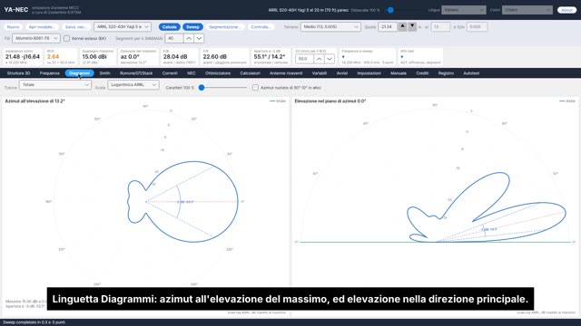</a></td><td>

### Lezione 13 - Le altre funzioni per l'HF

Sulla ARRL 520-40H (5 elementi per i 20 m dall'ARRL Antenna Book): riquadri dei risultati, diagrammi con azimut ruotato e scala ARRL o lineare, sweep di frequenza (voce Parametri, che era la linguetta Frequenza), Altri dati (efficienza, AGT, segmenti), carta di Smith (nella fascia dei Diagrammi), schede NEC modificabili (linguetta NEC/correnti) e la linguetta Rumore/GT/Stack.

▶ [Guarda il video](https://github.com/ic8tem/YA-NEC/blob/main/docs/videocorso/YA-NEC_corso_13_funzioni_hf_IT.mp4) · [sottotitoli .srt](https://raw.githubusercontent.com/ic8tem/YA-NEC/main/docs/videocorso/YA-NEC_corso_13_funzioni_hf_IT.srt)

</td></tr></table>
<table><tr><td width="40%"></td><td>

### Lezione 14 - Yagi 6 elementi DK7ZB con le misure del progettista

La 6 elementi per i 2 m di DK7ZB (28 ohm, boom 2,40 m, qsl.net/dk7zb) inserita con le misure del sito, senza variabili: 30,2 - j3,5 ohm, 12,06 dBi = 9,91 dBd come dichiarato, ROS 1,15 su 28 ohm, sweep su 2 MHz e diagrammi.

▶ [Guarda il video](https://github.com/ic8tem/YA-NEC/blob/main/docs/videocorso/YA-NEC_corso_14_dk7zb_6el_IT.mp4) · [sottotitoli .srt](https://raw.githubusercontent.com/ic8tem/YA-NEC/main/docs/videocorso/YA-NEC_corso_14_dk7zb_6el_IT.srt)

</td></tr></table>
<table><tr><td width="40%"></td><td>

### Lezione 15 - L'Ottimizzatore

La 6 elementi DK7ZB della lezione 14 con variabili e ottimizzata per 50 ohm, con il Monte Carlo e le tolleranze (ROS 1,24, 11,99 dBi, F/B 33,6 dB: 0,07 dB di guadagno in meno); poi una Yagi HF 3 elementi per i 20 m dalle misure di partenza, con il F/B da 21,6 a 32,8 dB e l'impedenza che resta sui 33 ohm. Linguetta Variabili e ottimizzazione.

▶ [Guarda il video](https://github.com/ic8tem/YA-NEC/blob/main/docs/videocorso/YA-NEC_corso_15_ottimizzatore_IT.mp4) · [sottotitoli .srt](https://raw.githubusercontent.com/ic8tem/YA-NEC/main/docs/videocorso/YA-NEC_corso_15_ottimizzatore_IT.srt)

</td></tr></table>
<table><tr><td width="40%"><a href="https://github.com/ic8tem/YA-NEC/blob/main/docs/videocorso/YA-NEC_corso_16_vhf_uhf_avanzato_IT.mp4">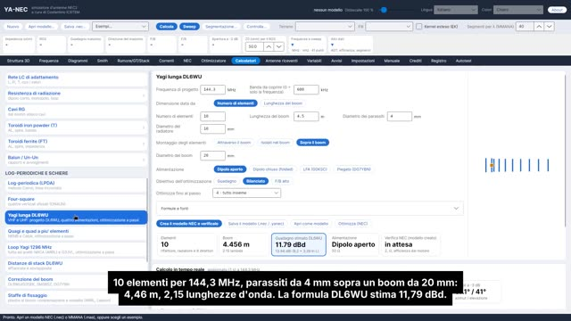</a></td><td>

### Lezione 16 - VHF/UHF avanzato

Yagi lunga DL6WU (Günter Hoch DL6WU) 10 elementi per i 144 MHz: stima della formula, NEC in tempo reale e ottimizzazione a passi; correzione del boom (DL6WU/G3SEK confrontata con YU7EF, VE7BQH, K1FO, I0JXX, DJ9BV, DG7YBN); piastre di fissaggio nel modello e perche' serve la correzione di Leeson.

▶ [Guarda il video](https://github.com/ic8tem/YA-NEC/blob/main/docs/videocorso/YA-NEC_corso_16_vhf_uhf_avanzato_IT.mp4) · [sottotitoli .srt](https://raw.githubusercontent.com/ic8tem/YA-NEC/main/docs/videocorso/YA-NEC_corso_16_vhf_uhf_avanzato_IT.srt)

</td></tr></table>
<table><tr><td width="40%"></td><td>

### Lezione 17 - Antenne VHF su un tetto

La Yagi 7 elementi EME di DK7ZB (esempio MMANA) a 3 m sopra un solaio a 15 m: lo strumento Antenna su tetto calcola i due casi, terreno vero sotto il fabbricato (19,28 dBi a 1,7 gradi) e solaio in calcestruzzo ITU-R P.2040 (18,19 dBi a 9,1 gradi); poi il diagramma di elevazione sul solaio.

▶ [Guarda il video](https://github.com/ic8tem/YA-NEC/blob/main/docs/videocorso/YA-NEC_corso_17_vhf_tetto_IT.mp4) · [sottotitoli .srt](https://raw.githubusercontent.com/ic8tem/YA-NEC/main/docs/videocorso/YA-NEC_corso_17_vhf_tetto_IT.srt)

</td></tr></table>
<table><tr><td width="40%"></td><td>

### Lezione 18 - Stack VHF, rumore e G/T

La Yagi 10 elementi DK7ZB (esempio) nella linguetta Rumore/GT/Stack: temperatura d'antenna e G/T come VE7BQH, poi 2 sovrapposte (+3,0 dB) e 2 x 2 (+6,03 dB, G/T -2,86 dB) con le distanze DL6WU; infine una Yagi lunga DL6WU 17 elementi in 2 x 2 (22,54 dBi, +5,8 dB, G/T -1,89 dB).

▶ [Guarda il video](https://github.com/ic8tem/YA-NEC/blob/main/docs/videocorso/YA-NEC_corso_18_stack_gt_IT.mp4) · [sottotitoli .srt](https://raw.githubusercontent.com/ic8tem/YA-NEC/main/docs/videocorso/YA-NEC_corso_18_stack_gt_IT.srt)

</td></tr></table>
<table><tr><td width="40%"><a href="https://github.com/ic8tem/YA-NEC/blob/main/docs/videocorso/YA-NEC_corso_19_loop_yagi_1296_IT.mp4">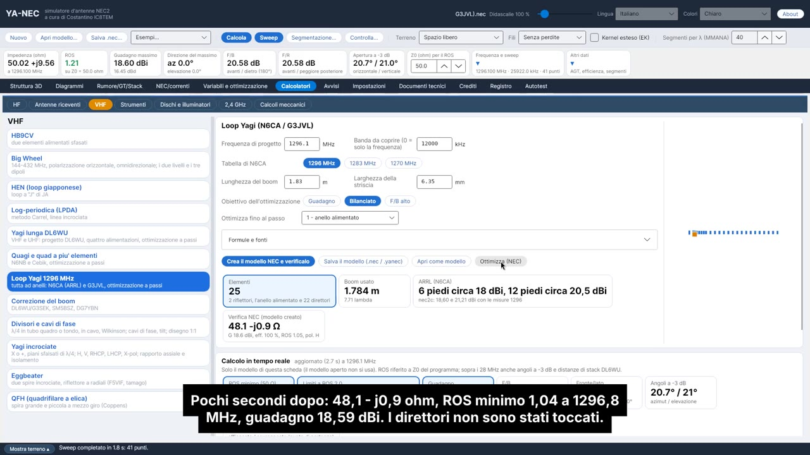</a></td><td>

### Lezione 19 - Loop Yagi per i 1296 MHz

La loop Yagi N6CA (tabelle ARRL) / G3JVL a 25 elementi su 1,78 m: stima ARRL e tempo reale (18,6 dBi), modello NEC da 400 fili, sweep di frequenza e ottimizzazione NEC a passi del solo anello alimentato (ROS minimo 1,04 a 1296,8 MHz).

▶ [Guarda il video](https://github.com/ic8tem/YA-NEC/blob/main/docs/videocorso/YA-NEC_corso_19_loop_yagi_1296_IT.mp4) · [sottotitoli .srt](https://raw.githubusercontent.com/ic8tem/YA-NEC/main/docs/videocorso/YA-NEC_corso_19_loop_yagi_1296_IT.srt)

</td></tr></table>
<table><tr><td width="40%"></td><td>

### Lezione 20 - Antenne per satelliti

Eggbeater F5VIF per 145,9 MHz (41,6 ohm, 1,99 dBic allo zenit, riflettore a radiali), QFH elica quadrifilare per i satelliti meteo a 137,5 MHz con le tabelle di Coppens e il suo modello NEC, Quagi N6NB a 8 elementi per l'inseguimento (13,34 dBi).

▶ [Guarda il video](https://github.com/ic8tem/YA-NEC/blob/main/docs/videocorso/YA-NEC_corso_20_satelliti_IT.mp4) · [sottotitoli .srt](https://raw.githubusercontent.com/ic8tem/YA-NEC/main/docs/videocorso/YA-NEC_corso_20_satelliti_IT.srt)

</td></tr></table>
<table><tr><td width="40%"></td><td>

### Lezione 21 - Parabole

Parabola primo fuoco da 3 m a 23 cm (30,4 dBi, efficienza 66 %, bilancio di spillover, illuminazione, blocco, Ruze e rete), lobi, meccanica, bande ed EME; trombe e illuminatori (W2IMU dual-mode: 10,5 dBi, -10 dB a 54 gradi, f/D migliore 0,50); parabola offset a 10 GHz (38,9 dBi, nessun blocco, squint in circolare).

▶ [Guarda il video](https://github.com/ic8tem/YA-NEC/blob/main/docs/videocorso/YA-NEC_corso_21_parabole_IT.mp4) · [sottotitoli .srt](https://raw.githubusercontent.com/ic8tem/YA-NEC/main/docs/videocorso/YA-NEC_corso_21_parabole_IT.srt)

</td></tr></table>
<table><tr><td width="40%"></td><td>

### Lezione 22 - Terreno reale (1.2)

Linguetta Diagrammi > Terreno reale alla HFTA di N6BV: locatore e mappa con la griglia dei locatori, profilo dal DEM (TINITALY/SRTM1), direzioni di traffico verso USA e Giappone con figura di merito e angoli di arrivo, scansione dell'altezza (Yagi ARRL 5 elementi per i 20 m da Capri).

▶ [Guarda il video](https://github.com/ic8tem/YA-NEC/blob/main/docs/videocorso/YA-NEC_corso_22_terreno_reale_IT.mp4) · [sottotitoli .srt](https://raw.githubusercontent.com/ic8tem/YA-NEC/main/docs/videocorso/YA-NEC_corso_22_terreno_reale_IT.srt)

</td></tr></table>
<table><tr><td width="40%"><a href="https://github.com/ic8tem/YA-NEC/blob/main/docs/videocorso/YA-NEC_corso_23_antenne_riceventi_IT.mp4">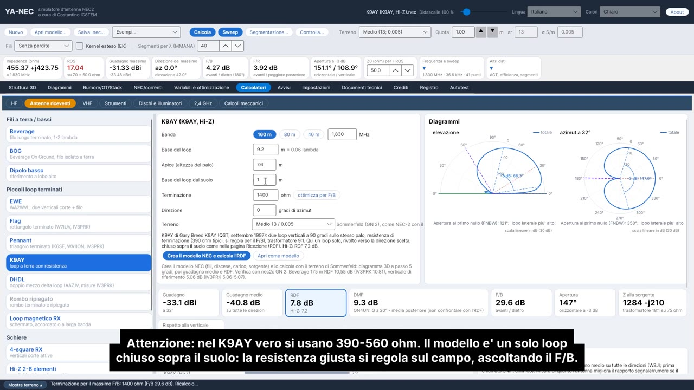</a></td><td>

### Lezione 23 - Antenne riceventi della 1.3

K9AY (ottimizzazione della terminazione per il F/B), 4-square in ricezione (fase tra le file ottimizzata per l'RDF: 200 gradi, 12,4 dB), schiere Hi-Z di 2/3/8 verticali e la pagina Ricezione (RDF), con gli avvisi sui valori delle fonti.

▶ [Guarda il video](https://github.com/ic8tem/YA-NEC/blob/main/docs/videocorso/YA-NEC_corso_23_antenne_riceventi_IT.mp4) · [sottotitoli .srt](https://raw.githubusercontent.com/ic8tem/YA-NEC/main/docs/videocorso/YA-NEC_corso_23_antenne_riceventi_IT.srt)

</td></tr></table>
<table><tr><td width="40%"></td><td>

### Lezione 24 - Strumenti VHF (1.2)

Tolleranze Monte Carlo con la lista di taglio (DJ9BV 10 elementi), Cavo e balun (corrente sulla calza, manicotto lambda/4, ferriti), Yagi incrociate in RHCP, divisori lambda/4 e cavi di fase, telaio a H e palo nello stack 4 x 7 elementi DK7ZB.

▶ [Guarda il video](https://github.com/ic8tem/YA-NEC/blob/main/docs/videocorso/YA-NEC_corso_24_strumenti_VHF_IT.mp4) · [sottotitoli .srt](https://raw.githubusercontent.com/ic8tem/YA-NEC/main/docs/videocorso/YA-NEC_corso_24_strumenti_VHF_IT.srt)

</td></tr></table>
<table><tr><td width="40%"><a href="https://github.com/ic8tem/YA-NEC/blob/main/docs/videocorso/YA-NEC_corso_25_meccanica_carichi_IT.mp4">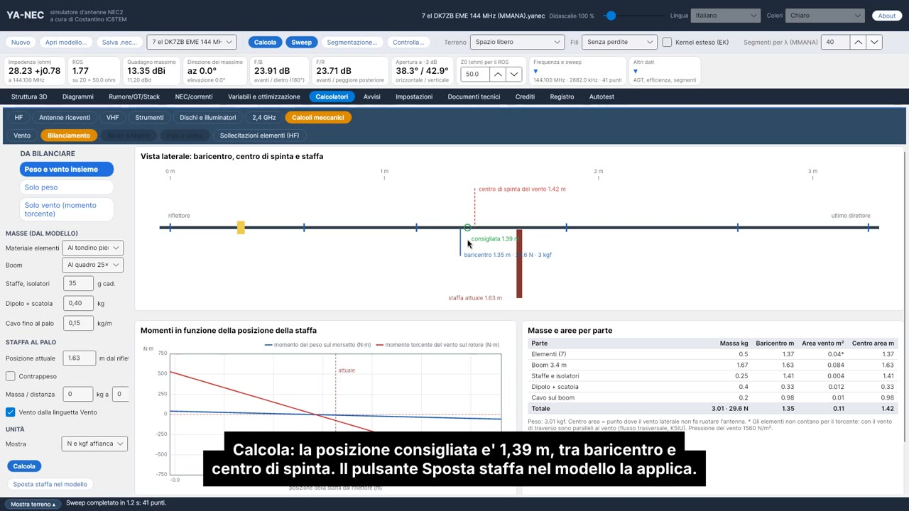</a></td><td>

### Lezione 25 - Calcoli meccanici e carichi HF (1.2)

Vento con NTC 2018 / CNR-DT 207 dal locatore, bilanciamento con la staffa consigliata, Carichi HF (trappola coassiale, bobina di carico con autorisonanza) e le tabelle F/B e F/R medio su tutta la banda.

▶ [Guarda il video](https://github.com/ic8tem/YA-NEC/blob/main/docs/videocorso/YA-NEC_corso_25_meccanica_carichi_IT.mp4) · [sottotitoli .srt](https://raw.githubusercontent.com/ic8tem/YA-NEC/main/docs/videocorso/YA-NEC_corso_25_meccanica_carichi_IT.srt)

</td></tr></table>
<table><tr><td width="40%"><a href="https://github.com/ic8tem/YA-NEC/blob/main/docs/videocorso/YA-NEC_corso_26_novita_calcolatori_IT.mp4">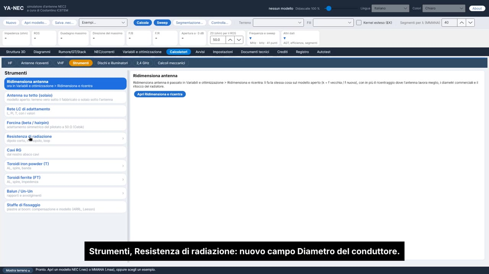</a></td><td>

### Lezione 26 - Novità dei Calcolatori (1.4.2 e 1.5)

Loop a più spire, resistenza di radiazione e reattanza (Tai, AEH) con la bobina di carico, dipolo ripiegato, NVIS, quad e hairpin: le voci nuove dei Calcolatori, con il controllo NEC.

▶ [Guarda il video](https://github.com/ic8tem/YA-NEC/blob/main/docs/videocorso/YA-NEC_corso_26_novita_calcolatori_IT.mp4) · [sottotitoli .srt](https://raw.githubusercontent.com/ic8tem/YA-NEC/main/docs/videocorso/YA-NEC_corso_26_novita_calcolatori_IT.srt)

</td></tr></table>
<table><tr><td width="40%"><a href="https://github.com/ic8tem/YA-NEC/blob/main/docs/videocorso/YA-NEC_corso_27_stack_montecarlo_IT.mp4">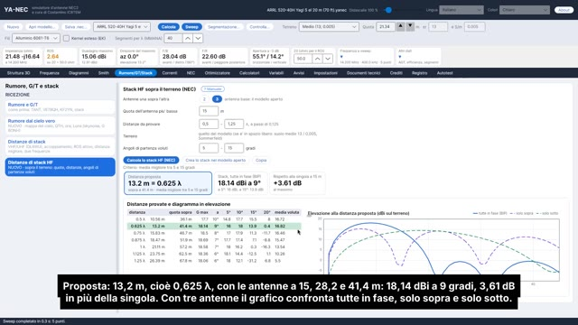</a></td><td>

### Lezione 27 - Stack, Monte Carlo, aggiornamento (1.5)

Distanze di stack VHF su due frequenze con l'impedenza di riferimento e il ROS attivo (DK7ZB 7 elementi), Distanze di stack HF + HFTA: stack sopra il terreno con due e tre ARRL 520-40H e la lettura del diagramma in elevazione (in fase, solo sopra, solo sotto, controfase), Monte Carlo nell'Ottimizzatore, aggiornamento forzato e Segnala un problema.

▶ [Guarda il video](https://github.com/ic8tem/YA-NEC/blob/main/docs/videocorso/YA-NEC_corso_27_stack_montecarlo_IT.mp4) · [sottotitoli .srt](https://raw.githubusercontent.com/ic8tem/YA-NEC/main/docs/videocorso/YA-NEC_corso_27_stack_montecarlo_IT.srt)

</td></tr></table>
<table><tr><td width="40%"><a href="https://github.com/ic8tem/YA-NEC/blob/main/docs/videocorso/YA-NEC_corso_28_rilievo_boom_IT.mp4">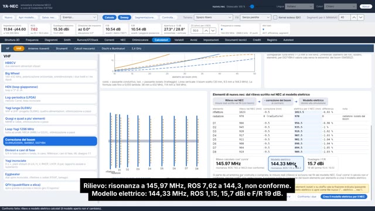</a></td><td>

### Lezione 28 - Il rilievo e la correzione del boom al contrario

Cosa misurare sull'antenna gia' costruita (lunghezze da punta a punta, posizioni sul boom dal riflettore, diametri col calibro, boom e montaggio degli elementi) e come scriverlo nella tabella dei Fili. Esempio: la 10el bvo di IC8TEM su boom tondo da 30 mm. Il rilievo calcolato cosi' com'e' risuona a 145,97 MHz (ROS 7,6 a 144,3): Calcolatori > VHF > Correzione del boom nel verso «rilievo → modello elettrico per il NEC» toglie 9,5 mm a riflettore e direttori, «Confronta i due» e «Crea il modello elettrico per il NEC» riportano l'antenna a 144,33 MHz, ROS 1,15, 15,7 dBi. Fonti: DL6WU, G3SEK, SM5BSZ, DG7YBN.

▶ [Guarda il video](https://github.com/ic8tem/YA-NEC/blob/main/docs/videocorso/YA-NEC_corso_28_rilievo_boom_IT.mp4) · [sottotitoli .srt](https://raw.githubusercontent.com/ic8tem/YA-NEC/main/docs/videocorso/YA-NEC_corso_28_rilievo_boom_IT.srt)

</td></tr></table>

<table><tr><td width="40%"><a href="https://github.com/ic8tem/YA-NEC/blob/main/docs/videocorso/YA-NEC_corso_29_ridimensiona_ricentra_IT.mp4">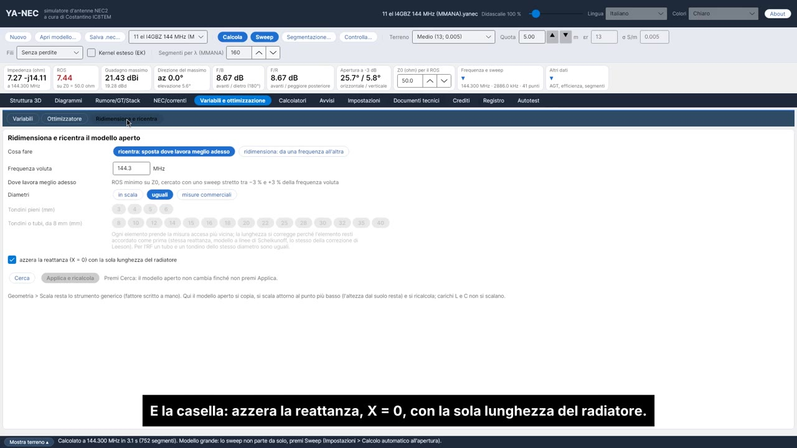</a></td><td>

### Lezione 29 - Ridimensiona e ricentra (1.5.3)

Variabili e ottimizzazione > Ridimensiona e ricentra. La Yagi 11 elementi di I4GBZ per i 144 MHz (file MMANA, dagli Esempi): in MMANA 51,4 + j4,5 ohm, nel NEC-2 a 5 m su terreno medio 7,3 - j14,1 ohm, ROS 7,4. «Ricentra» cerca dove l'antenna lavora meglio (143,766 MHz) e la riporta a 144,3 MHz (fattore 0,9963), la casella «azzera la reattanza» ritocca il solo radiatore: 53,5 - j0,0 ohm, ROS 1,07, 21,69 dBi. Diametri in scala, uguali o misure commerciali (correzione a reattanza uguale con il modello a linee di Schelkunoff, come Leeson); «Ridimensiona» porta un progetto da una frequenza a un'altra. Il modello aperto cambia solo con «Applica e ricalcola».

▶ [Guarda il video](https://github.com/ic8tem/YA-NEC/blob/main/docs/videocorso/YA-NEC_corso_29_ridimensiona_ricentra_IT.mp4) · [sottotitoli .srt](https://raw.githubusercontent.com/ic8tem/YA-NEC/main/docs/videocorso/YA-NEC_corso_29_ridimensiona_ricentra_IT.srt)

</td></tr></table>

<table><tr><td width="40%"><a href="https://github.com/ic8tem/YA-NEC/blob/main/docs/videocorso/YA-NEC_corso_30_cavi_misure_IT.mp4">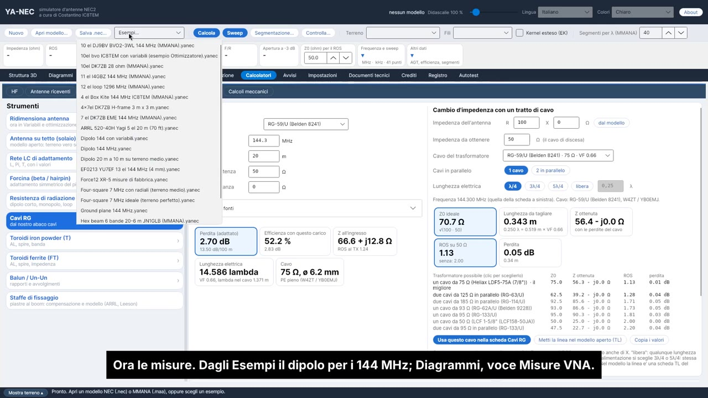</a></td><td>

### Lezione 30 - Cavi e misure col VNA

Calcolatori > Strumenti > Cavi RG: 20 m di RG-59 a 144,3 MHz perdono 2,7 dB (13,5 dB/100 m); su un carico da 50 ohm il cavo da 75 porta a 66,6 + j12,8 ohm. Cambio d'impedenza con un tratto di cavo: da 100 a 50 ohm serve Z0 70,7 ohm, un quarto d'onda di RG-59 (34,3 cm) da' 56,4 ohm e ROS 1,13 invece di 2. Diagrammi > Misure VNA con il dipolo per i 144 MHz e un file .s1p d'esempio (non una misura vera): ROS calcolato e misurato, carta di Smith, confronto (misura spostata in alto dell'1,09 %) e proposta di correzione; il cavo tra VNA e antenna si toglie dalla misura. Fonti: W4ZT, YB0EMJ, formato Touchstone.

▶ [Guarda il video](https://github.com/ic8tem/YA-NEC/blob/main/docs/videocorso/YA-NEC_corso_30_cavi_misure_IT.mp4) · [sottotitoli .srt](https://raw.githubusercontent.com/ic8tem/YA-NEC/main/docs/videocorso/YA-NEC_corso_30_cavi_misure_IT.srt)

</td></tr></table>

<table><tr><td width="40%"><a href="https://github.com/ic8tem/YA-NEC/blob/main/docs/videocorso/YA-NEC_corso_31_altri_calcolatori_IT.mp4">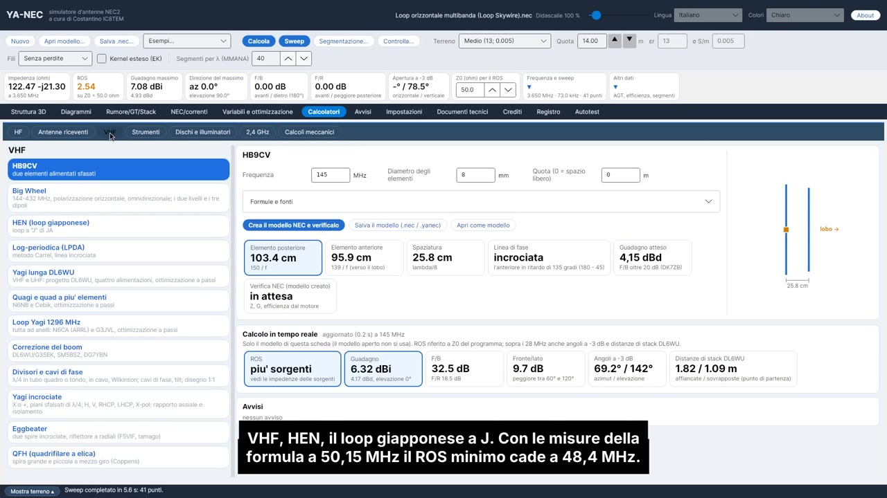</a></td><td>

### Lezione 31 - Altri calcolatori

Loop Skywire per gli 80 m (83,8 m, 14 m d'altezza, scala da 450 ohm: 122 - j21 ohm, 7,1 dBi verso lo zenit); loop rettangolare a 14,2 MHz portato in risonanza col NEC (22,26 m, 124,8 ohm); HEN a 50,15 MHz (lati 2,899 m, 66,5 ohm, 5 dBi, polarizzazione orizzontale); Big Wheel a 145 MHz con dima del petalo e mozzo in PDF 1:1; biquad a 2442 MHz; antenne su PCB a 2,4 GHz (IFA su FR4, PDF 1:1 e DXF). Fonti: W7FB, NT0Z, JE1DEU, W1IJD, W1FVY, F1BKM, TI, Kent Electronics.

▶ [Guarda il video](https://github.com/ic8tem/YA-NEC/blob/main/docs/videocorso/YA-NEC_corso_31_altri_calcolatori_IT.mp4) · [sottotitoli .srt](https://raw.githubusercontent.com/ic8tem/YA-NEC/main/docs/videocorso/YA-NEC_corso_31_altri_calcolatori_IT.srt)

</td></tr></table>
<table><tr><td width="40%"><a href="https://github.com/ic8tem/YA-NEC/blob/main/docs/videocorso/YA-NEC_corso_32_maschera_vhf_gt_IT.mp4">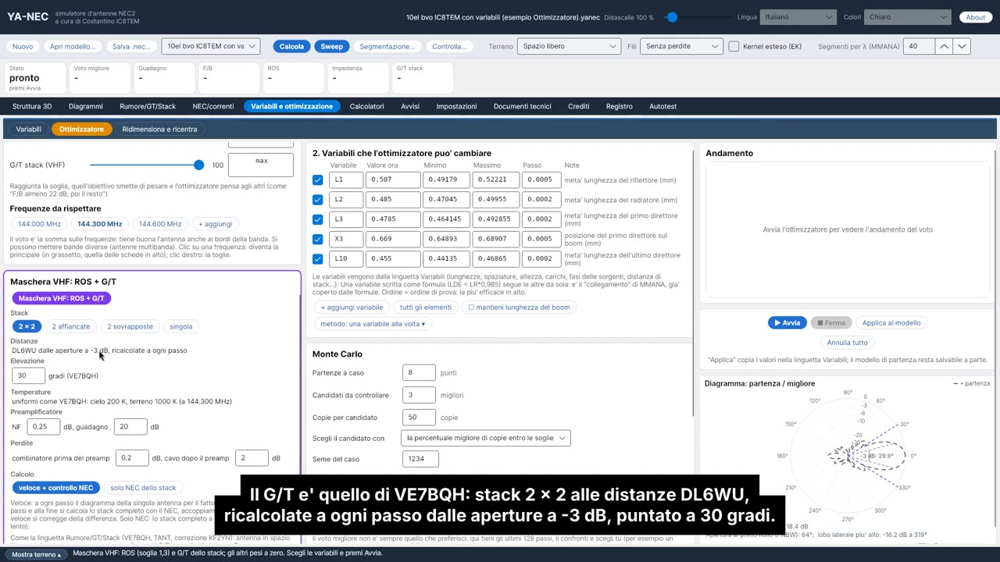</a></td><td>

### Lezione 32 - Maschera VHF ROS + G/T

Variabili e ottimizzazione › Ottimizzatore, la maschera VHF della 1.5.8 sulla Yagi 10 elementi a 144 MHz: ROS con soglia 1,3 e G/T dello stack 2 x 2 a 30 gradi come VE7BQH (distanze DL6WU ricalcolate a ogni passo, cielo 200 K e terreno 1000 K, preamplificatore 20 dB, 2 dB di cavo). In 89 passi il G/T sale da -2,95 a -2,81 dB/K e il ROS peggiore in banda scende da 1,66 a 1,33; tabella prima / dopo con lo stack NEC completo.

▶ [Guarda il video](https://github.com/ic8tem/YA-NEC/blob/main/docs/videocorso/YA-NEC_corso_32_maschera_vhf_gt_IT.mp4) · [sottotitoli .srt](https://raw.githubusercontent.com/ic8tem/YA-NEC/main/docs/videocorso/YA-NEC_corso_32_maschera_vhf_gt_IT.srt)

</td></tr></table>
<table><tr><td width="40%"></td><td>

### Lezione 33 - Filari, abaco e pulsanti viola

Calcolatori › HF › Filari della 1.5.9: EFHW multibanda o monobanda con il 49:1 o il 64:1, filo non risonante con il 9:1 o il 4:1, bobina di carico facoltativa; contrappeso (0,05 lambda come AA5TB, calza fino al choke o nessuno) e nucleo con le perdite misurate da DG1JAN. L'abaco delle lunghezze, la riga scelta che torna nella scheda, i pulsanti viola per il balun e il choke.

▶ [Guarda il video](https://github.com/ic8tem/YA-NEC/blob/main/docs/videocorso/YA-NEC_corso_33_filari_abaco_IT.mp4) · [sottotitoli .srt](https://raw.githubusercontent.com/ic8tem/YA-NEC/main/docs/videocorso/YA-NEC_corso_33_filari_abaco_IT.srt)

</td></tr></table>
<table><tr><td width="40%"><a href="https://github.com/ic8tem/YA-NEC/blob/main/docs/videocorso/YA-NEC_corso_34_novita_1_6_IT.mp4">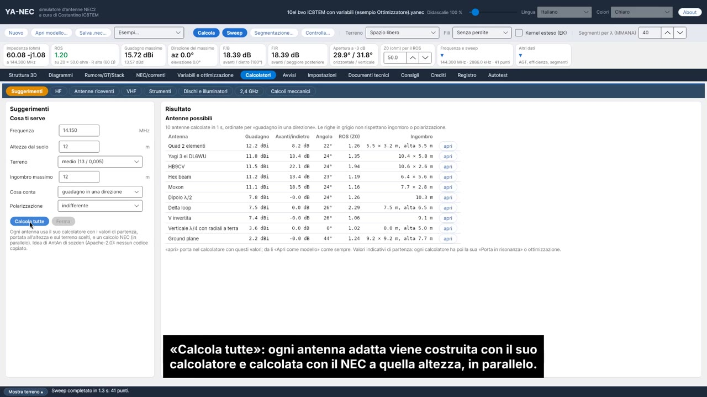</a></td><td>

### Lezione 34 - Le novità della 1.6

Calcolatori › Suggerimenti a 14,150 MHz (antenne adatte calcolate con il NEC a 12 m sul terreno medio, «apri» porta nella Moxon); «Fissa questo risultato» nei Diagrammi; l'evoluzione differenziale e l'Adattamento diretto a Z0 sulla Yagi 10 elementi a 144 MHz (ROS da 1,20 a 1,01, guadagno uguale); la colorazione «fase» nella Struttura 3D; Cavo e balun con il tratto verso la stazione, la corrente sulla calza in stazione e la potenza irradiata dalla calza.

▶ [Guarda il video](https://github.com/ic8tem/YA-NEC/blob/main/docs/videocorso/YA-NEC_corso_34_novita_1_6_IT.mp4) · [sottotitoli .srt](https://raw.githubusercontent.com/ic8tem/YA-NEC/main/docs/videocorso/YA-NEC_corso_34_novita_1_6_IT.srt)

</td></tr></table>
<table><tr><td width="40%"></td><td>

### Lezione 35 - Novità 1.7: i calcolatori HF

I nuovi calcolatori HF della 1.7: Yagi HF 2-3 elementi con la guida di taratura (I4MFA), Yagi bibanda interlacciata (W1JR), verticale trappolata multibanda con «Accorda le bande», L invertita / T per i 160 m, half-sloper sul traliccio, dipolo a banda larga con risonatore coassiale, dipolo multibanda a relè (IK4PKK e IK4CIE), carico lineare confrontato con bobina e cappello, filo risonante in armonica (EFLW).

▶ [Guarda il video](https://github.com/ic8tem/YA-NEC/blob/main/docs/videocorso/YA-NEC_corso_35_novita_1_7_calcolatori_hf_IT.mp4) · [sottotitoli .srt](https://raw.githubusercontent.com/ic8tem/YA-NEC/main/docs/videocorso/YA-NEC_corso_35_novita_1_7_calcolatori_hf_IT.srt)

</td></tr></table>
<table><tr><td width="40%"><a href="https://github.com/ic8tem/YA-NEC/blob/main/docs/videocorso/YA-NEC_corso_36_novita_1_7_adattamenti_stack_IT.mp4">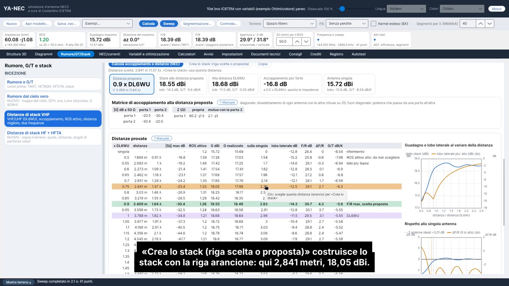</a></td><td>

### Lezione 36 - Novità 1.7: adattamenti, loop, stack e consigli

Quad multibanda con «Accorda e confronta»; loop magnetica rettangolare e ottagonale, spire in parallelo, accoppiamenti e bande coperte dal variabile; gamma match (Healey) accordato con il NEC; adattamento a stub con la carta di Smith (IW2FND); stack VHF con la riga della tabella scelta con un clic e «Crea lo stack»; il lato R < Z0 in arancio nella carta di Smith e nel ROS; la linguetta Consigli.

▶ [Guarda il video](https://github.com/ic8tem/YA-NEC/blob/main/docs/videocorso/YA-NEC_corso_36_novita_1_7_adattamenti_stack_IT.mp4) · [sottotitoli .srt](https://raw.githubusercontent.com/ic8tem/YA-NEC/main/docs/videocorso/YA-NEC_corso_36_novita_1_7_adattamenti_stack_IT.srt)

</td></tr></table>

Dalla 1.2 i calcolatori sono divisi in famiglie (HF, VHF, Antenne riceventi, Strumenti, Dischi e illuminatori, 2,4 GHz): nei video delle lezioni precedenti alcune voci possono trovarsi in una famiglia diversa da quella mostrata.

I file del modello si costruiscono seguendo il video; per provare subito, gli Esempi del programma contengono già molte antenne pronte. Fonti e progettisti citati nei video sono elencati anche nella linguetta Crediti del programma.
