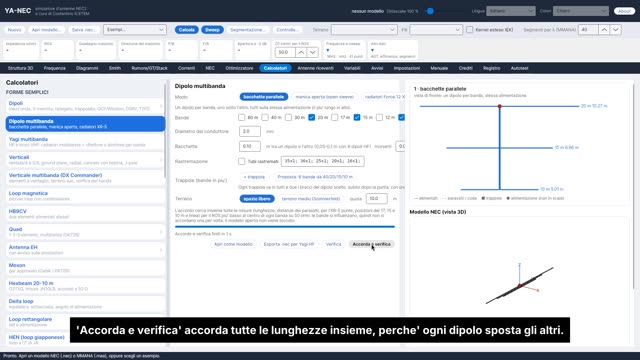

**Italiano** · [English](Videocorso-en)

# Videocorso

Un corso completo in 22 lezioni brevi (3-5 minuti), in italiano e in inglese, girate con YA-NEC 1.0.4 e successive. Ogni video ha i sottotitoli impressi; il file .srt serve per chi li vuole a parte (per esempio su YouTube). Le lezioni escono man mano: quelle senza collegamento sono in preparazione.

<table><tr><td width="40%"></td><td>

### Lezione 0 - Il programma in 5 minuti

Installazione, la barra in alto, i riquadri dei risultati e le linguette. Gli Esempi, i formati che si aprono (NEC2, MMANA, AutoEZ/MultiNEC, EZNEC, YO e AO di K6STI, .yanec) con un file AutoEZ di AC6LA e un MMANA di IC8TEM. Impostazioni, aggiornamento automatico, colori, Manuale, Registro e Autotest.

▶ [Guarda il video](https://github.com/ic8tem/YA-NEC/blob/main/docs/videocorso/YA-NEC_corso_00_programma_IT.mp4) · [sottotitoli .srt](https://raw.githubusercontent.com/ic8tem/YA-NEC/main/docs/videocorso/YA-NEC_corso_00_programma_IT.srt)

</td></tr></table>
<table><tr><td width="40%"></td><td>

### Lezione 1 - Dipolo per i 14 MHz in tre modi

Con il calcolatore Dipoli (porta in risonanza: 10,36 m, 72,7 ohm, 7,10 dBi a 29,5°), a mano con i numeri e con le variabili (L e H nelle formule dei fili). Poi l'altezza (a 5 m: 82 + j29 ohm), il materiale del filo (rame, alluminio) e il kernel esteso.

▶ [Guarda il video](https://github.com/ic8tem/YA-NEC/blob/main/docs/videocorso/YA-NEC_corso_01_dipolo_IT.mp4) · [sottotitoli .srt](https://raw.githubusercontent.com/ic8tem/YA-NEC/main/docs/videocorso/YA-NEC_corso_01_dipolo_IT.srt)

</td></tr></table>
<table><tr><td width="40%"></td><td>

### Lezione 2 - Antenne filari a un elemento

V invertita per i 40 m; delta loop per i 20 m e il suo quarto d'onda di RG-59 messo nel modello come linea TL (da 120 a 47 ohm); verticali λ/4 con radiali, 5/8, caricata con bobina, J-pole e la multibanda tipo DX Commander con la verifica banda per banda.

▶ [Guarda il video](https://github.com/ic8tem/YA-NEC/blob/main/docs/videocorso/YA-NEC_corso_02_filari_IT.mp4) · [sottotitoli .srt](https://raw.githubusercontent.com/ic8tem/YA-NEC/main/docs/videocorso/YA-NEC_corso_02_filari_IT.srt)

</td></tr></table>
<table><tr><td width="40%"></td><td>

### Lezione 3 - I dipoli speciali

Ripiegato (circa 290 ohm), OCF/Windom (W8GZ) visto da 3 a 30 MHz su 200 ohm, G5RV di Louis Varney G5RV con la scaletta da 600 ohm come scheda TL, T2FD di W3HH: ROS su 300 ohm ed efficienza di radiazione lungo tutta la banda.

▶ [Guarda il video](https://github.com/ic8tem/YA-NEC/blob/main/docs/videocorso/YA-NEC_corso_03_dipoli_speciali_IT.mp4) · [sottotitoli .srt](https://raw.githubusercontent.com/ic8tem/YA-NEC/main/docs/videocorso/YA-NEC_corso_03_dipoli_speciali_IT.srt)

</td></tr></table>
<table><tr><td width="40%"></td><td>

### Lezione 4 - I dipoli paralleli

Bacchette parallele per 20, 15 e 10 m accordate insieme con "Accorda e verifica"; aggiungendo i 40 m il dipolo dei 40 risuona sui 15 (tre mezze onde) e ruba corrente; poi la manica aperta (open sleeve) di N6BT, con i parassiti accordati in lunghezza e distanza.

▶ [Guarda il video](https://github.com/ic8tem/YA-NEC/blob/main/docs/videocorso/YA-NEC_corso_04_dipoli_paralleli_IT.mp4) · [sottotitoli .srt](https://raw.githubusercontent.com/ic8tem/YA-NEC/main/docs/videocorso/YA-NEC_corso_04_dipoli_paralleli_IT.srt)

</td></tr></table>

## Prossime lezioni

5. Trappole e dipolo trappolato
6. Gli strumenti del modello: barra Geometria, Controlla il modello, segmentazione e avvisi
7. Direttiva HF semplice dai calcolatori: Yagi 3 elementi e Moxon
8. Direttiva HF con trappole e terreno
9. Altre direttive HF: HB9CV, Quad 1-3 elementi e multibanda, Hexbeam, LPDA
10. Antenne riceventi: EWE e Beverage
11. Four-square e altre riceventi, classifica RDF
12. Loop caricato, toroidi, rete L-C e oggetti del modello (linee, trasformatori, balun, sorgenti a corrente)
13. Le altre funzioni per l'HF
14. Yagi 6 elementi DK7ZB con le misure del progettista
15. La stessa 6 elementi portata a 50 ohm con l'Ottimizzatore
16. VHF/UHF avanzato: Yagi lunga DL6WU, correzione del boom e staffe, tempo reale
17. Antenne VHF su un tetto
18. Stack VHF di antenne corte (DK7ZB) e lunghe (DL6WU), rumore e G/T
19. Loop Yagi per i 1296 MHz
20. Satelliti: Eggbeater, QFH, Quagi
21. Parabole: fuoco primario, offset e trombe

I file del modello si costruiscono seguendo il video; per provare subito, gli Esempi del programma contengono già molte antenne pronte. Fonti e progettisti citati nei video sono elencati anche nella linguetta Crediti del programma.
